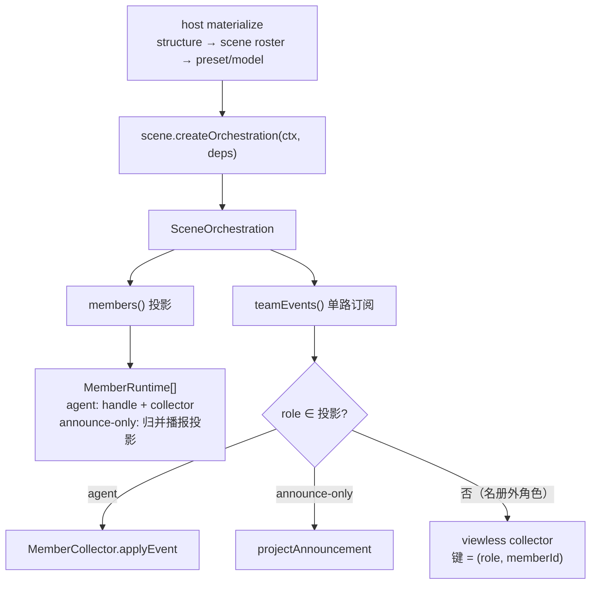
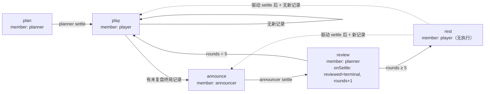

# game agent-v2

agent-v2 是 game 域的 **多场景 agent 服务**（服务发现名 `agent-v2`，deploy API
命名约束要求连字符——`specs/049-agent-v2-dsh-init/research.md` D13；项目目录与
bazel target 保留 `agent_v2`）：以 **dsh 进程内嵌入（B1 模式）**宿主
[deepseek-harness](https://github.com/deepseek-ai/deepseek-harness)（版本线
0.2.0-rc.2，与 `third_party/dsh/core` 同线），通过自研 LLM 插件
`@dominion/dsh-llm-glm`（`common/js/dsh-plugins/llm-glm`）接入 GLM codingplan
的 OpenAI **Responses** 协议端点（`https://open.bigmodel.cn/api/v1`，
https://docs.bigmodel.cn/cn/coding-plan/tool/others），并经
`@dominion/dsh-llm-opencode-go`（`common/js/dsh-plugins/llm-opencode-go`）接入
opencode-go 网关的 OpenAI **Chat Completions** 协议端点
（`https://opencode.ai/zen/go/v1`，https://opencode.ai/docs/zh-cn/go/ ）；模型
选择面以 `provider/model-id` 复合标识联合呈现两 provider 目录
（`specs/063-llm-reliability-opencode-go/contracts/model-selection.md`）。

host 通用路径场景中立：会话编排、成员投影与流语义按业务 template 消费**场景
注册**（`projects/game/agent_v2/src/scenes.ts`），场景差异（roster、preset 词表、
team 中继、announcer、memory 挂载）由各场景注册模块内部承载
（`specs/080-host-main-sub-model/contracts/scene-registry.md` §1-§7；需求与验收
锚点 `specs/080-host-main-sub-model/spec.md`）。当前注册两个场景：

- **saolei**（team 场景）：一个 session 至多物化一个 team——恰含 player 与
  planner 两个 LLM 成员（各持独立历史与 system prompt）与一个 announce-only 的
  announcer 成员（role `announcer`：无 preset/model、不经 LLM 驱动，作为正式成员
  进入三成员名册与 active_member 呈现，但不可由调用方配置；announcer 是团队播报
  的唯一生产出口——终局交接时播报本局统计，hooks 引擎在有棋盘变动且非终局的批量
  操作后亦经该出口播报 `[hook <name>]` 前缀文本（见
  `specs/078-saolei-js-hooks/contracts/hook-announcement.md`；
  `specs/076-agent-v2-optimize/contracts/announcer-member.md`）；需求与验收锚点见
  `specs/059-agent-v2-team-mode/spec.md` 与
  `specs/060-agent-v2-team-optimize/spec.md`，接口契约见两者
  `contracts/` 下的 team-api/preset-derivation/deploy-env/prompt-sections
  （060 以增量修订方式更新团队面与提示词面的语义；065 增量见
  `specs/065-agent-v2-team-refine/contracts/`）。
- **sts2**（主子最小接线）：单 `main` 主 agent——无 team 中继、无 announcer、
  无 memory 挂载、无游戏工具、无 desktop flow，由官方 agent-loop 直驱；它是主子
  形态的端到端验收载体与后续 sts2-loop feature 的落地板
  （`specs/080-host-main-sub-model/contracts/face-main-sub.md`；
  `specs/080-host-main-sub-model/contracts/sts2-loop-minimal.md`）。

proto（`projects/game/agent_v2.proto`）保持场景无关 team 原语：role 是开放字符串，
单成员 `members` 列表天然承载主子物化，场景差异不进入 wire
（`specs/080-host-main-sub-model/contracts/face-main-sub.md` §5）。

## 服务形态与拓扑

- **`kind: stateful`**：会话编排条目注册表（每 session 每个已物化场景一条）、成员
  未消费输入（用户消息经成员域投递——在途 steer 的 inbox pending 与取消落地的
  landed）、成员对话历史、flow 编排状态与游戏状态都驻留进程内存，因此会话面
  **必须**经 proxy 的 owner 亲和路由定向到同一实例
  （`specs/049-agent-v2-dsh-init/research.md` D4）。
- gRPC 监听 `0.0.0.0:50051`，三个服务（`projects/game/agent_v2.proto`）：
  - **AgentService**（team 会话面，
    `specs/059-agent-v2-team-mode/contracts/team-api.md`，060 增量见
    `specs/060-agent-v2-team-optimize/contracts/team-api.md`）：team 是 session
    的单例资源（AIP-156，`templates/{template}/sessions/{session}/team`），成员
    资源名即 `.../team/members/{role}`；名册由场景注册定义（saolei 三成员、
    sts2 单 `main`；`specs/080-host-main-sub-model/contracts/face-main-sub.md` §1/§2）。
    RPC：`UpdateTeam`（显式物化/刷新，见
    下节）、`GetTeam`（含 output-only `active_member`）、`GetTeamMember`（含
    output-only `system_prompt`）、`ListTeamMessages`（团队视图归并序列）、
    `ListMemberMessages`（成员视角）、`Send`（server-streaming team 流——成员
    事件帧 + `team_message`/`member_view` team 级帧，经 gateway 以 NDJSON
    输出）、`Cancel`（team 语义取消）。
  - **PresetService**（无状态配置面）：分池 preset 标准 CRUD + `ListModels`。
  - **DesktopBridgeService**：desktop 的 flow 控制面——`:stream` 会话下行流
    （`GET /api/v2/templates/{template}/sessions/{session}:stream`，chunked
    NDJSON）与 `:sendFrame` 上行单发
    （`POST /api/v2/templates/{template}/sessions/{session}:sendFrame`，
    octet-stream），session 单位、新流接管；桌面控制是 saolei 场景能力（player
    独占，`specs/059-agent-v2-team-mode/spec.md` FR-012），sts2 最小接线不含
    desktop flow；传输契约
    `specs/066-desktop-bridge-split/contracts/desktop-bridge-v2.md` §1。
- gateway 的 `/api/v2` 路由按 RPC 状态归属拆分
  （`specs/051-agent-v2-dsh-migration/revisions/directive-2026-09-01.md` §3）：
  会话面（AgentService + DesktopBridgeService）走
  `gateway → proxy → agent-v2 实例` 两跳，proxy 以 Mongo
  `game_proxy.agent_v2_owners` 做 owner 亲和路由；配置面（PresetService：状态在
  Mongo、模型目录静态）由 gateway 直连任一实例。web（`projects/game/web/`）由
  同 hostname 的 `/` PathPrefix
  服务，`/api/v1/`（session/wiki/memory 管理路由）和 `/api/v2/` 由
  gateway 服务（`specs/049-agent-v2-dsh-init/research.md` D5）。
- 周边服务：session 服务（`/api/v1` sessions CRUD）、memory 服务（saolei planner
  长期记忆存储，集合挂载于 preset 之下——管理路由
  `/api/v1/templates/{template}/presets/{preset}/memories`；
  `specs/071-memory-preset-scope/contracts/memory-service.md` §1-2）、Mongo
  （preset 持久化与 proxy owner 记录）。
- 进程内组件生命周期（启停序列
  `specs/053-js-bootstrap-migration/contracts/bootstrap-js-api.md` §3.1、health
  端点 §4；agent_v2 的特定顺序见 `projects/game/agent_v2/src/bootstrap.ts`
  头注释）：dsh 组合（成员会话 + root fiber；Mongo 连接由组合内 preset-authoring
  行持有——组合启动时连接并建索引，存储失败 boot fail-loud，关闭随组合 unwind）
  最先启动、最后停止；gRPC server 后启动、先停止（tryShutdown 在关停预算内排空，
  未完成则 forceShutdown）；组合停止时先逐 session dispose（在途回合 abort）再
  unwind root fiber（关闭 Mongo client）；38080 `/healthz` 在全部组件启动后开始
  服务、在停止序列首位关闭
  （`specs/052-deploy-health-probe/contracts/deploy-probe.md`）。

## 组合清单（cordis.yml）

`cordis.yml` 是启用插件集的唯一事实源
（`specs/059-agent-v2-team-mode/contracts/dsh-plugins.md` §5）：

- dsh 核心件：`llm`/`session`/`system-prompt`/`tools`/`agents`/`invariants`/
  `llm-retry`（`system-prompt` 关闭 harness 身份与运行时上下文注入——部署自有
  完整 system prompt）；`timer`/`invariants`/`system-prompt` 经框架基线
  `@dominion/dsh-core` 进入。
- **官方 `dsh-agent-loop` 行**：成员 agent 的驱动权归属官方 loop
  （`Config.agents[]` 留空，成员全部经 `ctx.agents.create` 动态物化）；自研
  `saolei-loop` 是 team loop 编排层（flow 流程控制 + 成员驱动/投递适配），不含
  turn/step 状态机（`specs/076-agent-v2-optimize/contracts/flow-orchestration.md`；
  `specs/059-agent-v2-team-mode/research.md` R7）；`sts2-loop` 同样由官方 loop
  驱动主 agent，自身只承载最小编排（物化/驱动/事件/快照，无 flow 状态机——
  `specs/080-host-main-sub-model/contracts/sts2-loop-minimal.md` §4）。
- 一致性防护伴生：`dsh-session`/`dsh-agent`/`dsh-scope` 三个包的 `/invariant`
  subpath 插件（官方 loop 的 request-reconstruction 不变量）。
- `llm-glm`（`@dominion/dsh-llm-glm`）：GLM Responses 端点接入；`models[]` 是该
  provider 的部署模型目录（`ListModels` 联合目录由各已注册 provider 的
  `listModels` 聚合，见
  `specs/063-llm-reliability-opencode-go/contracts/model-selection.md` §2；物化
  校验按复合标识切分后对所选 provider 目录进行）。
- `llm-opencode-go`（`@dominion/dsh-llm-opencode-go`）：opencode-go 网关 Chat
  Completions 端点接入（`specs/063-llm-reliability-opencode-go/spec.md` FR-015
  默认目录 = 官方该路由 16 项）；与 `llm-glm` 同套
  失败分类/重试/看护义务
  （`specs/063-llm-reliability-opencode-go/contracts/llm-failure-taxonomy.md`）。
- `agent-preset-registry`（`@deepseek-ai/dsh-agent-preset-registry`）：preset
  注册表，负责选择与运行时修订保留；`default` 指向空 id，preset 选择是必选
  语义（无 id 的 resolve fail-loud）。池模板（player/planner/main）定义在本组合
  清单 `preset-authoring` 行 Config 的 `templates` 快照——部署所有权即系统
  信任，用户面不可写删；用户 preset 的组合在物化时从 store 记录派生
  （`specs/070-dsh-upgrade/contracts/preset-model-mapping.md` §3）。
- `preset-authoring`（`@dominion/dsh-preset-authoring`）：创作/编辑面（Store
  Mongo 实现，`game_agent_v2.presets`）与池模板快照声明源（`templates` 的
  即插即用 persona 行；`player`/`planner`/`main` 三池模板）。
- `team`（`ctx.team`）：自研群聊原语（含全员广播的单一 XML 标注格式与 team
  section 格式约定）。仅注册 `ctx.team` 的场景（saolei）消费；sts2 不注册群聊
  中继（`specs/080-host-main-sub-model/contracts/scene-registry.md` §1）。
- `grpc-runtime`（`ctx.grpc`）：组合级 gRPC client 基建（类型化 client 构造 +
  unary 辅助 + channel/packageDefinition 缓存共享 + canonical protoPath 解析；
  `specs/074-dsh-grpc-runtime/contracts/grpc-runtime.md`）。组合内 RPC 能力经
  `inject: ["grpc"]` 消费，连接基建统一由本行承载。
- `desktop-bridge`（`@dominion/dsh-desktop-bridge`）：desktop flow 控制面基建。
- `saolei`（`@dominion/dsh-saolei`）：**顶级游戏基础行**（无 config，置于
  `@dominion/*` 分区）——提供 `ctx.saolei` 游戏基础面（纯领域游戏运行时工厂
  `createGameRuntime` + `saolei:game` 玩法 section）；saolei-loop 以
  `inject: ["saolei"]` 正向依赖它
  （`specs/075-saolei-game-foundation/contracts/saolei-foundation.md` §1/§2）。
- `saolei-loop`（`@dominion/dsh-saolei-loop`）：team loop 编排层（flow 流程控制 +
  成员驱动/投递适配）。其 `config.plugins` 是**扁平能力依赖声明**（无角色语义）——
  `@dominion/dsh-saolei-tools` 提供 `saoleiTools` 静态单元（三工具 + 仅
  `saolei:guidance` section）、`@dominion/dsh-saolei-memory` 提供 `memoryMount`
  工厂（memory 公共库 `@dominion/common-js-memory` + adapter config 的
  target/protoPath，跨 service client 共享 channel）、
  `@dominion/dsh-saolei-hooks` 提供 `saoleiHooks` team 级工厂（可选能力行——行
  缺席 = 无 hook 面，行在而面缺 = 组合装载失败，
  `specs/078-saolei-js-hooks/contracts/saolei-hooks-plugin.md` §5）。boot 时经
  `ctx.plugin` 挂载提供方，成员 setup 按角色消费——player 注册 saolei 三工具与
  `saolei:guidance` section，编排对 player 与 planner 注册 `saolei:game` 玩法
  section（源自基础面），planner 注册 hooks 单元工具面（单工具 `saolei_hook`，
  零 section）与 memory 单元（单工具 `memory` + `memory:snapshot` section；无
  wiki 工具与 guidance section）（角色分配归编排代码；
  `specs/074-dsh-grpc-runtime/contracts/team-assembly.md` §1-§4、
  `specs/075-saolei-game-foundation/contracts/team-loop-assembly.md` §3、
  `specs/078-saolei-js-hooks/contracts/saolei-hooks-plugin.md` §5）。
- `sts2`（`@dominion/dsh-sts2`）：sts2 游戏基础骨架行（惰性空行，本期不填充游戏
  面——`specs/080-host-main-sub-model/spec.md` FR-010）。
- `sts2-loop`（`@dominion/dsh-sts2-loop`）：sts2 场景的**最小编排插件行**（空
  config 惰性行：`inject: []`、空 `apply`，不 provide 服务/工具/section）。编排
  实例由 host 的场景注册按会话构造（非组合单例，与 saolei-loop 相同所有权模型）；
  后续 sts2-loop feature 的房间能力依赖在此行 `config.plugins` 生长
  （`specs/080-host-main-sub-model/contracts/sts2-loop-minimal.md` §1）。

## 场景注册与编排 seam

host 通用路径（`projects/game/agent_v2/src/session.ts`/`server.ts`/`history.ts` 的
通用部分）只承载场景无关职责；场景差异全部收敛到场景表与每场景一个注册模块
（`specs/080-host-main-sub-model/contracts/scene-registry.md` §1/§4/§7）：

- **场景表**（`projects/game/agent_v2/src/scenes.ts`）：`SceneSpec` 按 template id
  定义 `roster`（物化 roster，顺序即成员序）、`presetRoles`（preset 角色词表，
  空 = 无词汇）、`rolePoolTemplate`（角色 → 池模板 id）、`orchestratable`（唯一
  接线门）、`teamGoal`、`faceMembers`（face 可见成员名，仅用于成员名预检与
  roster 错误文案，不含能力/行为声明）与 `createOrchestration` 工厂。不变式：
  `orchestratable === true` ⇔ 工厂存在。`KNOWN_TEMPLATES`（`server.ts`）与
  `wiredScene`/preset 词表门均由该表派生，模板注册与场景接线不会漂移。
  saolei 条目 = roster `["player","planner"]` + face
  `["player","planner","announcer"]`；sts2 条目 = roster/face `["main"]`。
- **场景注册模块**：`scene-saolei.ts` 包装 `@dominion/dsh-saolei-loop` 的
  `TeamOrchestrator`——team goal（场景表原文）、planner memoryScope、announcer
  不变式与 `phase` 日志字段全部留在场景侧；`scene-sts2.ts` 直接构造
  `@dominion/dsh-sts2-loop` 的 `Sts2Orchestrator`，无额外派生。两个场景模块都
  不 import `scenes.ts`（场景数据由场景表以闭包注入，避免模块环）。
- **编排 seam**（`projects/game/agent_v2/src/orchestration.ts`）：
  `SceneOrchestration` 只声明场景中立的 `materialize`/`members`/`member`/
  `teamEvents`/`snapshot`/`submit`/`cancel`/`whenQuiescent`/`dispose`；
  `SceneSnapshot` 不含 phase；`SceneFailure.code` 为六码 `SceneLoopErrorCode`、
  `origin` 区分成员回合与编排层失败；`SceneStateError` 按 `code` 结构化映射
  `FAILED_PRECONDITION`。host 经 `TeamSessionsDeps.scenes` 注入场景注册（默认
  模块场景表），测试可注入合成场景。
- **成员投影与事件分发**：物化后成员运行时由 `orchestrator.members()` 的
  `{role, kind}` 投影派生（agent → handle + `MemberCollector`；announce-only →
  归并播报投影）；`teamEvents()` 单路订阅、按信封 role 分发。名册外角色按
  **`(role, memberId)`** 惰性创建 viewless collector：成员标注帧与归并序列条目
  可见，无成员资源/无成员视角，条目销毁或刷新不跨代
  （`specs/080-host-main-sub-model/contracts/scene-registry.md` §3；
  `specs/080-host-main-sub-model/contracts/face-main-sub.md` §2）。
- **结构门禁（SC-002）**：通用路径（`session.ts`/`server.ts`/`history.ts` +
  `orchestration.ts`）不含场景专属词汇与 saolei 专属计算；可执行代码中的场景词
  只允许出现在 `scenes.ts`/`scene-saolei.ts`/`scene-sts2.ts`，`orchestration.ts`
  零场景词汇（固定检查命令与判定口径见
  `specs/080-host-main-sub-model/quickstart.md` §V3）。

## team 物化与刷新（UpdateTeam）

team 不经 Send 懒创建，必须经 `UpdateTeam`（AIP-134 create-or-update，
`allow_missing=true`）**显式物化**
（`specs/059-agent-v2-team-mode/contracts/team-api.md` §2）：

- **物化输入 = `members` 列表**：每成员 `{role, preset, model?}`——proto 会话面
  是场景无关 team 原语（无 role 枚举、无场景字段）。role 为场景词汇字符串
  （saolei `"player"`/`"planner"`，sts2 `"main"`）；preset 为完整 preset 资源名；
  model 可空 = 部署默认。输出 members 是场景编排 `members()` 的投影：saolei 为
  两个 LLM 成员（生效 model、服务端按 role 构造的成员资源名）加服务端加入的
  announce-only announcer（`specs/076-agent-v2-optimize/contracts/announcer-member.md`
  §3）；sts2 恰为单 `main` 成员、无服务端附加成员
  （`specs/080-host-main-sub-model/contracts/face-main-sub.md` §1/§2）。
  `desktop_connected`、`active_member` 与时间戳为 output-only；
  `system_prompt` 仅 GetTeamMember 返回。
- **两层 fail-fast 校验（先于任何 teardown，无半物化）**：结构层（场景无关）
  ——members 非空、每成员 role 非空、preset 为同一模板下合法资源名、model 可空；
  场景层（由注入的场景注册驱动）——members 数与 role 集合等于 `roster`（saolei
  恰 `{"player","planner"}`、sts2 恰 `["main"]`）、每成员 preset 存在且
  `preset.role` 与成员 role 字符串相等、model 非空时在 ListModels 目录。失败均为
  `INVALID_ARGUMENT`，时序与 saolei 文案逐字节不变
  （`projects/game/agent_v2/src/session.ts`；
  `specs/080-host-main-sub-model/contracts/scene-registry.md` §4）。
- **物化编排**：host 校验通过后调用场景注册的 `createOrchestration(ctx, deps)`
  并 `materialize(input)`——输入只含 session/template/members 与已拆分的
  `provider/model` 路由，goal/memoryScope 等场景派生不进 seam
  （`specs/080-host-main-sub-model/contracts/scene-registry.md` §1/§2）。saolei
  场景内部逐成员 `ctx.agents.create`（官方 agent-loop 驱动）经 registry 绑定所选
  preset 声明：hooks 行在场时物化早期构建 hooks 单元（`saoleiHooks` face，行缺席
  则零 hook 装配）；player 侧注册 saoleiTools 单元、编排经基础面工厂构造并持有的
  GameRuntime 实例句柄（agent-scoped `saoleiGame`；hooks 行在场时以第三参
  `{ onBoardChange }` 接入 board-change 事件）与 `saolei:game` 玩法 section，
  planner 侧注册 `saolei:game`、hooks 单元的工具面（`saolei_hook`，零 section，
  hooks 行在场时）后经 `memoryMount.build(scope)` 组装 memory 单元并以
  `unit.ready()` 预取记忆快照（fail-loud）；随后 `ctx.team.register` 注册群聊服务，
  并自检 announcer 成员存在（缺失即整体回滚抛错）。sts2 场景直接由
  `Sts2Orchestrator.materialize` 构造单 `main` agent（compose → `ctx.agents.create`
  → preset setup），无 team/announcer/memory/hook/game 装配。任一步失败**整体
  回滚**：不残留半物化会话（GetTeam NOT_FOUND），可重试。
- **成员消息源与 announcer 成员（saolei 场景内部）**：team 的成员抽象为消息源
  接口（`TeamMemberSource`，
  `specs/065-agent-v2-team-refine/contracts/team-member-source.md` §1）：
  player/planner 经 `agentMemberSource` 适配器接入（语义零变化），物化同时注册
  announce-only 的 announcer 成员（role `announcer`、summary 为“终局播报
  对局结果与操作统计”，`common/js/dsh-plugins/saolei/loop/src/announcer.ts`；
  无 preset/model、不接收广播；作为正式成员进入 `GetTeam.members` 名册
  （三成员）与 `active_member` 呈现，但 `UpdateTeam` 请求侧仍只配置两个 LLM
  成员——announcer 由场景编排进入名册，
  `specs/076-agent-v2-optimize/contracts/announcer-member.md` §3）。终局交接时它
  先于 planner 复盘播报本局统计（`gameStatsText` 模板：结果 + 单个操作总数 +
  click/flag/chord 分项，
  `specs/065-agent-v2-team-refine/contracts/game-stats-broadcast.md` §2/§3），
  宿主经统一成员事件流单路消费，将其投影
  为归并序列条目与
  `team_message{member="announcer"}` 帧（同契约 §4），消息作为广播进入 planner
  复盘输入与 player 下次结构性驱动输入；每局至多一条（记录恒等 guard，重试
  不重发；被跳过局不补发——guard 对最新终局记录求值）。
- **成员事件单路消费与 kind 派生**：宿主的全部成员投影（web ChatEvent 帧、归并
  历史、成员视角、turn 收束）从编排的统一成员事件流单路消费（seam
  `teamEvents()`；saolei 的 `TeamOrchestrator.teamEvents()` 与 sts2 的
  `MainAgentEventStream` 同形），宿主物化时单路订阅、按信封 `role` 分发
  （投影内 agent 成员 → `MemberCollector.applyEvent`；announce-only 成员的 log
  `assistant/message` → 归并历史；名册外角色 → `(role, memberId)` viewless
  collector）——不逐成员下探 dsh 根事件
  （`specs/077-announcer-member-unification/contracts/member-event-stream.md` §5；
  `specs/080-host-main-sub-model/contracts/scene-registry.md` §3）。
  宿主 entry 的成员集合由 `members()` 投影派生（`MemberRuntime` 判别联合：agent
  成员含 handle/collector，announce-only 成员仅 role），名册/成员读取/成员视角/
  teardown 按成员 kind 派生，announcer 与 LLM 成员同权
  （`specs/077-announcer-member-unification/contracts/host-member-parity.md`）。
- **静止等待与用户首驱**：物化成功后编排静止等待——初始激活成员（activation）
  由场景定义，**不自动驱动任何成员**。saolei 初始 activation = planner
  （初始相位 planning）：游戏首次驱动由用户第一条消息触发（planner 处理并产出
  开局策略），随后 player 被驱动开始游戏，终局后 planner 复盘，planner 完成静止
  后编排层结构性续驱 player 进入下一轮；一切驱动输入 = 成员未消费的团队广播
  （驱动装配时 drain）+ 成员域投递的用户消息（在途 steer / 静止装配），编排层
  不合成任何驱动消息（`specs/059-agent-v2-team-mode/spec.md` FR-009/FR-010；
  `specs/076-agent-v2-optimize/contracts/flow-orchestration.md` §2/§3）。sts2
  初始 activation = `main`：用户消息即驱动主 agent 回合，回合收束即静止，无自动
  续驱（`specs/080-host-main-sub-model/contracts/sts2-loop-minimal.md` §4/§6）。
- **当前激活成员（`active_member`，单一合并值）**：成员回合在途时 = 该回合的
  驱动成员（任一时刻至多一个）；静止时 = 下一条输入的归属成员（activation，
  取消/冻结不改变归属；saolei 物化后初始 planner，sts2 恒 `main`）。物化后恒
  非空；web 对话页由该值叠加流式 `turn_start` 帧推导呈现
  （`specs/060-agent-v2-team-optimize/contracts/team-api.md` §1/§5；
  `specs/080-host-main-sub-model/contracts/face-main-sub.md` §3）。
- **刷新**：已物化会话再次 UpdateTeam 即刷新——终止在途成员回合
  （`turn_end{ABORTED}`）、未消费输入作废、清空场景 roster 成员的短期记忆（历史/
  游戏状态）、按新配置重建；`create_time` 保留、`update_time` 更新；重复 Update
  幂等。
- 未物化 session 的 `Send`/`Cancel` 以明确错误拒绝（FAILED_PRECONDITION，提示
  先物化）；`GetTeam`/`GetTeamMember`/List 面为 NOT_FOUND（含名册外角色）。

## saolei 场景编排：flow 与成员适配（成员切换标准化）

本节是 saolei 场景的内部实现（`@dominion/dsh-saolei-loop`，经 `scene-saolei.ts`
接入编排 seam）；host 通用路径只消费 `SceneOrchestration`
（`specs/080-host-main-sub-model/contracts/scene-registry.md` §2/§5）。成员切换由
saolei-loop 的 **flow 流程控制**承载（自研 minimal runtime，
`specs/076-agent-v2-optimize/contracts/flow-orchestration.md`）：F-Moore 活动图
（5 活动 + 8 边纯条件 guard）是唯一创作结构，flow 层状态 = position +
lastOutcome + facts + frozenError；唯一指令 `start(activity)` 与图节点一一对应
（成员切换即 start 不同 member 的活动），执行层只消费指令并回报活动终态，flow
层不触碰成员驱动等执行细节。

- **活动终态四态**：`settled`（成功完成——写 `onSettle` 流程事实后边判定）、
  `resting`（无可执行内容，泵静止）、`failed`（穷尽自愈后上报 `{code, detail}`）、
  `aborted`（取消/释放打断，非故障）；`failed`/`aborted` 产生**冻结**（位置保持、
  不消费流程事实、不边判定），冻结期间唯一驱动源是用户投递——投递即恢复，恢复链
  为「投递驱动 → flow 重启当前活动重放持有输入集」。
- **成员适配器**（实现类型差异下沉）：LLM agent 成员（player/planner 共用单一
  实现）经 `drive()` 闭环（输入构造 drain → `inject`/`followup` 驱动 →
  `agent.whenIdle()` 完成判定 → 引擎错误码映射 loop 六码）与 `deliver()` 分流
  （在途 `steer` 入 inbox、静止装配 `[drain, landed flush, message]` 开 turn）；
  announce-only 成员（announcer）同步执行即 settled。
- **用户消息成员域化**：编排侧不经 FIFO/queue gate——消息经当前激活成员的
  `deliver` 即时处理，完成定义自包含（inbox 空 + 无在途回合）；快照 `queued` =
  成员 inbox pending + steered-unclaimed。团队广播仍由驱动装配时 `drain` 拉动
  （exactly-once 锚点边界不变），编排层不合成任何驱动消息。
- **在途广播快路**：team relay 一条成员广播产出（message 单元）时，pending 锚点
  照常追加（拉动式 drain 基线不变），同时对带投递面的 consuming 接收方经成员
  适配器的投递面（`AgentMember.deliverInFlight`）以**与 drain 完全相同的构造
  路径**提前投递一份——不唤醒驱动（在途 `agent.inject` 落下一 step，静止 no-op），
  当前在途成员下一 step 边界认领；静止成员照旧 pending drain；exactly-once 由
  既有锚点闭包保证（认领去重 / 丢弃重投双向自愈），驱动与 flow 决策零影响
  （`specs/077-announcer-member-unification/contracts/inflight-broadcast-fastpath.md`）。
  插入式生产者有两类：announcer 的终局统计播报（成员收束后、无在途成员 → 快路
  惰性、pending drain）与 **saolei hook 播报**（player turn 内、player 在途 → 快路
  生效、下一 step 认领）（`specs/078-saolei-js-hooks/contracts/hook-announcement.md`
  §1/§3）。
- **错误契约**：`failed { code, detail }`，code ∈ {TRANSIENT, QUOTA, CREDENTIAL,
  CONFIG, INPUT_TOO_LARGE, INTERNAL}；编排层只分类，宿主按码产出用户动作文案
  （`projects/game/agent_v2/src/orchestration.ts` 的 `LOOP_ERROR_TEXT` /
  `loopErrorText`，key 类型为场景中立的 `SceneLoopErrorCode`；
  `specs/080-host-main-sub-model/contracts/scene-registry.md` §2）。

宿主消费面（`specs/080-host-main-sub-model/contracts/scene-registry.md` §2）：
`paused` ← 编排冻结态、`activeMember` = `active ?? activation`（saolei 播报窗口内
可为 `announcer`）、静止判定 = `paused || (active === null && queued === 0)`。
saolei 的 `phase` 由 flow 活动派生（plan→planning、review→reviewing、
play/rest→playing），但只保留在 saolei 场景的日志上下文，不进入通用 seam
（`SceneSnapshot` 无 phase；
`specs/076-agent-v2-optimize/contracts/flow-orchestration.md` §7）。

## saolei JS hook（planner 固化策略脚本 → 棋盘变动后执行播报）

saolei JS hook 让 planner 把策略/分析路径固化为 JS 代码，对 player 形成持续指导
通道（`specs/078-saolei-js-hooks/spec.md`）。能力由 hooks 插件
`@dominion/dsh-saolei-hooks` 提供——saolei-loop `config.plugins` 的可选能力行
（行缺席 = 无 hook 面，
`specs/078-saolei-js-hooks/contracts/saolei-hooks-plugin.md` §5）：

- **写入面（planner）**：planner 经专属工具 `saolei_hook`（`set`/`remove`/`list`）
  注册与管理策略脚本——`set` 在注册期做语法、上限与 banned-pattern 校验并以普通
  文本结果反馈（校验层次见
  `specs/078-saolei-js-hooks/contracts/saolei-hooks-plugin.md` §3.1；banned-pattern
  清单见 `specs/078-saolei-js-hooks/data-model.md` §2.4）；全部行为引导经工具
  describe 承载（零 prompt section）。
  脚本为函数体源码，以棋盘 JSON（`board`）为输入、`return` 字符串或可序列化对象。
- **执行与播报（player 对局）**：player 每次**有棋盘变动且非终局**的批量
  `operate`（`executed > 0` 且对局仍在进行）后，棋盘变动事件 seam 同步触发、按
  注册序执行全部已注册 hook，每个非空输出经 announcer 成员逐条播报（正文
  `[hook <name>]` 前缀；空字符串输出不播报）；脚本错误/超时/输出超限以播报形式
  反馈，不影响游戏流程与 `saolei_operate` 工具结果。播报作为 announcer 产出进入
  团队归并序列与实时流（web 可见，`member="announcer"`），在途 player 经在途广播
  快路于同一回合下一 step 可见；游戏开始与结束不触发 hook
  （`specs/078-saolei-js-hooks/contracts/hook-announcement.md` §2/§3）。
- **无持久化**：注册表是 team 物化生命周期的进程内存态——刷新（UpdateTeam 重建）
  与 dispose 即清空；需要跨局保留的脚本由调用方自行保存并重新注册
  （`specs/078-saolei-js-hooks/spec.md` FR-005）。
- **沙箱边界**：脚本在 `node:vm` 受约束环境执行——同步纯计算、无宿主 API、
  单次执行 500ms 超时中断、输出超 4096 字符截断、脚本 ≤16384 字符、至多 8 个
  hook（工程界，`specs/078-saolei-js-hooks/data-model.md` §2.2/§2.3）。

## sts2 场景（主子最小接线）

sts2 是主子形态的**最小接线**（`specs/080-host-main-sub-model/spec.md` FR-009；
契约 `specs/080-host-main-sub-model/contracts/face-main-sub.md`）：

- **物化**：`UpdateTeam.members = [{role: "main", preset, model?}]`（恰单成员）；
  preset 必须是 `templates/sts2/presets/{preset}` 且 `role = "main"`；名册 =
  场景成员投影 `[{main, agent}]`，**无服务端附加成员**（无 announcer）；物化后
  静止等待，`active_member = "main"`（activation）。
- **编排**：`scene-sts2.ts` 直接构造 `@dominion/dsh-sts2-loop` 的
  `Sts2Orchestrator`——`compose(preset)` → `ctx.agents.create`（session id
  `${session}/main`，绑定 preset 声明与 model 路由）→ preset setup；无 team 注册、
  announcer、memory、hooks、游戏运行时、desktop flow、子代理派发
  （`specs/080-host-main-sub-model/contracts/sts2-loop-minimal.md` §3/§4/§6）。
- **face 语义**：`GetTeam.members` 恰 `main`；`GetTeamMember`/
  `ListMemberMessages` 对 `main` 提供（system prompt 读取/成员视角），对其他角色
  `NOT_FOUND`；`active_member` 在途与静止均为 `main`；取消/刷新语义与既有 team
  契约同构（`turn_end{CANCELED}`/`{ABORTED}`、`create_time` 保留、无半物化）。
- **子代理可见性（机制）**：未来子代理产出的事件按 `(role, memberId)` 动态投影
  为成员标注帧与归并序列条目，不产生成员资源
  （`specs/080-host-main-sub-model/contracts/face-main-sub.md` §2）；本 feature
  不实现子代理派发（FR-010）。
- **组合与 preset**：`cordis.yml` 有 `sts2`（游戏基础骨架）与 `sts2-loop`
  （最小编排惰性行）；`preset-authoring` 快照含 `main` 池模板（persona 锚串
  “sts2 主 agent”）。验收用 preset MUST 空 persona（保留模板 prefix base，
  `specs/080-host-main-sub-model/contracts/testplan-game-sts2.md` §4）。

## preset 分池与角色能力组装

preset 数据按角色分池
（`specs/059-agent-v2-team-mode/contracts/preset-api.md`）：

- **role 为场景词汇字符串**（saolei `"player"`/`"planner"`，sts2 `"main"`），
  create 时必填且不可变（改 role 被拒）；同 template 内 preset id 全局唯一（跨池
  不重复）；`ListPresets` 支持 role 过滤（空 = 不过滤）。角色词表与池模板映射由
  场景表派生（`projects/game/agent_v2/src/scenes.ts`；
  `specs/080-host-main-sub-model/contracts/scene-registry.md` §1）。
- **用户可编辑内容仅 persona**（update_mask 仅 `persona`）；persona 为空时物化
  回退该角色默认 base（第一人称身份声明开头，
  `specs/059-agent-v2-team-mode/data-model.md` §2）。sts2 验收/测试创建的 preset
  MUST 传空 persona：空值保留 main 池模板 prefix base 与锚串“sts2 主 agent”，
  非空 persona 会覆盖 prefix
  （`common/js/dsh-plugins/preset-authoring/src/derive.ts`）。
- **创作 = store-only**：Create/Update/DeletePreset 只写 Mongo store（唯一
  事实源），无模板行校验路径。池模板（`cordis.yml` 的 preset-authoring
  `templates` 快照）为即插即用 persona 行，不可写/不可删。
- **角色能力组装（场景编排代码承载）**：role 不决定工具插件行——saolei 的
  player/planner 能力由 saolei-loop 编排在成员 setup 消费 `config.plugins` 提供面：
  player 取 `saoleiTools`（`saolei_init`/`saolei_operate`/`saolei_remain`
  工具 + `saolei:guidance` section），planner 取 `memoryMount.build(scope)`
  （memory 单元单工具 `memory` + `memory:snapshot` section）与 `saoleiHooks`
  单元的工具面（单工具 `saolei_hook`，零 section——见「saolei JS hook」节）；
  `saolei:game` 玩法 section 源自游戏基础面，由编排对 player 与 planner 两角色
  注册（不属于任一能力单元）。sts2 的 `main` 无能力行：组合仅为 main 池模板的
  persona 行（无工具/section/team/memory），后续房间能力由 sts2-loop feature
  在插件行 `config.plugins` 生长
  （`specs/080-host-main-sub-model/contracts/sts2-loop-minimal.md` §1/§3）。能力
  单元与其配套 section 作为整体生效或缺席，
  物化零定制。删除 preset 无
  fan-out：已物化成员保持其物化时组合，再次物化引用被拒
  （`specs/059-agent-v2-team-mode/spec.md` FR-006；
  `specs/074-dsh-grpc-runtime/contracts/preset-templates.md` §2-§3）。
- **物化 = 使用时派生**：成员物化消费的组合在使用时从 store 记录派生——以宿主
  注入的模板声明快照（`cordis.yml` `templates` 键）为基础，用记录 persona 替换
  persona 子行的 `prefix`（空值回退模板默认 base，记录 persona 即用户可编辑
  内容），经 `ctx.agentPresets.register` 物化为 registry 声明；磁盘上不存在
  需要与 store 对账的副本
  （`specs/070-dsh-upgrade/contracts/preset-model-mapping.md` §2）。

## team 流与编排（Send）

`Send` 建立的 stream 是 **team 流**
（`specs/059-agent-v2-team-mode/contracts/team-api.md` §3；060 增量见
`specs/060-agent-v2-team-optimize/contracts/team-api.md` §2/§3）：

- 编排在途回合时到达的用户消息投递入该成员 inbox（下一 step 边界消费、turn 收束
  自愈），本流首帧回 `queued{position}`；用户消息在 Send 被接受时即
  固化入归并序列（enqueue 即固化），并以 `team_message{member="user"}` 帧扇出。
  sts2 单成员场景无广播成分，`queued` 即 steered-in-flight 计数
  （`specs/080-host-main-sub-model/contracts/face-main-sub.md` §3）。
- **帧三类**：成员事件帧（`turn_start`/`block_start`/`delta`/`block_end`/
  `tool_result`/`turn_end`）外层 `member` 标注产出成员（block index/step 以成员
  回合为一个 index 空间，前端按 `(member, turn_id)` 分组增量渲染）；team 级帧
  `team_message` `{member, message, seq}` 与 `ListTeamMessages` 元素同构、seq
  同源同值，保证实时归并序与 List 回填跨视图一致；team 级帧 `member_view`
  `{member, sender, message}` 是成员消费一条输入（用户输入或广播注入）写入其
  视角的实时事实（扇出早于/伴随该成员回合事件），`message` 与
  `ListMemberMessages` 投影同源同值，幂等锚 `message.messageId`
  （`specs/060-agent-v2-team-optimize/contracts/team-api.md` §2）。
- **工具结果实时性**：`tool_result` 帧携带 `toolId` + 终态 + 结果文本，服务端
  帧序为 block_end（toolId 首次完整浮现）→ team_message（step 固化）→
  tool_result（终态）；前端在一次归约内对 live 草稿、归并序列条目、成员视角
  条目三个投影面按 `toolId` 幂等终态化，工具块在结果帧到达时即时转为终态并
  显示结果文本（`specs/060-agent-v2-team-optimize/contracts/team-api.md` §3）。
- **静止终点**：流从发起持续输出，覆盖其间全部成员回合——saolei 含编排自动驱动的
  结构性续驱、gameEnded 复盘与多局循环；sts2 单成员场景在回合收束即静止——直到
  编排静止（无在途回合且无待消化输入）才结束；自然收敛与 Cancel 后的冻结静止都属
  静止点（`specs/080-host-main-sub-model/contracts/face-main-sub.md` §3）。
- **流与编排解耦**：服务端向该 session 全部活跃流扇出（`queued` 仅回执其所响应
  的流）；客户端断开不终止编排，取消编排仅经 `Cancel`；多流重复帧由前端按
  seq / `(member, turn_id)` 锚去重，断开经 List 面回填补齐。
- **`Cancel`**：终止在途回合（`turn_end{CANCELED}`）+ 冻结（saolei 保持 flow
  位置、不消费流程事实；sts2 驱动冻结并持有未消费输入）+ 未消费**用户**输入落地
  为已固化历史（不触发新驱动）；团队广播（`team-broadcast`）inbox 残留不落地、
  由 pending 基线自愈重投
  （`specs/077-announcer-member-unification/contracts/inflight-broadcast-fastpath.md`
  §6）；幂等（已冻结时 no-op）；再次 Send（投递）即恢复（消息由当前激活成员
  处理，建立新 team 流）。

## 双视图、激活成员与 system prompt 查看

web（`projects/game/web/frontend/src/`）以 session → team 模型组织，且固定
saolei 场景（`CURRENT_TEMPLATE`，
`specs/079-sts2-template-scaffold/contracts/scene-dispatch.md` §5；080 零 web
改动，sts2 会话经 API/testplan 验收——
`specs/080-host-main-sub-model/spec.md` Assumptions；
`specs/059-agent-v2-team-mode/contracts/web-views.md`）：

- **团队视图**（1 个，`ListTeamMessages` 回填 + team 流实时）：全部消息按 seq
  归并，成员消息取该成员的原始输出（正文/思考/工具调用与结果），归属到成员
  名下，不显示广播包装形态。
- **成员视角视图**（saolei 每成员 1 个、共 2 个——player 与 planner，
  `ListMemberMessages` 回填 + `member_view` 实时）：用户消息 → user（该成员
  消费时经 `member_view` 帧即时追加，无需等待回填）、自己的输出 → agent、其他
  成员的消息 → 标注来源的 user 消息（渲染为 `user: [sender] 正文`）。
- 切换器（团队 | player | planner）为纯前端状态，各视图历史常驻不重填；同一
  消息跨视图正文一致（`specs/059-agent-v2-team-mode/spec.md` SC-003）。
- **激活成员**：对话页 team 工具条呈现当前激活成员徽标——实时推导为最近成员
  `turn_start` 帧的 member（流式期间覆盖最近 GetTeam 值），live 全部收束后以
  GetTeam 的 `active_member` 兜底（刷新时机沿用现状：进入会话/发送前/10s
  轮询/回合静止）；未物化时不呈现激活成员
  （`specs/060-agent-v2-team-optimize/contracts/team-api.md` §5）。
- **system prompt 查看（saolei 场景）**：对话页 team 工具条的成员清单区为每成员
  提供入口（点击经 `GetTeamMember` 读取并以只读浮层展示 `system_prompt` 全文），
  设置面板内入口保留。内容从成员实例的 system prompt 装配面读取（persona + team
  section + player 与 planner 的 `saolei:game` 玩法 section + player 的工具守则
  （`saolei:guidance`）+ planner 的长期记忆快照（`memory:snapshot`；memory 单元
  无 guidance section）），
  与该实例实际发给模型的一致，非另行拼装；刷新 team 后随新配置更新
  （`specs/059-agent-v2-team-mode/spec.md` FR-016）。

## 广播与提示词分层

成员间 1:1 广播（team 插件渲染、注入接收方成员上下文）采用**单一 XML 标注
形态**（`specs/060-agent-v2-team-optimize/contracts/team-api.md` §4）：标签名
即发送者标注，正文只出现一次、不另有发送者摘要行。该面属于注册 `ctx.team` 的
team 场景（saolei）；sts2 无群聊中继与广播
（`specs/080-host-main-sub-model/contracts/scene-registry.md` §1/§3）。

- 发言单元：`<{role}-message>` 标签对包裹发言正文原文（仅 text 块，不含
  think/reasoning 内容）。
- 工具单元：`<{role}-tool-call>` 标签对包裹 `tool:`/`args:`/`result:` 行
  （完整参数与结果全文，不截断不摘要）；广播方提供局上下文时前置 `context:`
  行。
- 成员视角渲染为 `user: [sender] 注入原文`（XML 标签对保留、正文仅呈现
  一次）；team section 的格式约定与该 wire 形态同源。
- 成员清单（roster）由注册成员渲染，含 announcer 行
  `- [announcer] 终局播报对局结果与操作统计`；team section 同时明确
  这些标签格式**仅输入侧**——只用于系统向接收方呈现他人输出，成员自身输出不
  使用 `<角色-message>`/`<角色-tool-call>` 自我包装
  （`specs/065-agent-v2-team-refine/contracts/team-member-source.md` §3/§4）。

提示词三层所有权：section 的注册点与生效范围以
`specs/075-saolei-game-foundation/contracts/team-loop-assembly.md` §3 为现行管辖
契约（`saolei:game` 内容归游戏基础面、编排对 player 与 planner 注册；
`saolei:guidance` 随 saoleiTools 单元在 player setup 注册、仅 player 生效）；
玩法/守则内容切分与 persona 去重基线见
`specs/060-agent-v2-team-optimize/contracts/prompt-sections.md` §1-§3：

| 层 | 所有者 | 生效范围 | 内容边界 |
|---|---|---|---|
| 玩法 + 可用操作（section `saolei:game`，order 50） | 游戏基础 `@dominion/dsh-saolei`（基础面 `gameSection`，编排注册） | player 与 planner | 经典扫雷规则 + 与三工具对齐的可用操作；不含调用形态/结果格式 |
| 工具守则（section `saolei:guidance`，order 100） | 编排 setup 经 `@dominion/dsh-saolei-tools` 的 saoleiTools 单元 | 仅 player | 仅工具用法（符号表/坐标/结果三层结构/校验拒绝语义/示例/纪律） |
| persona（order 0） | preset 模板 persona 行 | 各成员 | 身份/职责/风格；不重复玩法与操作描述 |

## planner memory（saolei 场景：物化来源 preset 作用域、快照固定、近因注入与 fail-loud）

planner 成员经 saolei-loop 依赖列表装配的 memory 能力
（`config.plugins` 的 `@dominion/dsh-saolei-memory` 提供 `memoryMount` 工厂；
`specs/074-dsh-grpc-runtime/contracts/team-assembly.md` §3.2）：长期记忆集合挂载于
**物化来源 preset** 之下——planner member 物化自哪个 preset，其 memory 工具读写
与快照装载就作用于该 preset 的集合（资源名
`templates/{template}/presets/{preset}/memories/{memory}`；装配语义见
`specs/071-memory-preset-scope/contracts/dsh-plugins.md` §4），同一 planner preset
在任意 session 物化的 planner 共享同一份记忆（跨 session 持久；
`specs/071-memory-preset-scope/contracts/memory-service.md` §1/§3）。memory 挂载
是 saolei 场景能力；sts2 最小接线无 memory 挂载
（`specs/080-host-main-sub-model/contracts/sts2-loop-minimal.md` §3）。

- **memory 单工具**：`{action: add|replace|remove, ...}` 单操作 XOR
  `{operations[]}` 批量（互斥校验、批量预检——preflight 全过才提交）；
  `old_text` 大小写敏感子串定位（0/多命中返回条目文本）；无 read 动作；失败
  也是普通文本结果、不中断对话。修改经 memory 服务立即持久化（scope 键
  (template, preset)，管理路由
  `/api/v1/templates/{template}/presets/{preset}/memories` 可查证），过程经
  planner 工具调用历史与团队消息流可见。
- **快照装载与透传渲染**：物化时编排经 `memoryMount.build(scope)` 组装单元、
  `await unit.ready()` 预取，并以
  `order_by=update_time desc` + `page_size=10` 单页装载长期记忆——最近 10 条
  由 memory 服务 `ListMemories` 的服务端排序承担，客户端按服务返回序纯透传
  渲染。`order_by` 为通用机制：AIP-132 `{field} [desc]` 逗号分隔语法（空白
  不敏感）、白名单 `memory_id`/`update_time`、指定 tie-breaker `memory_id`
  ——排序键不含它时自动追加 `memory_id asc`（`update_time desc` 归一化为
  `[update_time desc, memory_id asc]`）；含 `memory_id` 于任意键位即已是全序，
  不追加。游标编码页末条目在最终排序键上的键值序列且与续页排序键不匹配时
  拒绝（跨序重放 INVALID_ARGUMENT）。快照注入 system prompt 的函数式 section
  （order 200+，空不渲染），在成员实例生命周期内固定，运行中的外部修改待下次
  物化（刷新 team）生效
  （`specs/065-agent-v2-team-refine/contracts/memory-snapshot-recency.md` §1/§2；
  截断只影响注入面，memory 工具写路径仍面向全量存储）。
- **fail-loud**：memory 服务不可达时预取 throw，team 物化整体回滚（无半物化），
  可重试。

## preset 持久化与环境变量 MONGO_URI

preset 数据持久化在 Mongo `game_agent_v2.presets`，agent-v2 重启不丢；preset
CRUD 只写该集合（唯一事实源），物化组合在成员创建时从记录派生（无磁盘副本需
维护，见上节）。会话编排本体——历史/物化配置/游戏状态——为内存态，重启后需重新
物化（见「已知限制」）。Mongo 连接解析（`projects/game/agent_v2/src/presets.ts`）：

1. 环境变量 `MONGO_URI` 已设则直连使用（本地/测试直连形态）。
2. 否则经 Dominion 服务发现解析 `dominion:///game/mongo:27017`，并按部署
   环境派生 admin 凭据拼出 credentialed URI——派生算法与 Go 服务
   （`common/gopkg/mongo/credentials.go`）字节一致，同一实例同一
   认证（`DOMINION_ENVIRONMENT` 参与派生，缺省 `default`）。

## preset 模板快照

池模板（player/planner/main）定义在 `cordis.yml` 的 `preset-authoring` 行 Config
`templates` 快照（键 = 模板 id，值 = name/description/plugins）——模板定义的
单一事实源，不经行面表达。plugins 为即插即用自包含插件列表（当前仅 persona
行；角色能力经场景编排组装，不入模板：saolei 经 saolei-loop `config.plugins`，
sts2 无能力行）。persona 子行以 `prefix` 承载身份文案，随快照派生物化：
authoring 据此把 store 记录派生为 registry 声明
（`specs/074-dsh-grpc-runtime/contracts/preset-templates.md` §1；
`specs/070-dsh-upgrade/contracts/preset-model-mapping.md` §3）。main 池模板的
persona 含锚串“sts2 主 agent”（fake-llm `system_keywords` 的匹配依据，
`specs/080-host-main-sub-model/contracts/testplan-game-sts2.md` §4）。

## 模型端点与凭据配置

两个 LLM 插件行（`llm-glm`/`llm-opencode-go`）共享同一宿主注入模式
（`projects/game/agent_v2/src/dsh.ts`，`specs/049-agent-v2-dsh-init/research.md`
D9；`specs/063-llm-reliability-opencode-go/research.md` D13）：

1. 模型端点（各自一对变量）：`*_BASE_URL` 直用 > `*_LLM_TARGET` 经 Dominion
   服务发现解析（追加 `/v1` 路径）> 默认端点——GLM 默认
   `https://open.bigmodel.cn/api/v1`，opencode-go 默认
   `https://opencode.ai/zen/go/v1`。
2. API token（`GLM_API_KEY`/`OPENCODE_API_KEY`，三级解析）：环境变量已设直用
   （trim 非空，空白视为未设置）→ 否则读取
   `$DOMINION_SECRET_DIR/{glm-api-token,opencode-api-token}` 文件 → 皆缺失/为空
   则**保持未设**并记录一条 warning（含 env 名与 secret 文件路径，不含任何 key
   内容——`specs/049-agent-v2-dsh-init/spec.md` SC-004）后继续 boot。token 缺失
   不阻塞启动：插件对空 key 的模型请求**不携带 Authorization header**
   （`specs/049-agent-v2-dsh-init/contracts/glm-llm-plugin.md` §3 义务 6；
   `specs/063-llm-reliability-opencode-go/contracts/opencode-go-plugin.md` §3）
   ——fake 端点对凭据容忍；真实端点对无 Authorization 请求返回 401，以首轮
   `turn_end{ERROR}` 明确呈现。
3. 模型默认与看护窗口（cordis 行 env 注入）：`GLM_MODEL`/`OPENCODE_MODEL`
   覆盖各自目录首项（缺省 `glm-5.3`）；`GLM_STREAM_IDLE_TIMEOUT_MS`/
   `OPENCODE_STREAM_IDLE_TIMEOUT_MS` 为流停滞看护窗口（缺省 300000）。环境变量
   总表见 `specs/063-llm-reliability-opencode-go/data-model.md` §6。

### 运维预置（k8s secret，仅生产需要）

生产部署前，运维需在集群中预置 secret：**`llm-secrets` 增加 key
`glm-codingplan` 与 key `opencode-go`**——前者为 GLM codingplan API Key（在
https://docs.bigmodel.cn/cn/coding-plan/quick-start 套餐页新建），后者为
opencode-go 订阅 token（官方网关文档
https://opencode.ai/docs/zh-cn/go/ ）。`service.yaml` 的生产 artifact
`agent-v2` 声明逻辑 secret `glm-api-token` 与 `opencode-api-token`，
`projects/game/deploy.yaml` 分别将其绑定到 `llm-secrets/glm-codingplan` 与
`llm-secrets/opencode-go`（deploy 工具的 secret 双向校验仅对所选 artifact
生效，`tools/release/deploy/README.md` §服务类型；
`specs/063-llm-reliability-opencode-go/research.md` D13）；运行期经 projected
volume 挂载到 `$DOMINION_SECRET_DIR/{glm-api-token,opencode-api-token}`
（`specs/002-deploy-secret-config/contracts/secret-config.md`）。

测试 artifact **`agent-v2-test`**（同 target/tls、无 secrets 声明）承载零 secret
测试部署（`projects/game/testplan/deploy_agent_v2.yaml` 选用），测试集群无需为
agent-v2 预置任何 secret。

## 大型测试

`projects/game/testplan/system_test.yaml` 以五个 suite 覆盖 agent-v2 面与
周边模块：主 suite `game-system`（部署
`projects/game/testplan/deploy_agent_v2.yaml`——won 拓扑，fake-desktop
以 won 场景绑定 `desktop-e2e-won`）按模块顺序串行执行配置面、对话面
（/api/v2 team 流语义、双视图历史投影、排队/取消/刷新窗口、preset 分池与物化、
成员 system prompt 读取）、游戏面（won 链路、终局复盘与 memory 写入、
desktop 缺席、多会话隔离）与 desktop flow 面；断连 suite `game-disconnect`
（部署 `projects/game/testplan/deploy_agent_v2_drop.yaml`——同拓扑、fake-desktop
以 progressive 场景 + 断连故障 env 绑定 `desktop-e2e-drop`）承载 mid-game
断连恢复三局序列；memory 故障 suite `game-memory-down`（部署
`projects/game/testplan/deploy_agent_v2_memory_down.yaml`——无 memory
服务的拓扑变体）承载物化 fail-loud 回滚断言；停滞看护 suite `game-stall`
（部署 `projects/game/testplan/deploy_agent_v2_stall.yaml`——同拓扑、
agent-v2-test 以 `GLM_STREAM_IDLE_TIMEOUT_MS=2000` 使用专用看护窗口）承载
Responses wire 停滞模板在窗口内的有界超时收敛断言
（`specs/063-llm-reliability-opencode-go/spec.md` SC-004a，
`agent_v2_stall_test.go`）；sts2 suite `game-sts2`（部署
`projects/game/testplan/deploy_sts2.yaml`——mongo/session/fake-llm/proxy/
agent-v2-test/gateway 六服务精简拓扑，无 web/fake-desktop/memory）承载主子形态
端到端四用例：单 `main` 物化与名册、`sts2-ping` 对话回合、静止/刷新/取消、非名册
角色 `NOT_FOUND`
（`specs/080-host-main-sub-model/contracts/testplan-game-sts2.md` §3/§6）。测试
替换面：fake-llm `/v1/responses` 替换真实端点、fake-desktop 替换真实桌面、零外部
网络；套件-拓扑对照见 `projects/game/testplan/README.md` §2。saolei 面增量断言：
Send 流中 planner 消费用户输入的 `member_view` 帧与工具
`block_end → team_message → tool_result` 帧序（`agent_v2_conversation_test.go`）、
`GetTeam.active_member`
阶段流转（物化后 planner、回合在途为驱动成员、静止为 activation；
`agent_v2_game_test.go`）、preset store 派生链路（创建 → 物化 persona 与记录
一致 → 编辑记录后再物化取新值；`agent_v2_preset_test.go`）、广播单一 XML 形态
与提示词分层锚点（fake-llm 夹具 + 对话/游戏断言）。063 增量断言：单次瞬时失败
经重试恢复、planner 失败保持激活、配额/认证零重试风暴、opencode-go 复合标识
多局会话与合成 token 零泄漏（`agent_v2_conversation_test.go`）；ListModels 联合
目录与 UpdateTeam 复合标识三分支（`agent_v2_preset_test.go`）；停滞看护有界
收敛（`agent_v2_stall_test.go`）。065 增量断言：每局交接后归并序列恰一条
`member="announcer"` 统计消息（正文为 `gameStatsText` 模板、数值与该局
fake-desktop 实际成功派发序列一致，含批量多操作对照），planner 复盘输入与
player 成员视图消费该消息、`GetTeam` 名册含 announcer（三成员、空 preset/model）
（`agent_v2_game_test.go`）；排队跳局（排队消息驱动 player 开新局）被跳过局
无统计、新局交接恰一条新局统计，对照局（终局后无排队）即时播报
（`agent_v2_conversation_test.go`）；system prompt 含 roster 的 announcer 行与
“仅输入侧”表述、planner 快照 ≤10 条且由 memory 服务通用 `order_by`
（`update_time desc` 归一化含指定 tie-breaker）服务端有序（>10 条记忆夹具
对照）——
验收面见 `specs/065-agent-v2-team-refine/contracts/game-stats-broadcast.md` §5
与 `specs/065-agent-v2-team-refine/quickstart.md` §3。注入设施与触发词见
`projects/game/fake-llm/README.md`。

080（sts2 最小接线）增量：fake-llm 新增 `sts2_main.yaml`（`responses_only` +
`system_keywords: ["sts2 主 agent"]` + 触发词 `sts2-ping`，testdata 总数
41→42；`projects/game/fake-llm/service/message_store_test.go` 嵌入断言 lockstep）。
`game-sts2` 以空 persona 的 `main` preset 走完
`UpdateTeam → Send → 静止 → 刷新/取消`，并验证 face 名册固定（非名册角色
`GetTeamMember`/`ListMemberMessages` 为 `NOT_FOUND`）
（`specs/080-host-main-sub-model/contracts/testplan-game-sts2.md` §3/§4）。

068（wiki 服务端面与 saolei-loop 五轮自然停）增量：wiki 服务端面经
`projects/game/testplan/wiki_test.go` 的 gateway HTTP 大型测试验收（部署→测试→
清理闭环，含 `memory_test.go` name 断言零回归）；`saolei-loop` 的**每五轮自然停**
（`specs/068-wiki-round-pause/contracts/saolei-loop-round-stop.md`）**不单设大型
测试**——真实驱动 5 局完整游戏的成本与波动不可控，按宪法 VI 在此记录豁免：以
`common/js/dsh-plugins/saolei/loop/src/orchestrator.test.ts` 覆盖契约 §5 全部 8 条
状态机用例为验收，本文件所述既有各 suite 作零回归（裁断与理由见
`specs/068-wiki-round-pause/research.md` §7）。

## 已知限制

- **compact 明确排除**（`specs/059-agent-v2-team-mode/spec.md` FR-018）：成员
  历史不裁剪、不压缩；多局后 planner 视角的工具调用历史持续增长（工具结果
  原样广播），token 代价接受为已知限制，治理留待后续 feature。
- **hook 播报加速上下文增长**（已接受代价）：每次有棋盘变动的 `operate` 产生
  0..N 条 announcer 播报（N = 非空输出 hook 数），随对局进入各成员上下文；compact
  已明确排除（见上条），token 代价接受为已知限制
  （`specs/078-saolei-js-hooks/spec.md` Assumptions）。
- **会话编排为进程内存态**：对话历史、游戏状态与物化配置（preset/model
  绑定）随重启丢失；重启后再次对话前必须重新经 UpdateTeam 物化
  （`specs/059-agent-v2-team-mode/spec.md` Edge Cases 与 Assumptions）。仅
  preset 资源数据持久化（见上节）。
- **preset 组合为使用时派生物**：物化消费的组合在成员创建时从 Mongo store
  记录派生（模板声明快照 + 记录 persona），经 `ctx.agentPresets.register`
  物化为 registry 声明（任何时刻注销都不影响 store 数据与后续物化——重建
  幂等）。磁盘上不存在需要与 store 对账的副本，也不存在 preset 专用可写根
  路径（`specs/070-dsh-upgrade/contracts/preset-model-mapping.md` §2）。
- **preset 模板为宿主部署数据**：池模板（`cordis.yml` 的 preset-authoring
  `templates` 快照）是部署数据；用户 preset CRUD 只写 store 并经 registry
  物化，无运行时文件创作面
  （`specs/070-dsh-upgrade/contracts/composition-manifest.md` §2、
  `specs/070-dsh-upgrade/contracts/preset-model-mapping.md` §3）。
- **多标签页无实时推送**：team 流只覆盖已建立流（Send）的页面；未发送消息的
  标签页看不到其他页面的回合进展，可刷新经 `ListTeamMessages`/
  `ListMemberMessages` 回填查询。
- **session 删除不联动会话编排清理**：删除 session 仅移除元数据，进程内会话编排
  （含历史与 flow 连接）不受影响；以相同资源名重建 session 会命中残留编排
  （`specs/059-agent-v2-team-mode/spec.md` Edge Cases）。
