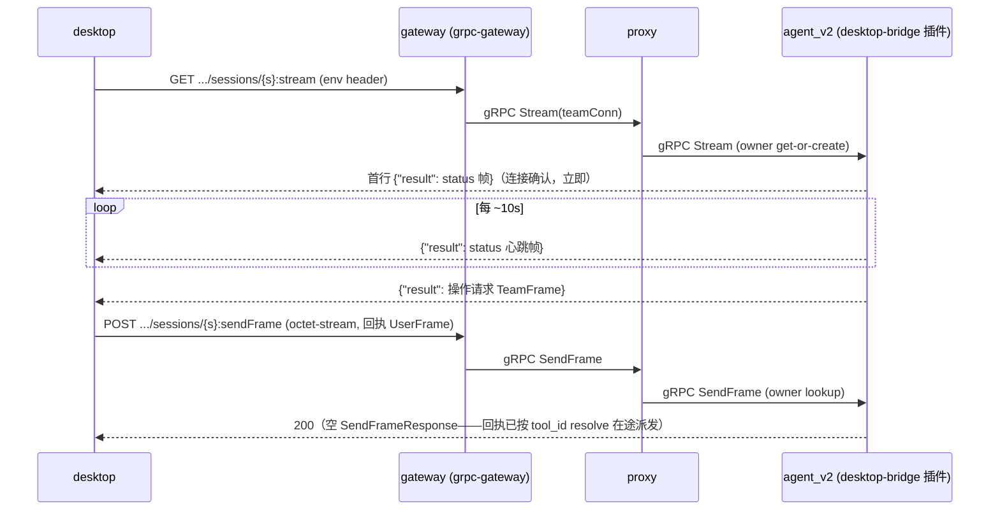

# Contract: DesktopBridge v2——会话下行流 + 上行单发（拆分 DesktopBridgeService.Connect）

> 本契约取代 [specs/051-agent-v2-dsh-migration/contracts/desktop-bridge.md](../../051-agent-v2-dsh-migration/contracts/desktop-bridge.md) 的传输层章节（§1 帧时序、§3 网关 WS 路由、§4 proxy bidi relay）；该文档中与传输无关的部分（桌面执行语义、§5 会话选择器）继续有效并在其自身范围内引用。帧词汇表（UserFrame/TeamFrame/FlowParts）沿用 `projects/game/game.proto`。
> 决策溯源：调研 [survey/desktop-bridge-connect-split.md](../../../../survey/desktop-bridge-connect-split.md)（D1–D7）+ [../research.md](../research.md)（D8–D16）。

## §1 端点与线格式

| 方向 | RPC | HTTP | 请求体 | 响应 |
|---|---|---|---|---|
| 服务端→desktop（下行流） | `DesktopBridgeService.Stream(StreamRequest) returns (stream TeamFrame)` | `GET /api/v2/{session=templates/*/sessions/*}:stream` | 无（身份在 path） | chunked NDJSON，每行 `{"result": <TeamFrame>}\n`；异常终止尾行 `{"error": {...}}\n` |
| desktop→服务端（上行单发） | `DesktopBridgeService.SendFrame(SendFrameRequest) returns (SendFrameResponse)` | `POST /api/v2/{session=templates/*/sessions/*}:sendFrame` | `application/octet-stream`：`proto.Marshal(SendFrameRequest)`（path 参数在 body 解码后覆盖 `session` 字段） | `200` + 空体（`SendFrameResponse` 为空消息）；错误为 gRPC→HTTP 映射的 JSON 信封 |

## §2 连接与上行语义

1. **绑定**：`:stream` 打开即按 path 中的 session 资源名绑定；body/客户端自报身份不作为绑定依据。template 合法性双侧校验（proxy `parseAgentSession` 同款规则）。
2. **首帧确认**：流打开后服务端**立即**推送一帧 status（`STATUS_SIGNAL_STATUS_ACTIVE`）TeamFrame；desktop 在 10s 内未收到首行 → 连接失败（关闭并报错）。该帧同时使响应头立即落盘（长流在中间层不挂起）。
3. **心跳**：活跃流上服务端每 ~10s 推送一帧 status 帧；帧为完整 TeamFrame 信封。心跳覆盖 ingress 空闲超时与 liveness。
4. **接管**：同 session 新 `:stream` 打开 → 注册覆盖 + 旧流被 end；旧流的晚到断开是 compare-and-delete no-op（不清新注册、不 settle 新连接的在途派发）。
5. **断开清理**：当前流结束（客户端断开/网络故障/服务终止）→ 清注册 + 该 session 在途派发全部 settle `FAILED "desktop disconnected"`。
6. **无流拒绝**：`SendFrame` 到达时该 session 无活跃下行流 → `FAILED_PRECONDITION`；desktop 侧有界重试（3 次 × 1s），覆盖接管间隙。proxy 无 owner 记录 → `NOT_FOUND`（回执不分配 owner，lookup-only）。
7. **上行无序**：每次 `SendFrame` 独立；关联仅靠 `flow_result.tool_id`（已在 [../research.md](../research.md) §1 逐帧核验：无跨帧顺序依赖）。
8. **在途派发失败路径**（原样保留，spec 051 §2）：无连接 → `FAILED "desktop disconnected"`；caller abort → `FAILED "aborted"`；20min backstop → `FAILED "operation timed out"`；迟到/未知 tool_id 回执 → 记日志忽略。
9. **上行 part 分派**：`flowResult` → resolve 在途派发；`wait`/`warn` → 既有日志行为；其余 part（含 desktop 不再发送的 `status`）→ warn 日志忽略。

## §3 网关装配（gateway）

1. `runtime.WithMarshalerOption("application/octet-stream", &runtime.ProtoMarshaller{})` 追加进 ServeMux 选项（JSON 路由不受影响；按 MIME 精确匹配）。
2. `game.RegisterDesktopBridgeServiceHandler(ctx, gwmux, teamConn)` 一行注册——与 AgentService 同连接（owner 亲和经 proxy；长流 keepalive 与 8MB hop 上限已配对）。
3. **Body 上限守卫**：仅对 sendFrame POST 路径应用 `http.MaxBytesReader`（8MiB，与 gRPC hop 对齐）；`Content-Length` 预检超限直接 `413`；超限读取在 gateway 解码处报 "request body too large" 类清晰错误。超限**永不**静默截断。
4. 不存在任何 WebSocket 升级分支；`/api/v1`、`/api/v2` 全部经 gwmux 分发。

## §4 proxy 转发

| RPC | owner 策略 | 转发 |
|---|---|---|
| `Stream` | `assignAgentOwner`（get-or-create——desktop 可先于 team 物化连接） | `Stream(ctx, req)` → `bind.ServerStreamBinder[TeamFrame].BindServerStream`（复用 `AgentService.Send` 范式） |
| `SendFrame` | `lookupAgentOwner`（lookup-only；无 owner → `NOT_FOUND`） | unary 直转（复用 `Cancel` 范式 + `propagateAgentError`） |

错误映射（两 RPC 一致）：agent_v2 的 status 承载拒绝保留原码透传（前端看到映射 HTTP 码）；proxy→agent_v2 非 status 传输故障 → `UNAVAILABLE`。

## §5 desktop 客户端行为（desktop / fake-desktop / 大型测试 helper 共同遵守）

1. **建流**：`GET :stream`（携带 env header；不设 Accept）。读首行（10s 超时）解析 status 枚举名（前端展示语义保持）；失败关闭重连。
2. **读循环**：按**行**缓冲解析（`\n` 为 delimiter；不假设 1 chunk = 1 消息）；`{"result"}` → `protojson.UnmarshalOptions{DiscardUnknown: true}` 解 TeamFrame（前向兼容，FR-007）；`{"error"}` → 流异常终止，关闭并按错误处理。
3. **上行**：`POST :sendFrame`，`Content-Type: application/octet-stream`，body 为 `SendFrameRequest` 二进制；**不设 Accept**（错误信封以 JSON 返回）。回执发送有界重试（3 × 1s；最终失败记日志，不阻塞读循环）。
4. **关闭**：取消请求 ctx（解除阻塞的行读取）后关闭 body。
5. fake-desktop 断连注入：第 N 笔回执 POST **完成**后断流（unary 完成即回执已抵达 agent_v2；无需 drain pause）。

## §6 验收锚点

- 单测：插件（attach 首帧推送/心跳启停、接管 no-op、SendFrame FAILED_PRECONDITION、回指 tool_id resolve、断开 settle）；desktop 桥客户端（NDJSON 行解析、首帧超时、octet-stream 编码、错误体解析）；proxy（Stream/SendFrame 转发与错误映射、owner 策略）；gateway（body 上限 413/归因、路由注册——`desktop_flow` 之外不回归）。
- 大型测试（[../quickstart.md](../quickstart.md)）：首帧 status、接管、派发→回执→识别闭环、在途断连失败、空闲存活（SC-004）、超限归因（SC-003）、断连恢复三局序列、既有游戏/团队链路全量回归。
- 行为不变量：扫雷统计口径（[../../065-agent-v2-team-refine/contracts/game-stats-broadcast.md](../../065-agent-v2-team-refine/contracts/game-stats-broadcast.md) §1.2，仅计已执行操作）经既有单测与游戏大型测试回归。
