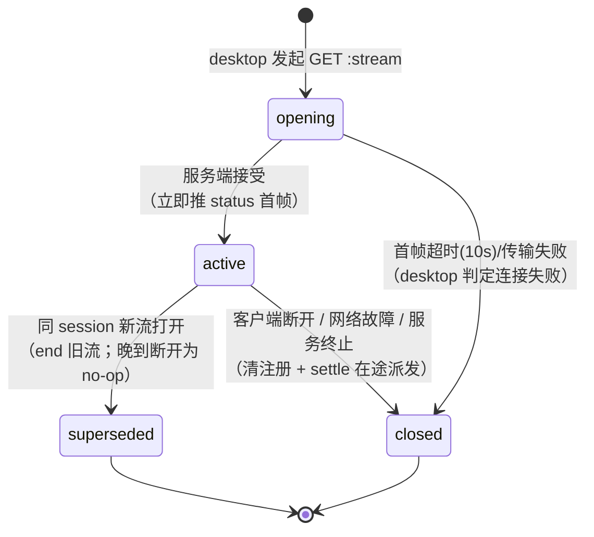

# Data Model: DesktopBridgeService.Connect 拆分

> 契约细节见 [contracts/desktop-bridge-v2.md](contracts/desktop-bridge-v2.md)；实现决策依据见 [research.md](research.md)（D8–D17）。

## 1. 实体

### 1.1 会话下行流（Session Control Stream）

一个游戏会话至多一条活跃；是桌面连接状态（`desktop_connected`）、接管与断开清理的**唯一事实源**。

| 字段 | 类型 | 说明 |
|---|---|---|
| session | string | 资源名 `templates/{template}/sessions/{session}`（HTTP path 参数注入，body 值不可左右） |
| state | enum | `opening` → `active` → `superseded` \| `closed`（见 §2 状态迁移） |
| writeFace | 对象 | 服务端→desktop 的帧写入面（gRPC server-streaming 的 Send 面） |
| heartbeat | 定时器 | ~10s 周期 status 帧推送；随流生命周期启停 |

验证规则（来自 spec FR-001/002/003/008）：session 必须是已知 template 的合法资源名（proxy `parseAgentSession` 双侧校验）；打开即推首帧 status；同 session 新流打开 → 旧流 `superseded`。

### 1.2 上行帧提交（Frame Submission）

一次独立请求-响应；帧自包含、按 `flow_result.tool_id` 关联，不依赖调用间顺序。

| 字段 | 类型 | 说明 |
|---|---|---|
| session | string | path 参数；覆盖 body 同名字段 |
| frame | UserFrame | 二进制 proto body 载荷（`application/octet-stream`） |
| 错误语义 | enum | `FAILED_PRECONDITION`（无活跃下行流）/ `NOT_FOUND`（proxy 无 owner）/ `INVALID_ARGUMENT` / 上限拒绝（413/400） |

### 1.3 会话连接注册表（Session Connection Registry）

agent_v2 插件内存态：`session → Connection{writeFace, heartbeat}`；伴随 `session → tool_id → PendingDispatch`（在途派发表）。不变量：

- 接管 = 覆盖注册 + end 旧流；旧流晚到断开为 compare-and-delete **no-op**（不得清除新注册、不得 settle 新连接的在途派发）。
- 断开（当前注册的流结束）→ 清注册 + 该 session 全部在途派发 settle `FAILED "desktop disconnected"`。
- 在途派发表锚定在 session 维（非连接维度）——重连/接管不丢失在途派发，晚到回执仍可 resolve。

### 1.4 下行信封帧（Server Frame Envelope）

下行流每消息的传输信封（NDJSON，每行一个 JSON 对象）：

| 形态 | 结构 | 语义 |
|---|---|---|
| 数据行 | `{"result": <TeamFrame JSON>}\n` | 一帧 TeamFrame（操作请求 / status 心跳 / 首帧确认） |
| 终止行 | `{"error": {...}}\n` | 流异常终止（客户端读到此行后关闭并按错误处理） |

TeamFrame 信封字段（`session_id`/`template_id`/`frame_id`/`create_time`/`flow_parts`）沿用 `projects/game/game.proto` 既有定义，每发送点全填（帧信封不变量见 [specs/051-agent-v2-dsh-migration/contracts/desktop-bridge.md](../051-agent-v2-dsh-migration/contracts/desktop-bridge.md) §1 与 [projects/game/game.proto](../../projects/game/game.proto)）。

## 2. 状态迁移

- `desktop_connected`（team 视图字段）= 注册表中存在该 session 的 `active` 流。
- 无 `active` 流时的上行提交 → `FAILED_PRECONDITION`；desktop 有界重试（3 次 × 1s）覆盖接管间隙。

## 3. 与既有实体的关系

| 既有实体 | 关系 |
|---|---|
| `UserFrame`/`TeamFrame`/`FlowParts`（game.proto） | 帧词汇表原样复用；仅传输层变化（WS 二进制帧 → NDJSON 行 / octet-stream body） |
| Owner 记录（proxy，Mongo） | `Stream` get-or-create、`SendFrame` lookup-only（research D10） |
| 在途派发（PendingDispatch，插件） | 结构与失败路径原样（20min backstop / abort / disconnected） |
| team 物化 / 消息流 / web 前端 | 零关系变化（本重构不触碰） |

## 4. 删除的旧模型元素

`BidiStream`（插件接口）、`bind.Binder` 双向泵、`bind.WithFirstFrame` 首帧重放、`wsStream` 适配器、WSClient/fake-desktop WS 会话、`deriveSessionName`（首帧身份解析）、探针 echo（`respondProbe`）、`disconnectDrainPause`——均为旧传输层机制，无对应新模型元素（用户指令：不遗留旧框架内容）。
