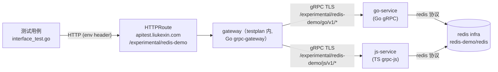

# Contract: Redis Demo（experimental/redis_demo）

**Feature**: [../spec.md](../spec.md) | **Research**: [../research.md](../research.md)（D8/D10）

## 1. 拓扑



* 目录：`experimental/redis_demo/{redis_demo.proto, go_service/, js_service/, testplan/}`（对齐 `experimental/grpc_chain` 布局）。
* app：`redis-demo`；两个业务服务实现**同一 proto 服务** `KvService`，redis target 均为 `redis-demo/redis`。
* gateway 内两个 `runtime.NewServeMux` 分别注册 go-service / js-service 的 handler，外层 `http.ServeMux` + `http.StripPrefix` 按 `/experimental/redis-demo/go/`、`/experimental/redis-demo/js/` 前缀分发；proto 注解路径为 `/v1/...`（StripPrefix 后完全匹配）。

## 2. API（redis_demo.proto，`package experimental.redis_demo`）

遵循 `style/api.md`（AIP 规范；标准方法 https://google.aip.dev/131 / https://google.aip.dev/135 ，custom method https://google.aip.dev/136 ）。

```protobuf
// KvService 演示双语言 gRPC 服务连接同一 redis 实例。
// Prefix Path: /v1
service KvService {
  // GetKvEntry 按 name 读取。不存在返回 NOT_FOUND。
  rpc GetKvEntry(GetKvEntryRequest) returns (KvEntry) {
    option (google.api.http) = { get: "/v1/{name=apps/*/kvEntries/*}" };
  }
  // SetKvEntry upsert 写入（custom method :set，返回写入后的值）。
  rpc SetKvEntry(SetKvEntryRequest) returns (KvEntry) {
    option (google.api.http) = { post: "/v1/{name=apps/*/kvEntries/*}:set" body: "*" };
  }
  // DeleteKvEntry 删除。不存在返回 NOT_FOUND（AIP-135）。
  rpc DeleteKvEntry(DeleteKvEntryRequest) returns (google.protobuf.Empty) {
    option (google.api.http) = { delete: "/v1/{name=apps/*/kvEntries/*}" };
  }
}

message KvEntry {
  // 资源全名 apps/{app}/kvEntries/{kv_entry_id}；同时也是 redis key（输出侧服务端生成）。
  string name = 1;
  string value = 2;
}
```

**redis key 映射**：key = 资源全名字符串（`apps/{app}/kvEntries/{id}`）。两语言实现必须使用同一映射（跨语言一致性契约）；无前缀、无编码变换。

## 3. 服务实现要点

* `go_service/`：`common/gopkg/grpc` 服务端 + `common/gopkg/redis` 客户端 + `common/gopkg/bootstrap`；`service.yaml`（gRPC 端口 50051、TLS、`artifact_pkg_go`/`artifact_image`）。
* `js_service/`：grpc-js 服务端（对齐 `experimental/grpc_chain/mid` 打包形态：`ts_proto_library` + `artifact_pkg_js` + `runtime_deps` 含 `@dominion/common-js-redis` 的 `runtime_pkg`）+ 健康端点 38080/`/healthz`（`common/js/bootstrap` health 组件或等价实现，`tools/release/deploy/README.md` §健康探针约定）。
* 生命周期：启动建连、退出断连（redis 客户端关闭）随服务 bootstrap 装配（research.md D10）。

## 4. testplan（`testplan/`）

* `deploy.yaml`（`name: redis.{{run}}`，type test）：

```yaml
services:
  - infra:
      app: redis-demo
      resource: redis
      profile: dev-single
      name: redis          # 不启用持久化（style/large_test.md SUT 默认不持久化）
  - artifact:
      path: //experimental/redis_demo/go_service/service.yaml
      name: go-service
  - artifact:
      path: //experimental/redis_demo/js_service/service.yaml
      name: js-service
  - artifact:
      path: //experimental/redis_demo/testplan/gateway/service.yaml
      name: gateway
    http:
      hostnames: [apitest.liukexin.com]
      matches:
        - backend: http
          path: { type: PathPrefix, value: /experimental/redis-demo }
```

* `interface_test.yaml`：单 suite；`deploy` 指向上表 deploy.yaml；`endpoint.http.public: https://apitest.liukexin.com`；cases 指向 `go_largetest` target `testplan_test`。
* 用例（`interface_test.go`，HTTP + env header，按 `style/large_test.md` 组织为单模块用例集）：
  1. go set → go get 回读一致（自环 + 认证验证）。
  2. js set → js get 回读一致。
  3. go set → js get 跨语言读取一致。
  4. js set → go get 跨语言读取一致。
  5. delete 后 get 返回 404/NOT_FOUND。
* 执行：`guitar run //experimental/redis_demo/testplan/interface_test.yaml`（部署→测试→清理闭环，宪章 VI）。

## 5. 验收

* 全部用例通过（含跨语言一致性）即视为 redis infra 部署面 + 双语言公共库 + 凭证注入链路端到端验证通过（spec SC-002）。
* demo 代码同时作为两种语言接入 redis 公共库的参考实现（spec User Story 5）。
