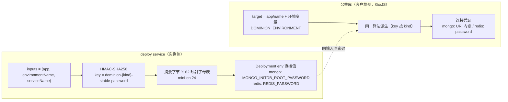
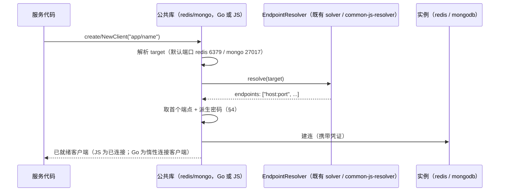

# Data Model: Redis 基础设施支持与实例凭证注入改造

**Feature**: [spec.md](spec.md) | **Research**: [research.md](research.md)

本文档定义特性涉及的数据结构与实体关系。字段类型按目标语言落地（Go struct / YAML / TS interface），实现时以 [contracts/](contracts/) 为接口契约基准。

## 1. Infra 服务声明（deploy.yaml `services[].infra`）

既有结构不变，`resource` 取值集合扩展：

| 字段 | 类型 | 约束 | 说明 |
|---|---|---|---|
| `resource` | string | 枚举 `{mongodb, redis}`（原 `{mongodb}`） | 基础设施种类；CLI 侧由 `tools/release/deploy/pkg/schema/deploy.schema.json` 枚举校验，服务端由 converter 分发校验 |
| `profile` | string | 非空；须存在于 `static_config.yaml` 对应资源种类的 profile 表 | 实例档案名 |
| `name` | string | 非空；参与资源名生成（63 字符上限） | 实例名 |
| `app` | string | 非空 | 实例所属应用 |
| `persistence` | object | `enabled` 必填；`capacity` 可选（≤1Ti） | 与 mongodb 语义一致 |

## 2. Workload 模型（deploy service k8s runtime）

### 2.1 RedisWorkload（新增，`projects/infra/deploy/runtime/k8s/model.go`）

```go
// 字段与 MongoDBWorkload 同构（research.md D6）。
type RedisWorkload struct {
    ServiceName     string             // infra.name
    EnvironmentName string             // 环境名（label 形式）
    App             string             // infra.app
    ProfileName     string             // infra.profile
    Persistence     PersistenceConfig  // 复用现有 {Enabled, Capacity}
}
```

资源名（`naming.go` `newObjectName`，前缀新增 `WorkloadKindRedis = "redis"`）：

| 对象 | 名称 | 说明 |
|---|---|---|
| Deployment | `redis-{env}-{name}-{hash}` | `ResourceName()` |
| Service | `svc-{env}-{name}-{hash}` | `ServiceResourceName()` |
| PVC | `pvc-{env}-{name}-{hash}` | `PVCResourceName()`（仅持久化启用） |

`Validate()` 校验：ServiceName/EnvironmentName/App/ProfileName 非空、资源名 ≤63 字符（对齐 `MongoDBWorkload.Validate`）。

### 2.2 MongoDBWorkload（凭证注入变更）

- 删除 `SecretResourceName()`；其余字段与校验不变。
- 容器环境变量注入方式变更（值来源从 `SecretKeyRef` → 直接值，见 §4）。

### 2.3 DeployObjects（`converter.go`）

```go
type DeployObjects struct {
    // 既有字段...
    MongoDBWorkloads []*MongoDBWorkload
    RedisWorkloads   []*RedisWorkload   // 新增
}
```

converter 按 `infra.Resource` 分发：`mongodb` → MongoDBWorkload，`redis` → RedisWorkload，其余报错（错误信息保留既有文案语义）。

### 2.4 静态配置（`static_config.yaml` + `static_config.go`）

```yaml
redis:
  dev-single:
    image: "redis"
    version: "8.4"
    port: 6379
    storage:                      # 与 mongodb.dev-single.storage 相同取值
      storage_class_name: "truenas-iscsi-v2"
      capacity: "4Gi"
      access_modes: ["ReadWriteOncePod"]
      volume_mode: "Filesystem"
```

```go
type RedisProfileConfig struct {   // 无 admin_username：redis 密码认证无用户名（research.md D6）
    Image   string
    Version string
    Port    int
    Storage StorageConfig           // 与 MongoProfileConfig 共用；由 MongoStorageConfig 更名（research.md D6）
}
// K8sConfig 增加 Redis map[string]*RedisProfileConfig 与 RedisProfile(name) 查询。
```

## 3. 生成资源清单（redis 实例，k8s builder）

| 对象 | 关键内容 |
|---|---|
| Deployment | `Recreate` 策略、单副本、单容器（无 init 容器）；命令 `["/bin/sh","-ec","exec redis-server --requirepass \"$REDIS_PASSWORD\" --appendonly yes"]`（`--appendonly yes` 仅持久化启用时追加）；env：`SERVICE_APP`、`DOMINION_ENVIRONMENT`、`POD_NAMESPACE`（fieldRef）、`REDIS_PASSWORD`（直接值）；卷 `redis-data` → PVC（持久化）或 `emptyDir`；liveness/readiness TCP 探针（端口名 `redis`）；labels `app/service/environment/managed-by`（与 mongo 一致） |
| Service | 单端口 `redis`（profile.port），selector 同 mongo 语义 |
| PVC | 复用 mongo 的 storage 解析与 `CheckPVCCompatibility` 兼容校验模式 |

mongo 实例：除凭证 env 改直接值（§4）外，Deployment/Service/PVC 生成不变；**不再生成 Secret**。

## 4. 实例凭证模型



派生输入与参数（research.md D4，mongo 既有行为不变，redis 为同构新键）：

| 参数 | mongo（不变） | redis（新增） |
|---|---|---|
| HMAC key | `dominion-mongo-stable-password` | `dominion-redis-stable-password` |
| 输入序列 | `(app, environmentName, serviceName)` | 同左 |
| joiner / 字母表 / minLen | `"\x00"` / `[a-zA-Z0-9]`（62） / 24 | 同左 |
| 实例侧注入变量 | `MONGO_INITDB_ROOT_USERNAME`（profile.admin_username）、`MONGO_INITDB_ROOT_PASSWORD`（直接值） | `REDIS_PASSWORD`（直接值） |
| 客户端认证 | 用户名 `admin` + 密码，`authSource=admin` | 密码（默认用户） |

实现位置（三处，行为逐字节一致）：
- 实例侧：`projects/infra/deploy/runtime/k8s/builder.go`（mongo 既有 `generateStablePassword`，redis 同构实现）。
- Go 客户端：`common/gopkg/redis/credentials.go`（对齐 `common/gopkg/mongo/credentials.go`）。
- JS 客户端：`common/js/redis/src/`、`common/js/mongo/src/` 各自内部实现（对齐 `projects/game/agent_v2/src/presets.ts` 现有实现语义）。

## 5. 公共库连接模型



数据要点：

* target 格式：Go 侧 `app/name`（无端口，`common/gopkg/mongo/client.go` `parseMongoTarget` 解析后由 solver 补默认端口）；JS 侧额外接受 `dominion:///app/service:port`（既有 JS 调用方惯例），两种形式归一化为 `app/service:port`（库内补默认端口）后交由 JS resolver（详见 [contracts/common-db-libs.md](contracts/common-db-libs.md) §3）。
* 端点解析复用既有 resolver（Go `common/gopkg/solver`、JS `@dominion/common-js-resolver`），环境名来自 `DOMINION_ENVIRONMENT`（缺失回退 `default`）。
* JS mongo 额外提供仅产出口（`resolveMongoUri`），供 agent_v2 的"连接串注入插件"模式（见 [contracts/common-db-libs.md](contracts/common-db-libs.md)）。

## 6. demo 实体（`experimental/redis_demo/`）

### KvEntry 资源

| 字段 | 类型 | 说明 |
|---|---|---|
| `name` | string | 资源全名 `apps/{app}/kvEntries/{kv_entry_id}`；**同时是 redis key**（两语言一致映射，跨语言一致性契约） |
| `value` | string | 存储值 |

方法（`style/api.md` AIP 规范，详见 [contracts/redis-demo.md](contracts/redis-demo.md)）：`GetKvEntry`（标准 Get）、`SetKvEntry`（custom method，upsert）、`DeleteKvEntry`（标准 Delete）。

### 部署拓扑（testplan deploy.yaml）

| 服务 | kind | 连接 |
|---|---|---|
| `redis`（infra） | redis standalone，无持久化 | — |
| `go-service` | stateless，gRPC TLS | redis target `redis-demo/redis` |
| `js-service` | stateless，gRPC TLS | redis target `redis-demo/redis` |
| `gateway`（testplan 内） | stateless，HTTP | grpc 目标 `redis-demo/go-service:grpc`、`redis-demo/js-service:grpc` |

## 7. agent_v2 替换后的连接装配

`projects/game/agent_v2/src/presets.ts`：删除本地派生/解析实现（约 70 行），改为调用 `@dominion/common-js-mongo` 的 URI 产出口；对外保留 `MONGO_URI` 直连优先、`PRESET_DATABASE`/`PRESET_COLLECTION_NAME`、`MONGO_TARGET` 常量与 `resolveMongoUri()` 函数签名（`bootstrap.ts` 零改动）。

## 8. 状态与生命周期

* redis/mongo 实例生命周期由 deploy 既有语义承载：apply（创建/更新/prune）、describe/list 观测（rollout 状态机对 Deployment 生效）、环境删除（按标签清理全部资源）。
* 凭证不轮换：同输入恒定派生（与 mongo 现状一致）；密码变更仅随 (app, env, service) 输入变化发生。
* 存量迁移：mongo 实例 Secret 在新版 deploy service 首次 apply 该环境时被 prune 自动删除（`executor.go` prune 语义，research.md D5）。
