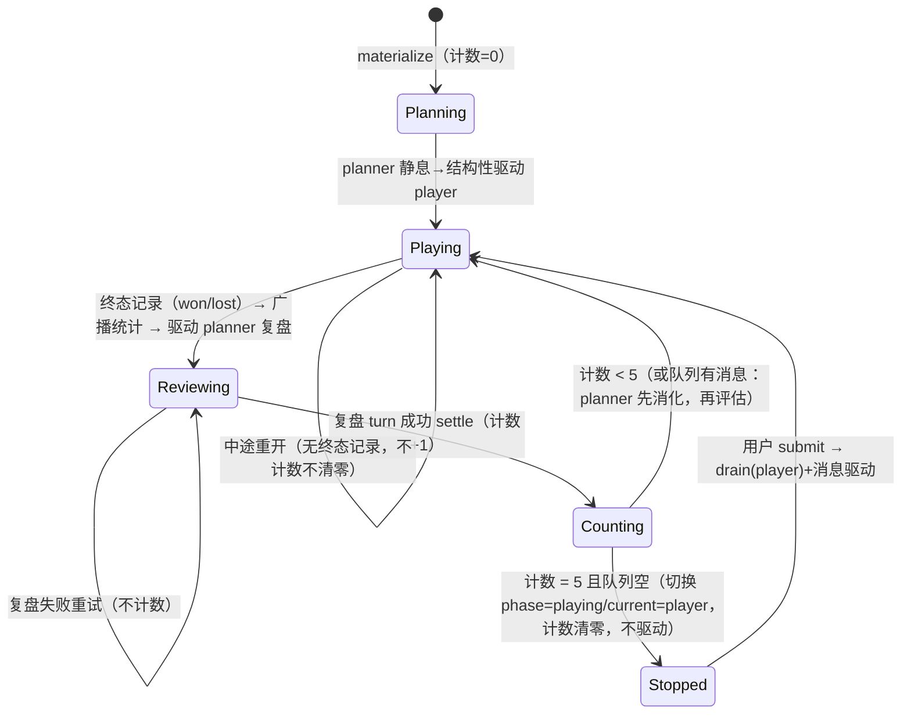

# Data Model: planner wiki 知识库与 saolei-loop 每五轮自然停

> **Feature**: specs/068-wiki-round-pause/spec.md | **契约**: [contracts/wiki-service.md](contracts/wiki-service.md)、[contracts/memory-resource-identity.md](contracts/memory-resource-identity.md)、[contracts/dsh-plugins.md](contracts/dsh-plugins.md)、[contracts/saolei-loop-round-stop.md](contracts/saolei-loop-round-stop.md)
> 存储规范：`style/mongo.md`；检索技术论证：`survey/game-wiki-knowledge-base.md` §4。

## 1. Wiki 资源（proto 消息）

```text
Wiki {
  name        string  = 1 [IDENTIFIER]   // templates/{template}/sessions/{session}/wikis/{wiki}
  title       string  = 2                // 模型侧地址；≤ 128 rune；规范化后在作用域内唯一
  content     string  = 3                // ≤ 64KB（64 * 1024 字节）
  create_time Timestamp = 4 [OUTPUT_ONLY]
  update_time Timestamp = 5 [OUTPUT_ONLY]
}
// 无独立 wiki_id 字段（FR-017：id 由 name 的 {wiki} 段承载；
// Create 请求携带 wiki_id——AIP-133 用户指定 id，REQUIRED）。
```

- 资源注解：`type: "game.liukexin.com/Wiki"`，`pattern: "templates/{template}/sessions/{session}/wikis/{wiki}"`，`singular: "wiki"`，`plural: "wikis"`。
- 校验（domain 层，违反 → INVALID_ARGUMENT）：`wiki_id` 匹配 `[a-z0-9_-]+`（对齐 domain 的 `ValidateMemoryID`，与 `ValidateWiki*` 同层）；title 非空且 ≤ 128 rune；content 非空且 ≤ 64KB（空 content 拒绝）；Search query 非空。
- 唯一性：`title_norm`（§2.1）在 `(template, session_id)` 内唯一，违反 → ALREADY_EXISTS（title 变更的 Update 同样受约束）。

## 2. 存储文档（mongo `game_memory.wikis`）

```text
{
  _id          // 数据库生成，不覆盖（style/mongo.md）
  template     string
  session_id   string
  wiki_id      string    // name 末段；agent 侧生成（§5）
  title        string    // 原文，List/Get 返回原样
  title_norm   string    // §2.1 规范化；唯一索引键
  title_grams  []string  // §2.2 bigram 去重集合；multikey 索引
  content      string
  create_time  time
  update_time  time
}
```

### 2.1 规范化函数 `NormalizeTitle`（纯函数，Go domain 层 + JS 工具层各一份同语义实现）

`NFKC(Unicode 规范化) → 小写化`。Go：`golang.org/x/text/unicode/norm.NFKC.String` + `strings.ToLower`；JS：`str.normalize("NFKC").toLowerCase()`。两侧对齐的验证 case：全角/半角（`Ａ`→`a`）、大小写（`Ａｂｃ`→`abc`）、中文原样、emoji 组合序列（NFKC 展开后小写化不变）。

### 2.2 bigram 函数 `TitleBigrams`（纯函数）

对 `title_norm` 做 rune 级 2-gram，去重存数组（title ≤ 128 rune ⇒ ≤ 127 个元素）。正确性原理：`title_norm` 含 `query_norm` 子串 ⇒ bigram 集合包含 query 的全部 bigram（必要条件）——`$all` 仅预过滤，命中后服务端 `strings.Contains(title_norm, query_norm)` 精确验证（充分性由验证步保证）。

### 2.3 索引（启动时创建）

| 索引 | 用途 |
|---|---|
| unique `(template, session_id, wiki_id)` | 身份；List 固定 `wiki_id asc` 排序键 |
| unique `(template, session_id, title_norm)` | title 作用域唯一（D3） |
| `(template, session_id, title_grams)` multikey | Search 的 `$all` 预过滤 |

## 3. Search 检索与分页

### 3.1 检索语义

- query 经 §2.1 规范化 → `q`。
- `len(q) ≥ 2 rune`：`Find({template, session_id, title_grams: {$all: bigrams(q)}}, 投影 {title, wiki_id})` → Go 侧 `strings.Contains(title_norm, q)` 验证过滤假阳性 → 评分排序。
- `len(q) < 2 rune`（含单个汉字）：回退 `Find({template, session_id, title_norm: {$regex: QuoteMeta(q)}})`（Go regexp QuoteMeta 消除注入面），成本以会话内条目数为上界。
- 评分排序（确定性全序）：精确相等 > 前缀匹配 > 子串匹配；同分按 `title_norm` 升序（UTF-8 码点序）。

### 3.2 Search token（AIP-158 不透明）

`base64url(JSON{q, offset})`——`q` 为规范化 query；续页请求的 query 规范化后 ≠ token 内 `q` → INVALID_ARGUMENT。`page_size` 默认 20、上限 100。与 List 的游标形态完全独立（List 为固定 `wiki_id` 单键 seek 游标，`page_size` 默认 20、上限 100，调研 D8）。

### 3.3 结果缓存（纯优化，可裁剪）

redis 快照缓存（067 基建）：key `wiki:search:{template}:{session}:{gen}:{hash(q)}`，TTL ~60s；写代际 `wiki:searchgen:{template}:{session}`（任何 wiki 写 INCR）。miss/不可用 → 逐页重执行降级，契约不变（research §5）。

## 4. Memory 资源修订（FR-017）

- proto：`Memory` 删除 `string memory_id = 2`，`reserved 2; reserved "memory_id";`（对齐 Session 在 035 的手法）。
- 存储文档与 domain/仓储的 `MemoryID` 内部字段**不变**（存储层继续持有 id）；仅 proto 响应面与 JS 解码变化。
- JS `MemoryEntry.memory_id` 保留为派生值：`parseMemoryName(name)` 取 `/memories/` 末段（与 `memoryName()` 构造对称）。
- `ListMemoriesRequest.order_by` 白名单（`memory_id`/`update_time`）与 tie-break 机制**不变**；proto 注释将 `memory_id` token 语义更新为 "name 的 `{memory}` 段"。

## 5. wiki_id 生成（JS 工具层）

`wiki_id = sha256(title_norm).hexdigest()[:32]`——确定性（同 title 重建同 id，upsert create 分支幂等），满足 `[a-z0-9_-]+`；与 `generateMemoryId` 的 content-digest 同型（`common/js/dsh-plugins/memory-service/src/operations.ts`）。

## 6. 工具面 schema（模型可见）

| 工具 | 参数 schema | 结果文本（{result}） |
|---|---|---|
| `wiki_search` | `{ query: string }`（唯一参数） | 命中标题列表（每行一个 title，无 content；内部按 `page_size`=100 折叠 `next_page_token` 取全）；空结果给"未命中 + 建议换关键词"引导 |
| `wiki_get` | `{ titles: string[] }`（≥1 项） | 每命中标题一段完整 content；未命中标题列出 + 引导先 `wiki_search` |
| `wiki_write` | 单条 `{ title, content }` XOR 批量 `{ entries: [{ title, content }] }` | 每条目 `wiki created` / `wiki updated`；批量预检失败 → 全批未写说明（失败条目与原因）；空 `entries` → 引导文本（不提交） |

- 三工具均为 `{result: string}` 输出 schema、文本渲染（对齐 memory 工具形态）。
- 参数根级全可选（单条 XOR 批量为运行时契约，文本应答——对齐 memory 工具的 schema 策略）；`titles`/`entries` 项内 `additionalProperties: false`。
- 失败面：基础设施故障 → `wiki failed: …` 文本（不抛错；提交中断时含已写入条目列表）；领域结果（未命中/超限/非法）→ 引导文本。
- `name`/`wiki_id` 不出现在任何模型可见文本（FR-009；`wiki_get`/`wiki_write` 的精确解析在工具层内部完成）。

## 7. 服务面扩展（`PlannerMemoryService`）

```text
interface PlannerMemoryService {
  load(agentCtx, scope)                       // 既有；绑定 (template, session)——wiki 共用同一绑定
  applyCall(agent, args)                      // 既有（memory 工具）
  snapshot(scope)                             // 既有
  wikiSearch(agent, query) -> string          // 新增：SearchWikis（按 page_size 折叠 next_page_token 取全）+ 渲染标题列表
  wikiGet(agent, titles[]) -> string          // 新增：每标题精确解析 + GetWiki + 渲染
  wikiWrite(agent, entries[] | {title, content}) -> string  // 新增：upsert + 批量预检 + 渲染
}
```

存储 seam：`WikiStore { searchWikis, getWiki, createWiki, updateWiki }`——恰为工具所需四方法（Delete/List 为服务端 API 面，JS client 不消费，YAGNI）。

## 8. 自然停状态机（orchestrator）



- 新增私有状态：`completedRounds int`（0 起）；常量 `ROUND_STOP_INTERVAL = 5`。
- 计数点：`runPump` 的 review settle 分支（`step.review !== undefined` 且 drive 成功）。
- 停点：`nextStep` 的 planning/reviewing 分支头部——队列分支在前保证"当期 member 处理完"；`completedRounds >= ROUND_STOP_INTERVAL` 时执行切换但不返回驱动步（返回 null），清零计数。
- 不新增对外快照字段（用户决策）；session 层 `watchQuiescence` 既有静息判定（`active === null && queued === 0`）自然收尾 Send 流，零改动。

## 9. prompt section 常量（memory 插件行注册）

| section | order（100–199 工具指引带） | 内容 |
|---|---|---|
| `memory:guidance` | 110 | memory vs wiki 分工差异（仅差异，无用法、无第三方术语，英文） |
| `wiki:guidance` | 120 | wiki 三工具整体用法（`wiki_search` 发现 → `wiki_get` 取回 → `wiki_write` 沉淀/更新，英文） |
| `memory:snapshot`（既有） | 200 | 记忆快照（不变） |

memory 工具描述（修订，英文）：去除 `planner`/`hermes-style` 等场景与外部措辞，新增"快照仅保留最近更新的 10 条、写操作作用于全量存储且不刷新快照"说明。三个 wiki 工具描述各仅述自身功能（英文）。
