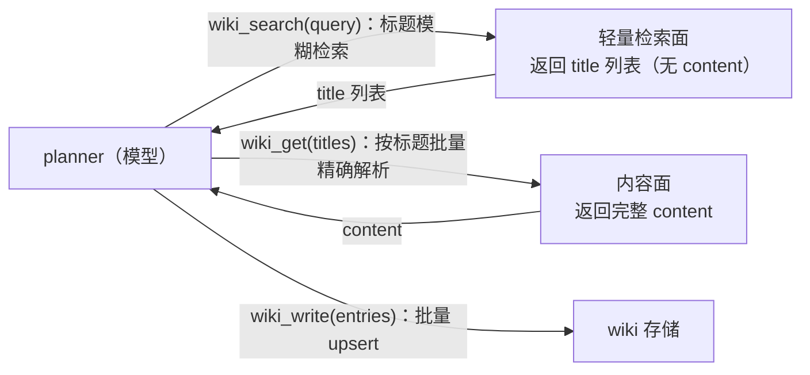
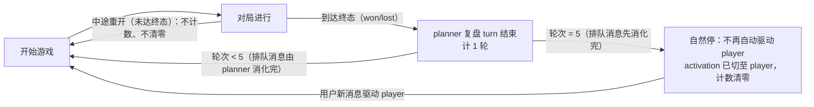

# Feature Specification: planner wiki 知识库与 saolei-loop 每五轮自然停

**Feature Branch**: `068-wiki-round-pause`

**Created**: 2026-09-19

**Status**: Draft

**Input**: User description: "为 memory 服务扩展 wiki 功能，并为 @common/js/dsh-plugins/memory/ 工具接入 wiki，以及为 @projects/game/agent_v2/ 的 planner 接入。1. 在 memory 工具的 DESCRIPTION 描述中增加只保留最近更新的10的说明。另外我发现 memory 工具的描述里怎么还包括 planner 这类特定场景的名词，作为通用记忆工具不应该包括特定场景的知识。2. 为 memory 插件增加 wiki 相关工具，与memory 工具类似，也是一个 function 支持多个操作。3. 为 memory 工具增加配套的 prompt，此 prompt 只描述 memory 和 wiki 两个工具之间的差异（不重复说明两个工具的用法），内容可以参考 memGPT 中关于 core Memory 和 Archival memory 的区别（但不要引入 memGPT 的概念，避免干扰）。另外，为 saolei-loop 增加一个每 5个游戏轮（从开始游戏到 planner turn 结束算一轮）自然停下的逻辑，即每第五轮游戏 planner 结束 turn 以后，不再自动续驱动 player。此逻辑不影响排队消息，即如果有排队消息，则先让当期 member 处理完（即planner 处理完）然后停下。只计算到达游戏终态的局，如果中途重新开始则不计算。因此原因停下后用户新的消息驱动 player（即 member 正常切换）；重开游戏后重置计数器。"

**调研基础**: `survey/game-wiki-knowledge-base.md`（wiki 部分的技术决策 D1–D10 已在该调研中与用户确认，本 spec 将其固化为行为需求）。

## Clarifications

### Session 2026-09-19

- Q: 每满 5 轮自然停下后，轮次计数器如何重置？（"重开游戏后重置计数器"存在两种读法） → A: **停下生效时重置为 0**——与"重开游戏后重置"行为等价（停下与重开之间不可能完成新的轮次）；中途重开的局既不计数也不清零，计数进度保留。
- Q: wiki 工具 write 动作的具体语义？（调研决策 D6 已定动作集 search/get/write，未定 write 行为） → A: **upsert 按规范化 title**——已存在则整体覆盖 content，不存在则创建；模型无需区分 create/update。
- Q: 自然停下是否需要在对外状态面（team 状态/快照）可见？ → A: **不新增状态面**——行为上停下、Send 流按既有静息语义收尾即可。
- Q: memory 工具描述修订与新增的 memory/wiki 分工指引段使用哪种语言撰写？ → A: **英文**——与既有模型面工具文本（工具描述、`saolei:guidance`）保持一致（persona 与快照头的中文不受影响）。
- **决策（用户指示）**: wiki 工具面为**三个独立工具**——`wiki_search`（仅接受一个 query 参数）、`wiki_get`（批量获取）、`wiki_write`（批量写入与更新，与 memory 工具形态类似）；配套 prompt 含"wiki 工具整体用法"section，各工具的描述仅描述自身功能（对应调研 D6 的动作集 search/get/write、无 list）。
- **决策（用户指示，plan 阶段）**: **资源标识形态**——资源消息 MUST NOT 携带独立 id 字段，资源 id 由 `name` 末段承载（AIP-133 定位 `{resource}_id` 于 Create 请求消息而非资源本身：https://google.aip.dev/133；仓库先例：Session 于 specs/035-proto-contract-refine 的 clean break）；`Memory.memory_id` 随本特性移除（消费面同步改造）。标识分层原则：面向 agent 一律以 title 寻址 wiki（memory 则以 content/old_text 寻址），面向后端服务遵守 API 规范以 name/id 寻址。

## User Scenarios & Testing *(mandatory)*

### User Story 1 - planner 将大量结构化知识沉淀进 wiki 并按需检索 (Priority: P1)

planner 在复盘与制定策略过程中会产生大量、复杂、值得跨局保留的知识（局面模式、策略推导、历史对局细节、长篇经验总结）。这类内容超出 memory 的定位——memory 是常驻系统提示的少量近期要点。planner 通过 wiki 工具把知识按标题沉淀为条目；之后需要时先用标题模糊检索"知道有什么"，再单条取回完整内容，避免大内容污染上下文。

**Why this priority**: wiki 的核心价值闭环（写入 → 发现 → 取回）；服务端资源与检索能力是一切的基座，没有它工具面无从消费。

**Independent Test**: 服务端可独立交付并通过 gateway HTTP 验证（CRUD、List、Search 契约）；工具面在其之后接入。

**Acceptance Scenarios**:

1. **Given** 会话作用域 (template, session) 内无同名条目，**When** 以 title + content 写入，**Then** 条目创建成功，后续按标题可检索到。
2. **Given** 作用域内已存在规范化后同名的条目，**When** 再次以同名 write，**Then** 不产生新条目，content 被整体覆盖（upsert）。
3. **Given** 存在中文、大小写混合、全角/半角差异的标题若干，**When** 以任意位置子串检索（大小写/全半角不敏感），**Then** 命中所有规范化子串匹配的条目，返回标题列表（不含正文）。
4. **Given** search 命中若干标题，**When** 按标题 get，**Then** 返回该条目的完整 content。
5. **Given** 作用域内已存在某规范化标题的条目，**When** 服务端 Create 面以同名 title 写入，**Then** 请求被拒绝并返回"已存在"类错误。
6. **Given** title 超过 128 个字符或 content 超过 64KB，**When** 写入，**Then** 请求被拒绝并返回参数错误。

---

### User Story 2 - planner 通过 wiki_search/wiki_get/wiki_write 三个工具消费 wiki (Priority: P1)

wiki 以**三个独立工具**提供：`wiki_search` 仅接受一个 query 参数，做标题模糊检索；`wiki_get` 接受一个或多个标题，批量取回完整内容；`wiki_write` 支持批量写入与更新（按规范化 title 的 upsert），单条/批量形态与 memory 工具类似。wiki 内部条目标识对模型不可见，title 即模型侧的自然地址；工具面不提供 list——发现一律走 `wiki_search`；各工具的描述仅描述自身功能，跨工具的整体用法由配套 prompt 的 wiki 用法 section 承载；领域结果与失败均以文本结果返回，不打断对话。

**Why this priority**: 工具面是 planner 实际消费 wiki 的入口；`wiki_write` 与 memory 工具同形态（单条/批量 upsert）、`wiki_search`/`wiki_get` 单职责单参数（`wiki_search` 仅 query），降低模型学习成本与误用概率。

**Independent Test**: 依赖 US1 服务端；在 planner preset 组合后通过 agent 对话驱动工具调用验证，player preset 断言不挂载。

**Acceptance Scenarios**:

1. **Given** planner preset 组合完成，**When** 检查注册的工具，**Then** 存在 `wiki_search`/`wiki_get`/`wiki_write` 三个 wiki 工具（`wiki_search` 的参数仅 query 一个），且 player preset 不挂载任何 wiki 工具。
2. **Given** 模型调用任一 wiki 工具时底层服务不可用，**Then** 返回 `wiki failed: …` 类文本结果，对话不中断、无抛出的工具错误。
3. **Given** `wiki_get` 传入的标题（单个或批量）未命中，**Then** 命中条目正常返回完整 content，未命中标题在结果中列出并附引导文本（建议先 `wiki_search` 换用更准确的标题/关键词），而非工具错误。
4. **Given** write 以批量形式提交且任一条目校验失败（如 title 超限），**Then** 全批不写入，返回说明失败条目与原因的文本结果。
5. **Given** 任一 wiki 工具结果，**When** 渲染为模型可见文本，**Then** 不出现 wiki 内部资源 id。

---

### User Story 3 - memory 工具描述通用化与 memory/wiki 配套指引 (Priority: P2)

memory 工具是通用记忆工具：其描述去除 planner 等特定场景词汇，并补充说明系统提示中的记忆快照只保留最近更新的 10 条（写操作作用于全量存储、不刷新快照）。同时 memory 插件新增两个配套 prompt section：一个只描述 memory 与 wiki 两个工具之间的分工差异——memory 是始终可见的少量近期工作记忆（快照常驻、按近期性截断），wiki 是不自动进入上下文的海量知识库（随用随取）——不重复工具用法说明；另一个描述 wiki 工具整体用法（`wiki_search` 发现 → `wiki_get` 取回 → `wiki_write` 沉淀/更新的跨工具配合方式）。每个工具的描述仅描述自身功能。所有新增文本不引入第三方记忆框架（memGPT/Letta 等）的概念术语。

**Why this priority**: 提升模型在 memory 与 wiki 之间、以及三个 wiki 工具之间正确选择与配合的概率；指引内容依赖 US1/US2 交付的工具存在才有意义。

**Independent Test**: 对 memory 工具描述文本与新增 prompt section 的注册与内容做断言（通用性、top-10 说明、分工段不含用法、用法段不含分工、各工具描述仅述自身、无外部框架术语）。

**Acceptance Scenarios**:

1. **Given** 更新后的 memory 工具描述，**When** 做文本检查，**Then** 不含 planner 等特定场景名词，且包含"系统提示中的快照仅保留最近更新的 10 条"的说明（含写操作作用于全量存储、不刷新快照的语义）。
2. **Given** planner 组合后的系统提示，**When** 检查 prompt section，**Then** 存在分工差异与 wiki 整体用法两个 section：分工 section 不重复描述任一工具的参数/用法，用法 section 聚焦三个 wiki 工具的跨工具配合而不重复分工差异；均不包含第三方记忆框架的术语。
3. **Given** 三个 wiki 工具与 memory 工具的描述，**When** 做文本检查，**Then** 每个描述仅描述自身功能，不含其他工具的用法说明。

---

### User Story 4 - saolei-loop 每五个游戏轮自然停下 (Priority: P2)

自动续驱动的对局循环每完成 5 个游戏轮后自然停下：第 5 轮 planner 的 turn（含排队消息的消化）结束后，不再自动续驱动 player，循环静息等待；下一条用户消息驱动 player（member 正常切换，planner 未被消费的复盘广播随该消息一并投递）。停下不是失败也不是取消，不产生错误状态、不丢弃任何消息。停下时计数器重置，重开游戏后的轮次从 1 重新计。

**Why this priority**: 循环的自动续驱动 token 消耗不受控；每 5 轮一个自然检查点让用户有机会观察与介入。循环没有它仍可运转（用户可手动 cancel），故低于 wiki 两条 P1。

**Independent Test**: 与 wiki 部分完全独立；用编排层单测（注入 fake 成员/终态记录）驱动多轮对局序列验证计数与停点。

**Acceptance Scenarios**:

1. **Given** 一局游戏到达终态且 planner 复盘 turn 成功结束（完成第 N 轮，N < 5），**When** 泵续评估，**Then** 照常自动驱动 player 开始下一局。
2. **Given** 第 5 轮 planner 复盘 turn 结束、队列已空，**When** 泵续评估，**Then** 不再自动驱动 player；activation 已切换到 player，循环静息，不产生失败/取消状态。
3. **Given** 第 5 轮 planner turn 进行中或刚结束时存在排队用户消息，**When** planner 结束当前 turn，**Then** planner 继续按既有队列语义消化完排队消息（当期 member 处理完），队列清空后才停下。
4. **Given** 因满 5 轮已停下，**When** 用户发送新消息，**Then** 该消息驱动 player，且 planner 未被消费的复盘广播随之一并投递给 player（与不停时结构性续驱动的投递内容一致）。
5. **Given** 一局中途重新开始（未达终态）后续完成并复盘，**Then** 该次中途重开不计入轮次（计数不增加、不清零）。
6. **Given** 因满 5 轮停下后用户消息驱动 player 重开游戏，**When** 后续轮次完成，**Then** 轮次从 1 重新计数。
7. **Given** 第 5 轮的复盘 turn 因 LLM 失败未成功结束，**Then** 该轮未完成、不计入计数；按既有失败恢复语义重试，成功完成后才计数并触发停下。

### Edge Cases

- **wiki 检索的短查询**：单个字符（含单个汉字）查询仍须保持子串匹配语义（允许实现走不同路径，但结果语义不变）。
- **title 规范化边界**：全角/半角、大小写、Unicode 组合字符；规范化后唯一性冲突在 create 与 update（改 title）两个写路径上都须拒绝。
- **空与超限**：空 query、空 title、空 content、空批量列表（get/write 传入空数组）、超限 title/content 的拒绝与引导。
- **批量 get 部分未命中**：命中条目正常返回完整 content，未命中标题在结果中列出并引导 search，不作为整体失败。
- **批量 write 的原子性**：任一条目校验失败则全批不写；基础设施故障中断提交可能留下部分写入（与 memory 工具批量形态同一限制，结果文本如实反映已写入部分）。
- **服务端 Update 改 title**：title 变更后检索索引随之重建，唯一性约束仍成立。
- **`wiki_search` 结果分页**：续页的 query 与令牌不一致时报参数错误；翻页期间发生写入不破坏契约（结果允许回到偏移语义）。
- **5 轮节点与 cancel 交叠**：cancel 的暂停/恢复语义不变；若第 5 轮已计数，恢复并消化完排队消息后同样停下。
- **停下时的 player 广播**：停下不消费 player 的待投递广播（保留到下次驱动一并投递），不得丢失。
- **wiki 不注入快照**：wiki 条目不向系统提示注入任何内容（与 memory 快照相反）。

## Requirements *(mandatory)*

### Functional Requirements

**Wiki 服务端（memory 服务扩展）**

- **FR-001**: 系统 MUST 在 memory 服务内提供 wiki 资源：条目归属 (template, session) 作用域，由 title、content 与创建/更新时间构成；资源命名与检索遵循仓库既有 AIP 风格资源模式（`WikiService`，资源 `wikis`）。
- **FR-002**: 规范化 title（Unicode 规范化 + 大小写折叠）在作用域内 MUST 唯一；违反唯一性的写入 MUST 被拒绝并返回"已存在"类错误。
- **FR-003**: 系统 MUST 提供标准资源 API：按资源名的 Create/Get/Update/Delete，以及 List（全量获取语义，返回完整资源、固定按 `name` 末段 id 升序、游标分页）。
- **FR-004**: 系统 MUST 提供按 title 的模糊检索（自定义检索方法）：规范化子串匹配（大小写不敏感、任意位置、支持中文），返回轻量结果（title 与资源 `name`，不含 content）；结果排序确定性（精确匹配 > 前缀匹配 > 子串匹配，同分按规范化标题升序）；分页为查询限定的偏移语义，续页 query 与令牌不一致 MUST 报参数错误。
- **FR-005**: 字段上限 MUST 强制：title ≤ 128 个字符（rune 计）、content ≤ 64KB；超限拒绝并返回参数错误。

**wiki 工具面（memory 插件）**

- **FR-006**: memory 插件 MUST 提供三个 wiki 工具：`wiki_search`（仅接受一个 query 参数，返回命中标题列表）、`wiki_get`（接受一个或多个标题，批量返回完整 content）、`wiki_write`（单条 XOR 批量形式，批量写入与更新）；MUST NOT 提供 list 工具（发现一律走 `wiki_search`）。
- **FR-007**: `wiki_write` MUST 为按规范化 title 的 upsert：条目存在则整体覆盖 content，不存在则创建；单条与批量两种形式 MUST 可用（与 memory 工具的单条/`operations` 批量形态对应）；批量 MUST 原子（任一条目校验失败则全批不写）；结果文本 MUST 逐条目区分 created/updated。
- **FR-008**: `wiki_get` MUST 支持批量：按规范化后精确 title 解析一个或多个条目并返回完整 content；未命中的标题 MUST 在结果中列出并附引导文本（建议先 `wiki_search`），不得作为工具错误抛出，且不影响命中条目的返回。
- **FR-009**: 工具面 MUST NOT 向模型暴露 wiki 内部资源 id；title 是模型侧唯一寻址方式。
- **FR-010**: 三个 wiki 工具 MUST 均仅随 planner preset 挂载（memory 插件行仅出现在 planner 池模板组合；player 的挂载禁用规则保持不变）。
- **FR-011**: 任一 wiki 工具执行失败（存储不可用等基础设施故障）MUST 以文本结果返回（`wiki failed: …` 风格）；领域性结果（未命中、超限、非法参数）同样 MUST 是文本结果——任何失败都不得以抛出的工具错误中断对话。

**memory 工具描述与分工指引**

- **FR-012**: memory 工具描述 MUST 为通用表述（MUST NOT 包含 planner 等特定场景名词），并 MUST 说明：系统提示中的记忆快照仅保留最近更新的 10 条、写操作作用于全量存储且不刷新快照；描述 MUST 以英文撰写（与既有模型面工具文本一致）。
- **FR-013**: memory 插件 MUST 注册两个配套 prompt section：(a) 分工差异段——仅描述 memory 与 wiki 两个工具之间的分工（少量、常驻可见、按近期性截断的工作记忆 vs 海量、不自动进入上下文、按需检索的知识库），MUST NOT 重复工具用法/参数说明；(b) wiki 整体用法段——描述 `wiki_search`/`wiki_get`/`wiki_write` 三个工具的跨工具配合用法（`wiki_search` 发现 → `wiki_get` 取回 → `wiki_write` 沉淀/更新），MUST NOT 重复分工差异段内容。两个 section 均 MUST NOT 引入第三方记忆框架（memGPT/Letta 等）的概念术语，且 MUST 以英文撰写。各工具的描述 MUST 仅描述自身功能，MUST NOT 承载跨工具配合内容。

**saolei-loop 每五轮自然停**

- **FR-014**: 循环 MUST 以"游戏轮"计数：一局从开始到达游戏终态、且其 planner 复盘 turn 成功结束后记为一轮；中途重开的局 MUST NOT 计入（既不增加也不清零计数）。
- **FR-015**: 每当累计完成第 5 轮：当期 member（planner）消化完排队用户消息并结束后，循环 MUST 停止自动续驱动 player；activation MUST 已切换到 player；计数器 MUST 重置为 0。
- **FR-016**: 因满 5 轮停下后，用户的下一条消息 MUST 驱动 player（planner 未消费的复盘广播随之一并投递）；该停下 MUST NOT 表现为失败或取消（无错误状态、不丢弃消息、不影响既有 Send 流收尾语义）。

**资源标识形态（plan 阶段修订）**

- **FR-017**: 服务端资源消息 MUST NOT 携带独立 id 字段——资源 id 由 `name` 的末段承载（AIP-133：`{resource}_id` 属于 Create 请求消息而非资源本身，https://google.aip.dev/133；仓库先例：Session 于 specs/035-proto-contract-refine 的 clean break）。既有 `Memory.memory_id` 字段 MUST 随本特性移除（proto、Go handler、JS 客户端、testplan 断言同步改造，clean break）；Create 请求中的 `memory_id`/`wiki_id`（用户/agent 指定 id，REQUIRED）不受影响；List 的 `order_by` 面与内部 tie-break 行为不变（`memory_id` token 语义更新为"name 的 `{memory}` 段"）。

### Key Entities

- **Wiki 条目**: title（模型侧唯一地址，规范化后在作用域内唯一）、content（大块知识正文）、创建/更新时间、作用域 (template, session)、服务端条目标识（由资源 `name` 的末段承载，模型不可见——FR-017）。
- **游戏轮（自然停计数）**: 一次"到达终态的对局 + 其复盘 turn 成功结束"；累计 5 轮触发一次自然停；停下时清零。

## Success Criteria *(mandatory)*

### Measurable Outcomes

- **SC-001**: planner 能以中英文混合标题写入 wiki，并通过任意位置子串（大小写/全半角不敏感）检索命中、`wiki_get` 取回完整内容——全链路（工具 → 服务）在测试用例中 100% 成功（含 testplan 大型测试全绿）。
- **SC-002**: 服务端检索响应仅含标题与资源 `name`（id 由 `name` 末段承载、不含 content）；`wiki_search` 工具结果仅含标题列表（不出现 `name` 或内部 id）；单条 content 只经 `wiki_get` 进入模型上下文（List 为服务端全量获取面，工具面不消费）。
- **SC-003**: 更新后的 memory 工具描述不含特定场景名词且含"快照仅保留最近更新 10 条"说明；两个新增 prompt section 职责分明（分工差异段不含用法、wiki 用法段不含分工）；各工具描述仅述自身功能；均不含外部框架术语（断言与评审双重验证）。
- **SC-004**: 连续自动对局场景下，自然停恰好发生在每个第 5 完成轮次的 planner turn（含排队消息消化）结束之后；停下期间无任何新 turn 被自动驱动；用户消息后从 player 恢复并收到 planner 复盘广播；重开后轮次从 1 重新计数。
- **SC-005**: 既有行为零回归：memory 工具语义、快照注入、队列/取消/失败恢复语义不变——既有单测与大型测试全部通过。

## Assumptions

- 存储沿用现有 mongo（`game_memory` 库新增 `wikis` 集合），不引入新存储组件；检索结果的缓存（redis，仓库 067 已提供基建）为实现层纯优化，不构成行为契约（缓存 miss 降级重执行，结果语义不变）。
- 服务端 Update API 允许变更 title（重建检索索引并保持唯一性）；工具面仅经 `wiki_write` 消费（title 不变、覆盖 content），改名不是工具面能力。
- 计数器在停下生效时重置，与"重开游戏后重置"行为等价（两事件间不可能完成新的轮次）——2026-09-19 用户确认。
- 自然停不新增对外状态字段（team 状态/快照不变），Send 流按既有静息语义收尾——2026-09-19 用户确认。
- wiki `wiki_write` 为按规范化 title 的 upsert——2026-09-19 用户确认。
- memory 插件行（`@dominion/dsh-memory`）同时注册 memory 工具、三个 wiki 工具（`wiki_search`/`wiki_get`/`wiki_write`）、记忆快照 section 与两个指引 section（分工差异、wiki 整体用法）；`specs/064-memory-split-fold-remain/contracts/dsh-plugins.md` §2 item 4"不注册 guidance section"的约定需在方案阶段随本特性修订（跨工具协调需求出现）。
- wiki 不向系统提示注入任何快照或"路标"（Letta MemFS 式标题索引注入为明确的后续可选项，本次不做）。
- 检索排序为确定性规范化标题序（UTF-8 码点序），不追求 locale/拼音序；该语义将在方案契约中声明。
