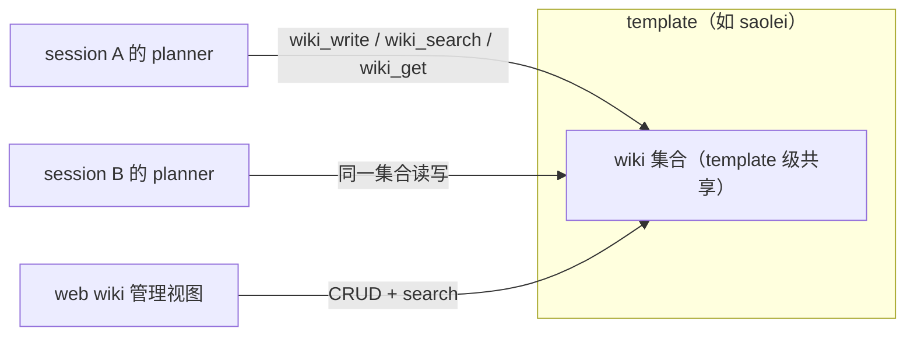

# Feature Specification: wiki 提升为 template 级知识库、memory 单条长度上限与 web wiki 管理

**Feature Branch**: `069-wiki-template-web`

**Created**: 2026-09-20

**Status**: Draft

**Input**: User description: "对 @specs/068-wiki-round-pause/plan.md 进行一些修补 1. 将 wiki 的层架从 template/session 提升到 template 下 2. 为每条 memory 长度增加限制，避免过长。 3. 在web 上增加对于 wiki 的 CURD + search 功能"

**修订基线**: specs/068-wiki-round-pause/spec.md（已全部交付）。068 将 wiki 定为 (template, session) 作用域并落地了 WikiService 与三个 wiki 工具；本特性以增量修订方式调整作用域并扩展消费面（仓库先例：060 对 059、065 对 059 的契约增量修订）。

## Clarifications

### Session 2026-09-20

- Q: 每条 memory 的 content 长度上限取多少？ → A: **1024 rune**——按 Unicode 字符计（与 wiki title 的 128 rune 度量口径一致，对中英文公平）；快照 10 条上限约 10K 字符，上下文成本可控，对要点式记忆余量充足。
- Q: 既有 (template, session) 作用域的存量 wiki 数据如何处置？ → A: **丢弃（clean break）**——不写迁移代码，作用域切换后旧数据弃用（存储按新作用域重建索引/唯一约束）；符合仓库 clean break 惯例（068 刚交付、无长期沉淀的生产数据）。
- Q: web wiki 视图无搜索关键词时浏览列表如何排序？ → A: **保持服务端 List 既有语义**——固定 id 升序（哈希序），不为本特性增加 order_by/title 浏览序（`survey/game-wiki-knowledge-base.md` §5 决策 D8 不变）；发现路径以搜索为主。
- Q: memory 长度上限是否在模型面指引文本中预先说明？ → A: **指引预先说明**——memory 相关指引 section 增加单条长度上限说明（约数表述）并将长内容引导至 wiki；超限文本结果反馈（FR-009）保留作为兜底。

## User Scenarios & Testing *(mandatory)*

### User Story 1 - wiki 作用域提升为 template 级，跨 session 共享知识 (Priority: P1)

planner 沉淀的 wiki 知识（局面模式、策略推导、长篇经验总结）本质上是跨局、跨会话的资产。当前 wiki 按 (template, session) 作用域隔离——同一 template 的每个 session 各持一套 wiki，换一个 session 知识就"失忆"。将 wiki 挂载点从 session 之下提升到 template 之下：同一 template 的所有 session 共享同一套 wiki 集合。服务端 WikiService 六个 RPC（Create/Get/Update/Delete/List/Search）与工具面三个工具（`wiki_search`/`wiki_get`/`wiki_write`）的行为语义保持 `specs/068-wiki-round-pause/contracts/wiki-service.md` 契约不变，仅资源作用域（parent/name 形态、唯一性范围）随之变更。

**Why this priority**: 作用域是 wiki 资源模型与存储索引的根基，服务端寻址、唯一性、工具面与 web 管理视图全部依赖它先定形；它是其余两个用户故事的结构基座。

**Independent Test**: 服务端可独立交付并经 gateway HTTP 验证（template 级路由的 CRUD/List/Search 契约与跨 session 可见性）；工具面在其后同步改造并以单测验证。

**Acceptance Scenarios**:

1. **Given** session A 的 planner 以 title T 写入 wiki 条目，**When** 同 template 新开的 session B 中 planner 执行 `wiki_search`/`wiki_get` T，**Then** 命中并取回完整 content（跨 session 可见）。
2. **Given** wiki 资源的寻址（服务端 RPC 的 parent/name、工具面底层请求），**Then** 全部为 template 级形态，wiki 资源名中不再含 session 段。
3. **Given** 同 template 的两个 session 先后 `wiki_write` 同名（规范化后相同）title，**Then** 后写整体覆盖先写（upsert 语义随作用域自然跨 session 生效）。
4. **Given** title 规范化后与 template 作用域内任一既有条目重复（无论该条目源自哪个 session），**When** 服务端 Create 或 Update 改 title，**Then** 请求被拒绝并返回"已存在"类错误。
5. **Given** `specs/068-wiki-round-pause/spec.md` 已交付的校验、检索、排序与分页语义，**Then** 除作用域外全部保持不变（零回归口径见 SC-004）。

---

### User Story 2 - web 端 wiki 管理：查看、搜索、创建、编辑、删除 (Priority: P1)

用户（人类）目前完全看不到 planner 在 wiki 里沉淀了什么，也无法干预错误或过时的知识。web 前端增加 wiki 管理视图（与既有 sessions/presets 视图并列）：按 title 关键词搜索（子串、大小写/全半角不敏感——与服务端检索语义一致）、分页列表浏览、创建新条目（title + content）、编辑既有条目（title/content）、删除条目。所有请求经同源 gateway REST 相对路径访问（零 CORS，沿用现有前端 API 客户端模式）。

**Why this priority**: wiki 的价值依赖内容质量；人类可检视、可纠错、可清理是知识库长期可信的运营闭环。依赖 US1 的 template 级作用域（管理面按 template 组织，而非逐 session 翻找）。

**Independent Test**: 前端组件测试（vitest）+ API 客户端 fetch mock 测试可独立验证 UI；网页视图无浏览器执行面（不做 testplan 大型测试），管理闭环的 REST 面（创建 → 搜索 → 编辑 → 删除）由 `projects/game/testplan/wiki_test.go` 的 HTTP 用例覆盖（裁断见 plan.md 门禁 5 与 research.md R8）。

**Acceptance Scenarios**:

1. **Given** web 打开 wiki 视图，**When** 输入关键词搜索，**Then** 展示命中条目的标题列表（子串、大小写/全半角不敏感，与服务端语义一致），并可查看条目完整 content。
2. **When** 以 title + content 创建条目，**Then** 创建成功后条目出现在列表/搜索结果中；title 与既有条目规范化重复时，界面呈现"已存在"类错误提示，不静默失败。
3. **When** 编辑条目的 title/content 并保存，**Then** 保存后列表与详情反映新值；title 改为与其他条目重复时被拒绝并提示。
4. **When** 删除条目（经确认步骤），**Then** 条目从列表消失，后续检索不再命中。
5. **Given** 超限输入（title > 128 rune 或 content > 64KB）或非法参数提交被服务端拒绝，**Then** 界面呈现可理解的参数错误说明。

---

### User Story 3 - memory 单条长度上限，防止上下文膨胀 (Priority: P2)

memory 是常驻系统提示的工作记忆：快照注入最近更新的 10 条，写操作作用于全量存储。单条 memory 过长会直接、持续地膨胀每一轮对话的系统提示，挤占有效上下文。为每条 memory 的 content 增加长度上限：超限的写入被拒绝并返回参数错误；memory 工具面以文本结果反馈上限说明，并引导模型改用 wiki 沉淀长内容（wiki 才是为大块知识准备的存储）。

**Why this priority**: 防御性约束，防止行为退化而非开启新能力；实现面小、独立于两个 P1，可并行交付。

**Independent Test**: 服务端单测（上限校验与错误映射）+ 工具面单测（超限文本结果的内容断言），不依赖其他用户故事。

**Acceptance Scenarios**:

1. **Given** content 长度超过上限，**When** 服务端写入（创建/更新/替换），**Then** 请求被拒绝并返回参数错误（说明超限）。
2. **Given** 模型经 memory 工具提交超长 content，**Then** 返回 `memory: …` 风格的领域文本结果（与既有 `memory: content cannot be empty` 同族，非抛出的工具错误），包含长度上限说明并建议改用 wiki 工具；对话不中断（`memory failed: …` 前缀专属于基建失败，不用于本场景）。
3. **Given** 批量操作中任一条目超限，**Then** 全批不写入（批量原子性保持）。
4. **Given** 长度合法的写入与既有条目的读取/快照注入，**Then** 行为不变（top-10 快照机制不变；上限不追溯既有数据）。
5. **Given** 更新后的 memory 指引 section，**When** 做文本检查，**Then** 包含单条长度上限的预先说明，并将长内容引导至 wiki 工具。

---

### Edge Cases

- **跨 session 同名覆盖**：upsert 语义随作用域跨 session 生效——后写覆盖先写是预期行为（知识更新视角）；无版本化/冲突检测（服务端 Update 无乐观锁，与 `specs/068-wiki-round-pause/contracts/wiki-service.md` 交付面一致）。
- **web 并发编辑**：多标签页同时编辑同一 entry 时最后写入胜出；不引入乐观锁。
- **web 删除与 planner 写入并发**：删除后 planner 以同名 title upsert 会走创建路径重建条目（语义自然闭合）。
- **存量数据**：旧 (template, session) 作用域条目按 FR-004 的 clean break 弃用，不做迁移（裁定见 Clarifications 2026-09-20）。
- **memory 上限的度量**：按字符（rune）计，对中英文一致；`old_text`（替换/删除的定位子串）不设独立上限——其长度天然受既有条目内容约束。
- **短查询与续页**：wiki search 单字符查询与续页 token 一致性校验语义不变（`specs/068-wiki-round-pause/contracts/wiki-service.md` §4 既有）。
- **web 空搜索/空列表**：无关键词时呈现分页全量列表（List 语义，服务端固定 id 升序——哈希序，不引入 title 浏览序；发现以搜索为主，见 Clarifications），无结果时呈现空态而非错误。

## Requirements *(mandatory)*

### Functional Requirements

**wiki template 级作用域（修订 `specs/068-wiki-round-pause/spec.md` FR-001/FR-002 的作用域面）**

- **FR-001**: wiki 资源 MUST 挂载于 template 之下（template 级资源形态），同一 template 的全部 session 共享同一 wiki 集合；WikiService 六个 RPC 的行为语义（字段校验、title/content 上限、检索匹配与排序、分页、错误映射）MUST 保持 `specs/068-wiki-round-pause/contracts/wiki-service.md` 契约不变，仅 parent/name 的作用域层级变更。
- **FR-002**: 规范化 title（Unicode 规范化 + 大小写折叠）的唯一性 MUST 在 template 作用域内强制；跨 session 的规范化同名冲突同样构成"已存在"类错误（工具面 `wiki_write` 的同名 upsert 经 Update 路径实现，不触发 Create 的重复拒绝）。
- **FR-003**: 三个 wiki 工具（`wiki_search`/`wiki_get`/`wiki_write`）的模型面行为 MUST 不变（title 寻址、按规范化 title 的 upsert、批量原子、领域结果与失败均为文本结果、不暴露内部资源 id、仅随 planner preset 挂载），其底层作用域 MUST 变更为 template 级——planner 在任一 session 写入的知识对同 template 的所有 session 可见。
- **FR-004**: 既有 (template, session) 作用域的存量 wiki 数据 MUST 以 clean break 方式处置：不提供迁移，作用域切换后旧作用域数据弃用，存储按 template 作用域重建唯一性约束与索引（2026-09-20 用户裁定）。

**web wiki 管理**

- **FR-005**: web MUST 提供 wiki 管理视图（与既有 sessions/presets 视图并列切换），按 template 作用域组织条目。
- **FR-006**: web wiki 视图 MUST 支持完整管理闭环：按 title 关键词搜索（子串、大小写/全半角不敏感，语义与服务端检索一致）、分页列表、查看条目详情（完整 content）、创建（title + content）、编辑（title/content）、删除。
- **FR-007**: web 的全部 wiki 请求 MUST 经同源网关 REST 以相对路径访问（零 CORS，沿用现有前端 API 客户端模式）；操作失败（已存在/未找到/参数超限等）MUST 将服务端返回的错误信息呈现为用户可见的提示，MUST NOT 静默失败。

**memory 单条长度上限**

- **FR-008**: 每条 memory 的 content MUST 强制长度上限 1024 rune（2026-09-20 用户裁定）；超限的写入（创建/更新/替换）MUST 被拒绝并返回参数错误。
- **FR-009**: memory 工具面对超限写入 MUST 返回领域文本结果（`memory: …` 前缀，与既有空 content 领域文本同族；不中断对话、MUST NOT 作为工具错误抛出——`memory failed: …` 保留给基建失败），结果 MUST 包含上限数值说明，并引导改用 wiki 工具沉淀长内容。
- **FR-010**: 长度上限 MUST 仅约束写入路径：既有条目的读取、快照注入（top-10）与删除不受追溯影响；批量操作保持原子（任一条目超限则全批不写）。
- **FR-011**: memory 相关指引 section MUST 预先说明单条长度上限（约数表述即可）并将长内容引导至 wiki 工具（修订 `specs/068-wiki-round-pause/spec.md` FR-013 的指引面）；该说明 MUST 以英文撰写（与既有模型面工具文本一致）。

### Key Entities

- **Wiki 条目（template 作用域）**: title（模型侧唯一地址，规范化后在 template 作用域内唯一）、content（大块知识正文）、创建/更新时间、所属 template、服务端条目标识（由资源 name 末段承载，模型不可见）。
- **Memory 条目（含新约束）**: content（新增长度上限属性—— rune 计的上界）、创建/更新时间、作用域 (template, session) 不变。
- **web wiki 管理视图**: 按 template 组织的 wiki 消费面——搜索框、分页列表、条目详情（完整 content）、创建/编辑表单、删除确认。

## Success Criteria *(mandatory)*

### Measurable Outcomes

- **SC-001**: 跨 session 知识共享闭环——session A 写入的条目在新 session B 检索取回，相关测试用例 100% 通过（含 testplan 大型测试）。
- **SC-002**: web wiki 管理闭环（创建 → 搜索 → 编辑 → 删除）在前端组件测试（UI 逻辑）与 REST 大型测试（HTTP 面，`wiki_test.go`）中 100% 通过；错误场景（重名、超限）均有可见提示。
- **SC-003**: 超限 memory 写入 100% 被拒绝，且模型收到含上限说明与 wiki 引导的文本结果；memory 指引 section 预先说明上限并引导长内容走 wiki；合法长度写入与既有 memory 语义零回归（既有单测与大型测试全部通过）。
- **SC-004**: 既有 wiki 行为零回归：三个工具语义、检索匹配/排序、分页与唯一性约束在作用域变更后全部保持（既有单测修订后与大型测试全部通过）。

## Assumptions

- web wiki 视图固定面向 saolei template：template 是封闭集合且当前仅 saolei 一个（`projects/game/pkg/gameconst/const.go` 的 knownTemplateIDs），对齐 web 既有视图的固定 template 做法；template 切换器留待模板集合实际扩展时再做。
- memory 长度上限按 rune（Unicode 字符）计，与 wiki title 上限（128 rune）的度量口径一致，对中英文公平；wiki 的 title/content 上限（128 rune / 64KB）不变。
- 超限时面向模型的文本以 "characters" 表述（模型可读性），但校验与上限度量一律以 rune 为准（FR-008）。
- wiki_id 生成规则（sha256(title_norm)[:32]）、服务端 List/Search 的分页与排序语义不变，仅作用域变更。
- web UI 沿用现有前端技术体系与组件库、桌面浏览器形态，不做移动端适配。
- memory 快照 top-10 注入机制不变；上限只影响写入路径。
- `specs/068-wiki-round-pause/spec.md` 交付的 saolei-loop 自然停与本特性无关，不受影响。
