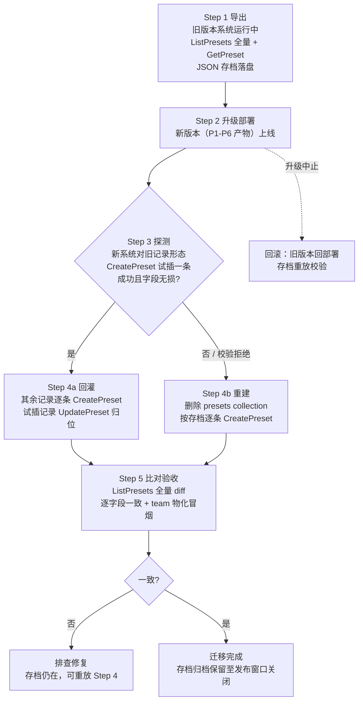

# Runbook Contract: Mongo preset 旧数据一次性迁移（最后 phase 执行）

**Feature**: specs/070-dsh-upgrade/spec.md（FR-012、US3 场景 6）
**Research**: specs/070-dsh-upgrade/research.md（D11）
**前置**: P1–P6 全部完成并通过验收（编译/单测/四拓扑 system_test/demo interface_test 实际执行全绿）——**迁移是 P7，最后一项**。

## 1. 范围与不变式

| 项 | 值 |
|---|---|
| 迁移对象 | Mongo `game_agent_v2.presets` collection（`PresetRecord`：id/template/role/persona/displayName/createTime/updateTime） |
| 记录 schema | **不变**（`specs/070-dsh-upgrade/data-model.md` §3.4 冻结）；迁移语义 = `template` 值对齐声明式模板 id、persona `prefix` 物化可用，非字段形态转换 |
| 不迁移 | 会话（无持久化）；planner memory / wiki 数据（与 dsh 版本无关） |
| 契约 | 迁移只经 **PresetService API**（`projects/game/agent_v2.proto`：ListPresets/GetPreset/CreatePreset/UpdatePreset），不直连 Mongo 改写 |
| 不变式 | 迁移后 ListPresets 全量与迁移前导出比对：id/template/role/persona/displayName 逐字段一致 |

## 2. 流程

**Step 1（导出）**：在**旧版本**系统上执行（升级前）；导出含全角色/模板；存档文件带时间戳落盘（`/tmp` 或部署机安全位置），校验和记录。

**Step 3（探测）**：新系统上线后，取一条导出记录 `CreatePreset`——成功且 `GetPreset` 字段无损 → 走 4a 覆盖回灌（`UpdatePreset` 归位试插记录）；失败（服务端校验拒绝旧形态）→ 走 4b（**先删后建**：删 collection，再按存档逐条 `CreatePreset`）。

**Step 5（比对）**：`ListPresets`（全角色）逐字段 diff 存档；冒烟：team 会话物化一个 player、一个 planner preset（走 `meta.agentPreset` 路径）确认 roster 可解析。

## 3. 失败与回滚

- Step 4 任一条失败：中止重放（4b 路径 collection 已重建为幂等目标；4a 路径按 id 幂等跳过已存在）。
- 升级部署本身中止（P7 之前或期间）：回滚旧版本 + 用存档校验数据未损（旧记录仍在或可重放）。
- 存档保留至升级发布窗口关闭后方可清理。

## 4. 验收

1. Step 5 比对全量一致（0 diff）。
2. team 物化冒烟通过（player/planner 各一）。
3. 执行证据（命令、输出摘要、存档校验和）记录于 PR 描述（宪法 VI 执行闭环）。
