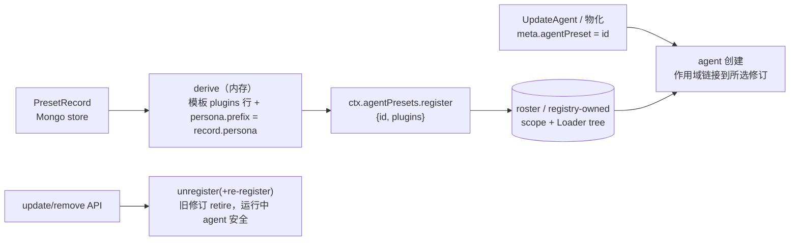
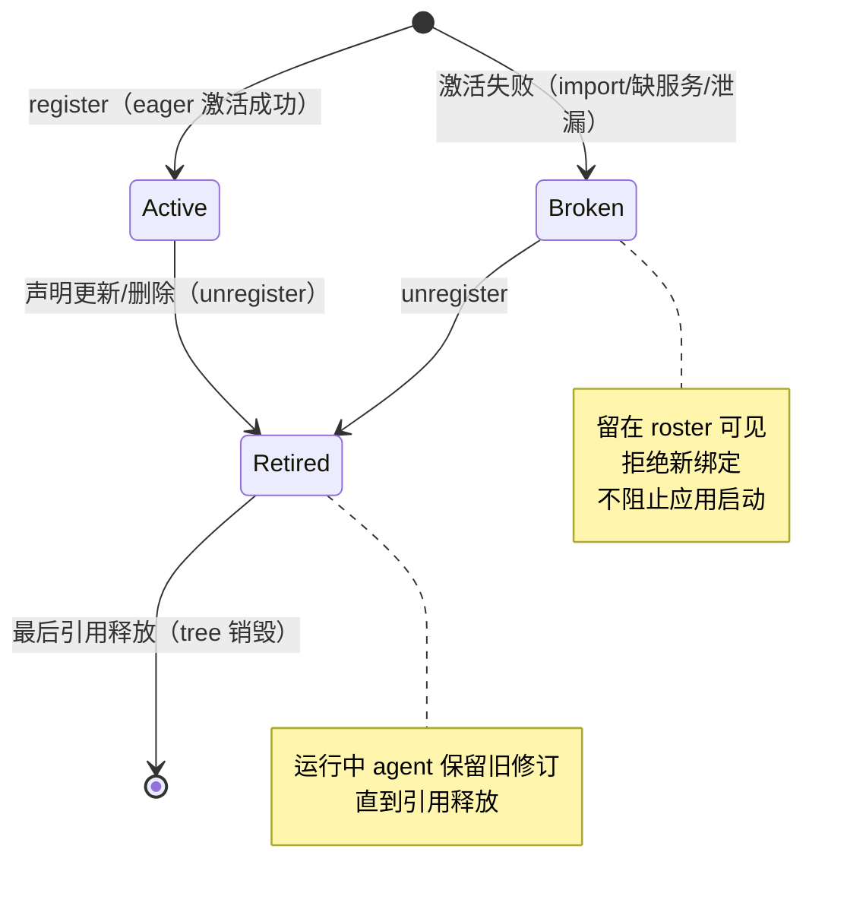

# Data Model: dsh 升级到 0.1.7 线 + preset 模型重构

**Feature**: specs/070-dsh-upgrade/spec.md
**Research**: specs/070-dsh-upgrade/research.md（D1–D14）

本特性为依赖升级 + preset 模型迁移，无新业务数据实体；数据模型变更集中在 **dsh 版本线实体、声明面实体、preset 模型实体** 三类。

---

## 1. dsh 版本线（version line）

### 1.1 版本线实体

| 属性 | 值（0.1.7-rc.2 线） |
|---|---|
| dsh 家族版本 | `0.1.7-rc.2`（lockstep 精确 pin，全仓库唯一） |
| cordis 互锁 | `~4.0.4`（解析必须落 4.0.4） |
| loader / include / group / timer | `1.0.5` / `1.0.9` / `1.0.4` / `1.1.6` |
| node-addon-require-builtin | `0.1.6`（`linux-x64-gnu` optionalDep 必在场） |
| schemastery | `^3.18.4` |
| 不变式 | 同一包名在 lockfile/产物中只允许一个版本（closure audit ③）；`@deepseek-ai/dsh-agent-presets` 不允许出现（SC-001） |

### 1.2 声明面（declaration surface）实体

三面一致（同一集合的三个投影）：

| 声明面 | 位置 | 校验 |
|---|---|---|
| catalog | `pnpm-workspace.yaml` `catalog:` | lockfile 解析同线 |
| package.json | `third_party/dsh/core/package.json`（核心 11 包）、`projects/game/agent_v2/package.json`、`experimental/dsh/demo/agent/package.json`、各 `common/js/dsh-plugins/*/package.json` | closure audit ② 声明闭包 |
| BUILD 枚举 | 对应 `BUILD.bazel` 的 `npm_deps` / ts_project deps / vitest data | closure audit ①②、构建 |

**核心 11 包清单（不变）**：app-boot、cordis、cordis-plugin-loader/include/group/timer、dsh-home-paths、dsh-invariants、dsh-system-prompt、dsh-launch-environment、node-addon-require-builtin。

### 1.3 随行新包（agent_v2 侧，全部 `0.1.7-rc.2`）

- **成行**：`dsh-session-projection`、`dsh-agent-preset-registry`
- **仅安装级**：`dsh-settings`、`dsh-typert-protocol`、`dsh-util-values`、`dsh-brand`、`dsh-session-persistence`、`dsh-sandbox`、`dsh-sandbox-policy`、`dsh-ptc-runtime`、`dsh-user-approval`
- **移除**：`dsh-agent-presets`、`dsh-agent-preset`（2026-09-28 用户裁定，模板经 preset-authoring `templates` 快照表达——research.md D4 终态结论）
- demo 侧另含 llm-deepseek peer 面（`dsh-fs`、`dsh-credentials`、`dsh-attachment`、`dsh-anonymous-user-id`、`dsh-deepseek-llm-api-extensions`、`dsh-settings`、`dsh-timeout`）

---

## 2. 组合清单（composition manifest）

### 2.1 agent_v2 行集合（目标态）

`projects/game/agent_v2/cordis.yml` 行（顺序按依赖分层；行集合 = 现清单 − `agent-presets` + 2 个新行）：

| id | name | 变化 |
|---|---|---|
| timer / llm / session / tools / agents / agent-loop / invariants / invariant-session / invariant-agent / invariant-scope / llm-retry | （不变） | 包版本升级，行不变 |
| system-prompt | `@deepseek-ai/dsh-system-prompt` | config 不变（`includeHarnessIdentity/includeRuntimeContext: false`） |
| **session-projection** | `@deepseek-ai/dsh-session-projection` | **新增行**（agent-loop/registry 服务注入要求） |
| **agent-preset-registry** | `@deepseek-ai/dsh-agent-preset-registry` | **新增行**，config `default: ''`（fail-loud，research D5） |
| llm-glm / llm-opencode-go / desktop-bridge / preset-authoring / team / memory / saolei-loop | `@dominion/*` | 行不变（preset-authoring 内部重构，其 Config 携池模板快照） |

**池模板**：player/planner 定义在 `preset-authoring` 行 Config 的 `templates` 快照（键 = 模板 id，值 = `{ name, description, plugins }`：persona `prefix` + 角色专属工具行）与 `templateRules`（required/forbidden）；模板不经行面表达（2026-09-28 用户裁定，research.md D4 终态结论）。

**移除数据面**：`preset-templates/` 目录、`PRESET_TEMPLATES_ROOT` env（research D4）。

### 2.2 persona 行形态迁移

| | 0.1.1（旧） | 0.1.7（新） |
|---|---|---|
| persona 行 config | `text: <文案>` | `prefix: <文案>`（+ 可选 `suffix`/`complete`，模板不用） |
| 渲染 section | `deployment:persona` | `deployment:persona-prefix` / `-suffix` |

---

## 3. preset 模型实体

### 3.1 实体对照

| 旧（dsh-agent-presets 0.1.1） | 新（registry + `templates` 快照） |
|---|---|
| Roster roots：`{path, trust}` 目录扫描 | 宿主组合清单 `preset-authoring` 行 Config 的 `templates` 快照（部署所有权 = 系统信任） |
| `Config { default, includeUserRoot, roots }` | `Config { default, selectedDefault? }`；无目录概念 |
| `mountPreset(dir)` → `AgentPreset {trust}` | `ctx.agentPresets.register({id, plugins})` → disposer |
| preset 身份 = 目录内 `preset.yml` | 模板身份 = `templates` 快照键；用户 preset 身份 = store id |
| 用户 preset = `<dshHome>/.agent-presets` 可写副本 | 用户 preset = preset-authoring 从 store 记录物化（经 `ctx.agentPresets.register`） |
| 选择解析失败 | `RemoteError('agent-preset/not-found')` fail-loud |

### 3.2 PresetDefinition（新，物化输入）

| 字段 | 类型 | 约束 |
|---|---|---|
| `id` | string | 非空、roster 内唯一；空 id register 抛错 |
| `plugins` | entry list（include 方言行） | 行集合即子插件清单；激活审计（import/缺服务/泄漏）失败 → 留 roster 拒新绑定，不阻止启动 |
| `name` / `description` / `order` | 可选 | 展示元数据（roster 排序） |

### 3.3 registry 运行时状态（不持久化）

- 修订（generation）：声明更新 → 旧修订 retire；运行中 agent/冷读持有引用至释放；最后引用释放时销毁。
- `selectedDefault`（volatile）：无名新会话解析目标；本服务不使用（显式必选语义）。
- 会话事件：`agent-preset/selected` 投影入 session projection（会话无持久化 → 仅进程内）。

### 3.4 PresetRecord（preset-authoring store，**冻结**）

| 字段 | 类型 | 约束（不变） |
|---|---|---|
| `id` | string | store 内唯一（`ALREADY_EXISTS`） |
| `template` | `'player' \| 'planner'` | 必须是声明的模板 id |
| `role?` | string | 角色池记录 |
| `persona` | string | 派生时写入 persona 子行 `prefix` |
| `displayName?` / `createTime` / `updateTime` | — | — |

存储：Mongo `game_agent_v2.presets`（`PresetStore` seam：create/get/list/update/remove）。

### 3.5 物化数据流（用户 preset）

**templateRules 校验**（不变）：create 时按 `templateRules[template].{required, forbidden}` 校验派生行集合（player 必含 `@dominion/dsh-saolei` 禁 `@dominion/dsh-memory`；planner 反之）→ 失败 `INVALID_ARGUMENT`，不落产物；校验输入为宿主注入的 `templates` 快照。

---

## 4. 迁移数据（一次性，最后 phase）

| 项 | 值 |
|---|---|
| 范围 | 仅 `game_agent_v2.presets` collection |
| 记录 schema | **不变**（§3.4 冻结）；迁移语义 = `template` 值对齐声明式模板 id、persona 子行 `prefix` 物化可用，非字段形态转换 |
| 导出面 | PresetService API（ListPresets/GetPreset），JSON 存档 |
| 回灌面 | CreatePreset（UpdatePreset 旧形态被校验拒绝时：删 collection 后重建） |
| 验收 | ListPresets 全量比对：id/template/role/persona/displayName 一致 |
| 不迁移 | 会话（无持久化）、planner memory/wiki（与 dsh 版本无关） |
| 回滚 | 升级中止 → 旧版本 + 存档文件重放 |

流程图见 `specs/070-dsh-upgrade/contracts/mongo-preset-migration.md`。

---

## 5. 状态转移（preset 定义生命周期，新模型）

**验证规则**（来源 FR-008/US3）：
1. 未知 preset id 绑定 → `agent-preset/not-found`（fail-loud，SC-005）。
2. 模板定义 = 宿主注入的 `templates` 快照 → 用户面无写删路径（系统信任）。
3. 用户 preset 全部经 preset-authoring CRUD → register（无第二事实源）。
4. `dsh.test.ts` 断言 21 行行集合与 registry 行 `default: ''`（D5 终态结论：`''` 通过 schema，无 sentinel 回退）。
