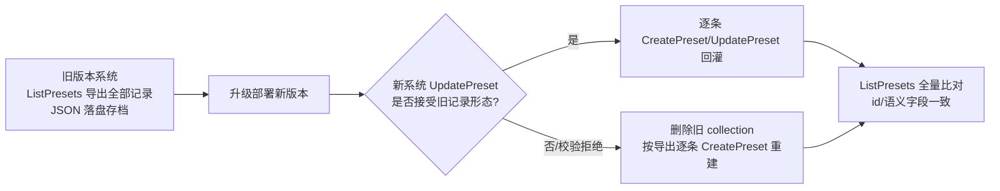

# Research: dsh 升级到 0.1.7 线（core 底座 + agent_v2 官方插件 + preset 模型重构）

**Feature**: specs/070-dsh-upgrade/spec.md
**Date**: 2026-09-27
**方法**: registry 实测（npm registry metadata + unpkg tarball 类型面）+ 上游源码仓库（https://github.com/deepseek-ai/deepseek-harness ，master = 0.1.7 线）逐符号 diff；仓库消费面清单由全仓扫描产出（`projects/game/agent_v2/src`、`common/js/dsh-plugins/*`、`experimental/dsh/demo/agent`、`projects/game/web/frontend`）。

---

## D1 — 目标版本线与互锁矩阵（锁定 0.1.7-rc.2）

**Decision**: 全仓库 dsh 闭包统一升级到 `0.1.7-rc.2` 线（registry `next` tag，2026-09-27 实测）；cordis 家族与互锁包取线内精确值：

| 包 | 现值 | 新值（0.1.7 线内） | 依据 |
|---|---|---|---|
| `@deepseek-ai/dsh-*`（全家) | `0.1.1-rc.2` | `0.1.7-rc.2` | lockstep 发布线 |
| `@deepseek-ai/cordis` | `^4.0.1`（解析 4.0.1） | `~4.0.4`（catalog 解析锁 4.0.4） | dsh-app-boot/agent/loop 等 peer `~4.0.4` |
| `@deepseek-ai/cordis-plugin-loader` | `1.0.2` | `1.0.5` | peer `~1.0.5` |
| `@deepseek-ai/cordis-plugin-include` | `1.0.6` | `1.0.9` | peer `~1.0.9` |
| `@deepseek-ai/cordis-plugin-group` | `1.0.1` | `1.0.4` | peer `~1.0.4` |
| `@deepseek-ai/cordis-plugin-timer` | `1.1.3` | `1.1.6` | timer 1.1.6 peer `~4.0.4`（线内最新） |
| `node-addon-require-builtin` | `0.1.5` | `0.1.6` | loader 1.0.5 peer `^0.1.6` |
| `@deepseek-ai/schemastery` | `^3.18.1` | `^3.18.4` | dsh-agent-preset-registry dep `~3.18.4` |
| `@deepseek-ai/dsh-client-ui-primitives` | `0.1.1-rc.2` | `0.1.7-rc.2` | 同线发布 |

**Rationale**: 0.1.7-rc.2 线 peer 用 tilde 互锁（`~4.0.4` 等）；catalog 解析必须落在线内值，否则可能物化两份 cordis（DI 双实例故障）。dsh 家族保持精确 pin（"闭包整体一个版本单元"，先例 `specs/049-agent-v2-dsh-init/spec.md`）。

**Alternatives considered**: `0.1.5-rc.3`（含旧 presets 的最高同线版本）——用户已决策走 0.1.7 并重构 preset（spec 澄清记录）；`0.1.6-alpha.2` alpha 线质量风险。

---

## D2 — preset 模型重构：旧包移除，新包（registry + 声明）接入

**Decision**: `@deepseek-ai/dsh-agent-presets`（最高 0.1.5-rc.3，peer 与 0.1.7 线互斥）从全部声明面移除；接入：

- **`@deepseek-ai/dsh-agent-preset-registry`**（行 `agent-preset-registry`）：`Config = { default: string (required), selectedDefault?: string (volatile) }`；`static inject = ['loader', 'sessionProjections']`（settings 为运行时可选注入）；服务 `ctx.agentPresets`。
- **`@deepseek-ai/dsh-agent-preset`**（每 preset 一行）：`Config = { id (required), plugins (required, 子插件 entry list), name?, description?, order? }`；行 `id` 供 Loader 编辑寻址，`config.id` 是会话持久保存的 preset 身份；重复 id 使声明加载失败。

关键 API（上游源码实测 `packages/preset/agent-preset-registry/src/index.ts`）：

- `ctx.agentPresets.register(definition: PresetDefinition): Promise<() => Promise<void>>` — **程序化注册面**：注册即 eager 激活（激活失败留在 roster、拒绝新绑定、不阻止启动），返回声明方持有的 disposer；重注册同 id 报 Duplicate。
- `@Remote('list' | 'read' | 'select')` — roster 列表 / 子清单回渲 YAML / 会话选择绑定；未知 id → `RemoteError('agent-preset/not-found')`；会话已启动 → `'agent-preset/locked'`。
- `serviceFor(agent, name)` — 读取 Agent 隔离 preset group 内的服务（工具可见性隔离的支撑面）。
- 修订保留：更新/删除声明只 retire 旧修订；运行中 Agent 与临时读持有引用直至释放。

**Rationale**: 上游以声明式模型取代目录式（roots/trust/includeUserRoot 全部消失）；`register()` 程序化面正好承载"Mongo 事实源 → 物化为声明"的澄清决策，无需走 profile user-patch/plugin_manager 路径（那是 Web/Creator 面的路径）。

**Alternatives considered**: profile bundle patch + `plugin_manager`（上游 Web 面动态 preset 路径）——绕远且引入 profile 存储面；保留目录模型——0.1.7 线无此能力。

**Sources**: https://github.com/deepseek-ai/deepseek-harness/blob/master/.agents/notes/implemented/architecture/2026-09-18-declarative-agent-presets.md ；https://github.com/deepseek-ai/deepseek-harness/tree/master/packages/preset ；registry src（上述路径）。

---

## D3 — preset-authoring 重构映射（服务面冻结，物化走 register）

**Decision**: `common/js/dsh-plugins/preset-authoring` 保持服务面契约不变（`PresetAuthoringService`: compose/create/get/list/update/remove；`inject = ["agentPresets"]`——新旧 registry 同服务键，连续性成立），内部重构：

- `derive.ts` 的"模板行 + persona 替换 → 临时目录 → `mountPreset`"链路改为纯内存构造：模板声明行（persona prefix = 记录 persona）→ `ctx.agentPresets.register({ id, plugins })`；`update` = unregister + re-register（registry 的 revision retirement 天然保证运行中 agent 不掉工具）；`remove` = unregister。
- store seam（`PresetStore`/`PresetRecord`/Mongo 实现）与 `templateRules` 校验（required/forbidden 插件行，INVALID_ARGUMENT fail-loud）保持不变。
- `ComposeResult.agentPreset` 语义不变：返回可传入 `CreateAgentOptions.meta.agentPreset` 的 preset id（消费方 `common/js/dsh-plugins/saolei-loop/src/orchestrator.ts:740` 与 demo session 不需改动）。

**Rationale**: 用户澄清决策"Mongo 唯一事实源 + 服务面契约不变"（spec Clarifications 2026-09-27）；registry 的 register/disposer 生命周期与 CRUD 语义一一对应。

**Alternatives considered**: 改走 profile user-patch 持久化——违反澄清决策；agent_v2 启动时全量物化 + CRUD 直接改声明——register 面本就支持按需物化，无需全量。

---

## D4 — 模板 preset 声明化（目录数据 → 组合清单行）

**Decision**: `projects/game/agent_v2/preset-templates/{player,planner}` 的模板从"镜像内数据目录 + `PRESET_TEMPLATES_ROOT` env + roots 扫描"改为**agent_v2 `cordis.yml` 内的 `@deepseek-ai/dsh-agent-preset` 声明行**（player/planner 各一行：persona prefix 子行 + `@dominion/dsh-saolei` / `@dominion/dsh-memory` 子行；`preset.yml` 的 name/description 并入行 config）。`preset-templates/` 目录与 `PRESET_TEMPLATES_ROOT` env 移除；templateRules 校验改读组合清单内声明的行集合（fs seam 删除）。宿主组合行 = 部署所有权 = 系统信任、不可被用户写删（对齐 US3 语义 1）。

**Rationale**: 新模型"定义即普通 Cordis 行"，宿主行天然系统信任；目录面被上游明确否决（"presets have no separate paths"）；同时消除镜像数据挂载与 env 装配（宪法原则 II 简化）。

**Alternatives considered**: 保留文件目录由引导代码读入后 register()——重新引入目录式双事实源，违背上游模型；模板行放独立 profile 文件——组合面分裂，无收益。

**终态结论（用户裁定，2026-09-28）— 模板声明行移除，templates 快照为唯一事实源**: 经用户裁定，agent_v2 与 demo 组合清单中的 `preset-*` 声明行（`@deepseek-ai/dsh-agent-preset` 行）整体移除：声明行与 preset-authoring `templates` 快照维护两份相同数据，成本高于收益（单测锁定的漂移防护不改变维护双份的事实）。模板定义单一事实源 = preset-authoring 的 `templates` 快照（经插件 Config 注入，宿主 cordis.yml 内）。`PresetDefinition` schema（id 必填）无法表达"id+name 纯声明行"（官方 schema 实测：`{ id(必填), name?, description?, order?, plugins(必填) }`，node_modules/@deepseek-ai/dsh-agent-preset-registry/lib/types/definition.d.ts），故选择整体移除而非保留元数据行。随裁定接受的代价与订正：
- registry roster 不再含模板条目（list/read Remote 面失去模板；现有消费方——agent_v2 PresetService、demo PresetService、web PresetsView——均为 store-only，零影响）。模板 id 与用户 preset id 的撞名保护由 create 的快照 hasOwnProperty 检查承担，不再依赖 roster 全局唯一；信任边界从 registry seam 移至 authoring seam（当前唯一 register 调用方）。
- 零存量记录的模板失去 boot 期子行 eager 激活校验（有记录模板经 boot list() → derive → register 仍激活子行）：子行损坏暴露时点从 boot 后移至首次 create/派生（服务面 INVALID_ARGUMENT fail-loud，无静默退化）——接受并记录。
- demo registry `default` 由 `demo-standard` 订正为 `''`：原值指向声明行的"默认回落"能力随声明行移除而不存在；服务面会话创建本就必须显式 store preset（compose 前置 INVALID_ARGUMENT），registry default 恒为惰性，空值即"无默认"的诚实表达。契约 §3"demo 允许默认回落"表述随之订正。
- D5 门禁锁定断言随本裁定重述（更强形态）：registry 行 config 恰为 `{ default: '' }` 且清单零 `@deepseek-ai/dsh-agent-preset` 行；roster 条目仅经 preset-authoring 物化进入（id 语法拒绝空串，preset-authoring 单测含空串 id 显式用例）。
- `@deepseek-ai/dsh-agent-preset` 包从全部声明面移除（agent_v2/demo package.json + BUILD、catalog 条目）；零源码 import，闭包内无 deps/peers 边可达（registry 仅 devDependencies 引用），closure audit ② expected set 数据驱动收缩、测试代码零改动。

---

## D5 — fail-loud 选择语义在新模型的表达（`default: ''`）

**Decision**: registry `Config.default` 虽为 required，但取空字符串 `''`：无名解析走 `''` → not-found `RemoteError` = fail-loud（与现 `projects/game/agent_v2/cordis.yml` agent-presets 行 `default: ''` 语义一致）；宿主代码路径全部显式传 `meta.agentPreset`。**实现门禁**：若 schemastery `z.string().required()` 在运行时拒绝空串（schema 层面语义需实测），回退方案为 sentinel id + 断言宿主全显式（并在 dsh.test.ts 加"无名解析必失败"用例锁定）。

**终态结论（实测，2026-09-27）**: **`''` 通过 registry Config schema，采用 `''`，不启用 sentinel 回退**。实测证据：以 `@deepseek-ai/dsh-agent-preset-registry@0.1.7-rc.2` 导出的 `AgentPresetRegistry.Config` 校验 `{ default: '' }` → 接受；`{ default: '__none__' }` 亦接受；`{}` 被拒（`ValidationError: $.default missing required value`）——即 `"defined"` 注解只要求键在场，空串是合法 `z.string()`。锁定断言：`projects/game/agent_v2/src/dsh.test.ts` 的 “keeps preset selection fail-loud: the registry default points at no preset”（registry 行 config 恰为 `{ default: '' }`，且无 `@deepseek-ai/dsh-agent-preset` 声明以 `config.id === ''`；空 id 解析不匹配任何声明 → `agent-preset/not-found`）。

**Rationale**: 保持"preset 选择必选、未知 id fail-loud"产品语义（US3 语义 4）；`selectedDefault` 为 volatile 用户默认（本服务不使用用户默认选择，不设置）。

**Alternatives considered**: default 指向 player 模板——静默回落，违反语义。

---

## D6 — 组合清单新行集合与声明面扩展（peer 义务矩阵）

**Decision**: 0.1.7 线 peer 义务实测（`peerDependenciesMeta` + 各包 `static inject`）：

**运行时必须成行**（服务注入要求）：
- `@deepseek-ai/dsh-session-projection`（提供 `ctx.sessionProjections`；dsh-agent-loop `static inject = [..., 'sessionProjections']`（`packages/core/agent-loop/src/index.ts:331`）、registry `inject = ['loader', 'sessionProjections']` 均要求）。

**仅安装级声明**（npm peer 非可选、无运行时服务注入，进 package.json/catalog + BUILD 闭包，不进行）：
- `@deepseek-ai/dsh-settings`（registry 运行时 `ctx.inject(['settings'])` 可选注入；本服务无用户设置面）
- `@deepseek-ai/dsh-typert-protocol`、`@deepseek-ai/dsh-util-values`、`@deepseek-ai/dsh-brand`（协议/类型基元）
- `@deepseek-ai/dsh-session-persistence`（agent-loop peer；未用 resume 持久化，且会话无持久化）
- `@deepseek-ai/dsh-sandbox`、`@deepseek-ai/dsh-sandbox-policy`、`@deepseek-ai/dsh-ptc-runtime`、`@deepseek-ai/dsh-user-approval`（dsh-tools peer；`static inject = ['systemPrompt']`（`packages/core/tools/src/index.ts:808`）不含这些，运行时按需惰性注入，本服务不启用 sandbox/审批面）
- `@deepseek-ai/dsh-workspace`（dsh-agent **optional** peer，不采用）

**声明面变更清单**：
- `projects/game/agent_v2/package.json` + `BUILD.bazel`（npm_deps）增：session-projection、settings、typert-protocol、util-values、brand、session-persistence、sandbox、sandbox-policy、ptc-runtime、user-approval、agent-preset-registry、agent-preset；删：agent-presets。
- `experimental/dsh/demo/agent` 同类扩展（另含 llm-deepseek 0.1.7 的 peer 面：dsh-fs、dsh-credentials、dsh-attachment、dsh-anonymous-user-id、dsh-deepseek-llm-api-extensions、dsh-settings、dsh-timeout 等）。
- catalog 增上述新包条目（全 `0.1.7-rc.2`）。
- cordis.yml 增行：`session-projection`、`agent-preset-registry`、模板 `agent-preset` 声明行（×2，agent_v2；demo 同构）。

**Rationale**: 行=服务注入需求，安装=peer 满足；closure audit ②按 deps∪peers∪optionalPeers 边展开（`experimental/dsh/demo/testplan/closure_audit_test.go:160-216`），显式声明保持"每个随行包可追溯"（FR-005）；"无 persistence/settings 行"断言随组合变化更新为准确断言（settings 行确不进行、persistence 行不进行——断言改为精确行集合）。

**Alternatives considered**: 全部新 peer 都成行——引入未使用的服务面，违反原则 II 最小化；依赖 pnpm autoInstallPeers 隐式满足——声明面不可追溯，audit 失败。

---

## D7 — agent_v2 源 API 适配面（逐符号验证结论：极薄）

**Decision**: 仓库消费的全部 dsh 符号在 0.1.7-rc.2 **全部存活**（实测清单）：

| 包 | 消费符号（全仓） | 0.1.7 状态 |
|---|---|---|
| dsh-app-boot | `boot` | ✅ 签名不变（`boot(binName, absoluteConfigPath, patches?, prepare?, bareModuleBaseUrl?)`）；`assertEntries*` 导出被 `auditStartupEntries`/`StartupError` 取代（仓库未用）；新增运行时 dep：dsh-atomic-write、dsh-package-manifest、resolve.exports（传递闭包） |
| dsh-agent | `Agent`、`AgentHandle`、`AgentStatus`、`CreateAgentOptions`、`assembleContextFor` | ✅ 全存活；`meta` 形状微调：`seedLength` → `isSeeded` + 顶层 `inheritedEventCount`（仓库未用 seedLength；`session.test.ts:469` 与 `orchestrator.ts:740` 用的 `meta.{cwd, agentPreset}`、`agentOptions.{provider,model}`、`setup` 均为 0.1.7 形状） |
| dsh-llm | `createUserMessage/LlmError/UserMessage/LlmModelInfo`（agent_v2）；llm-glm/llm-opencode-go 的 `LlmAdapter、assertUsableApiKey、attributionHeaders、isContextWindowExceededError、isQuotaExceededError、resolveRetryPolicy、RetryPolicySchema、GenerateOptions、StreamChunk、ContentBlock、TokenUsage、CallId、EMPTY_RESPONSE_CODE、MessageId、createAssistantMessage、createToolResultMessage、FinishReason、AppIdentity、RetryPolicyConfig、ResolvedRetryPolicy、RetryPolicyConfig、LlmProviderInfo、LlmResolvedModelInfo` | ✅ 全存活（retry 面在 `lib/types/retry-policy.d.ts`、错误谓词与 `EMPTY_RESPONSE_CODE` 在 `error.d.ts`、`AppIdentity` 在 `attribution.d.ts`，均经 index `export *` 重导出） |
| dsh-system-prompt | `PromptAssembly`、`renderPrompt`、Config `includeHarnessIdentity`/`includeRuntimeContext` | ✅ 存活；persona section 常量 `PERSONA_SECTION` → `PERSONA_PREFIX_SECTION`/`PERSONA_SUFFIX_SECTION`（仓库未直接引用常量） |
| dsh-persona | 组合行（无源导入） | ⚠️ Config 变更：`text` → `prefix`(必填) + `suffix?` + `complete?` + `includeRuntimeContext?`（模板数据迁移点） |
| dsh-session / dsh-scope / dsh-tools / dsh-timeout | `SessionEvent`、`SessionId`；`createScope`、`scopeOf`、`scopeParentOf`、`ScopeKey`；`defineTool`、`validateArgs`、`ToolDefinition`、`ToolRunContext`；`idleWatchdog`、`timeoutOf`、`MAX_TIMER_DELAY_MS` | ✅ 全存活 |
| 子路径行 | `@deepseek-ai/{dsh-session,dsh-agent,dsh-scope}/invariant` | ✅ exports map 全保留（loader 裸名 + 子路径解析机制不变） |

**Rationale/方法**: 逐符号在 unpkg `lib/types/*.d.ts` 实测；适配热点集中在组合清单/断言/模板数据/preset-authoring，而非源码 API。

**终态结论（实测，2026-09-27）**: 上表"全部存活 / 极薄"的结论在 workspace 插件消费面**多处被实测证伪**；以 `node_modules` 内安装包的 `lib/types/*.d.ts` 为唯一权威（unpkg `0.1.7-rc.2/lib/types/` 交叉验证），实测差异与适配落点：

| 消费符号/模型面 | D7 预期 | 0.1.7-rc.2 实测 | 适配落点 |
|---|---|---|---|
| `CallId` 值导入 | 存活 | 更名为 `ToolCallId`（`dsh-llm` `lib/types/brand.d.ts`；`CallId` 不再导出） | `common/js/dsh-plugins/llm-glm/src/wire.ts`、`llm-opencode-go/src/wire.ts` 改 `ToolCallId` |
| ContentBlock `"tool-result"` 变体 | 生效 | 移除；工具结果为一等 `ToolResultMessage`（`role:'tool'`，顶层 `toolCallId`/`isError`，`content` 即结果块） | `llm-glm/src/serialize.ts`、`llm-opencode-go/src/serialize.ts` 新增 `case "tool"`；`team/src/broadcast.ts` 与 `team/src/team.ts` 改读 `message.toolCallId` |
| `GenerateOptions.messages` 系统提示位置 | `options.system` | loop-built 请求以**首个 system-role 消息**承载渲染后 prompt（`assembleContextFor`/`deriveMessages`；`GenerateOptions.messages` JSDoc 明示） | 两适配器新增 `case "system"`（GLM → 顶层 `instructions`；opencode-go → `role:'system'` wire 消息）；`options.system` 保留为 one-shot 面 |
| `Context.agent`（agent 作用域身份） | 存活 | 移除（`Context.agents` 为 registry）；作用域键经 `dsh-scope.scopeOf(ctx)` 读取（`assembleContextFor` 设 `scope: agent`，二者同一对象） | `memory-service/src/service.ts` `scopeKeyOf` 改 `scopeOf(agentCtx)`；`runtime_pkg` 增 `dsh-scope` 运行时依赖 |
| `Session.events` | 存活 | 移除；同步历史读仅余 `eventAt`/`snapshotEvents`/`ownEvents`（均 `@deprecated`） | `team/src/team.ts` `agentMemberSource.events` 改 `agent.session.snapshotEvents()`（既有同步原语的过渡读；投影化重构 defer，依据 https://github.com/deepseek-ai/deepseek-harness/blob/master/.agents/notes/implemented/architecture/2026-09-09-deprecate-synchronous-session-event-reads.md） |
| `AgentSetup` 回调 | `(agentCtx)` / `agentCtx.agent` | `(agentCtx, agent)`；`agentCtx.agent` 不存在 | `saolei-loop/src/orchestrator.ts` 用第二参数（player runtime 挂载）；测试同步 |
| `assistant/message` data 形状 | `{turn,step,message}` | 增必填 `stream: AssistantStreamRecord[]`；`seq` 为 branded `SessionSeq`；surface 事件必填 `surfaceOp` | `saolei-loop/src/announcer.ts` 合成事件补 `stream: []`、`SessionSeq(seq)`、`surfaceOp: 'append'` |

**实测证据**: 适配前 `bazel test //common/js/dsh-plugins/...` 中 llm-glm/llm-opencode-go/team/memory-service 的 `lib`（tsc）失败，且 llm-glm/llm-opencode-go/team 的 vitest 用例运行时失败（`TypeError: (0, CallId) is not a function`、`agent.session.snapshotEvents is not a function` 等）；适配后 18 个 target（9 包 × `lib_test`/`lib_typecheck_test`）在 `--nocache_test_results` 下全绿。saolei/saolei-loop 的编译错误并非"仅来自传递的 team 源"——`announcer.ts`/`orchestrator.ts` 有自身 0.1.7 差异（见上表末两行），修 team 不覆盖。

**Alternatives considered**: 无——事实性验证。

**终态结论（实测，2026-09-28）— demo LLM 行换线**: `@deepseek-ai/dsh-llm-deepseek@0.1.7-rc.2` 不再是 OpenAI Chat Completions cordis 插件行，而是 "DeepSeek Messages adapter" transport 库——package `description` 与其 `lib/types/index.d.ts` 导出面（`DeepSeekAdapter`、`registerDeepSeekProvider`、`DeepSeekFilesClient`、`resolveAdapterOptions` 等，实测 `node_modules/@deepseek-ai/dsh-llm-deepseek/lib/types/index.d.ts`；https://github.com/deepseek-ai/deepseek-harness/blob/master/packages/llm/llm-deepseek/README.md）。provider 路由注册由伴生包承担：`@deepseek-ai/dsh-llm-deepseek-api-key`（API-key）或 `@deepseek-ai/dsh-llm-deepseek-account`（account），wire 为 Anthropic Messages（`/v1/messages`；实测 `https://unpkg.com/@deepseek-ai/dsh-llm-deepseek-api-key@0.1.7-rc.2/lib/index.js`，该包 `inject = ["llm"]`、注册 `deepseek-official`）。

demo 的 `fake-llm` 是 OpenAI Chat Completions wire（`specs/047-dsh-chat-demo/contracts/fake-llm-wire.md`；Go 侧不在本 spec 迁移面），而 0.1.7 官方 llm 家族无 OpenAI 兼容的适配器插件行。经用户 2026-09-28 裁定，demo LLM 行换为仓库内 OpenAI Chat Completions 适配器 `@dominion/dsh-llm-opencode-go`（route `opencode-go`，`common/js/dsh-plugins/llm-opencode-go`）并写入 `experimental/dsh/demo/agent/cordis.yml`，`fake-llm` 与部署面零改动；`specs/047-dsh-chat-demo/research.md` D1 "官方 `dsh-llm-deepseek` 胜出、零自研插件" 的前提由此不再成立。demo 声明面随之不再声明 DeepSeek peer 面（`dsh-llm-deepseek`、`dsh-fs`、`dsh-credentials`、`dsh-attachment`、`dsh-anonymous-user-id`、`dsh-deepseek-llm-api-extensions`）。

---

## D8 — 单测断言面重写范围

**Decision**: `projects/game/agent_v2/src/dsh.test.ts`（20 行组合清单精确断言、agent-presets 行 config、模板 persona `text`、"无 persistence/settings 行"）按新组合清单重写（行集合 = 现 20 行 − agent-presets + session-projection + agent-preset-registry + agent-preset×2；persona 行 config `prefix`）；`common/js/dsh-plugins/preset-authoring/src/index.test.ts` 的派生断言改为 register 调用断言；demo `dsh.test.ts`/`composition.test.ts` 同步。**不得删除用例语义**（SC-002）：行数/顺序/配置断言全部按新事实重写。

**Rationale**: 断言即契约；重写≠放松。

---

## D9 — web 前端：ui-primitives 升级 + vendored theme 重取

**Decision**: `@deepseek-ai/dsh-client-ui-primitives` → `0.1.7-rc.2`（现值 `0.1.1-rc.2`；消费符号 `Button/Input/Menu/MenuEntry/MarkdownText/JsonBlock/StateDot/StateDotState/DisclosureRow/Icon*` 需在升级后编译验证）；`projects/game/web/frontend/src/dsh-theme/`（vendored 自 `@deepseek-ai/dsh-client-ui-theme`）从 theme `0.1.7-rc.2` 重新 vendoring（两包同线发布，样式契约随 primitives 演进）。

**Rationale**: 家族同线；`src/theme.css` 引用的 `lib/markdown/CodeBlock.module.css` 路径与类名契约需随版本重验。0.1.1-rc.2 → 0.1.7-rc.2 跨五个 minor 线，前端是本特性唯一"符号面未逐一验证"的消费方（0.1.1 侧仅 BUILD/Vite 引用与 CSS 契约，无 .d.ts 级消费清单），tasks 中以编译+组件测试门禁覆盖。

**Alternatives considered**: 前端留在 0.1.1 线——catalog 单一版本单元不可拆（除非命名 catalog，Q2 决策已排除）。

**终态结论（实测，2026-09-28）**: 前端消费面的 0.1.7 差异实测如下（以 `node_modules/@deepseek-ai/dsh-client-ui-primitives/lib/types` 与 unpkg `0.1.7-rc.2` 双重核对；theme 以 npm tarball `lib/client.js` 的 `\0dsh-inline-css:` region 为唯一权威）：

| 消费面 | D9 预期 | 0.1.7-rc.2 实测 | 适配落点 |
|---|---|---|---|
| 图标导出名 | `Icon*` 存活 | 尺寸后缀名（`IconPlusOutline16`/`IconEllipsisOutline16`/`IconRefreshOutline14`/`IconChevronDownOutline14`/`IconThinkOutline14`）**移除**，改为尺寸无关的 `Icon<Name>Outline{Regular,Medium}` 两档（默认 16px，`size` prop 仍可覆盖） | `SessionList.tsx`→`IconPlusOutlineRegular`/`IconEllipsisOutlineRegular`、`IconRefreshOutlineRegular size={14}`（保留原 14px 视觉尺寸）；`ChatView.tsx`→`IconChevronDownOutlineRegular`（原 14 档默认即 14px，无需 size）；`ReasoningRow.tsx`→`IconThinkOutlineRegular size={14}`（保留原视觉尺寸） |
| `MarkdownText` 必填 props | `text`/`streaming` | 新增**必填** `labels: MarkdownLabels`（`code.copyLabel`/`code.copiedLabel`/`footnotes`；0.1.1 的 `codeLabels` 可选面被取代），缺省即在渲染代码围栏时抛 `TypeError` | `ChatView.tsx`/`ReasoningRow.tsx` 共用 `src/markdown-labels.ts` 的模块级 `MARKDOWN_LABELS`（引用稳定性：新建对象会丢弃流式渲染缓存） |
| `JsonBlock` | 存活 | 存活但 `truncatedLabel` 由可选转**必填**（`(total: number) => string`；`payload` 序列化超 20000 字符时拼接于尾部）；本仓 `ToolCard.tsx` 虽未触发截断路径，仍为类型面必填 | `ToolCard.tsx` 补 `truncatedLabel={(total) => \`已截断，共 ${total} 字符\`}` |
| `Button`/`Input`/`Menu`/`MenuEntry`/`StateDot`/`StateDotState`/`DisclosureRow` | 存活 | 全存活且签名兼容（`Button` 已改 `ForwardRefExoticComponent`/`forwardRef`，锚点 ref 机制可用） | 无源码改动 |
| `lib/markdown/CodeBlock.module.css` 契约 | 需重验 | 路径不变；全局类仍为 `md-code-block`（`className: clsx(css.block, "md-code-block", ...)`），`.block` 仍在 | `theme.css:762` 注释补全为 `.block`（文件名 + 段选择器），`theme-fence.test.ts` 断言不变 |
| primitives 依赖闭包 | 安装级 | `@deepseek-ai/dsh-client-ui-primitives` 与伴生 `@deepseek-ai/dsh-client-store` 把运行时导入发布在 `devDependencies` 并声明"由独立消费方提供"（上游 README "Use this package"）；pnpm 默认**不**为 workspace 消费方链接这些依赖 | `pnpm-workspace.yaml` 新增 `packageExtensions` 两条（primitives + client-store），依赖闭包挂在包自身，Vite 构建与沙箱 vitest inline 均可解析 |
| theme vendored sheet 面 | 重取 | 0.1.1 的 5 sheet → 0.1.7 的 8 sheet：新增 `corner-shape.css`/`focus.css`/`onboarding.css`；`base.css`/`design-platform.css`/`gradient-shadow-text.css`/`scrollbar.css` 字节变化；`shiki.css` 不变（逐字节相同） | `src/dsh-theme/` 逐文件重取（8 sheet + 新 `index.css` `@import` 顺序） |
| FR-022 消费覆盖 | 升级信号 | primitives 0.1.7 的 `settings-form/*` 新纳入消费面，引用 `--dsw-alias-bg-layer-4`/`--dsw-alias-label-error`；二者仅由本应用未渲染的 `SettingsForm` 面消费、且不在 vendored ui-theme sheets 内定义，与既有 `--dsw-hovercard-bg` 同性质 | `dsh-theme.test.ts` 豁免集合从 1 项扩为 3 项（语义类守恒：仍为"本应用未消费其承载面"） |

**门禁证据**: 前端 vitest 15 文件 255 用例全绿（改动前 79 passed / 1 failed）；`bazel build //projects/game/web/frontend/...`（含 `:dist` Vite 生产构建）通过；全仓 `//common/js/dsh-plugins/...`、`//experimental/dsh/demo/...`、`//projects/game/agent_v2/...`（含 closure audit）在 `--nocache_test_results` 下 26 target 全绿。**类型面核验**: 前端 bazel 门禁（`vite_build` + `vitest_test`）不含 `tsc` 类型检查，0.1.7 类型面差异（如 `JsonBlock.truncatedLabel` 转必填）不会被 bazel 拦截；故以手动核验全量类型：`cd projects/game/web/frontend && ./node_modules/.bin/tsc --noEmit`（前端包内 tsc 6.0.3，零错误；已用临时还原 `truncatedLabel` 反向验证该核验确实覆盖 `src/components/ToolCard.tsx`）。

---

## D10 — 新能力复用调研（用户输入 1）

**Decision**:

**(a) 强制引入**（0.1.7 peer 义务，非新功能）：D6 所列 seam 包（session-projection 成行；settings/typert-protocol/util-values/brand/session-persistence/sandbox 家族/user-approval 安装级）。它们是抽象 seam（服务注册表），不改变行为面。

**(b) 明确不复用**：上游 agent 编排/team 能力。用户已调研确认 dsh agent team（`dsh-subagent`：`ctx.subagents` 命名 provider 委派子 agent 的 seam）与 Dominion team 模式（`common/js/dsh-plugins/team`，自研 team 原语 + saolei-loop 编排）相互独立；本次不合并、不引入 `dsh-subagent`（其 optional peer 面含 registry/jobs/sandbox 等，引入即扩大闭包无对应产品需求）。

**(c) 可选候选评估后全部 defer**（升级不引入新业务功能，spec Assumptions）：

| 候选 | 描述 | 评估 | 结论 |
|---|---|---|---|
| `dsh-compaction` | `ctx.compaction` 上下文压缩 seam | team 长会话有潜在价值，但属新行为面 | defer，记录为后续特性候选 |
| `dsh-skill` | skill provider registry（agent-preset 已随包携带 skills 目录） | 游戏场景无 skill 需求 | defer |
| `dsh-session-query` | 会话查询/trace/过滤 | 桌面/调试价值，无当前需求 | defer |
| `dsh-goal` | 同会话目标状态事件溯源 | 无对应产品面 | defer |
| `dsh-workspace` | workspace 实体注册表（agent optional peer） | 会话无持久化、无工作区概念 | 不引入 |

**(d) 免费获得的优化**（升级自动生效，测试应覆盖）：
1. preset eager 激活诊断：坏定义留在 roster 可见（US3 场景 5 原生支撑）。
2. revision 保留：preset 编辑/更新对运行中 agent 安全（CRUD update 语义增强，无需自研）。
3. 激活审计：import 失败/服务缺失/全局泄漏服务在挂载时拒绝。
4. registry `read` Remote 的子清单回渲（未来 preset 视图增强的现成面）。

**Rationale**: 宪法原则 II（不过度设计）+ spec"不引入新业务功能"；复用决策显式记录避免重复调研。

---

## D11 — Mongo 旧数据迁移（用户输入 2：最后 phase、API 导出→重建）

**Decision**: 迁移作为**最后一个 phase**（全部验证完成后执行）；范围仅 `game_agent_v2.presets` collection（会话无持久化；planner memory/wiki 数据与 dsh 版本无关，不动）。流程（runbook 详见 `specs/070-dsh-upgrade/contracts/mongo-preset-migration.md`）：

- 导出走 **PresetService API**（`projects/game/agent_v2.proto` 的 ListPresets/GetPreset），不直连 Mongo dump——API 即契约，避免存储细节耦合。
- 回灌优先 CreatePreset（新 id 语义不变）；若走 update 路径且服务端校验拒绝旧形态（persona/模板行等字段变化），按用户指示**先删后建**。
- **记录 schema 不变**：`PresetRecord` 字段（id/template/role/persona/displayName）冻结（`specs/070-dsh-upgrade/data-model.md` §3.4）；迁移的实际语义 = 确认/归一化 `template` 值对应声明式模板 id、persona 子行 `prefix` 映射在物化路径下可用，而非字段形态转换。
- 存档文件保留至验收通过；升级中止则旧版本 + 存档可回滚。

**Rationale**: 用户输入 2 显式要求；API 层迁移与"Mongo 唯一事实源"澄清一致；最后执行避免迁移后又有破坏性变更返工。

**Alternatives considered**: Mongo 原地脚本改写——耦合存储 schema，被用户方案排除；升级前预迁移——验证未完成即改数据，风险前置。

---

## D12 — closure audit 与声明面契约更新

**Decision**:
- `third_party/dsh/core` 的 11 包核心清单**不变**（app-boot/cordis/loader/include/group/timer/home-paths/invariants/system-prompt/launch-environment/node-addon-require-builtin 仍为 0.1.7 的"框架核心"，新 seam 包均为插件面服务，不入底座）——`d6CorePackages` 口径不变，断言① 逻辑不动。
- 断言② 的 expected set 由 package.json 声明自动推导（roots = core deps ∪ demo agent deps，沿 tar 内 deps∪peers∪optionalPeers 边闭包），demo package.json 扩展后自动重算；断言③（版本唯一）天然校验"一个版本单元"。
- `version.ts` 快照标识更新为 `dsh-core@0.1.7-rc.2`。

**Rationale**: 审计机制零改动，声明面数据驱动；核心/插件分界维持 047 D6 口径。

**Alternatives considered**: 把 session-projection 等升入底座——违背 plugin-free 底座约束（断言①）。

---

## D13 — catalog 与 lockfile 流程

**Decision**: catalog（`pnpm-workspace.yaml`）按 D1/D6 更新；`pnpm up`（`bazel run @pnpm -- --dir /mnt/code/dominion up`）刷新 → 检查 lockfile 全部 `@deepseek-ai/*` 同线、无第二份 cordis → gazelle（受影响目录）→ `bazel mod tidy`（AGENTS.md 流程）。zod：registry dep `^4.4.3` 为嵌套依赖（仓库 catalog zod `^3.25.76` 服务其他消费者），两 major 并存合法，不动 catalog。

**Rationale**: 仓库既定流程；zod 并存说明避免误升级。

---

## D14 — 交付顺序建议（给 tasks 规划的输入）

**Decision**: 建议 phase 划分（每个 phase 可独立验证）：
1. **P1 catalog/底座**：catalog 切线 + core 声明面 + lockfile + `version.ts` + 断言① 绿（`bazel build //third_party/dsh/core:runtime_pkg`）。
2. **P2 preset-authoring 新模型重构**（插件级，单测先行）：derive→register、store 冻结、templateRules 改读声明。
3. **P3 agent_v2 组合与源适配**：cordis.yml 新行集合 + 模板声明化（D4）+ 源/断言适配（D7/D8）+ BUILD 声明面；agent_v2 单测全绿。
4. **P4 demo + 其余插件同线**：demo 迁移（含 preset demo、llm-deepseek peer 面）+ llm-glm/llm-opencode-go 等 BUILD 面；demo 单测 + 断言②③ 绿。
5. **P5 前端**：ui-primitives + theme 重取，前端测试绿。
6. **P6 大型测试验收**：game 四拓扑 system_test + demo interface_test 全量实际执行（宪法 VI）。
7. **P7 Mongo 迁移（最后）**：按 D11 runbook 执行并验收。

**Rationale**: 依赖顺序（底座→插件→服务→生态→验收→数据）；迁移最后（用户输入 2）；每 phase 有 bazel/test 门禁。

**与 tasks.md Phase 的映射（tasks.md 编号为唯一权威）**: P1 = tasks Phase 1 + Phase 3；P2 = Phase 2；P3 = Phase 4 + Phase 5；P4 = Phase 6；P5 = Phase 7；P6 = Phase 8（T025/T026 大型测试）；P7 = Phase 8（T027 迁移）。

---

## 遗留验证点（实现期门禁，非阻塞）

1. D5：`default: ''` 是否通过 registry Config schema（否则 sentinel 回退）。
2. D9：ui-primitives 0.1.7 符号/类名契约（编译 + 组件测试覆盖）。
3. `preset-authoring` 对 `mountPreset`/`AgentPreset` 旧类型的替换编译验证（`common/js/dsh-plugins/preset-authoring/src/index.ts:1` 等 5 处 import）。
4. boot 行为变化实测：0.1.7 startup policy（optional 行失败 warn、required 行失败 StartupError）对 agent_v2/demo 组合的实际影响（组合清单内行是否全部 required——Loader 默认行为确认）。

（D5/D9 的实现期门禁结论已在上文各 Decision 的"终态结论"小节落档。）
