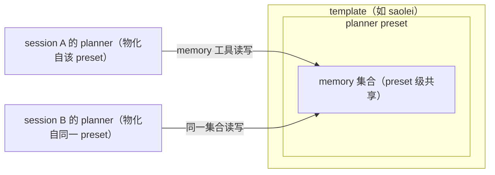
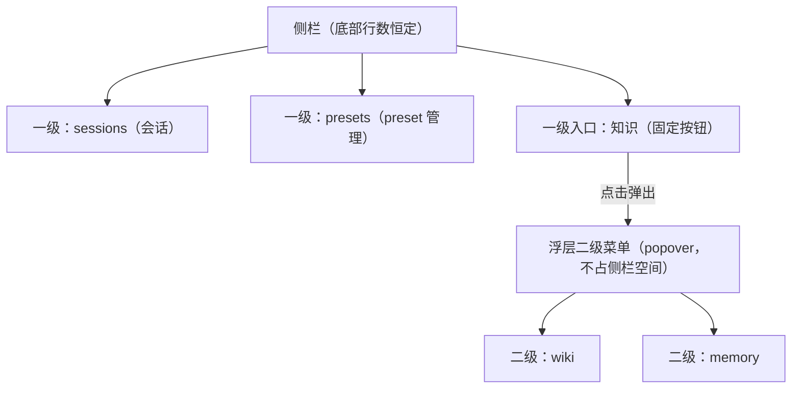

# Feature Specification: memory 作用域从 session 迁移至 preset、web memory 管理与侧栏二级导航

**Feature Branch**: `071-memory-preset-scope`

**Created**: 2026-09-28

**Status**: Draft

**Input**: User description: "将 @projects/game/game.proto 当中的 memory 从 session 下面改为 preset 下，即 memory 与 preset 关联，为这个 preset 创建的 agent 关联对应的 memory 集合。"；Session 2026-09-28 增补：web 端增加 memory 管理页面，侧栏视图导航除 session 与 preset 外收纳进二级菜单；wiki web 管理页面存在 planner（saolei 场景）措辞，memory 与 wiki 是场景无关的基础功能，一并检查并修正。

**修订基线**: memory 的现行作用域契约为 (template, session)，由 specs/039-planner-memory-calibration/spec.md 创立，经 specs/064-memory-split-fold-remain、specs/065-agent-v2-team-refine（快照近因注入）、specs/068-wiki-round-pause（资源身份与 page token 上下文）、specs/069-wiki-template-web（单条长度上限与 web wiki 管理视图）逐次增量修订。本特性变更**作用域挂载点**（session → preset），服务端其余行为契约保持不变（仓库先例：069 将 wiki 从 session 提升为 template 级时采用同一"仅变作用域、契约零改动"口径）；web 管理视图与交互语汇沿用 069 web wiki 视图与 specs/054-agent-v2-bugfixes/contracts/web-ui.md §6 的既有形态。

## Clarifications

### Session 2026-09-28（增补需求）

- Q: web memory 管理页面如何组织？ → A: **仿照 wiki 管理视图**（specs/069-wiki-template-web/spec.md US2 交付面），但集合按 **preset** 组织——先选 preset、再管理该 preset 的 memory 集合（列表分页、查看全文、创建、编辑、删除）。
- Q: 侧栏视图导航如何收纳？ → A: **两级结构**——一级仅保留 session 与 preset 两个入口，其余视图（wiki、memory）收纳进二级菜单（分组），避免平铺 tab 随视图增多变长。
- Q: 场景无关化的范围？ → A: **wiki 与 memory 的 web 管理页面用户可见文案**不得出现场景角色词（planner 等）与具体场景示例（如扫雷示例）；wiki 页面既有场景化措辞（空态文案中的 planner、表单占位示例中的扫雷局面）在本需求内修正。preset 视图与对话页中的 player/planner 是 preset 资源与 team 物化的场景词汇数据（specs/059-agent-v2-team-mode 场景词汇），不在清理范围。

### Session 2026-09-28

- Q: 在 web 管理页面创建 memory 条目时，条目的 id 应如何产生？ → A: **前端按内容摘要自动生成**（与 memory 工具的 agent 写入路径同一摘要方案，sha256 前 32 hex，符合 [a-z0-9_-]+），表单仅填 content；同内容重复创建自然命中"已存在"错误（去重反馈）。
- Q: 侧栏的二级菜单采用哪种交互形态承载 wiki 与 memory 视图？ → A: **浮出菜单（popover）**——侧栏一级放一个固定入口按钮，点击弹出浮层子菜单，选中后浮层关闭。裁断依据：本收纳需求的设计目标是侧栏底部不随视图增多变长、不多行；侧栏内分组展开会在展开时增加侧栏行数，不满足该目标。
- Q: web memory 管理视图中，preset 内条目列表的默认排序采用哪种？ → A: **update_time 降序（最近优先）**——与 planner 快照注入的近因口径一致，运营纠错时"刚被写入/修改的条目"最先可见。
- Q: memory 集合升级为 preset 级跨 session 持久资产后，是否为单个 preset 的 memory 条目数量设置上限？ → A: **不设上限（维持现状口径）**——终态见 FR-018；判断依据（单条上限与快照条数已约束上下文成本）不再复述。

## User Scenarios & Testing *(mandatory)*

### User Story 1 - Memory 资源作用域迁移：memory 挂载到 preset 之下 (Priority: P1)

memory 是 planner 的长期记忆，本质上是跟随"人设"而非"某一局"的资产：同一个 planner preset 在不同 session（不同局）里反复上场，它在某一局沉淀的要点（局面判断、失误教训、策略倾向）换一个 session 就"失忆"了——因为现行 memory 按 (template, session) 作用域隔离，每个 session 各持一套 memory 集合。将 memory 的挂载点从 session 之下迁移到 preset 之下：资源名形态变为 `templates/{template}/presets/{preset}/memories/{memory}`，MemoryService 的 Create/Update/Delete/List 四个 RPC 的 parent/name 寻址全部随之变更为 preset 级形态，资源名中不再含 session 段。

**Why this priority**: 作用域是 memory 资源模型与存储索引的根基，服务端寻址、唯一性、工具面与快照注入全部依赖它先定形；它是其余用户故事的结构基座。

**Independent Test**: 服务端可独立交付并经 gateway HTTP 验证（preset 级路由的 CRUD/List 契约与跨 session 可见性）；工具面与快照注入在其后同步改造并以单测验证。

**Acceptance Scenarios**:

1. **Given** memory 资源的寻址（服务端 RPC 的 parent/name、工具面底层请求），**Then** 全部为 preset 级形态 `templates/{template}/presets/{preset}/memories/{memory}`，资源名与请求 parent 中不再含 session 段。
2. **Given** 同一 preset 下已存在 memory_id 为 M 的条目，**When** 在同一 preset 下再次创建 M，**Then** 请求被拒绝并返回"已存在"类错误；**Given** 另一 preset 下不存在 M，**When** 在该 preset 下创建 M，**Then** 创建成功（唯一性作用域为 (template, preset, memory_id)）。
3. **Given** specs/068-wiki-round-pause 与 specs/069-wiki-template-web 已交付的校验、排序与分页语义，**Then** 除作用域键外全部保持不变（规范见 FR-003，零回归验收见 SC-003）。
4. **Given** 单条 memory content 超过 1024 rune（specs/069-wiki-template-web/spec.md FR 上限），**When** 创建或更新，**Then** 仍被拒绝并返回参数错误（上限不因作用域迁移而变化）。

---

### User Story 2 - 从同一 preset 物化的 planner agent 共享该 preset 的 memory 集合（跨 session 持久） (Priority: P1)

agent（team member）物化自 preset（specs/059-agent-v2-team-mode：member 携带 {role, preset, model?}）。作用域迁移后，planner member 的长期记忆关联到**物化来源 preset** 的 memory 集合：物化时加载该集合的快照（最近更新的 10 条、update_time 降序，specs/065-agent-v2-team-refine 契约不变），memory 工具的写路径作用于该集合。由此，同一 planner preset 在任意 session 物化的 agent 读写同一份记忆——上一局沉淀的要点，下一局开局即在快照中。快照"物化时冻结"的既有语义不变：同一物化周期内快照不随写操作刷新，写直达存储、下次物化可见。

**Why this priority**: 这是本特性的用户价值核心——跨 session 的记忆持久；依赖 US1 的 preset 级作用域先定形。

**Independent Test**: 物化→写→换 session 再物化的完整回路可经大型测试验证（快照跨 session 可见）；memory 工具写路径与快照注入分别有单测覆盖。

**Acceptance Scenarios**:

1. **Given** session A 中物化自 preset P 的 planner 写入 memory 条目，**When** 同 template 新开 session B、其 planner 仍物化自 P，**Then** B 的物化快照包含该条目（跨 session 可见）。
2. **Given** planner 在一局中通过 memory 工具修改/删除条目，**When** 该局结束后同 preset 再开新局，**Then** 新局读到的是修改/删除后的状态。
3. **Given** 终局回顾（specs/062-team-game-end-handoff 的回顾落库流程）中 planner 沉淀 memory，**Then** 落库目标为物化来源 preset 的集合。
4. **Given** 某一 preset 的 memory 集合为空（新 preset），**When** 物化该 preset 的 planner，**Then** 快照为空、系统提示中不出现 memory 快照段（空快照丢弃段的既有行为不变）。

---

### User Story 3 - 作用域隔离与生命周期边界 (Priority: P2)

作用域迁移带来新的边界语义，需要明确并验证：不同 planner preset 的 memory 集合相互隔离；team 刷新换用不同 planner preset 时加载新 preset 的快照；session 与 preset 的删除均不影响已落库的 memory 数据。

**Why this priority**: 边界与隔离是正确性约束而非新能力，防止作用域迁移引入跨集合泄漏或数据意外丢失；实现面小、独立可测。

**Independent Test**: 服务端与物化层单测即可完整验证（隔离、刷新、删除语义各为独立用例），不依赖其他用户故事的交付顺序。

**Acceptance Scenarios**:

1. **Given** preset P1 与 P2（同为 planner 角色），P1 下有记忆条目而 P2 无，**When** 分别物化两者的 planner，**Then** P2 的 planner 快照为空、任何读取路径均看不到 P1 的条目（零泄漏）。
2. **Given** 已物化的 team（planner 物化自 P1），**When** 刷新 team 且 planner 改为物化自 P2，**Then** 刷新后加载的是 P2 的快照，P1 的集合数据不受影响。
3. **Given** session S（其 planner 物化自 P）下已沉淀 memory，**When** 删除 S，**Then** P 的 memory 集合不受任何影响（后续 session 物化自 P 仍可读取）。
4. **Given** preset P 下已沉淀 memory，**When** 删除 P（specs/059-agent-v2-team-mode 契约：删除不波及已物化 member），**Then** 其 memory 集合保留不清除；若之后以同 id 重建 P，新物化的 planner 重新关联到既有集合。

---

### User Story 4 - web memory 管理视图：按 preset 检视与维护记忆集合 (Priority: P2)

用户（人类）目前完全看不到 planner 沉淀了哪些长期记忆，也无法干预错误或过时的记忆——尤其是记忆升级为 preset 级跨 session 资产后，错误记忆会在每一局重复注入。web 前端增加 memory 管理视图（与既有 sessions/presets/wiki 视图并列）：先选择 preset（列出当前 template 的全部 preset），再管理该 preset 的 memory 集合——分页列表浏览、查看条目全文、创建新条目、编辑既有条目内容、删除条目（二步确认）。所有请求经同源 gateway REST 相对路径访问（零 CORS，沿用现有前端 API 客户端模式与交互语汇：独占表单、inline 二步删除、loading/error/空态呈现）。

**Why this priority**: 记忆成为跨 session 持久资产后，内容质量直接放大影响每一局；人类可检视、可纠错、可清理是记忆资产长期可信的运营闭环。依赖 US1 的 preset 级作用域（管理面按 preset 组织）。

**Independent Test**: 前端组件测试（vitest）+ API 客户端 fetch mock 测试可独立验证 UI；管理闭环的 REST 面（按 preset 创建 → 列表 → 编辑 → 删除）由 testplan 既有 memory HTTP 用例框架覆盖（随作用域改造为 preset 级路由）。

**Acceptance Scenarios**:

1. **Given** web 打开 memory 视图，**When** 选择某 preset，**Then** 展示该 preset 的 memory 集合分页列表（按更新时间降序、最近优先，含条目内容与更新时间），可翻页浏览。
2. **When** 以 content 创建条目（id 由前端按内容摘要自动生成），**Then** 创建成功后条目出现在列表中；同 preset 下重复创建相同内容时界面呈现"已存在"类错误提示，不静默失败。
3. **When** 编辑条目内容并保存，**Then** 列表与详情反映新值；content 超过 1024 rune 时被拒绝并呈现可理解的参数错误说明。
4. **When** 删除条目（经确认步骤），**Then** 条目从列表消失，后续浏览不再出现。
5. **Given** 选择的 preset 集合为空，**Then** 呈现场景无关的空态说明与创建入口。

---

### User Story 5 - 侧栏视图导航收纳：浮出二级菜单承载扩展视图 (Priority: P2)

侧栏底部的视图切换现平铺 sessions/presets/wiki 三个 tab，新增 memory 视图后将达四个，随视图继续增多会变得过长。将视图导航收纳为两级：一级仅保留 session 与 preset 两个直接入口，另加一个固定的二级菜单入口按钮；其余视图（wiki、memory）收纳在该入口弹出的**浮出子菜单（popover）**中——点击入口展开浮层、点选视图项后浮层关闭，浮层不占用侧栏空间，侧栏底部行数恒定（这是收纳的设计目标）。视图切换语义不变（主区视图互斥渲染，会话面板常驻挂载的既有行为不受影响）。

**Why this priority**: 与 US4 同批交付的导航基础设施——memory 视图入驻即触发收纳，避免平铺 tab 持续膨胀；独立于业务逻辑，纯前端可单独验证。

**Independent Test**: 前端组件测试可独立验证两级结构、浮层开关与组内切换、既有视图互斥渲染语义；无服务端依赖。

**Acceptance Scenarios**:

1. **Given** 侧栏视图导航，**Then** 一级仅有 session、preset 两个直接入口与一个二级菜单入口按钮，wiki 与 memory 不再平铺于一级；收纳后侧栏底部行数不随视图数量增加而增长。
2. **When** 点击二级菜单入口弹出浮层并选择 wiki 或 memory，**Then** 主区切换到对应视图且浮层关闭；切换后主区互斥渲染语义与切换前一致（同一时刻至多一个管理视图渲染）。
3. **When** 浮层展开时点击浮层外部，**Then** 浮层关闭且不改变当前视图。
4. **Given** 已从二级菜单进入某视图（浮层已关闭），**Then** 当前视图与选中态保持（入口按钮呈现当前选中视图），不因浮层关闭而回退到默认视图。
5. **Given** 既有 session/preset 视图入口，**Then** 其直达行为与选中态呈现不因导航改造变化。

---

### User Story 6 - wiki/memory 管理页面文案场景无关化 (Priority: P3)

memory 与 wiki 是场景无关的基础能力（不绑定扫雷场景），其 web 管理页面的用户可见文案不应出现场景内容。现状 wiki 管理页面存在两处场景化措辞：空态文案"…planner 也能检索到"（planner 是 saolei 场景角色词）、创建表单标题占位示例"如 开局-左上角"（扫雷局面示例）。本故事修正 wiki 页面既有场景化文案，并约束新建的 memory 管理视图文案同样场景无关（以"agent/助手"等中性词指代消费方，示例用中性内容）。

**Why this priority**: 原则性约束而非功能能力，防止基础能力的呈现被场景污染；实现面小、独立可测，且不影响其他故事的交付。

**Independent Test**: 前端组件测试对两个视图的全部用户可见文案做场景词断言（不含场景角色词与场景示例词）即可独立验证。

**Acceptance Scenarios**:

1. **Given** wiki 管理视图的用户可见文案（标题、空态、占位、提示、按钮），**Then** 不出现场景角色词（planner/player 等）与具体场景示例（扫雷局面等），消费方以中性词指代。
2. **Given** memory 管理视图的用户可见文案，**Then** 同样不出现场景角色词与具体场景示例。
3. **Given** preset 视图与对话页中作为**数据**呈现的场景词汇（preset 的 role、team 成员角色），**Then** 保持不变（它们是资源数据而非基础能力文案）。

### Edge Cases

- 存量 (template, session) 作用域的 memory 数据如何处置？→ **clean break 丢弃**：不写迁移代码，存储按 (template, preset) 作用域重建索引与唯一约束后旧数据弃用（仓库 clean break 惯例：069 处理 wiki 作用域迁移的同款裁断；且 session→preset 不存在可靠的归属映射，迁移本身不可定义）。
- 同一 preset 同时被多个 session 使用（并发共享）：两个 planner agent 读写同一集合；各自的快照在自己的物化时点冻结（互不实时刷新），写操作直达存储、彼此的后续工具读取可见——与同一 session 内既有语义一致，无新增一致性保证。
- 同一内容（内容哈希相同的 memory_id）在不同 session 由同 preset 的 agent 重复写入 → 落入同一集合，按"已存在"去重（memory 工具既有 batch 预检语义自然生效于 preset 作用域）。
- parent preset 不存在（从未创建或已删除）时的服务端写入：与现行 session 处理口径一致——仅解析资源名与校验 template，不做跨服务存在性校验（写入按名称寻址生效）。
- player preset：memory 工具的挂载锁定在 planner 角色不变（specs/059-agent-v2-team-mode 的 templateRules 禁挂约束），player agent 不感知 memory；preset 级集合在资源模型上对所有 preset 存在，仅无消费面。
- wiki 不受影响：wiki 保持 template 级作用域（specs/069-wiki-template-web），wiki 工具行为不变。
- memory 视图中 preset 选择器的来源：列出当前 template 的全部 preset（不做"是否有记忆"预过滤）；被删除 preset 的既有集合不再出现在选择器中（无 preset 可寻址），数据本身仍保留于存储（FR-010 口径）。
- web 创建 memory 的条目 id：由前端按内容摘要自动生成（与 memory 工具 agent 写入路径同一摘要方案），符合服务端 [a-z0-9_-]+ 约束；同内容重复创建呈现"已存在"类错误。
- memory 视图无搜索框：memory 条目无 title 字段（与 wiki 不同），管理面以 preset 内分页列表为主，不新增内容检索面。
- 集合容量：单个 preset 的 memory 集合不设条数上限、无淘汰、无超限拒绝（终态见 FR-018；Session 2026-09-28 裁断）——跨 session 累积不触发淘汰或拒绝写入。
- 二级浮出菜单的开关是纯前端瞬态：浮层打开/关闭不承载视图状态，当前视图与选中态独立保持；视图切换、会话切换均不重置其他管理视图的既有表单状态（互斥渲染语义沿用现状）。

## Requirements *(mandatory)*

### Functional Requirements

- **FR-001**: Memory 资源 MUST 挂载于 preset 之下，资源名形态为 `templates/{template}/presets/{preset}/memories/{memory}`；MemoryService 的 Create/Update/Delete/List 的 parent/name 寻址 MUST 全部为 preset 级形态，不再接受含 session 段的寻址。
- **FR-002**: memory 的唯一性键 MUST 为 (template, preset_id, memory_id)：同一 preset 下 memory_id 唯一，重复创建被拒绝并返回"已存在"类错误；不同 preset 之间互不冲突。
- **FR-003**: 除作用域外，既有行为契约 MUST 保持不变：单条 content ≤ 1024 rune 校验、order_by 语法与字段白名单、page token 携带的 order_by 上下文校验、分页语义（specs/068-wiki-round-pause、specs/069-wiki-template-web 契约）。
- **FR-004**: 存储必须按 (template, preset) 作用域组织：查询过滤、唯一约束与排序索引全部以 preset 为集合键；存量 session 作用域数据按 clean break 弃用，MUST NOT 保留迁移代码路径。
- **FR-005**: planner member 物化时 MUST 加载其物化来源 preset 的 memory 快照（最近更新 10 条、update_time 降序），快照"物化时冻结"语义与系统提示注入形态（specs/065-agent-v2-team-refine、specs/064-memory-split-fold-remain 契约）不变。
- **FR-006**: memory 工具的写路径（新增、修改、删除）MUST 作用于物化来源 preset 的 memory 集合。
- **FR-007**: 同一 planner preset 在不同 session 物化的 agent MUST 关联同一 memory 集合：任一 session 写入的条目，对同 preset 后续物化的 agent 可见（快照与工具读取）。
- **FR-008**: 不同 preset 的 memory 集合 MUST 相互隔离，任一读取路径不得跨集合返回条目。
- **FR-009**: team 刷新（UpdateTeam）改用不同 planner preset 时，MUST 加载新 preset 的 memory 快照；被替换 preset 的集合数据不受影响。
- **FR-010**: 删除 session MUST NOT 影响任何 memory 数据；删除 preset MUST NOT 级联删除其 memory 集合（集合保留，同 id 重建 preset 后重新可用）。
- **FR-011**: gateway 的 memory 路由 MUST 更新为 preset 级路径形态（parent 为 `templates/{template}/presets/{preset}`），session 级 memory 路由不再存在；路由随 proto HTTP 注解 codegen 自动生成，gateway MUST NOT 引入手写路由。
- **FR-012**: 服务端对 parent 的处理 MUST 与既有口径一致：仅解析 preset 资源名并校验 template 合法性，不做跨服务的 preset 存在性校验。
- **FR-013**: wiki 的 template 级作用域与 wiki 工具行为 MUST 保持不变；player 角色禁挂 memory 工具的锁定 MUST 保持不变。
- **FR-014**: web 端 MUST 提供 memory 管理视图：按 preset 选择集合（列出当前 template 的全部 preset），支持该集合的分页列表浏览（默认按更新时间降序、最近优先，与快照近因口径一致）、条目全文查看、创建（表单仅填 content，id 由前端按内容摘要自动生成——与 memory 工具写入路径同构；content ≤ 1024 rune）、编辑 content 与二步删除；错误、空态与超限输入 MUST 以可理解的方式呈现，不静默失败。
- **FR-015**: 侧栏视图导航 MUST 收纳为两级结构：一级仅有 session、preset 两个直接入口与一个固定的二级菜单入口按钮，其余视图（wiki、memory）MUST 经该入口弹出的浮层二级菜单（popover，不占侧栏空间）到达；侧栏底部行数 MUST 不随视图数量增加而增长；浮层关闭（含点选后自动关闭与点击外部关闭）MUST NOT 改变当前视图，视图切换的主区互斥渲染语义 MUST 与现状一致。
- **FR-016**: wiki 与 memory 管理视图的用户可见文案 MUST 场景无关：不出现场景角色词（planner/player 等）与具体场景示例（如扫雷局面）；wiki 页面既有场景化文案（含空态与表单占位示例）MUST 在本特性内修正。
- **FR-017**: preset 视图与对话页中作为资源数据呈现的场景词汇（preset 的 role、team 成员角色）MUST 保持不变（场景数据呈现不属于基础能力文案）。
- **FR-018**: memory 集合 MUST NOT 引入条数上限、最旧淘汰或超限拒绝写入等容量治理语义（本特性仅变作用域；容量治理如需要另行立项）。

### Key Entities *(include if feature involves data)*

- **Memory**: planner 的单条长期记忆条目。属性不变：content（≤1024 rune）、create_time、update_time、id（由资源名末段承载，资源消息无独立 id 字段——specs/068-wiki-round-pause 资源身份契约）。关系变更：父资源由 Session 改为 Preset；唯一性作用域随之变为 (template, preset)。
- **Preset**: planner/player 角色的配置资源（specs/059-agent-v2-team-mode：persona、role 等，属性不变）。新增隐式关系：每个 preset 关联一个 memory 集合；从该 preset 物化的 agent 消费（planner）该集合。
- **Session**: 一局游戏的容器（属性不变）。关系变更：不再作为 memory 的作用域载体；session 生命周期与 memory 数据彻底解耦。
- **Wiki**: template 级知识库（specs/069-wiki-template-web），资源与作用域不变；本特性仅修正其 web 管理页面的场景化文案，并作为"作用域先行迁移"的仓库先例参照。

## Success Criteria *(mandatory)*

### Measurable Outcomes

- **SC-001**: 同一 planner preset 沉淀过记忆后，新开 session 以该 preset 物化 planner，无需任何额外操作，上一 session 写入的条目即出现在新 session 的记忆快照中（跨 session 持久 100% 生效）。
- **SC-002**: 不同 preset 的 memory 集合零泄漏：任一 preset 的 agent 通过任何读取路径（快照、工具读取、服务端 List）都取不到其他 preset 的条目（隔离用例全过）。
- **SC-003**: 零回归：memory 服务的既有契约行为（校验、排序、分页、长度上限）与 memory 工具/快照注入行为在 preset 作用域下既有单测与大型测试用例全部通过（all cases passed）。
- **SC-004**: 端到端回路可用：物化 → memory 写入 → 换 session 再物化 → 快照与工具读取命中，全链路经大型测试验证通过。
- **SC-005**: web memory 管理闭环可用：选择 preset → 创建 → 列表可见 → 编辑 → 删除，全流程在 web 界面完成且状态正确（前端组件测试与管理面 REST 大型测试用例全过）。
- **SC-006**: 侧栏一级仅 2 个直接视图入口（session、preset）加 1 个固定的二级菜单入口按钮，侧栏底部行数恒定不随视图增多增长；wiki 与 memory 经浮出二级菜单可达且切换语义不回归（导航用例全过）。
- **SC-007**: wiki 与 memory 管理视图用户可见文案零场景词：场景角色词与场景示例词扫描用例 100% 通过，preset 视图与对话页的场景数据呈现零改动。

## Assumptions

- 存量 (template, session) 作用域 memory 数据按 clean break 丢弃（仓库惯例先例：specs/069-wiki-template-web/spec.md 对 wiki 作用域迁移的同款裁断；无生产数据沉淀诉求，且 session→preset 无可靠归属映射，迁移不可定义）。
- 服务端不校验 parent preset 的存在性，与现行不校验 parent session 存在性的口径一致（服务间按资源名寻址、保持解耦）。
- 删除 preset 不清理其 memory 集合（与 specs/059-agent-v2-team-mode 的"删除不波及已物化 member"无扇出口径一致）；不新增级联清理。
- 快照注入的条数（10）、排序（update_time 降序）与冻结语义不变，仅作用域键变更（specs/065-agent-v2-team-refine 契约继续有效）。
- MemoryService 仍经既有 gateway 前缀暴露，仅路径中的 parent 段形态变更；不新增版本化路径。
- memory 的消费面维持 planner 单角色：不为 player 或其他角色新增 memory 工具/快照注入。
- web memory 管理视图为本特性新增交付面（US4）；其余 web 视图（sessions/presets/wiki）的功能面不新增能力，仅导航收纳（US5）与 wiki 文案修正（US6）。
- experimental/dsh/demo 下的 preset demo（chat.proto 的 store preset）是独立实验面，与 game.proto 的 MemoryService 无关，不在本特性范围。
- 大型测试沿用 projects/game/testplan 既有 memory/agent_v2 用例框架，随作用域同步改造，不新增独立测试计划体系。
- web memory 管理视图沿用既有管理视图交互语汇（specs/054-agent-v2-bugfixes/contracts/web-ui.md §6：独占表单、inline 二步删除、loading/error/空态）与同源 gateway REST 客户端模式（specs/069-wiki-template-web web wiki 视图先例）；条目详情取自列表数据（memory 服务无单条 Get 面，List 返回全量资源）。
- 二级菜单交互形态已定为浮出菜单（popover，Session 2026-09-28 裁断）：一级固定入口按钮 + 浮层子菜单，侧栏底部行数恒定；入口按钮文案为「知识」（plan 层定），spec 约束两级结构、可达性与浮层关闭不改当前视图。
- web 创建 memory 的 id 由前端按内容摘要自动生成（与工具路径同一方案，表单仅填 content），服务端 [a-z0-9_-]+ 校验不变；不为此新增服务端自动生成 id 语义。
- 场景无关化清理范围限于 wiki 与 memory 两个管理视图的用户可见文案；服务端资源模型、memory 工具与指引文本（LLM 面）经检查已无场景措辞，不在改动范围；preset 视图/对话页的场景词汇是资源数据，保持不变。
