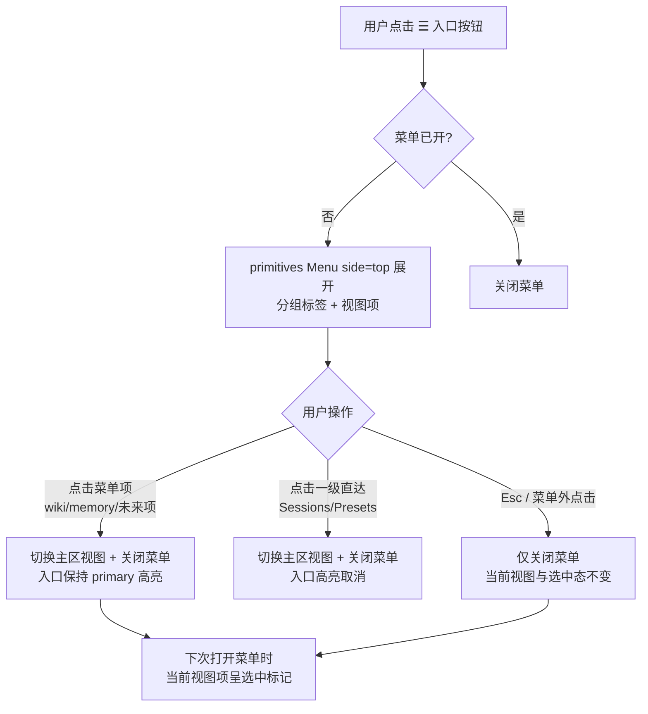
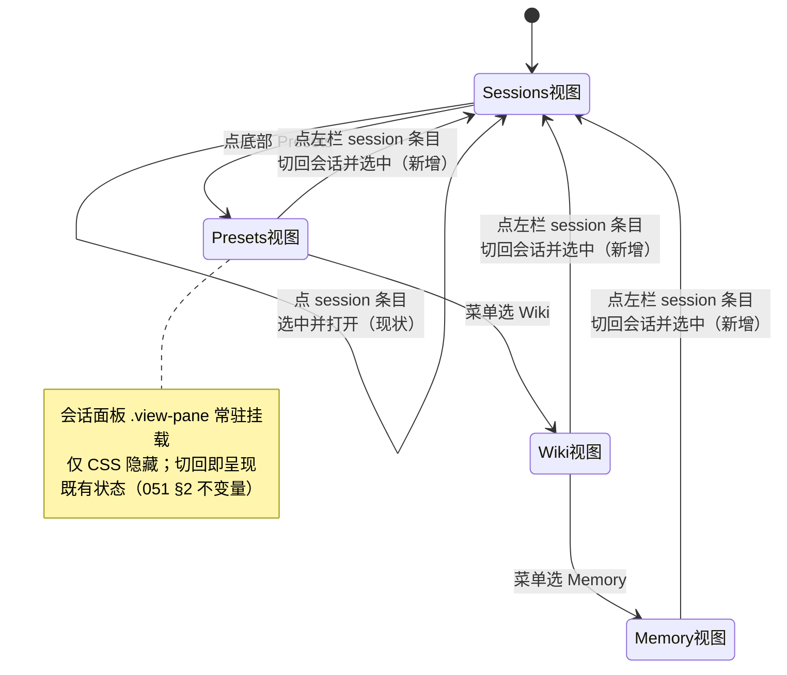

# Design: web 侧栏导航重设计（☰ 图标菜单 + 左栏会话直达）

**Feature**: specs/072-web-nav-redesign | **Date**: 2026-09-29（裁定落定 2026-09-29）| **调研**: [research.md](research.md) | **契约**: [contracts/web-nav.md](contracts/web-nav.md)
**修订对象**: `specs/071-memory-preset-scope/contracts/web-nav.md`（由 [072 契约](contracts/web-nav.md) 取代）、`specs/051-agent-v2-dsh-migration/contracts/web-frontend.md` §2（措辞层补全）

> **文档位置说明**：本修订跨 051/071 两个已交付特性的契约（导航结构 + 左栏交互），属新特性规模，按仓库惯例（069 修订 068 的 wiki 面、051 演进 049 的前端基线均以新编号特性承载）开 `specs/072-web-nav-redesign/`。分叉点已全部裁定（§8），spec/plan/tasks 随本文产出。

## 1. 背景与目标

用户对已交付 web UI（`specs/071-memory-preset-scope`）提出三项意见：

1. **入口按钮改为三横杠菜单按钮**：底部「知识」入口未来承载不止知识一类内容；并消除二级视图激活时「知识 · Wiki」文本两行问题（机理：`App.tsx:649` 的 `知识 · {view}` 拼接在 260px 侧栏 flex 行内换行）。
2. **左栏与主区不协调**：底部 tab 切换只改主区，左侧恒为 session 列表；非 session tab 下点击 session 条目无任何可见响应（"死点击"机理见 [research.md](research.md) §1.2：`openSession` 只设 `selected` 不设 `view`）。
3. **重新设计左栏内容与交互逻辑**：调研官方 dsh webUI 与社区常见设计后落地。

**裁定结果**（详见 §8）：左栏模式采用**官方对齐**（左栏恒为 SessionList、点击穿透回会话）；☰ 入口图标化并迁移 primitives `Menu` 分组菜单；方案 B（左栏随域切换 master 列表）rejected。

**不变约束**：会话面板常驻挂载、CSS 隐藏（`specs/051-agent-v2-dsh-migration/contracts/web-frontend.md` §2）；主区管理视图互斥渲染；无路由库、单页 state 切换；无新增第三方依赖（primitives + theme.css + 内联 SVG）。

## 2. 调研结论摘要

完整调研与出处见 [research.md](research.md)。要点：

- **官方 dsh webUI**（https://github.com/deepseek-ai/deepseek-harness/blob/master/packages/client/ui-sidebar/README.md 、ui-workspace/README.md、ui-layout/README.md）：三栏 AppFrame；左栏**恒为** workspace/session 导航器；管理页面是**主区全局面板**（`selectPanel`）；**点击 session 条目永远切回 Conversation 并打开该会话**——官方不存在死点击。本设计的左栏模式与其对齐。
- **社区两派正典**：VS Code（Activity Bar ⇄ Side Bar 联动，https://code.visualstudio.com/api/ux-guidelines/overview ）、Discord、Slack 支持"左栏随一级导航切换"；管理后台模板（https://ant.design/components/layout/ 、https://ui.shadcn.com/docs/components/sidebar ）与官方 dsh 支持"左栏恒定"。两派均成立，取舍裁定见 §8 D1。
- **组件能力面**：primitives `Menu`（`lib/types/Menu.d.ts`）原生支持分组标签 `{type:'label'}`/分隔线/`side="top"`（in-place 纯 CSS 向上展开，`lib/Menu.module.css` `.sideTop`）/`selectedId` 选中呈现/键盘漫游/Esc+外点 `onClose`——可整体替代手写 popover；图标集（`lib/types/icons/index.d.ts` 全量核对）**无三横杠 glyph**（最近似的 `IconFlatListOutline` 是"点+线"清单图标），纯三横杠用 16px 内联 SVG（`specs/051-agent-v2-dsh-migration/contracts/web-frontend.md` §1 "primitives 图标或内联 SVG"先例；图标按钮可访问名 `title`+`aria-label`，`projects/game/web/frontend/src/components/SessionList.tsx:52-80`）。

## 3. 布局与交互设计（终态）

### 3.1 ☰ 图标菜单入口

**按钮**（替换 `App.tsx` 现「知识」入口按钮，`App.tsx:640-675`）：

- `Button`（默认尺寸 md，与一级直达按钮同高），`icon` = 三横杠内联 SVG（viewBox `0 0 16 16`、三等长线、`stroke="currentColor"`、`aria-hidden`，svg 属性形态对齐 primitives 图标实现），**无 children**——纯图标按钮，任意侧栏宽度下不换行，两行问题根除；三个一级入口分摊侧栏横向空间（`theme.css` `.view-switch > * { flex: 1 }`，入口 `width: 100%` 撑满 Menu wrapper）。
- 可访问名：`title="更多视图"` + `aria-label="更多视图"`；`aria-haspopup="menu"` + `aria-expanded={knowledgeMenuOpen}` 延续（WAI-ARIA APG menu-button，https://www.w3.org/WAI/ARIA/apg/patterns/menu-button/ ）。
- 选中态：wiki/memory（或未来二级项）激活时 `variant="primary"` + `data-active="true"`；入口不承载视图名文本（`知识 · Wiki` 拼接删除）。

**菜单**（替换手写 `div.knowledge-menu` popover，改用 primitives `Menu`；`SessionList.tsx:274-301` 同组件先例，`SessionList.test.tsx:127` 的 `getByRole('menuitem', { name })` 断言先例）：

- **in-place 模式 + `side="top"`**：`view-switch` 不处滚动容器内，无 overflow 裁剪（SessionList 用 portal 是因其列表在 `overflow-y:auto` 容器内——场景不同）；定位与卡片样式由 Menu 自带（`.root` relative + `.sideTop` 自底向上），侧栏流内仅锚定 wrapper 占位，底部行数恒定。
- owner-controlled：`open={knowledgeMenuOpen}` + `onClose={() => setKnowledgeMenuOpen(false)}`；Esc/外点关闭由 Menu 内建——**删除 App 手写外点/Esc effect**（`App.tsx:499-523`）与 `menuRef`（宪法 II 简化）。
- 条目以 `MenuEntry` 分组（分组即"以后不只有知识这一类"的扩展形态——新类别 = 追加 `{type:'label'}` 段，入口与底部行数不变）；当前二级视图经 `selectedId={knowledgeView ? view : undefined}` 呈现选中标记。
- 行为语义不变（[contracts/web-nav.md](contracts/web-nav.md) §2 行为表）：点直达切视图并关菜单；点菜单项切视图并关菜单；外点/Esc 仅关菜单不改视图；关闭后视图与选中态保持。

**一级直达按钮**（Sessions/Presets）：保留文本形态（D2 裁定；短词无换行问题、语义直观）。

### 3.2 左栏恒为会话导航，session 条目任意视图直达

**信息架构**（对齐官方 ui-sidebar/ui-workspace，https://github.com/deepseek-ai/deepseek-harness/blob/master/packages/client/ui-sidebar/README.md ）：

- 左栏**恒为 SessionList**（现状不动）：标题 + 刷新/新建 + session 列表。
- 底部 `.view-switch`：`Sessions | Presets | ☰`——主区面板选择器（官方 `sidebar.panellist` + `selectPanel` 的同构简化版）。
- presets/wiki/memory 为**主区管理面板**，自带各自的列表/选择器（现状不动，无两处列表冗余问题）。

**交互修订**（本设计的核心行为变更）：

- `openSession(name)` 语义扩展：**任何视图下**点击 session 条目 → `setView('sessions')` + `setSelected(name)`（对齐官方 "`openSession` … returns the main area to Conversation"，research.md §2.2）。死点击消除：非 session 视图下点 session = 跳回该会话。
- 会话面板常驻挂载零变化（切回 sessions 视图后 `.view-pane` 取消隐藏，既有状态直接呈现）；主区互斥渲染零变化。
- SessionList 选中高亮在非 session 视图下**保留**（D6 裁定）：点击条目即切回会话视图，高亮是"当前会话"指示，不存在"高亮与主区不一致仍停留"的状态（官方在全局面板停留态抑制高亮的口径，与本设计"点击即切回"的语义不同）。

### 3.3 样式收敛

`theme.css` 删除 071 手写浮层样式（`.view-menu`/`.knowledge-menu`/`.knowledge-menu-item`，`theme.css:193-242`）——卡片、层级、键盘焦点样式由 primitives `Menu.module.css` 提供；`theme.css` 保持只含 `--app-*` 与布局样式的既有职责。侧栏其余样式零改动。

## 4. 交互流程图（宪法 VIII：Mermaid）

### 4.1 ☰ 入口与菜单交互

### 4.2 视图 × session 条目点击联动（状态图）

## 5. 对既有契约的影响

- **`specs/071-memory-preset-scope/contracts/web-nav.md`**：由 [specs/072-web-nav-redesign/contracts/web-nav.md](contracts/web-nav.md) 取代（同名契约演进，031→040 supersede 先例）；旧契约头部已加 `[SUPERSEDED — see Feature 072]` 指针。变更面：§1 入口 ☰ 图标化 + Menu 载体 + 左栏恒会话条款；§2 行为表新增 session 条目跨视图行；§3 选中态（图标入口高亮 + 菜单 `selectedId`，删除视图名拼接；高亮保留条款）；§4 可访问性（图标按钮可访问名）与 testid 约定（入口 `view-more`；条目经 role 查询）；§5 验收锚点更新。
- **`specs/051-agent-v2-dsh-migration/contracts/web-frontend.md` §2**：措辞层补全"session 条目点击在任何视图下回到会话视图"（基线语义的自然补全，非结构变更）——随实现任务落注（`App.tsx` 头注释引用更新），契约文件本身不改（该基线已被 072 契约 §2 行为表显式扩展）。
- 不触及 `web-memory-view.md`/`web-wiki-view.md`（管理视图零改动）。

## 6. 测试影响面

`projects/game/web/frontend/src/App.test.tsx:1948-2083` 三个导航用例改造 + 新增用例（[contracts/web-nav.md](contracts/web-nav.md) §5）：

- **入口断言**：`view-knowledge` → `view-more`；`aria-haspopup`/`aria-expanded` 保留；新增 `aria-label` 断言；`entry.textContent` 含 `Wiki`/`Memory` 断言删除（无文本），新增"无文本子节点"断言（不换行回归防护）；`data-active` 断言保留。
- **菜单断言**：`knowledge-menu` 手写浮层 DOM 断言（含 `menu.parentElement.className === 'view-menu'`，`App.test.tsx:1972`）改为 primitives Menu 渲染断言——条目经 `getByRole('menuitem', { name: 'Wiki' / 'Memory' })`（`MenuItem` 数据行无 testid 通道，`SessionList.test.tsx:127` 先例）；分组 label「知识」经文本查询断言；`selectedId` 选中呈现断言按 Menu selection 实现落地。
- **新增跨视图用例（US2）**：presets/wiki/memory 视图下点击 `session-item` → `view-sessions` 激活、目标会话面板呈现、原管理视图不渲染。
- **零回归**：四视图互斥渲染、会话面板常驻挂载、直达按钮行为、菜单关闭不改视图等既有断言语义保留（载体更新）。
- `SessionList.test.tsx`/各 View 测试零改动（SessionList 与管理视图均不动）。

## 7. 分期交付

1. **Phase 1（US1）**：☰ 图标入口 + primitives Menu 迁移（theme.css 样式收敛 + App.tsx 入口/菜单改造 + App.test.tsx 断言改造）——独立可交付，消除两行问题并建立分组可扩展菜单。
2. **Phase 2（US2）**：`openSession` 跨视图切换 + 新用例——依赖 Phase 1（同文件串行）。
3. **Polish**：前端全量回归（`bazel test` 前端相关 target 全绿）；无大型测试新增面（纯前端导航变更、零服务端行为变更，豁免口径对齐 `specs/069-wiki-template-web/research.md` R8：UI 逻辑由 vitest 组件测试覆盖）。

## 8. 裁定记录与 Rejected Alternatives

### 裁定（Session 2026-09-29）

| # | 分叉点 | 裁定 |
|---|---|---|
| D1 | 左栏模式 | **A 官方对齐**：左栏恒 SessionList，点击穿透回会话；管理视图零改动 |
| D2 | 一级直达按钮形态 | **保留文本** |
| D3 | 菜单载体 | **迁移 primitives `Menu`**（`side="top"`、`MenuEntry` 分组、`selectedId`、键盘漫游/外点内建），删手写浮层与外点/Esc effect |
| D4 | （随 B）memory preset 选择器上移 | **作废**（B rejected） |
| D5 | （随 B）wiki 搜索/分页上移 | **作废**（B rejected） |
| D6 | 非 session 视图下 session 高亮 | **保留高亮**（点击即切回，无不一致停留态） |

### Rejected：方案 B（activity-rail 式左栏随域切换、master-detail 上移）

左栏内容随底部域切换为四 pane（presets/wiki 列表与 memory preset 选择器上移左栏、主区收敛 detail 面）。**拒绝理由**：与官方 dsh 左栏模式不一致；重构面大（三个管理视图 + App + 全部视图测试重写）；非会话域下失去"任意时刻直达会话"能力。**防踩坑记录**：若未来视图数量增长到左栏 master-detail 明显更优，该方案的设计要点曾备于本文档历史版本（见版本控制），重启时须重新评估"会话可达性"代价与官方模式的一致性诉求；memory preset 选择器上移（D4）与 wiki 搜索/分页上移（D5）仅在该方案下成立，本特性不实施。
