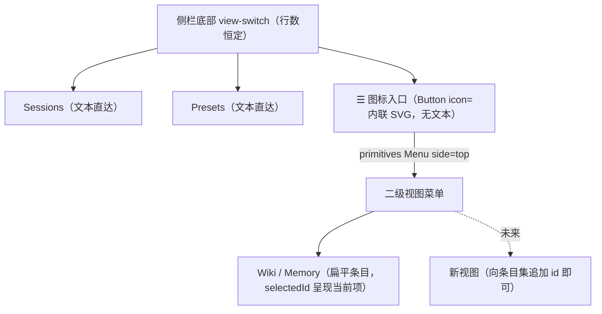

# Feature Specification: web 侧栏导航重设计（☰ 图标菜单 + 左栏会话直达）

**Feature Branch**: `072-web-nav-redesign`

**Created**: 2026-09-29

**Status**: Draft

**Input**: User description: "把底部的'知识'改为三横杠的那种菜单按钮，因为这个地方以后不只有知识这一类。而且现在点击 memory 或 wiki 会让这个按钮文本变 2 行。另外……底部按钮更改的内容都在右侧的主页面区，但左侧类似导航栏的地方却一直是 session，并且在非 session 的 tab，点击其中的 session item 也无法切换到 session 的内容。我个人感觉是左侧的栏位内容也应该跟随底部 tab 改变，调研下 dsh 官方 webUI 插件的 UI 布局和交互、一些常用 web 页面以及社区常见设计。左侧的内容和交互逻辑需要重新设计下。"；调研与设计见 [research.md](research.md)/[design.md](design.md)，分叉裁定见 Session 2026-09-29 与 Session 2026-09-30（D7 二级菜单去知识域耦合）。

**修订基线**: 侧栏两级导航由 `specs/071-memory-preset-scope/spec.md` US5/FR-015 创立（一级 sessions/presets 直达 + 「知识」文本入口 + 手写浮层）；会话面板常驻挂载与主区互斥渲染基线为 `specs/051-agent-v2-dsh-migration/contracts/web-frontend.md` §2。本特性将入口演进为 ☰ 图标菜单（primitives `Menu` 承载二级视图条目，不为域定制）、消除入口文本两行问题，并将左栏 session 条目交互对齐官方 dsh webUI（任意视图点击直达会话）；左栏恒为会话导航的结构不改变。

## Clarifications

### Session 2026-09-29（分叉裁定）

- Q: 左栏内容是否随底部 tab 切换？ → A: **不切换（官方对齐）**——调研结论（[research.md](research.md) §2/§4）：官方 dsh webUI 左栏恒为 workspace/session 导航器，管理页面是主区全局面板；VS Code/Discord 的"左栏随域切换"是另一派正典但重构面大且牺牲任意视图直达会话。左栏结构不变，消解痛点的方式是让 session 条目**任意视图可达**（点击即切回会话视图并打开，对齐官方 `openSession` 语义）。
- Q: ☰ 入口的实现载体？ → A: **primitives `Menu`**（`side="top"`、`MenuEntry` 分组：`{type:'label'}` 类别标题——首组「知识」含 wiki/memory；`selectedId` 呈现当前二级视图；键盘漫游/外点/Esc 由 Menu 内建），删除 App 手写浮层与外点/Esc effect。（其中"分组承载"形态已被 Session 2026-09-30 修正为扁平条目，见下节。）
- Q: 入口选中态如何呈现"当前在哪个二级视图"？ → A: 入口仅以 `variant="primary"` + `data-active` 示意"菜单内有激活项"（图标-only，**不拼接视图名文本**——两行问题根除）；具体视图在打开菜单时经 `selectedId` 选中标记可见。
- Q: 一级直达按钮是否一并图标化？ → A: **保留文本**（Sessions/Presets 短词无换行问题、语义直观）。
- Q: 非 session 视图下 session 条目选中高亮是否抑制（官方口径）？ → A: **保留**——本设计点击条目即切回会话视图，高亮是"当前会话"指示，不存在高亮与主区不一致的停留态（官方抑制是全局面板停留态的做法，语义不同）。
- Rejected：左栏随域切换 + master 列表上移（memory 选择器/wiki 搜索列表上移左栏）——见 [design.md](design.md) §8。

### Session 2026-09-30（二级菜单去知识域耦合）

- Q: 二级菜单是否以「知识」域分组或命名？ → A: **不为域定制**——移除菜单内「知识」分组标题（条目扁平：wiki/memory，经 `SECONDARY_VIEWS`/`SECONDARY_MENU_ITEMS` 承载），实现命名中性化（`secondaryMenuOpen`/`secondaryView`）。理由：该菜单是通用二级视图入口，将来可能有更多域加入，限定为「知识」域不准确。primitives `Menu` 的 `{type:'label'}` 分组能力保留为**可用未用**——将来域类条目增多时按需添加条目（或分组）。取代 Session 2026-09-29 D3 落定时的"分组承载"形态。

## User Scenarios & Testing *(mandatory)*

### User Story 1 - ☰ 图标菜单入口：替换「知识」文本按钮，条目可扩展 (Priority: P1)

侧栏底部的「知识」文本入口在 wiki/memory 激活时呈现「知识 · Wiki」等拼接文案，在 260px 侧栏内换行为两行；且该入口承载的是全部二级视图而非仅"知识"一类。将该入口替换为三横杠（☰）图标菜单按钮（图标-only、无文本、永不换行），菜单迁移为 primitives `Menu` 并承载二级视图条目（wiki/memory，扁平无分组标题——**不为某一域定制**）——未来新增二级视图只需追加条目 id，入口按钮与侧栏底部行数均不变。菜单的键盘漫游（↑/↓/Home/End）、外点/Esc 关闭由 primitives `Menu` 内建承载，App 删除手写浮层与自维护的关闭监听。

**Why this priority**: 用户意见的第一项且含视觉缺陷（两行）；是纯前端、无依赖的独立交付面；可扩展的条目结构是后续视图入驻的前提。

**Independent Test**: `App.test.tsx` 组件测试独立验证入口图标化、菜单条目结构、切换/关闭行为与既有导航零回归（无服务端依赖）。

**Acceptance Scenarios**:

1. **Given** 侧栏底部视图导航，**Then** 一级为 `Sessions`、`Presets` 两个文本按钮与一个 ☰ 图标按钮；图标按钮无文本子节点（任意侧栏宽度不换行），有 `title`/`aria-label` 可访问名与 `aria-haspopup="menu"`/`aria-expanded` 状态。
2. **When** 点击 ☰ 入口，**Then** 菜单自底向上展开，呈现 `Wiki`、`Memory` 两个视图项（扁平条目、无分组标题，role=menuitem 可达）；再次点击入口关闭（toggle）。
3. **When** 菜单内选择 wiki 或 memory，**Then** 主区切换到对应视图且菜单关闭；入口按钮呈 `data-active` 高亮；再次打开菜单时当前视图项呈选中标记（`selectedId`）。
4. **When** 菜单展开时点击菜单外部或按 Esc，**Then** 仅关闭菜单，当前视图与选中态保持不变。
5. **Given** 菜单条目集（`SECONDARY_VIEWS` 域），**Then** 新增二级视图仅需向其追加条目 id，侧栏底部子元素数恒定（结构断言：二级项渲染于菜单列表内而非侧栏流内）。
6. **Given** 既有 sessions/presets 直达按钮，**Then** 直达行为与选中态呈现零回归（切换视图并关闭菜单）。

---

### User Story 2 - 左栏 session 条目任意视图可达：点击即回会话 (Priority: P2)

底部 tab 切换到 presets/wiki/memory 后主区变为管理面板，但左侧 session 列表仍完整呈现——点击其中条目却无任何可见响应（`openSession` 只更新隐藏面板的选中态，不改当前视图），形成"死点击"。将 `openSession` 语义对齐官方 dsh webUI（`ctx.uiWorkspace.openSession` "returns the main area to Conversation"，[research.md](research.md) §2.2）：**任何视图下**点击 session 条目都切回 sessions 视图并打开该会话；会话面板常驻挂载语义保证切回即呈现既有状态（不重新回填、不丢在途回合）。session 条目的选中高亮在非 session 视图下保留（当前会话指示）。

**Why this priority**: 用户意见的第二项（不协调 + 死点击）；依赖 US1 后同文件串行实施；改动面极小（一个函数）但交互价值直接。

**Independent Test**: `App.test.tsx` 组件测试在三个管理视图下分别点击 session 条目，断言切回 sessions 视图、目标会话呈现、管理视图卸载（无服务端依赖）。

**Acceptance Scenarios**:

1. **Given** 当前处于 presets 视图（或 wiki/memory），**When** 点击左栏某 session 条目，**Then** 主区切回 sessions 视图并打开该会话，原管理视图不再渲染。
2. **Given** 该会话此前已打开过（面板常驻挂载、含在途或既有对话状态），**When** 从管理视图切回，**Then** 面板直接呈现既有状态（无重新回填、在途回合不丢失——常驻挂载不变量）。
3. **Given** 非 session 视图下当前选中会话为 S（条目高亮保留），**When** 点击另一会话 S'，**Then** 切回 sessions 视图并选中 S'（高亮随选择更新）。
4. **Given** 非 session 视图，**When** 点击侧栏"新建会话"按钮，**Then** 同样切回 sessions 视图并打开新建会话（`openSession` 统一语义，`onCreate` 复用同一入口）。
5. **Given** sessions 视图，**When** 点击 session 条目，**Then** 行为与现状一致（选中并打开，零回归）。

### Edge Cases

- 空 session 列表：SessionList 空态/加载/错误呈现照常（`specs/051-agent-v2-dsh-migration/contracts/web-frontend.md` §1 基线不变）；US2 无新增分支。
- 删除会话（`···` 菜单二步删除）：删除编排与"仅当被删会话仍是当前视图时返回列表"的既有逻辑零改动（`App.tsx` onDelete）；在非 session 视图下删除非当前会话，视图停留不变。
- 菜单关闭态下浏览器刷新：`view`/选中态本为内存态，刷新回到初始 sessions 视图（现状语义，不新增持久化）。
- 菜单开启时切换视图（点直达按钮）：切换并关闭菜单（既有行为表语义延续）。
- primitives Menu 的 `MenuItem` 数据行无 `data-testid` 通道：条目定位经 `getByRole('menuitem', { name })`（`SessionList.test.tsx:127` 先例）；入口 testid 更名 `view-knowledge` → `view-more`（测试为唯一消费者，无外部联动）。

## Requirements *(mandatory)*

### Functional Requirements

- **FR-001**: 侧栏底部二级入口 MUST 为图标-only 按钮（`Button` 默认尺寸 md，与一级直达按钮同高 + 内联三横杠 SVG，无 children）——任意侧栏宽度下 MUST NOT 换行；MUST 提供 `title` + `aria-label` 可访问名（「更多视图」）与 `aria-haspopup="menu"`、`aria-expanded` 状态（WAI-ARIA APG menu-button，https://www.w3.org/WAI/ARIA/apg/patterns/menu-button/ ）。
- **FR-002**: 二级菜单 MUST 以 primitives `Menu`（`@deepseek-ai/dsh-client-ui-primitives`）承载：in-place 模式、`side="top"` 自底向上展开；条目为 `MenuEntry` 数据行的**扁平集合**（wiki/memory，经 `SECONDARY_VIEWS`/`SECONDARY_MENU_ITEMS` 承载），MUST NOT 以特定域命名、分组或排序（菜单是通用二级视图入口，不为某一域定制）；新增二级视图 MUST 仅向条目集追加 id，侧栏底部子元素数 MUST 恒定。`{type:'label'}` 分组能力保留为可用未用（将来域类条目增多时按需启用）。
- **FR-003**: 入口选中态：任一二级视图激活时入口呈 `variant="primary"` + `data-active="true"`；MUST NOT 拼接视图名文本。菜单内当前二级视图项 MUST 经 `selectedId` 呈现选中标记。
- **FR-004**: 菜单键盘漫游（↑/↓/Home/End）与外点/Esc 关闭 MUST 由 primitives `Menu` 内建承载（owner 经 `open`/`onClose` 控制）；App MUST NOT 自维护外点/Esc 监听（071 手写浮层 JSX 与关闭 effect 删除）；菜单关闭（含点选后自动关闭与外点/Esc）MUST NOT 改变当前视图。
- **FR-005**: `openSession` MUST 满足：任何视图下点击左栏 session 条目（含"新建会话"路径的复用入口）即 `view` 置 `sessions` 并选中打开该会话——非 session 视图下 MUST NOT 存在无可见响应的 session 条目点击。
- **FR-006**: SessionList 的选中高亮在非 session 视图下 MUST 保留（当前会话指示；无"高亮与主区不一致"的停留态）。
- **FR-007**: 一级直达按钮（sessions/presets）MUST 保留文本形态；直达与菜单项的视图切换语义（切换即关菜单、互斥高亮）MUST 与 071 契约一致。
- **FR-008**: 会话面板常驻挂载（CSS 隐藏、切换返回不重跑回填、不丢在途回合）与主区管理视图互斥渲染 MUST 保持不变（`specs/051-agent-v2-dsh-migration/contracts/web-frontend.md` §2、`specs/071-memory-preset-scope/contracts/web-nav.md` §3 语义延续）。
- **FR-009**: 三横杠图标 MUST 以内联 SVG 实现（primitives 图标集无汉堡 glyph，`projects/game/web/frontend/node_modules/@deepseek-ai/dsh-client-ui-primitives/lib/types/icons/index.d.ts`；内联 SVG 为 `specs/051-agent-v2-dsh-migration/contracts/web-frontend.md` §1 允许载体）；本特性 MUST NOT 新增第三方依赖。
- **FR-010**: `theme.css` MUST 删除 071 手写浮层样式（`.view-menu`/`.knowledge-menu`/`.knowledge-menu-item`）；菜单卡片/层级/焦点样式由 primitives `Menu` 提供，`theme.css` 保持只含 `--app-*` 与布局样式的既有职责。

### Key Entities

无新增资源实体。App 前端状态面语义保持：`view: 'sessions' | 'presets' | 'wiki' | 'memory'`（值域不变）、瞬态 `secondaryMenuOpen: boolean`（菜单开闭，不承载视图状态）、`selected`/`opened`（会话选中与常驻挂载清单）；行为变更集中于 `openSession`（新增 `view` 置位）。终态契约见 [contracts/web-nav.md](contracts/web-nav.md)。

## Success Criteria *(mandatory)*

### Measurable Outcomes

- **SC-001**: 入口两行问题根除：组件测试断言入口按钮无文本子节点、`aria-label` 存在（图标-only）；侧栏底部行数恒定断言通过。
- **SC-002**: 菜单可扩展性可验证：wiki/memory 条目经 role 查询可达（扁平条目、无分组标题）；`selectedId` 选中呈现断言通过；结构断言（二级项在菜单列表内、`view-switch` 子元素数恒定）通过。
- **SC-003**: 死点击消除：presets/wiki/memory 三个视图下点击 session 条目均切回 sessions 视图并打开目标会话（三路径用例全过），切回呈现既有状态（常驻挂载不变量断言零回归）。
- **SC-004**: 零回归：既有导航行为（直达切换、菜单关闭不改视图、四视图互斥渲染、会话面板常驻挂载、SessionList 交互）全部既有断言语义保留并通过；`bazel test`（web 前端相关 target）全绿。

## Assumptions

- primitives `Menu` in-place 模式满足侧栏底部场景（`view-switch` 不处滚动容器内，无 overflow 裁剪；`SessionList` 的 `Menu` 用 portal 是因其列表在 `overflow-y:auto` 容器内——场景不同，见 [design.md](design.md) §3.1）。
- 入口 testid 更名（`view-knowledge` → `view-more`）无外部消费者：测试是 data-testid 的唯一消费者（071 契约 §4 同口径）。
- 左栏结构（SessionList 恒为会话导航）与管理视图（presets/wiki/memory 自带列表/选择器）零改动——左栏随域切换的替代方案已 rejected（[design.md](design.md) §8）。
- 纯前端导航变更：无服务端/REST/gRPC 面改动，无大型测试新增（UI 逻辑由 vitest 组件测试覆盖，豁免口径对齐 `specs/069-wiki-template-web/research.md` R8；既有 testplan suite 不受影响——前端为静态资产）。
- `specs/071-memory-preset-scope/contracts/web-nav.md` 由本特性 [contracts/web-nav.md](contracts/web-nav.md) 取代（同名契约演进；旧契约头部已加 `[SUPERSEDED — see Feature 072]` 指针，031→040 supersede 先例）。
- `specs/051-agent-v2-dsh-migration/contracts/web-frontend.md` §2 基线语义由 072 契约 §2 行为表显式扩展（session 条目跨视图行），该基线文件本身不改。
