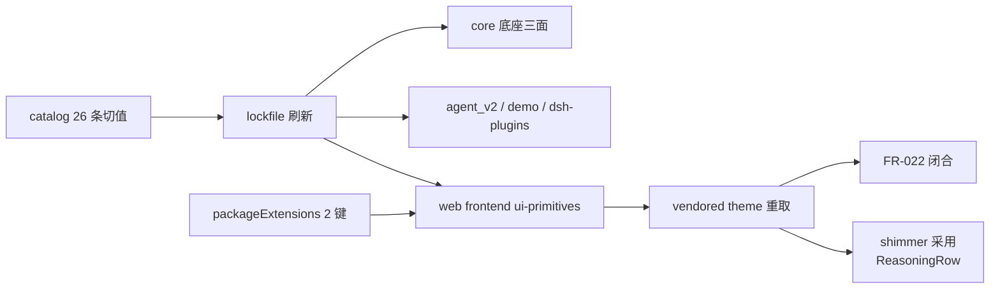

# Data Model: dsh 升级到 0.2.0 线

**Feature**: specs/073-dsh-0.2-upgrade/spec.md

本特性为版本线迁移 + 单组件设计采用，**无运行时数据模型变化**（Mongo `PresetRecord` schema 冻结不动，`specs/070-dsh-upgrade/data-model.md` §3.4；会话仍为内存态）。本文档定义涉及的**声明面/配置实体**及其校验规则——它们是本特性的"数据"，验收即校验其一致性。

## 1. 实体清单

### 1.1 dsh 版本线（version line）

| 字段 | 值（升级后终态） | 校验规则 |
|---|---|---|
| dsh 家族版本 | `0.2.0-rc.2`（26 个 catalog 条目精确 pin） | lockfile 中全部 `@deepseek-ai/dsh-*` 解析值 === `0.2.0-rc.2`；零跨线混装（SC-001） |
| cordis 互锁 | cordis `4.0.4`、loader `1.0.5`、include `1.0.9`、group `1.0.4`、timer `1.1.6` | cordis 全仓库唯一物理副本（closure audit 断言③） |
| node-addon-require-builtin | `0.1.6` | lockfile 含 `linux-x64-gnu` optionalDep |
| schemastery | `^3.18.4` | 解析不变 |

### 1.2 框架核心底座（core baseline）

`third_party/dsh/core` 的 11 包闭包（app-boot、cordis、cordis-plugin-loader/include/group/timer、dsh-home-paths、dsh-invariants、dsh-launch-environment、dsh-system-prompt、node-addon-require-builtin）。字段：`package.json` 依赖 pin、`BUILD.bazel` npm_deps 枚举、`version.ts` 快照标识（`dsh-core@0.2.0-rc.2`）。校验：三面互一致；零插件（closure audit 断言①，`d6CorePackages` 口径不变——0.2.0 线无新核心包）。

### 1.3 vendored token sheets

`projects/game/web/frontend/src/dsh-theme/`：8 张 sheet + `index.css`（@import 顺序）+ README（版本记录）。升级后仅 `design-platform.css` 内容变化（+8 token，见 `contracts/theme-vendoring.md` §2）。校验：FR-022 消费覆盖断言（定义见 `specs/054-agent-v2-bugfixes/spec.md`；`src/dsh-theme.test.ts`）——primitives 全部 lib css 与自有 `theme.css` 消费的 `--dsw-*` ∈ {sheets 定义集} ∪ {豁免 3 项}。

### 1.4 ReasoningRow shimmer 状态（UX 状态实体）

| 状态 | 进入条件 | 呈现 | 退出 |
|---|---|---|---|
| `running` | 所属回合流式中（`running && 是尾块`，ChatView AgentStep 传入） | 摘要 `latestLine(text)` + TextShimmer `active`（高光动画）+ DisclosureRow `running`（头部动画）+ visually-hidden「正在生成」 | `running` 转 false |
| `ok` | 回合完结 / 历史回填 | 摘要 `firstLine(text)` + TextShimmer 非 active（文字节点保留、可选中）+ 无头部动画 | — |

不变量：进行中语义始终由 visibly-hidden 文本承载（动画仅装饰）；状态切换不重挂载摘要文本节点（TextShimmer 契约："inactive text keeps the same node"）；展开态正文（MarkdownText `streaming`）与折叠摘要的状态相互独立。

## 2. 关系与依赖序

依赖序约束：theme 重取与 shimmer 采用依赖 ui-primitives 先升级（token 与组件同线）；服务面验证依赖底座先落定。

## 3. 冻结面（本特性不动）

- `PresetRecord`（Mongo `game_agent_v2.presets`）：schema 冻结（`specs/070-dsh-upgrade/data-model.md` §3.4）；preset 声明式模型 0.2.0 线稳定（research.md D6）。
- 会话事件 schema：`SessionEventMap` 事件类型集合 0.1.7 → 0.2.0 不变（仅 typert 快照声明顺序调整，research.md D2）。
- 组合清单（`cordis.yml`）行集合：agent_v2 与 demo 均不变（FR-006）。
