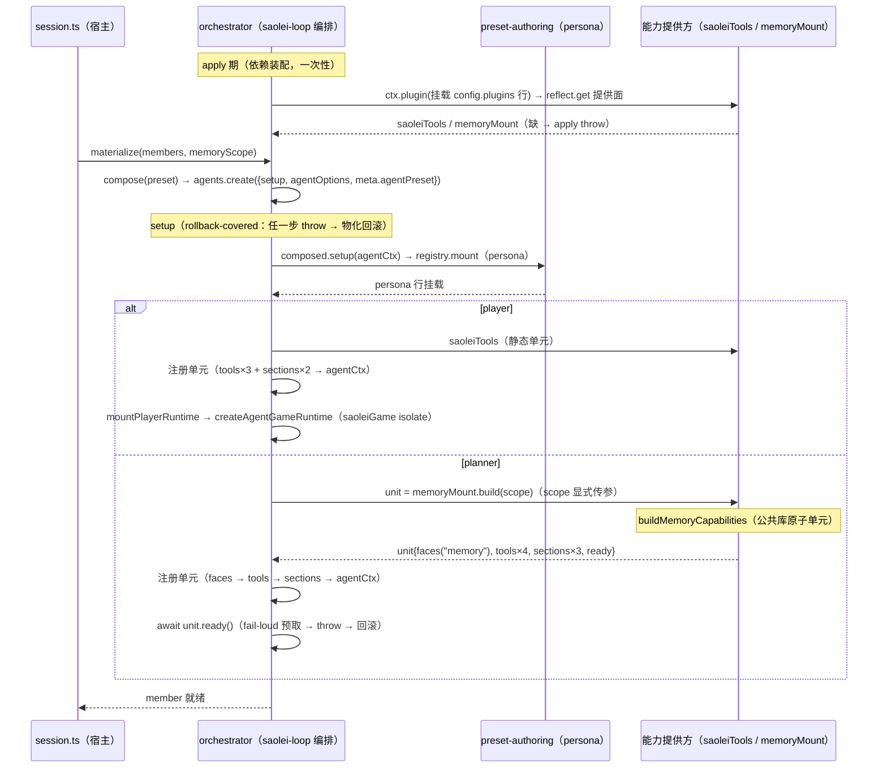

# Data Model: gRPC client 基建插件、memory 能力化与 preset 模板简化

**Feature**: [spec.md](spec.md) | **Date**: 2026-09-30

本特性无新增持久化数据（preset Mongo store、memory/wiki 存储语义均不变——specs/071 契约继续有效）。本文档刻画**运行时结构实体**（基建服务面、memory 公共库、能力提供方、编排装配）与其生命周期/状态迁移。

## 1. 基建层实体（grpc-runtime 插件）

### GrpcRuntime（`ctx.grpc` 服务面）

| 属性 | 形态 | 说明 |
|---|---|---|
| `client<T>(options): T` | 方法 | 按 options 构造类型化 service client（[contracts/grpc-runtime.md](contracts/grpc-runtime.md)） |
| `callUnary<T>(client, label, invoke, deadlineMs?): Promise<T>` | 方法 | unary 调用策略辅助（waitForReady/deadline/探测/失败日志） |
| channel 缓存 | `Map<string, ClientChannel>` | 键 = target（凭据/channel 策略为基建统一常量）；组合 dispose 时全部关闭 |
| packageDefinition 缓存 | `Map<string, PackageDefinition>` | 键 = protoPath + includeDirs join |
| canonical protoPath 解析 | 模块内 | runtime_protos 部署标准（service root 深溯）；绝对路径逃逸出口 |
| 策略常量 | 模块内 | round_robin / 无 keepalive / 退避 1s/15s / TLS ca.crt+TLS_SERVER_NAME（research.md D3） |

生命周期：随组合（apply 建立、teardown 关闭 channel）。无 per-agent 状态。

### GrpcClientOptions（消费方传入）

| 字段 | 类型 | 归属层 |
|---|---|---|
| `target` | string（dominion URI） | adapter config（部署拓扑） |
| `protoPath` | string（canonical import path 或绝对路径） | adapter config（部署拓扑） |
| `includeDirs` | string[]?（缺省 service root） | 基建缺省 |
| `serviceName` | string（完全限定名） | adapter（能力面知识） |
| `label` | string? | 可选 |

## 2. 能力层实体

### memory 公共库（@dominion/common-js-memory，`common/js/memory/`）

| 实体 | 关键成员 | 状态 |
|---|---|---|
| `MemoryScope` | `{ template, preset }`（specs/071 作用域键不变） | 值对象；编排层派生 |
| `MemoryStore` | memory 四 RPC 域语义 + wiki 三工具域语义（页游走、batch 两阶段、校验、分页——**等价迁入**） | 无状态（纯 client 适配） |
| `MemoryFace` | `prefetch()` / `applyCall` / `wikiSearch` / `wikiGet` / `wikiWrite` / `snapshotText()` | per agent；创建时绑定 scope；prefetch 冻结快照文本（specs/071 FR-005） |
| `MemoryCapabilities` | `{ faces:[{key:"memory",value:face}], tools×4, sections×3, ready }` | 原子单元（buildMemoryCapabilities 纯函数产出；不可部分消费） |
| `MemoryServiceCalls` / `WikiServiceCalls` | 8 个 RPC 方法结构类型 | 库内声明；adapter 构造 client 的泛型 T |

关系：`buildMemoryCapabilities` 内部 `createMemoryStore(clients)` → `createMemoryFace(store, scope)`；faces/tools/sections/ready 随单元产出，由 adapter 整单元注册。

### @dominion/dsh-saolei（对照实体）

保持 cordis 插件形态，**轻度改造为静态单元提供方**：挂载位置从 agent scope（模板行）变为组合级（saolei-loop config.plugins 子插件），apply 内改为 `ctx.provide("saoleiTools", { tools×3, sections×2 })`（组合级挂载下全局注册会泄漏给全员，故必须改）；工具定义/schema/文案与 sections 名/order/文本零变化；`saoleiGame` 运行时挂载仍属 createAgentGameRuntime（不在本包）。

## 3. 组装层实体（依赖声明 × 提供方 × 编排）

### saolei-loop Config 与依赖装配

| 实体 | 说明 |
|---|---|
| `config.plugins` | **扁平**能力依赖插件列表（包名 + config；无角色分组/白名单/校验）——纯依赖声明 |
| 依赖装配（apply 期） | 按裸包名动态解析 → `await ctx.plugin(entry, config)`（config schema 校验，失败 reject → 组合启动失败）→ `reflect.get("saoleiTools")` / `reflect.get("memoryMount")`（缺 → throw fail-loud）；子插件 fiber 随 saolei-loop dispose |
| `loadPlannerMemory` | 移除（预取并入编排对 `unit.ready()` 的 await） |

### 能力提供方（saolei-loop 子插件）

| 提供方 | 提供面 | 形态 |
|---|---|---|
| `@dominion/dsh-saolei` | `saoleiTools`：静态单元 `{ tools×3, sections×2 }` | apply 内 provide（改造：原 apply 全局注册会泄漏） |
| `@dominion/dsh-saolei-memory` | `memoryMount`：工厂 `{ build(scope): MemoryCapabilities }` | inject grpc；config `{ target, protoPath, label? }`；apply 组合级一次性构造 client（channel 共享）；build 经公共库原子单元工厂 |

### 成员物化组装状态迁移（P3 后终态）

**回滚不变量**：setup 内任一 reject（persona 挂载、单元注册、预取）→ `CreateAgentOptions` 既有 rollback——不残留半组装成员（specs/059；memory-plugin survey 决策 ⑧）。机制依据（cordis `ctx.plugin`/`provide`/`reflect.get`）见 research.md D13。

**编排权威**：player/planner 的能力分配、"planner 需要 memory"（tools + system prompt 记忆组装）由 saolei-loop 编排代码承载；能力内容语义（section 规格/文本/快照渲染与冻结）归公共库。

## 4. 模板/registry 实体（语义变更项）

| 实体 | 变更 |
|---|---|
| `TemplateDeclaration.plugins` | 语义收窄：即插即用自包含插件列表（当前 = persona 行）；工具行移除；无校验（[contracts/preset-templates.md](contracts/preset-templates.md)） |
| `TemplateRowRules` / `validateTemplateRows` | **删除**（research.md D8 清单） |
| `PresetRecord` / derive / registry 生命周期 | 不变（persona patch、分池、修订保留、restore、fail-loud resolve） |
| `meta.agentPreset` / registry.mount | 不变（成员身份 + persona 挂载） |
| saolei-loop `config.plugins` | 新增：扁平能力依赖插件列表（组装依赖能力的声明式归处，组合清单可见；无角色语义） |

## 5. 消失的实体（移除清单）

- `@dominion/dsh-memory-service` 包全部导出（MemoryClient 自建分支、MEMORY_SERVICE_TARGET、`ctx.plannerMemory` 面、PlannerMemoryService、service.ts scope Maps）——去向：领域语义迁入公共库；连接策略迁入基建；target 常量迁入 cordis.yml adapter config；host row 消失。
- `@dominion/dsh-memory` 包（插件形态）——退化为 `@dominion/common-js-memory` 公共库迁址 `common/js/memory/`。
- orchestrator `LoadPlannerMemory` 类型与 dep、session.ts `loadPlannerMemoryBinding`。
- templateRules 全部（D8 清单）。
