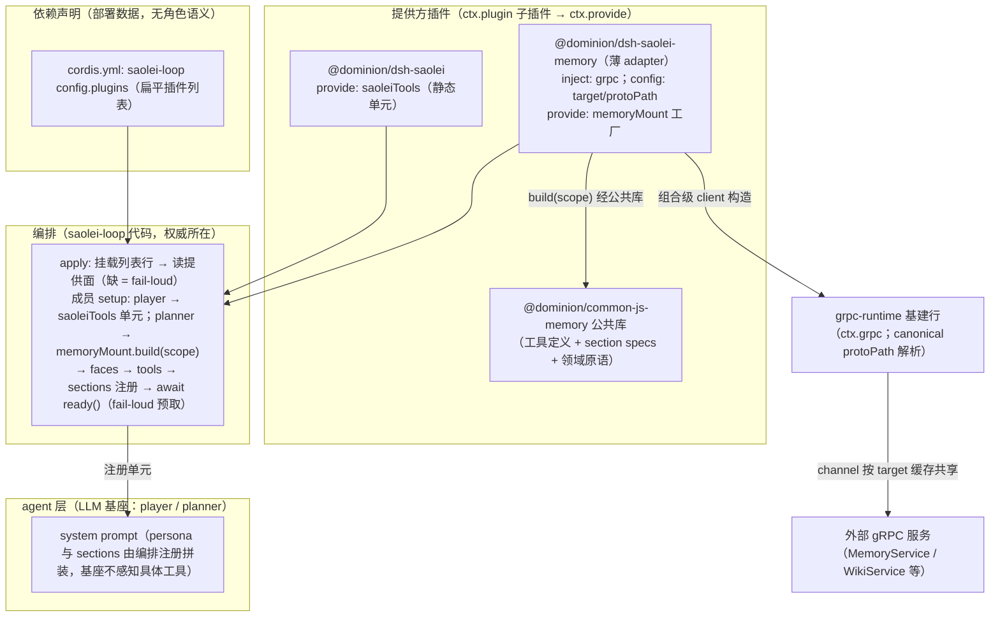

# Feature Specification: gRPC client 基建插件、memory 能力化与 preset 模板简化

**Feature Branch**: `074-dsh-grpc-runtime`

**Created**: 2026-09-30

**Status**: Draft

**Input**: User description: "1. 实现 grpc client runtime 基建插件，并对 memory 插件进行简化、移除 memory-service 插件；2. 简化 preset 模板（注意： 1. plugins 列表仍然存在，但语义发生变化，相关模块代码需要重构、死代码/不需要的功能需要被清理。2. saolei-loop 负责组装仍然以插件为单位组装，即 tools + prompt + 其他能力仍以插件为单位进行组装，不得拆分其中某个部分单独组装。）"；调研基线：[survey/dsh-grpc-runtime-client.md](../../survey/dsh-grpc-runtime-client.md)（调研三轮收敛，15 项决策已裁定；组装机制另经四轮收敛，见本 spec Clarifications）。

**决策基线**: 本特性按 survey/dsh-grpc-runtime-client.md 的自上而下三层模型定义目标形态——**基建 / 能力 / 组装分离**：基建（grpc runtime，组合级一件，各层消费）纵向贯穿；能力（memory 公共库与 saolei 插件，领域无关，无组装职责）；组装（scope 派生与发布、能力提供方挂载与编排消费、fail-loud 预取时序）归 **team 层**（代码驱动，非 LLM 驱动）。survey 决策 ①–⑮ 已由用户裁定，对本 spec 构成约束；其 §9 移交清单已在 plan 阶段定稿（specs/074-dsh-grpc-runtime/research.md D1–D14）。

## Clarifications

### Session 2026-09-30（plan 阶段，组装机制四轮收敛）

- Q: 编排层（saolei-loop）如何获得能力实现的组装入口？ → A: 四轮收敛。**终态 = 依赖声明 × 提供方挂载 × 编排消费**（cordis 原生 DI）：saolei-loop Config 携带**扁平**能力依赖插件列表（无角色分组），列表插件经 `ctx.plugin` 挂载为子插件并以 `ctx.provide` 暴露能力实现，saolei-loop apply 完成依赖装配（缺失 fail-loud）、成员 setup 按角色消费能力单元注册到成员上下文（注册序 faces → tools → sections → ready await，预取失败 = 物化回滚）。第一轮"副作用回调注入"（宿主直接修改编排域）、第二轮"bundle provider 回调"（部署知识进代码、机制自创）、第三轮"role 分组插件列表 + 官方 agentPresets.mount"（把角色编排逻辑泄漏进配置；官方 registry 仅为可选实现手段而非架构目标——用户澄清）均被否决。用户原则："saolei-loop 声明有哪些依赖，plugins 中的插件实现这些依赖并挂载，然后 saolei-loop 拿着这些依赖再去组装和编排"；"如果仅仅承担依赖注入，那不需要分 role"。
- Q: memory 能力进入成员的桥接形态？ → A: **薄 adapter 插件 `@dominion/dsh-saolei-memory`**（common/js/dsh-plugins/saolei-memory/）——inject grpc、config 携带部署连接参数（target、canonical protoPath）、apply 内组合级一次性构造 client 并提供 `memoryMount` 工厂；`build(scope)` 由编排**显式传参**（无属性穿越约定），内部调用 memory 公共库的原子单元工厂。依赖方向：adapter → memory 公共库（不依赖 saolei-loop）；编排权威（"planner 需要 memory"、tools + system prompt 记忆组装的执行）在 saolei-loop 代码。
- Q: adapter 承接插件职责后，dsh-memory 还需要插件形态吗？ → A: **不需要——干脆退化为公共 JS 库**：迁至 `common/js/memory/`、更名 `@dominion/common-js-memory`（公共库命名惯例：common/js/<域> → common-js-*；dsh-* 前缀保留给 cordis 插件）；无 name/inject/apply 导出，只导出 tool 定义工厂、section specs、能力原语与结构化调用面类型，由 adapter 消费。dsh-saolei 保持插件形态但**改造为静态单元提供方**（组合级挂载下 apply 内全局注册工具会泄漏给全员，改为 `ctx.provide("saoleiTools", ...)`——定义/文案零变化）。
- Q: protoPath 如何配置化（构建系统相关）？ → A: **config 携带 canonical import path**（如 `projects/game/game.proto`——构建系统无关的逻辑身份），由 grpc-runtime 基建按仓库 runtime_protos 部署标准解析为运行时绝对路径（与 TLS 常量同级的仓库统一约定）；绝对路径作为逃逸出口。
- Q: survey 决策 ⑥（消费 agent_v2_types 生成接口）是否维持？ → A: **精确化**——"消除 proto 对象 any 强转"目标不变（基建单点泛型收口，消费面为能力包的结构化调用面类型）；生成接口从"必选消费面"变为可选的兼容性校验（client 构造移入 adapter 后，生成接口不再必然可达）。

## User Scenarios & Testing *(mandatory)*

### User Story 1 - gRPC client 基建插件：RPC 依赖型工具的共享 runtime (Priority: P1)

依赖外部 gRPC 服务的插件目前必须内嵌完整 client 基建（现状 memory-service：~470 行连接基建——client.ts 473 行，wiki-client.ts 复用同型 unary 策略），且每个新 RPC 依赖域都要复制样板并单独抽一个 host row。新增一个**组合级 gRPC client 基建插件行**（与框架基线行 `@dominion/dsh-core` 同级，领域无关，生命周期随组合）：对外提供"按 target + proto + service 构造 client"的服务面与 unary 调用辅助；内部组合既有 dominion resolver（`common/js/grpc/resolver`）与 grpc otel（`common/js/grpc/otel`），channel 按 (target, 凭据策略, channel 策略) 键缓存、跨服务 client 共享，packageDefinition 按 protoPath 缓存。此后任何消费方（能力包、未来的自包含插件）经 inject 声明即可消费，与 `inject: ["tools"]` 同构。

**Why this priority**: 基建行是 memory 能力化的结构前提（memory 领域语义迁移后经它建连），也是本特性消除"每域一行样板"的收益载体；独立于其余故事可先行交付。

**Independent Test**: 基建行可独立组合进测试进程并以单测验证：client 构造、channel/packageDefinition 缓存命中、连接策略（见验收 3）、unary 辅助语义；并以 Memory/Wiki 双 client 为消费样板验证连接共享。

**Acceptance Scenarios**:

1. **Given** 组合清单含基建行且已启动，**When** 消费方声明消费基建服务面并请求某 (target, proto, serviceName) 的 client，**Then** 获得该服务的 client，不要求消费方自带任何连接代码。
2. **Given** 同一 (target, 凭据策略, channel 策略) 下的多个服务 client 请求（如 MemoryService 与 WikiService），**Then** 两者共享同一底层 channel（现状两条独立连接的缺陷顺带修正，survey R1）。
3. **Given** 现状 client.ts 已验证的连接策略（完整清单、取值与 why 见 FR-004）——**Then** 在基建行中语义等价保留，且其 why 以注释随代码迁移（survey"必须随代码迁移的策略"清单）。
4. **Given** grpc otel 的载入顺序约束（须先于 grpc-js 模块加载），**Then** 基建行保持正确初始化顺序，且 MUST NOT 出现模块顶层副作用初始化（survey §8 风险项）。
5. **Given** proto 文件路径（protoPath），**Then** 由消费方 config 携带 canonical import path（构建系统无关的逻辑身份）；基建按仓库统一 runtime_protos 部署标准解析为运行时绝对路径（个性/非标准布局知识不入基建；绝对路径为逃逸出口），同一基建可服务不同部署布局。
6. **Given** unary 调用，**Then** 既有策略雏形语义（deadline、waitForReady、调用前连接探测、失败后连接状态日志）等价保留于基建服务面。
7. **Given** gRPC server 侧配置、HTTP/Mongo 等其他协议，**Then** 不在本基建范围内（组合级留同构扩展位，survey 决策 ⑤）。

---

### User Story 2 - memory 能力化与 memory-service 移除 (Priority: P1)

memory-service 插件（`common/js/dsh-plugins/memory-service/`，2,080 行/8 文件）把连接基建与领域语义耦在一个 host row 里，并要求消费方经 `ctx.plannerMemory` 闭包绑定工具。本故事：**memory-service 整体移除**；其领域语义（operations / wiki-operations / snapshot / errors / service，~1,139 行）**等价迁入** memory 公共库；`common/js/dsh-plugins/memory/`（`@dominion/dsh-memory`）**退化为公共 JS 库**并迁至 `common/js/memory/`（`@dominion/common-js-memory`）：插件形态（name/inject/apply 导出与行挂载）完全消失，导出 tool 定义工厂（execute 经执行期 agent 上下文解析 per-agent 调用面——`common/js/dsh-plugins/saolei/src/index.ts:91-104` 同型先例）、prompt section specs、能力原语（建 store、按 scope 构面、快照渲染与 section 构造）与结构化调用面类型；由 adapter 插件（US3）消费。类型面消除 proto any 强转（基建单点泛型收口）。

**Why this priority**: 与 US1 共同构成本特性的结构核心——"memory 是与场景无关的部分，组装 memory 不是它的职责"（survey 决策 ⑨ 原话）；领域语义等价迁移保证行为零回归。

**Independent Test**: 领域语义单测随迁移等价保留并可独立全绿（校验、batch 两阶段、wiki 分页、快照渲染）；库导出面（单元工厂 + 原语）以单测验证（缺面 fail-loud、per-agent 面解析）；`@dominion/dsh-memory-service` 包名在仓库内引用清零可静态验证。

**Acceptance Scenarios**:

1. **Given** memory-service 包与其组合清单行（`projects/game/agent_v2/cordis.yml:176`），**Then** 包目录、行、依赖声明（package.json / BUILD.bazel / tsconfig / README）与全部引用整体消失，`ctx.plannerMemory` 服务面不复存在，仓库内对包名与面名的引用清零。
2. **Given** memory 领域既有行为契约（memory 操作语义与 content ≤1024 rune 校验、batch 两阶段预检/提交、wiki 校验/分页/单条上限、快照 10 条 update_time 降序与"物化时冻结"语义——specs/071-memory-preset-scope、specs/069-wiki-template-web 契约），**Then** 迁移后全部等价保持（语义用例等价迁移，零行为变化）。
3. **Given** common-js-memory 公共库，**Then** 无插件形态（不导出 name/inject/apply、不以行挂载）；其能力单元（四工具 + memory/wiki guidance + 快照 section + agent-scoped 面）作为**一个原子单元**产出，由编排（team 层成员 setup，经 adapter 提供的 `memoryMount` 工厂）整单元注册（用户约束：不得拆分其中某个部分单独组装）。
4. **Given** 已挂载单元的 memory/wiki 工具执行，**When** 执行期 agent 上下文上缺少该单元注册的调用面，**Then** fail-loud 报错（错误信息指明缺失的面与注册责任在组装层），不静默回退、不猜 scope。
5. **Given** 库的类型面，**Then** proto 对象无 any 强转（基建 client 泛型单点收口，库以结构化调用面类型消费 client）；types-only 声明 + 运行时 proto-loader 的既有约定不变（survey 决策 ⑥ 按 Clarifications 2026-09-30 精确化）。
6. **Given** 库的领域无关性，**Then** 包内无场景词汇（player/planner 等）、无 scope 自足派生、无组装流程（建连、预取、注册顺序均不在库内）。

---

### User Story 3 - team 层以插件为单位的成员组装 (Priority: P1)

工具与配套 prompt 的挂载点从 preset 模板插件行迁移到 **team 层成员物化组装**，机制为**依赖声明 × 提供方挂载 × 编排消费**（cordis 原生 DI 惯用法，四轮收敛终态）：团队循环插件（saolei-loop）的 Config 携带**扁平能力依赖插件列表**（`plugins`，无角色分组——纯依赖声明，"这些能力分给谁"不是配置的职责）；列表插件被挂载为 saolei-loop 子插件并以 `ctx.provide` 暴露能力实现（`@dominion/dsh-saolei` 改造为静态单元提供方 `saoleiTools`；薄 adapter `@dominion/dsh-saolei-memory` 以 config 携带 target 与 canonical protoPath、提供 per-member 工厂 `memoryMount`）；saolei-loop 在 apply 完成依赖装配（挂载列表行 + 读取提供面，缺失 fail-loud）、在成员 setup 按角色消费能力单元并注册到成员上下文（player → saoleiTools 单元 + 既有 mountPlayerRuntime；planner → `memoryMount.build(scope)` 显式传参 → faces/tools/sections 注册 → await fail-loud 预取）——**"player 用 saolei、planner 用 memory（含 system prompt 记忆组装）"的编排权威在 saolei-loop 代码**；能力内容语义归 memory 公共库（`@dominion/common-js-memory`，US2）。

**Why this priority**: 组装归 team 层是三层模型的第三块结构（survey 决策 ⑧⑨⑬），也是 US4 模板简化的前提（工具行移出模板后必须存在组装通路）；saolei-loop 编排层已有同型生产先例（成员 setup 挂 saoleiGame），风险已知。

**Independent Test**: 组装流程以 orchestrator/session 层单测验证（player/planner 成员物化后的工具可见面、section 注入面、预取失败回滚）；planner 记忆回路（写入 → 快照注入 → 跨 session 可见）经既有大型测试 memory/preset 用例覆盖。

**Acceptance Scenarios**:

1. **Given** 组合清单中 saolei-loop 行的扁平能力依赖列表（`@dominion/dsh-saolei`；`@dominion/dsh-saolei-memory` + 连接 config），**When** planner 成员物化，**Then** setup 内完成 persona 挂载（composed.setup）与 memory 能力单元注册（`memoryMount.build(scope)` → client/face 构建 → 注册 agent-scoped 面 + 四工具 + guidance + 快照 section（注册序固定 faces → tools → sections）→ `await unit.ready()` fail-loud 预取）。
2. **Given** player 成员物化，**Then** setup 内完成 persona 挂载、saoleiTools 单元注册（三工具 + sections）与既有 mountPlayerRuntime；player 的工具面与 system prompt 中**不出现**任何 memory/wiki 工具与快照段（角色能力隔离由编排代码保证）。
3. **Given** 物化期 memory 预取失败（服务不可达等），**Then** `ready()` reject → setup throw → 物化整体回滚、不残留半组装成员——fail-loud 预取语义不变（specs/071 memory-plugin survey 决策 ⑧；`CreateAgentOptions` setup throw 即回滚的既有框架行为）。
4. **Given** 任一能力提供方（saoleiTools、memoryMount），**Then** 其 tools + prompt + 其他能力在编排注册中**一次整单元完成**，不存在只挂工具不挂 prompt 的拆分形态（用户约束 2）。
5. **Given** scope（(template, preset) 记忆作用域），**Then** 由编排层派生并经 `build(scope)` 显式传入；能力库与工具不自足派生 scope（框架事实：Agent 公共面仅 id，meta.agentPreset 不暴露给执行期——survey 决策 ⑫/R2）。
6. **Given** 能力依赖插件列表，**Then** 为纯依赖声明：无角色分组、无白名单、无校验——编排代码不消费的提供为惰性；插件自身依赖不满足或所需提供缺失 → 组合启动 fail-loud；"把 X 错配给某角色"的配置形态不存在（角色分配权威在编排代码）。

---

### User Story 4 - preset 模板与 registry 简化：即插即用列表 (Priority: P2)

现状模板行机制存在层序倒置：templateRules 把场景知识（"player 恰含 saolei 行、禁 memory 行"）放进部署数据（cordis.yml Config），而用户 preset 从来不能改组合——校验的只是部署自控常量，无运行时灵活性收益。本故事：**templateRules 机制整体移除**（Config schema、校验逻辑、宿主数据、测试 fixture）；模板快照 `templates.{}.plugins` **保留但语义变更**——**自包含通用插件的即插即用挂载列表**：无校验、无额外语义，"往里添加插件就表明你知道你在做什么"（survey 决策 ⑭）；当前内容为 persona 行（经既有 registry/compose 挂载，persona patch 语义不变）。需要上层组装的能力（saolei、memory 类：有 per-agent 状态/scope/物化期动作者）不列入此表，其组装归 US3。分界判据唯一：**是否需要上层组装**。preset registry **瘦身保留**（survey 决策 ⑮）：store CRUD、分池、persona-only 编辑、fail-loud resolve、修订保留、restore、derive（persona patch + 即插即用行）语义不变；registry 对成员生效面的贡献收缩为 persona 挂载 + `meta.agentPreset` 身份（provider/model 经 agentOptions 直达 loop 的既有通路不变）。

**Why this priority**: 依赖 US3 通路存在后才能移除模板工具行；本身是机制简化与层序修正，无新能力，风险低。

**Independent Test**: preset-authoring 单测重组后全绿（CRUD/derive/resolve/修订保留语义不变 + templateRules 校验路径消失）；模板→物化回路经既有 agent_v2_preset 大型测试用例验证零回归。

**Acceptance Scenarios**:

1. **Given** templateRules 相关代码与数据（`common/js/dsh-plugins/preset-authoring/src/index.ts` Config schema 与校验调用、`src/derive.ts` validateTemplateRows、`projects/game/agent_v2/cordis.yml:160-170` 规则数据、各测试 fixture），**Then** 整体移除；preset 创建不再存在行校验拒绝路径。
2. **Given** 模板快照 plugins 列表，**Then** 工具行（`@dominion/dsh-saolei`、`@dominion/dsh-memory`）移除，保留 persona 行；列表语义 = 即插即用自包含插件（无 per-agent 状态、无物化期动作），添加即挂载，无额外校验。
3. **Given** 即插即用与组装依赖的分界，**Then** 唯一判据"是否需要上层组装"在契约文档中明确（`contracts/preset-templates.md` §2）；**误将**组装依赖插件（如 `@dominion/dsh-saolei`）挂入即插即用列表且漏入 saolei-loop `config.plugins` 时，编排 apply 读取提供面缺失 → **组合启动 fail-loud**（不静默半功能）；若两处同时列入，编排按 `config.plugins` 消费、即插即用侧的挂载为惰性（无害）。
4. **Given** preset registry 全部既有语义（store CRUD、role 分池与模板选择、persona-only 编辑、fail-loud resolve、修订保留、restore、derive 的 persona patch），**Then** 除 templateRules 与模板行内容外全部不变。
5. **Given** 成员生效面，**Then** persona 与身份经 registry 挂载（composed.setup → registry.mount），provider/model 仍经 agentOptions 直达 loop——成员生效行为零变化。
6. **Given** 角色默认 persona（模板 persona 行 prefix），**Then** 作为纯配置项保留（去留不影响架构与系统运行，survey 决策 ⑮）。

---

### User Story 5 - 终态清理：死代码、单测重组与契约修订 (Priority: P2)

形态迁移后遗留的引用与文档必须终态化（宪章原则 VII：交付物只表述终态）：无引用代码与不需要的功能清理（templateRules 之外：过时测试 fixture、组合清单头部注释、README 与模板描述文案中的旧形态表述）；单测随形态迁移重组——领域语义用例等价迁移、形态用例按新形态重写、新增缺面 fail-loud 断言；受影响契约文档修订至终态并契约化三处行为差异（缺面错误信息、section 注册点从 preset 行挂载迁移到组装点、session.ts planner memory seam 形态）。

**Why this priority**: 保证交付物一致性与后续 spec 的引用有效性；依赖前序故事定形，独立于功能正确性可单独验收。

**Independent Test**: 静态检查（引用清零、文案无旧形态残留）+ 契约文档 diff 审阅 + 重组后单测全绿。

**Acceptance Scenarios**:

1. **Given** 仓库内对 `@dominion/dsh-memory-service`、`plannerMemory`、`templateRules` 的引用，**Then** 代码与文档全部清理或改写为终态表述（`projects/game/agent_v2/README.md`、`projects/game/agent_v2/src/dsh.test.ts` fixture、preset-authoring 测试 fixture 等）。
2. **Given** 受影响契约（specs/059-agent-v2-team-mode/contracts/preset-api.md §2 与 dsh-plugins.md §3/§5、specs/070-dsh-upgrade/contracts/composition-manifest.md 与 preset-model-mapping.md §3、specs/071-memory-preset-scope/contracts/dsh-plugins.md 与 memory-service.md），**Then** 修订至新形态终态：组合清单行变化（含 saolei-loop 角色插件 config）、模板 plugins 新语义、组装归属、memory 公共库面。
3. **Given** 三处行为差异（缺面错误信息文案、section 注册点、session.ts seam 形态），**Then** 在契约中以终态表述固化。
4. **Given** 单测布局，**Then** 迁移后语义覆盖不低于现状：领域用例等价迁移全绿、新形态用例（基建缓存/共享、库导出面、adapter 挂载流程、缺面 fail-loud）齐备。

### Edge Cases

- **误挂插件到能力列表**：配置无角色槽位可错填（扁平纯依赖声明）；非插件包或自身依赖不满足的插件列入 saolei-loop 列表 → 其挂载失败 → 组合启动 fail-loud；列入但编排不消费 = 惰性（无害）；所需提供缺失（列表漏项）→ saolei-loop apply fail-loud——不存在静默降级路径。
- **channel 共享放大同 target 故障域**：多服务 client 共享一条 channel 后，该 target 故障影响面扩大——风险等价评估为不变（现状 Memory/Wiki 本就同实例集），在契约中记录（survey §8）。
- **grpc-otel 载入顺序**：基建行初始化顺序约束延续；任何"提前 import grpc-js"的改动都可能破坏 otel 注入——单测覆盖基建行初始化路径。
- **物化回滚的半组装残留**：组装步骤（预取、面注册）任一失败必须整体回滚（既有 CreateAgentOptions rollback 语义），不留下"有工具无面"或"有面无快照"的部分成员。
- **并发物化同一 preset 的多个 planner**：各自物化时点冻结各自快照（specs/071 既有语义），组装流程不引入跨成员共享状态。
- **experimental/dsh/demo 零改动**：demo 组合（`experimental/dsh/demo/agent/cordis.yml`）不引用 memory 体系且无 templateRules，其 templates 形态即即插即用目标形态的既有先例——不在改动范围。
- **迁移中间态**：基建行可先行合入（无消费方时不影响行为）、memory 公共库与 adapter 可并行准备，切换步骤（模板行移除 + saolei-loop config.plugins 激活与编排消费接入 + memory-service 删除）应收敛为可验证的分步——具体分步与验收门禁见 plan（research.md D11），每步必须保持 `bazel build //...` 与 `bazel test //...` 可通过。
- **saolei-loop 与能力实现的依赖方向**：编排包以包名动态解析消费提供方插件（非编译依赖）；公共库无场景/部署知识；adapter 不依赖 saolei-loop（scope 显式传参）——三层互不反向依赖。
- **机制时序依赖**：fail-loud 预取依赖 `ready()` reject → setup throw → 回滚（框架既有语义）；依赖装配依赖 cordis `ctx.plugin` 的 config 校验与挂载失败 reject、`reflect.get` 的 undefined 判缺（cordis 4.0.4 已核验，research.md D13）——cordis 版本升级时复核。
- **角色默认 persona 与模板描述文案**：persona 行保留；模板 description 中的旧表述（"persona + saolei 工具插件行"）随语义变更改写。

## Requirements *(mandatory)*

### Functional Requirements

**基建层（US1）**

- **FR-001**: 系统 MUST 新增组合级 gRPC client 基建插件行：组合清单一件、与框架基线行同级、领域无关、生命周期随组合；MUST NOT 以领域专属 host row 形态存在（survey 决策 ④⑤）。包名与服务名在 plan 阶段定稿（survey §9 移交项 1）。
- **FR-002**: 基建服务面 MUST 提供：按 (target, proto, serviceName) 构造 client 的能力与 unary 调用辅助；unary 辅助 MUST 等价保留既有策略雏形语义（deadline、waitForReady、调用前连接探测、失败后连接状态日志）。API 签名在 plan 阶段定稿。
- **FR-003**: channel MUST 按 target 缓存并跨服务 client 共享（凭据/channel 策略为基建统一常量，故键退化为 target——策略分化时 MUST 扩键；经官方 channel 共享机制，survey R1）；packageDefinition MUST 按 (protoPath + includeDirs) 缓存；MemoryService 与 WikiService 的 client MUST 共享一条底层连接。
- **FR-004**: 连接策略 MUST 等价迁移且带 why 注释：round_robin 覆盖默认 pick_first（滚动升级路由）、MUST NOT 引入 app 级 keepalive（对齐 grpc-go ClientDefault，unary server enforcement 会 GOAWAY 多余 ping）、重连退避 1s/15s、TLS `/etc/tls/ca.crt` + TLS_SERVER_NAME override（survey"必须随代码迁移的策略"清单）。
- **FR-005**: 基建行 MUST 组合既有 `@dominion/common-js-grpc-resolver`（源码依赖）与 `@dominion/common-js-grpc-otel`（部署闭包依赖，源码不 import；不拆独立 common lib，survey §6.1）；gRPC 插桩注册 MUST 归服务 bootstrap 两段式入口（specs/048-js-esm-migration/contracts/otel-instrumentation-esm-contract.md §2），基建插件 MUST NOT 自行注册插桩；otel 先于 grpc-js 模块加载的顺序约束 MUST 保持（插件 channel 惰性创建，创建必然后于 bootstrap 插桩注册）；基建 MUST NOT 存在模块顶层副作用初始化。
- **FR-006**: protoPath MUST 以 canonical import path 形态（如 `projects/game/game.proto`——构建系统无关的逻辑身份）由插件 config 携带；基建 MUST 按仓库 runtime_protos 部署标准（`tools/release/deploy/README.md` §runtime_protos，与 TLS 常量同级的仓库统一约定）解析为运行时绝对路径（service root 经模块相对深溯，与现状 memory-service `serviceRoot()` 生产布局同型），绝对路径作为逃逸出口（Clarifications 2026-09-30）。
- **FR-007**: 本基建 MUST 仅覆盖 gRPC client 侧；gRPC server 配置与 HTTP/Mongo 等其他协议 MUST NOT 纳入（组合清单留同构扩展位，survey 决策 ⑤）。

**能力层（US2）**

- **FR-008**: `@dominion/dsh-memory-service` 包 MUST 整体移除：包目录、组合清单行、依赖声明（package.json / BUILD.bazel / tsconfig / README）与全部引用；`ctx.plannerMemory` 服务面 MUST 消失；MUST NOT 以改名或瘦身形态保留 memory 专属服务行（survey 决策 ⑪）。
- **FR-009**: memory 领域语义（memory 操作与校验、batch 两阶段、wiki 三工具语义与校验/分页/上限、快照渲染 10 条 update_time 降序）MUST 等价迁入 memory 公共库，行为契约零变化（specs/068/069/071 既有契约全部继续有效）。
- **FR-010**: `@dominion/dsh-memory` MUST 退化为公共 JS 库并迁移为 `@dominion/common-js-memory`（`common/js/memory/`）：无插件形态（不导出 name/inject/apply、不以行挂载）、无组装职责；MUST 导出（a）原子能力单元工厂——memory + wiki_search/wiki_get/wiki_write 工具定义、memory/wiki guidance、快照 section、agent-scoped 面与 fail-loud 预取 ready 作为**一个单元**产出；（b）能力原语——建 store（收注入 client）、按 scope 构面、快照渲染与 section 构造（无副作用、无组装流程）。导出面粒度与命名在 plan 阶段定稿（survey §9 移交项 2）。
- **FR-011**: 库工具定义的 execute MUST 经执行期 agent 上下文解析 per-agent 调用面（saolei 同型模式）；面缺失时 MUST fail-loud，错误信息 MUST 指明缺失面与注册责任方（team 层成员物化 setup，即编排层；adapter 仅为提供方，不负责注册）。
- **FR-012**: proto 对象 MUST NOT 出现 any 强转（基建 client 泛型单点收口；库以结构化调用面类型消费 client）；types-only 声明 + 运行时 proto-loader 的约定 MUST NOT 改变（survey 决策 ⑥ 按 Clarifications 2026-09-30 精确化）。
- **FR-013**: memory 公共库 MUST 领域无关：包内 MUST NOT 出现场景词汇、scope 自足派生、组装流程、部署布局知识（survey 决策 ⑨）。

**组装层（US3）**

- **FR-014**: 成员能力组装 MUST 落在 team 层成员物化 setup，机制为依赖声明 × 提供方挂载 × 编排消费：saolei-loop Config 携带**扁平**能力依赖插件列表（`plugins`，无角色分组、无白名单、无校验——角色编排逻辑 MUST NOT 下放进配置）；列表插件经运行时挂载成为 saolei-loop 子插件并以服务面提供能力实现；saolei-loop apply 完成依赖装配（挂载失败或所需提供缺失 MUST fail-loud），成员 setup 按角色消费能力单元注册到成员上下文（cordis 原生 DI，survey 决策 ⑬）。
- **FR-015**: 组装 MUST 以插件为单位：每个能力提供方的 tools + prompt + 其他能力 MUST 作为整单元被编排一次注册；MUST NOT 存在对某能力单元的部分组装（只挂工具不挂 prompt 之类的拆分形态——用户约束 2 原文约束）。
- **FR-016**: planner 成员组装 MUST 完成：persona（经 composed.setup）+ memory 能力单元注册——`memoryMount.build(scope)`（client/face 构建）→ 注册序固定 **faces → tools → sections**（agent-scoped 面 + 四工具 + guidance + 快照 section）→ `await unit.ready()`（fail-loud 预取；reject → setup throw → 物化回滚语义见 FR-018）。
- **FR-017**: player 成员组装 MUST 完成：persona + saoleiTools 单元注册（三工具 + saolei sections）+ 既有 mountPlayerRuntime；player MUST NOT 感知 memory/wiki 工具与 memory 快照段。
- **FR-018**: 物化期 fail-loud 预取语义 MUST 保留：预取失败即物化回滚，MUST NOT 残留半组装成员（单一事实源：`contracts/team-assembly.md` §6；specs/071 与 memory-plugin survey 决策 ⑧；`ready()` reject → setup throw → rollback）。
- **FR-019**: (template, preset) scope 派生 MUST 保留在 team 层（编排层既有 memoryScope 流）并经 `build(scope)` 显式传入能力工厂；能力库与工具 MUST NOT 自足派生 scope（survey 决策 ⑫）。
- **FR-020**: `@dominion/dsh-saolei` MUST 改造为静态单元提供方插件：apply 内 `ctx.provide("saoleiTools", ...)` 暴露三工具与 saolei:guidance/saolei:game sections（定义/schema/文案/名/order/文本零变化）；MUST NOT 在组合级挂载的 apply 中全局注册工具（会泄漏给全员）；工具 execute 的 `exec.agent.ctx.saoleiGame` 解析与 createAgentGameRuntime 运行时挂载不变。
- **FR-021**: memory 能力进入成员 MUST 经薄 adapter 插件 `@dominion/dsh-saolei-memory`（`common/js/dsh-plugins/saolei-memory/`）：inject grpc、config 携带部署连接参数（target、canonical protoPath）、apply 内组合级一次性构造 client 并 `ctx.provide("memoryMount", { build(scope) })`；依赖方向 MUST 为 adapter → memory 公共库，adapter MUST NOT 依赖 saolei-loop 任何约定（scope 显式传参）。

**模板与 registry（US4）**

- **FR-022**: templateRules 机制 MUST 整体移除：preset-authoring Config schema、validateTemplateRows 校验、宿主 cordis.yml 规则数据、相关测试 fixture（survey 决策 ⑭）。
- **FR-023**: 模板快照 `templates.{}.plugins` MUST 移除工具行并保留 persona 行；其语义 MUST 变更为自包含通用插件的即插即用挂载列表：经既有 registry/compose 挂载、无校验、无额外语义。
- **FR-024**: 即插即用与组装依赖的分界判据 MUST 唯一且契约化：是否需要上层组装（per-agent 状态 / scope / 物化期动作）；需要上层组装的能力 MUST NOT 列入即插即用列表（team 层角色能力插件列表是其归处）。
- **FR-025**: preset registry MUST 瘦身保留：store CRUD、role 分池与模板选择、persona-only 编辑、fail-loud resolve、修订保留、restore、derive（persona patch + 即插即用行）语义 MUST 不变；registry 对成员生效面的贡献为 persona 挂载 + meta.agentPreset 身份（survey 决策 ⑮）。
- **FR-026**: 能力依赖插件 MUST 在 saolei-loop 行 config 中声明式可见（组合清单可检视，包经组合闭包解析）；能力提供方（插件/库）与即插即用插件的组合可见性边界 MUST 在契约文档中明确（survey §8 可见性担忧由此收束：两类能力均声明式可见）。

**终态清理（US5）**

- **FR-027**: 无引用代码、过时 fixture、过时注释与 README/模板描述文案 MUST 清理至终态表述（宪章原则 VII：不保留迭代过程记录）。
- **FR-028**: 受影响契约文档 MUST 修订至终态（specs/059 preset-api.md §2 / dsh-plugins.md §3/§5、specs/070 composition-manifest.md / preset-model-mapping.md §3、specs/071 dsh-plugins.md / memory-service.md）；三处行为差异（缺面错误信息、section 注册点迁移、session.ts planner memory seam 形态）MUST 契约化。
- **FR-029**: 单测 MUST 随形态迁移重组：领域语义用例等价迁移、形态用例按新形态重写、新增缺面 fail-loud 断言与基建缓存/共享断言；重组后语义覆盖 MUST NOT 低于现状。

### Key Entities *(include if feature involves data)*

- **grpc-runtime 基建（ctx.grpc）**: 组合级 gRPC client 共享 runtime。关键属性：服务面（client 构造 + unary 辅助）、channel 缓存（键 = target；凭据/channel 策略为基建统一常量）、packageDefinition 缓存（键 = protoPath）、canonical protoPath 解析（runtime_protos 部署标准）、连接策略常量（round_robin / 无 keepalive / 退避 / TLS）、可观测性（otel）。关系：纵向贯穿各层，被角色能力插件与自包含插件消费；不持有任何领域语义。
- **memory 公共库（@dominion/common-js-memory）**: memory 领域能力的库封装（原 dsh-memory 退化）。关键属性：原子能力单元工厂（工具定义 + sections + 面 + ready 作为一个单元产出）、能力原语（无副作用）、领域语义实现、结构化调用面类型。关系：由 adapter 消费；不感知组装流程、场景与部署布局。
- **薄 adapter（@dominion/dsh-saolei-memory）**: 部署知识 × 能力实现的胶水插件（saolei-loop 依赖列表项，挂载为子插件）。关键属性：inject grpc、config 携带部署连接参数（target、canonical protoPath）、apply 内组合级一次性构造 client 并提供 `memoryMount` 工厂（`build(scope)` 显式收 scope → 公共库原子单元）。关系：依赖公共库与 grpc 面，不依赖 saolei-loop。
- **能力提供方插件（capability provider plugin）**: saolei-loop config.plugins 列表项（扁平、无角色语义）——挂载后以 `ctx.provide` 暴露能力实现（静态单元：dsh-saolei 的 saoleiTools；per-member 工厂：adapter 的 memoryMount）。关系：被 saolei-loop 装配与消费；组合清单声明式可见。
- **即插即用插件（plug-and-play plugin）**: `templates.{}.plugins` 列表项的目标语义——自包含通用插件（无 per-agent 状态、无物化期动作；web 浏览/搜索类及未来 RPC 自足工具）。关系：经 registry/compose 既有挂载；当前实例为 persona 行。
- **组装（assembly）**: team 层职责——依赖装配（挂载 config.plugins 行、读取提供面）、scope 派生与显式传参、能力单元注册（faces → tools → sections → ready）、fail-loud 预取时序、回滚。关系：发生在 saolei-loop（apply 装配 + 成员物化 setup 编排）。
- **Preset / Template / preset registry**: 语义不变，瘦身保留——preset 记录（persona、role、模板来源）、模板快照（name/description/plugins）、registry（CRUD/分池/resolve/修订保留/derive）。关系变化：模板 plugins 语义收窄为即插即用；角色能力 wiring 从模板行移至 saolei-loop config。

## Success Criteria *(mandatory)*

### Measurable Outcomes

- **SC-001**: 行为零回归：既有 agent_v2 大型测试四 suite（projects/game/testplan/system_test.yaml：game-system / game-disconnect / game-memory-down / game-stall）全部用例通过（all cases passed，经 testplan skill 完整执行），且重组后单测全部通过。
- **SC-002**: memory-service 零残留：`@dominion/dsh-memory-service` 包目录、组合清单行、依赖声明与 `plannerMemory` 引用在仓库内代码与文档中清零（静态检索零命中）。
- **SC-003**: 组合清单终态达成：新增 grpc-runtime 基建行；memory-service 行移除；saolei-loop 行 config 增**扁平**能力依赖列表（`@dominion/dsh-saolei`；`@dominion/dsh-saolei-memory` + 连接 config）；模板快照工具行与 templateRules 移除；`templates.{}.plugins` 保留（persona 行）且新语义契约化。
- **SC-004**: 连接共享生效：同 target 的 MemoryService 与 WikiService client 共享单一底层 channel（以单测断言与可观测面验证）。
- **SC-005**: 缺面 fail-loud 断言全过：未注册单元的工具执行报错、预取失败回滚、依赖装配失败（列表漏项 → apply throw；坏插件挂载 → 组合启动失败）——三类用例全部以明确错误信息失败（无静默路径）。
- **SC-006**: 样板收敛达成：现状 memory-service 8 文件 2,080 行全部去向明确——连接基建（client.ts 473 行）由基建行吸收、WikiService RPC 适配（wiki-client.ts 377 行）与领域语义（operations 478 / wiki-operations 379 / snapshot 66 / errors 10 / service 206，合计 1,139 行）等价迁入 memory 公共库、host row（index.ts 91 行）消失（473 + 377 + 1,139 + 91 = 2,080）；memory 库与 adapter 均不再含连接策略代码。
- **SC-007**: preset 回路不回归：preset CRUD、persona-only 编辑、role 池选择、fail-loud resolve、修订保留、模板→物化回路在 templateRules 移除后行为正常（preset-authoring 与 agent_v2 preset 用例全过）。
- **SC-008**: 组装完整性可验证：player/planner 成员物化后的工具面与 prompt section 面与改造前等价（player 三工具 + saolei sections；planner 四工具 + guidance + 快照 section），以组装流程单测断言。

## Assumptions

- survey/dsh-grpc-runtime-client.md 决策 ①–⑮ 已由用户多轮裁定，作为本 spec 的既定约束；被否决方案（MCP 桥、PTC 模式）不再评估，其否决理由见 survey §3 存档。survey §9 移交清单已在 plan 阶段全部定稿（specs/074-dsh-grpc-runtime/research.md D1–D14）；组装机制四轮收敛（回调注入 → bundle provider → role 分组 + 官方 mount → config.plugins 扁平声明 + 编排消费）与 dsh-memory 库化的裁定记录于本 spec Clarifications 2026-09-30。
- 仓库级基线化（基建行迁入 `third_party/dsh/core` 框架基线）推迟至第二个 agent 服务出现时评估（survey R4）；本特性基建行为组合清单行（projects/game/agent_v2/cordis.yml）。
- gRPC server 侧配置（agent_v2/src/server.ts）与 memory/wiki 存储 API 服务端实现不在本特性范围；web 管理视图零改动。
- experimental/dsh/demo 组合零改动（无 memory 体系引用、无 templateRules；其 templates 形态为目标即插即用语义的既有先例）。
- 角色默认 persona（模板 persona 行 prefix）保留为纯配置项；player/planner 模板 description 文案随语义变更改写。
- wiki 的 template 级作用域、memory 的 preset 级作用域及快照冻结/近因语义（specs/069/071 契约）不变；本特性只改"工具与能力如何到达 agent"的通路，不改领域行为。
- 单测迁移遵循"语义用例等价迁移、形态用例重写"的既有仓库惯例；大型测试沿用 projects/game/testplan 既有四 suite 框架，不新增独立测试计划体系。
- 正向依赖（inject，如 desktopBridge、ctx.grpc）与配置式依赖注入（config.plugins 能力单元）的取舍边界为设计原则，契约化于 contracts/team-assembly.md §7（判据：依赖对象是服务还是能力单元 + 归属共享还是场景私有）；本特性不改 desktop-bridge 等既有正向依赖。
- 迁移分步期间每步保持仓库可构建可测试（`bazel build //...` / `bazel test //...`）；最终验收按宪章原则 VI 以 testplan 实际执行为准。
