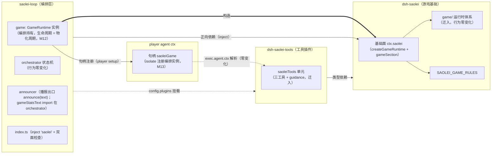

# Data Model: saolei 游戏基础与智能体工具解耦

**Feature**: [spec.md](spec.md) | **Date**: 2026-10-01

本特性为包边界重新划分，**无存储/schema/持久化变化**。数据模型 = 实体归属与导出面的迁移映射、组合清单结构变化、prompt section 注册矩阵。实体语义（游戏运行时状态机、终局记录、工具结果契约）零变化——本文件只记录"实体住在哪、谁导出、谁消费"的终态。

## 1. 游戏运行时实体（归属迁移：saolei-loop → dsh-saolei）

语义契约不变（specs/051-agent-v2-dsh-migration/data-model.md §2.5 为行为权威；specs/062-team-game-end-handoff §1 concludesTurn；specs/064-memory-split-fold-remain remain 语义）。此处仅列归属与导出。

| 实体 | 形态 | 需求前导出方 | 需求后导出方 | 消费方（终态） |
|---|---|---|---|---|
| `GameRuntime`（原 `GameRuntimeService`） | **普通实现类**（构造器仅收 `GameRuntimeDeps`；cordis Service 继承移除——D10） | `@dominion/dsh-saolei-loop` | `@dominion/dsh-saolei` | **TeamOrchestrator 持有实例**（编排字段，生命周期 = 物化周期）；工具经 player agent ctx 句柄解析调用 |
| `createGameRuntime` | 纯领域工厂（sessionName, desktopBridge）→ `GameRuntime`（无 agent、无 scope 注册副作用；desktop-bridge 预绑定 dispatch 组装等价保留） | ——（原 `createAgentGameRuntime(agent, bridge, sessionName)`，scope 注册型工厂） | `@dominion/dsh-saolei`（**且经基础面 `ctx.saolei` 暴露**） | saolei-loop 编排（materialize 构造） |
| `SaoleiGame` / `GameRuntime` 接口 | 接口（init/operate/remain/peekGameEvent） | `@dominion/dsh-saolei-loop` | `@dominion/dsh-saolei` | dsh-saolei-tools（工具 execute 类型面）、编排、句柄注册类型面 |
| `OperateInput` / `CellOperation` / `OperationType` | 操作类型 | 同上 | 同上 | dsh-saolei-tools |
| `ToolOutcome` | 工具结果契约（isError/text/concludesTurn） | 同上 | 同上 | dsh-saolei-tools（executeOutcome） |
| `GameEventRecord` | 终局记录（status/stats/endedAt） | 同上 | 同上 | 编排（review 触发/播报——**直读自身持有实例**）、testplan 语境 |
| `GameLogEntry` / `GameStats` | 游戏日志条目 / 终局统计 | 同上 | 同上 | dsh-saolei 内部（runtime 与 `gameStatsText` 渲染） |
| `gameStatsText` | 纯函数（GameEventRecord → 播报文案） | 同上 | 同上 | saolei-loop orchestrator（import 消费——`announceStats()` 播报路径；announcer 仅 `announce(text)`） |
| `board.ts`（`SaoleiBoardApi`/`validateMove`/`gameStatus`/`computeGameStats` 等） | 棋盘 API（依赖 `@dominion/game-saolei-board`） | saolei-loop `src/game/board.ts` | dsh-saolei `src/game/board.ts` | dsh-saolei 内部（runtime） |
| `geometry.ts` / `text.ts` | 窗口几何 / 结果文本渲染 | 同上 | 同上 | dsh-saolei 内部（runtime）+ orchestrator（`gameStatsText` 经包导出） |

**生命周期变化（M12）**：实例由 TeamOrchestrator 持有——materialize 构造、dispose/物化回滚丢弃、refresh 重建（与"随 player agent scope"的现状行为等价：游戏局从不跨 refresh 存留）；player agent ctx 上仅注册**句柄**（`isolate("saoleiGame").provide("saoleiGame", runtime)`，memory face 同型，M13）。**消失的 seam**：`MemberRuntime.game` 字段、`MountPlayerRuntime` 类型与 deps、session.ts 透传（M14）。**迁移后 saolei-loop 不再导出上述任何实体（单一出口，M8）**。

## 2. 游戏基础面（新增实体）

```ts
/** dsh-saolei 导出（contracts/saolei-foundation.md §2 为权威）： */
interface SaoleiFoundation {
  readonly createGameRuntime: typeof createGameRuntime;
  readonly gameSection: PromptSection;  // { name: "saolei:game", order: 50, text: SAOLEI_GAME_RULES }
}
/** Context 声明合并（两项）：
 *  ctx.saolei?: SaoleiFoundation（组合级，顶级 saolei 行提供）；
 *  ctx.saoleiGame?: SaoleiGame（agent-scoped 句柄，player setup 注册，工具 exec 解析——M8/M13）。 */
```

- **`SAOLEI_GAME_RULES`**（玩法文本常量）：归属 dsh-saolei（自旧 saoleiTools 单元拆出，文本零变化）；经 `gameSection` spec 与包导出双形态可见。
- 无状态、无 config、无生命周期动作（apply 仅 provide）。

## 3. saoleiTools 能力单元（定义收窄 + 归属迁移）

| 字段 | 需求前（dsh-saolei） | 需求后（dsh-saolei-tools） |
|---|---|---|
| `tools` | saolei_init / saolei_operate / saolei_remain（定义/schema/文案零变化） | 同左（等价迁入） |
| `sections` | [saolei:guidance(100), saolei:game(50)] | **[saolei:guidance(100)]**（saolei:game 拆归基础面，M5） |
| 校验资产 | AMBIGUOUS/MISSING/INCOMPLETE_ARGS_TEXT、normalizeOperateArgs、RESULT_OUTPUT_SCHEMA、resolveRuntime、executeOutcome | 同左（等价迁入，文案零变化） |
| `SAOLEI_GUIDANCE` | dsh-saolei 常量 | dsh-saolei-tools 常量（文本零变化） |
| 提供面 | `ctx.provide("saoleiTools", unit)` | 同名面（074 契约连续性），提供方换包 |

**v1 拒绝字面量与 `{result}` 输出 schema 为冻结契约值**（specs/051 §3、specs/064 §2）——迁移以逐字等价为验收。

## 4. prompt section 注册矩阵（终态）

| Section / 句柄 | order | 内容持有 | 注册点 | player | planner |
|---|---|---|---|---|---|
| persona（deployment:persona） | 0 | preset（模板 persona 行） | composed.setup | ✅ | ✅ |
| team:roster | 10 | @dominion/dsh-team | roster mount（team.register） | ✅ | ✅ |
| **saolei:game** | 50 | **@dominion/dsh-saolei**（gameSection） | **编排 setup 注册（基础面）** | ✅ | ✅ **（新增——074 遗留修复）** |
| saolei:guidance | 100 | @dominion/dsh-saolei-tools | 编排 setup 注册（saoleiTools 单元） | ✅ | ❌ |
| memory:guidance / wiki:guidance | 110/120 | @dominion/common-js-memory | 编排 setup 注册（memory 单元） | ❌ | ✅ |
| memory:snapshot | 200 | @dominion/common-js-memory（闭包渲染） | 编排 setup 注册（memory 单元） | ❌ | ✅ |
| **游戏句柄（saoleiGame）** | —（非 section：agent ctx 服务槽） | 编排持有的 `GameRuntime` 实例 | player setup 注册（`isolate("saoleiGame").provide`，M13） | ✅ | ❌ |

组装顺序语义不变（specs/060 contracts/prompt-sections.md §4 频带；order 升序拼接，同 order 按名序）。

## 5. 组合清单结构变化（projects/game/agent_v2/cordis.yml）

```yaml
# 需求后终态（22 行；contracts/cutover-contracts.md §2 为权威）：
- { id: grpc-runtime, name: '@dominion/dsh-grpc-runtime' }   # 既有基建行
- { id: saolei, name: '@dominion/dsh-saolei' }               # 新增：游戏基础行（无 config）
# ...（其余 19 行零变化）
- id: saolei-loop
  name: '@dominion/dsh-saolei-loop'                          # inject 增 "saolei"（代码侧）
  config:
    plugins:
      - name: '@dominion/dsh-saolei-tools'                   # 换入（原 @dominion/dsh-saolei）
      - name: '@dominion/dsh-saolei-memory'                  # 不变
        config: { target: 'dominion:///game/memory:50051', protoPath: 'projects/game/game.proto' }
```

行集合 21 → 22；`templates.{}.plugins`（persona-only）零变化。

## 6. 状态迁移总览



**消失实体**：saolei-loop `src/game/` 目录及其全部再导出；dsh-saolei 旧 saoleiTools provide 与工具资产；`GameRuntimeService`（Service 形态）与 `createAgentGameRuntime`（scope 注册型工厂）；`MemberRuntime.game` 字段、`MountPlayerRuntime` seam 与 session.ts 透传；`@dominion/dsh-saolei` 对 `@dominion/dsh-saolei-loop` 的依赖声明。
