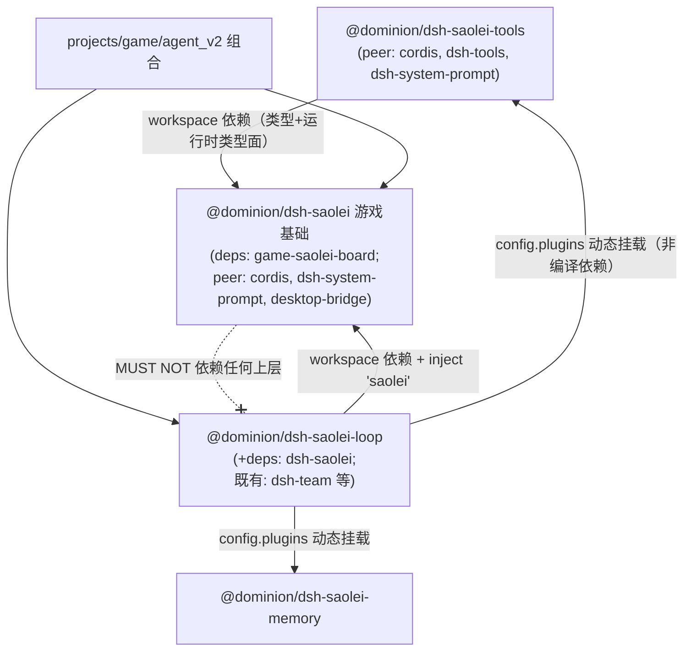

# Research: saolei 游戏基础与智能体工具解耦

**Feature**: [spec.md](spec.md) | **Date**: 2026-10-01

**决策基线**: spec 三项用户裁定（2026-10-01：顶级插件形态 / 玩法编排按角色注册 / 游戏领域全迁）+ Clarifications（大型测试显式 prompt 断言 Option B）。本文档对 plan 阶段的全部实现形态问题作出裁定；每条以仓库先例为依据（cordis 基础服务面先例 = grpc-runtime / desktop-bridge；能力单元先例 = 074 saoleiTools / memoryMount）。

---

## D1. 游戏基础服务面：命名、内容与形态

**Decision**: dsh-saolei 以组合清单**顶级行**挂载（`- { id: saolei, name: '@dominion/dsh-saolei' }`，无 config——游戏基础无部署参数，desktopBridge 是运行时服务经工厂参数注入），apply 内：

```ts
export const SAOLEI_FOUNDATION_SERVICE = "saolei";

/** 游戏基础面：游戏领域对编排层的服务边界（contracts/saolei-foundation.md §2）。 */
export interface SaoleiFoundation {
  /** 纯领域游戏运行时工厂（编排 materialize 时构造并持有实例，D10）。 */
  readonly createGameRuntime: typeof createGameRuntime;
  /** 游戏玩法 section spec（编排注册给 player 与 planner）。 */
  readonly gameSection: PromptSection;   // { name: "saolei:game", order: 50, text: SAOLEI_GAME_RULES }
}

export function apply(ctx: Context): void {
  ctx.provide(SAOLEI_FOUNDATION_SERVICE, buildSaoleiFoundation());
}

declare module "@deepseek-ai/cordis" {
  interface Context {
    /** 游戏基础服务面（组合级，顶级 saolei 行提供）。 */
    saolei?: SaoleiFoundation;
  }
}
```

类型与纯函数（`SaoleiGame`/`OperateInput`/`ToolOutcome`/`GameEventRecord` 等类型、`gameStatsText`）经包导出面直接 import（announcer/编排类型语境/工具包）；面只携带编排运行时消费的两个**值**（工厂 + section spec）——面 = 服务边界（可 stub/替换），库导出 = 编译期类型与纯函数。

**Rationale**: 面名 `saolei` 与插件名/包名一致（grpc 先例：插件 `grpc-runtime` → 面 `ctx.grpc` 用领域短名；desktopBridge 同型）；`declare module` 属性增强使消费方经 `ctx.saolei` 静态类型访问（cordis Context 属性代理到 provide 面——现状 `ctx.desktopBridge`/`ctx.saoleiGame` 均此机制）。`gameSection` 入面而非仅常量导出：编排消费的"玩法注册"是一个服务动作的输入，保持基础面 = 游戏领域对编排的完整服务边界（内聚），测试可对面断言全部内容。

**Alternatives considered**: (a) 面携带更多（gameStatsText/全部运行时 API）——纯函数与类型无服务边界价值，无谓放大面；(b) 不设面、纯库式 import——用户裁定顶级插件形态（"基础服务提供"），且失去运行时可替换边界与组合清单声明式可见；(c) 面名 `saoleiFoundation`——与仓库短名惯例（grpc/desktopBridge）不符。

## D2. saolei-loop 的消费方式：`inject: ["saolei"]`

**Decision**: saolei-loop 的 `inject` 从 `[]` 改为 `["saolei"]`——正式的正向依赖声明，组合装载期即 fail-loud（顶级 saolei 行缺失 → saolei-loop 加载失败，错误来自 cordis inject 解析，无需自写检查）。apply 期仍保留对 `saoleiTools`/`memoryMount` 两能力面的显式 fail-loud 检查（074 既有逻辑不变——能力面无 inject 声明，读取点检查）。

**Rationale**: 074 D14 判据下游戏基础是**服务**（正向依赖），与 saolei-memory `inject: ["grpc"]` 同型；inject 声明比 apply 内 `ctx.get` 检查更早失败（装载期 vs apply 期）且类型化。orchestrator 内部消费经 `ctx.saolei`（D1 属性增强），编排单测以 `ctx.provide("saolei", stub)` 注入（074 harness 注入 saoleiTools/memoryMount 同型）。

**Alternatives considered**: (a) 保持 `inject: []` + apply 检查 `ctx.get("saolei")`——可用但晚失败且无类型化访问；(b) orchestrator 构造期读面——把组合装载错误推迟到首次 team 物化，更晚。

## D3. 成员 setup 注册序（player / planner）

**Decision**（注册序对最终 prompt 无影响——dsh-system-prompt 按 order 排序拼接；固定序为确定性测试断言服务，contracts/team-loop-assembly.md §3）：

```text
player:  composed.setup(persona)
       → saoleiTools 单元（tools×3 → sections×1[saolei:guidance]，074 既有整单元注册）
       → systemPrompt.section(foundation.gameSection)                      [saolei:game]
       → 游戏句柄注册（agentCtx.isolate("saoleiGame").provide("saoleiGame", this.game)）
         （this.game = materialize 期经 foundation.createGameRuntime 构造的编排持有实例，D10）

planner: composed.setup(persona)
       → systemPrompt.section(foundation.gameSection)                      [saolei:game]（新增，074 遗留修复）
       → memory 单元（faces → tools → sections → ready，074 FR-016 既有注册序不变）
```

**Rationale**: saolei:game 不进 saoleiTools 单元（spec M5：单元 = 工具 + 工具指导的自洽集合），由编排对两个角色分别注册（spec 决策基线 2）；player 的 saoleiTools 单元注册保持 074 "整单元一次注册"约束（FR-007），玩法 section 与游戏句柄是单元外的独立注册项（源自基础面与编排持有实例，非能力单元拆分——074 FR-015 约束对象是能力提供方单元）。游戏句柄注册采用 memory face 同型（`agentCtx.isolate(key).provide(key, value)`——074 registerMemory 模式）：工具 `exec.agent.ctx.saoleiGame` 属性解析对 provide 值有效（memory 工具既有验证），解析路径零变化。planner 先玩法后 memory：玩法是静态知识注册（无失败路径），memory ready 是 fail-loud 预取（保持其作为 setup 最后一步的回滚语义）。

**Alternatives considered**: (a) saolei:game 并入 saoleiTools 单元 sections——planner 无该单元，玩法无法到达 planner（正是 074 遗留的成因），否决；(b) 基础插件 apply 全局注册 saolei:game（060 原形态回归）——spec 决策基线 2 已裁定编排按角色注册（保持 074 成员生效面统一经编排的叙事）；(c) 游戏句柄经工具闭包绑定——工具是静态单元（组合级 provide，无 per-team 状态），否决；(d) 组合级单一游戏实例——多 team 并发物化下冲突（session.ts 每 session 一个 TeamOrchestrator），实例必须 per-编排。

## D4. 包内布局与导出面

**Decision**:

- **dsh-saolei**（原地改造）：`src/index.ts`（插件入口 name=`"saolei"`、`inject: []`、apply provide 面、`SAOLEI_GAME_RULES` 常量与 `gameSection` spec、`SaoleiFoundation` 类型、declare module 增强）+ `src/game/{runtime,board,geometry,text}.ts`（文件级随迁，保持子目录；**runtime.ts 迁移内含改造**：`GameRuntimeService` 的 cordis `Service` 继承移除——类改名为 `GameRuntime` 的普通实现类（构造器仅收 `GameRuntimeDeps`）；`createAgentGameRuntime(agent, bridge, sessionName)` 改造为 `createGameRuntime(sessionName, desktopBridge): GameRuntime` 纯领域工厂（无 agent、无 scope 注册副作用），desktop-bridge 预绑定 dispatch 的组装逻辑等价保留）。导出面：既有 saolei-loop 游戏导出**全部移交**——`createGameRuntime`、`GameRuntime`（原 GameRuntimeService）、类型（`SaoleiGame`/`GameRuntime` 接口/`GameEventRecord`/`GameLogEntry`/`GameStats`/`OperationType`/`OperateInput`/`CellOperation`/`ToolOutcome`/`GameRuntimeDeps`）、`gameStatsText`。依赖：+`@dominion/game-saolei-board`（workspace）、+peer `@dominion/dsh-desktop-bridge`（随 game/runtime.ts 迁移；`@deepseek-ai/dsh-agent` 迁移后无 `Agent` 引用，**不声明**）；**移除** `@dominion/dsh-saolei-loop` 依赖（P3，工具迁走后无剩余引用）。
- **dsh-saolei-tools**（新包 `common/js/dsh-plugins/saolei-tools/`，包契约对齐 048 esm-package-conventions）：`src/index.ts`（name=`"saolei-tools"`、`inject: []`、apply `ctx.provide(SAOLEI_TOOLS_SERVICE, ...)`——074 既有面名 `saoleiTools` 与 `SaoleiToolsUnit` 类型随迁；三工具 + `normalizeOperateArgs` + v1 拒绝字面量 + `resultOutput` + `SAOLEI_GUIDANCE`）。依赖：`@dominion/dsh-saolei`（workspace，类型与运行时解析的类型面）+ peer cordis/dsh-tools/dsh-system-prompt。
- **saolei-loop**：`src/game/` 删除；index.ts 移除全部 game 再导出与 `MountPlayerRuntime` 类型（**单一出口原则**：游戏类型只从 dsh-saolei 导出，宪章 VII 终态——无兼容期双出口）；orchestrator.ts 增编排持有字段 `private game: GameRuntime | null`（materialize 构造/回滚与 dispose 丢弃）、`nextStep` 终局判定改 `this.game?.peekGameEvent()`、删除 `MemberRuntime.game` 与 `MountPlayerRuntime` seam/默认实现（desktopBridge 获取移入实例构造处）；announcer.ts 的 `gameStatsText` 改 `from "@dominion/dsh-saolei"`。依赖：+`@dominion/dsh-saolei`（workspace）。
- **宿主 session.ts**：删除 `mountPlayerRuntime` deps 透传与 `MountPlayerRuntime` 类型导入（编排类型导入面收缩；其余零改动——已核实 session.ts 不直接消费任何游戏类型）。

**Rationale**: `game/` 子目录保持 = 文件级迁移最小 diff（074 T007 领域语义文件级迁入先例）；面名/单元类型名沿用（074 契约连续性，仅单元 sections 收窄）；宿主 session.ts 仅透传 `mountPlayerRuntime` deps（已核实 `session.ts:48-56` 无直接游戏类型消费）——seam 删除后宿主改动收敛为透传清理。

**Alternatives considered**: (a) 平铺 `src/{runtime,board,...}.ts`——制造无意义 diff，破坏等价迁移比对；(b) saolei-loop 保留 game 类型再导出（糖出口）——双出口形成归属含糊与循环依赖（dsh-saolei 无法摆脱 saolei-loop 引用嫌疑），违反单一出口。

## D5. 迁移分步与原子切换批次

**Decision**: 四步，每步 `bazel build //...` + 相关 `bazel test //...` 通过（074 D11 门禁模式）。**顺序依据**：基础先行——工具包的类型依赖（OperateInput/SaoleiGame/ToolOutcome 从 `@dominion/dsh-saolei` 导出）在 P1 产出，P2 消费：

| 步 | 内容 | 门禁 |
|---|---|---|
| **P1 基础双面期** | dsh-saolei 增量改造：`game/` 副本迁入（含形态改造：Service 继承移除 → `GameRuntime` 普通类、`createAgentGameRuntime` → `createGameRuntime(sessionName, desktopBridge)` 纯领域工厂——D10；saolei-loop 本地版不动，两份并存）+ 游戏类型/值导出（单一出口就绪）+ 基础面（`ctx.provide("saolei")`：createGameRuntime + gameSection）+ `SAOLEI_GAME_RULES`/`gameSection` + game 测试随迁（构造形态适配）+ 依赖增补（game-saolei-board/desktop-bridge）——**保留旧 saoleiTools provide（双面兼容）**；saolei-loop/cordis.yml 不动 | build + dsh-saolei 单测（game 迁移等价 + 面断言）+ 全仓测试 |
| **P2 工具包并行** | 新建 `dsh-saolei-tools`（工具/校验/guidance 自 dsh-saolei 复制改造 + 单测迁移改写；类型从 `@dominion/dsh-saolei` 导入——P1 已就绪）——无消费方，组合行为零变化 | build + 新包单测 |
| **P3 原子切换** ⚠️ 单一合入单元 | ① saolei-loop：`inject: ["saolei"]`、编排持有游戏实例字段（materialize 构造/回滚与 dispose 丢弃）、基础面消费（工厂/section）、player/planner setup 注册 saolei:game、player 句柄注册、终局直读自身字段（删 `MemberRuntime.game`/`MountPlayerRuntime` seam）、announcer import 切换、**删 `src/game/`**、类型 import 切换、apply 双能力面检查保留；② dsh-saolei：移除 saoleiTools 双面与工具残留、移除 dsh-saolei-loop 依赖；③ session.ts 透传清理；④ cordis.yml：+顶级 saolei 行、config.plugins → [dsh-saolei-tools, dsh-saolei-memory]（22 行）；⑤ agent_v2 package.json/BUILD +dsh-saolei-tools；⑥ dsh.test.ts 断言终态化（与 070 契约 §2 锁步修订，074 T005 先例）；⑦ testplan 三显式断言；⑧ 大型测试四 suite 执行验收 | build + 全量单测 + **四 suite 全绿**（宪章 VI） |
| **P4 终态文档** | 契约修订八份（D7 清单）+ README/注释终态化 + 引用清零复查（含 `@dominion/dsh-saolei-loop` 游戏导出引用清零、依赖方向静态检查） | review + 静态检索零命中 |

**原子性依据（P3 不可拆分）**: dsh-saolei 移除 saoleiTools 面 ↔ saolei-loop 必须已改读 tools 包（否则 apply fail-loud，组合不可用）；saolei-loop 删 `src/game/` ↔ 必须已消费基础面；config.plugins 换 tools 行 ↔ tools 包必须就绪且 dsh-saolei 移出列表（同列表两处 provide "saoleiTools" = 双挂载冲突）。P2 双面期使 dsh-saolei 的改造（大头：game/ 迁移）先行独立 review，P3 收敛为纯切换逻辑。

**Alternatives considered**: (a) P2/P3 合并——单批次过大（迁移 + 切换混 review），否决；(b) 无双面期直接切换——P3 承担全部迁移风险，且 saolei-loop 未切换期间 dsh-saolei 已无 saoleiTools → 中间态组合不可用，违反每步可构建约束。

## D6. 等价迁移比对基准与单测重组映射

**Decision**: 迁移"零逻辑改动"的比对基准与测试重组：

| 迁移内容 | 比对基准（迁移源） | 测试处置 |
|---|---|---|
| `game/runtime.ts`（440 行）+ `runtime.test.ts`（1,097 行） | `common/js/dsh-plugins/saolei-loop/src/game/runtime.ts` 现状 | 文件级随迁 + **构造形态适配**（Service 继承移除：`new GameRuntimeService(ctx, name, deps)` → `new GameRuntime(deps)`，测试构造点同步；行为断言零改动）；行为契约 = specs/051 data-model §2.5、specs/062 turn-conclude、specs/064 remain 语义，用例零改动 |
| `game/board.ts` / `geometry.ts` / `text.ts` + `text.test.ts` | 同上目录现状 | board/geometry 无测试（既有状态）；text.test 随迁 |
| 三工具 + 校验 + guidance（→ tools 包） | `common/js/dsh-plugins/saolei/src/index.ts` 现状（工具 schema/描述/文案、AMBIGUOUS/MISSING/INCOMPLETE 字面量、SAOLEI_GUIDANCE 文本） | 旧 `index.test.ts` 主体迁移改写：三工具 schema 逐字断言、guidance 逐字断言、**新增单元 sections 仅 guidance 断言（无 saolei:game）**、无全局注册断言、缺运行时 fail-loud 断言（原样保留） |
| `SAOLEI_GAME_RULES`（留 dsh-saolei） | 同上（文本零变化） | dsh-saolei 新 index.test：gameSection 名/order 50/文本逐字断言、面存在断言（`createGameRuntime` 工厂可调用、gameSection 即面字段）、**无工具断言**（tools keys 为空） |
| orchestrator 编排 | `common/js/dsh-plugins/saolei-loop/src/orchestrator.ts` 现状 | orchestrator.test：harness 增 `ctx.provide("saolei", stub 面)`（含 `createGameRuntime` fake 工厂）；player 分支断言更新（saoleiTools 单元 sections 仅 guidance + gameSection 注册 + 句柄 isolate 注册同一实例）；**planner 分支新增 gameSection 注册断言 + 无工具无 guidance 无句柄断言**；编排持有断言（materialize 后实例在编排字段、终局读取不经成员）；`MountPlayerRuntime` seam 用例删除（session.test 的 mountPlayerRuntime stub 断言同步移除）；注册序断言更新 |
| index.ts apply | saolei-loop/src/index.ts 现状 | index.test：inject 语义 + 双能力面 fail-loud 保留 |

**Rationale**: "语义用例等价迁移、形态用例按新形态重写"（074 D11 既有惯例）；逐字断言是"零漂移"约束（SC-006）的机械化验证。

## D7. 契约修订清单（P4，精确到文件）

**Decision**（spec FR-015 展开；引用点已逐一核实）:

| 契约 | 修订点 |
|---|---|
| `specs/060-agent-v2-team-optimize/contracts/prompt-sections.md` | §1：注册表述"saolei-loop 的 apply 全局注册全员生效"→"内容归 @dominion/dsh-saolei（游戏基础），saolei-loop 编排在 player 与 planner 成员 setup 注册"（074 遗留挂起项收口）；§4 组装顺序表注记注册点；§5 断言语义改述为显式 prompt 断言（Clarifications Option B）+ 夹具锚点核实 |
| `specs/074-dsh-grpc-runtime/contracts/team-assembly.md` | §3.1 saoleiTools 提供方行：sections 收窄为 [saolei:guidance]、提供方改 @dominion/dsh-saolei-tools；§5 行为差异②补正（saolei:game 注册路径：player 单元内 → 编排对双角色注册，源自基础面）；§6 单元边界注记同步（`saoleiGame` 运行时挂载引用路径改 dsh-saolei） |
| `specs/070-dsh-upgrade/contracts/composition-manifest.md` | §2 行集合 21 → 22 行（+顶级 saolei 行；saolei-loop 行 config.plugins 内容）；§4 声明面表（dsh-saolei-tools 增补） |
| `specs/051-agent-v2-dsh-migration/contracts/saolei-plugins.md` | §2/§3 包边界终态化：dsh-saolei = 游戏基础（面导出）、dsh-saolei-tools = 工具插件（074 后该契约 §3"全局注册"表述已过时未修，本批一并终态化）；游戏行为条款零改动 |
| `specs/064-memory-split-fold-remain/contracts/saolei-plugins.md` | 工具/玩法条款的包归属表述改 dsh-saolei-tools / dsh-saolei（remain 语义与文案条款零改动） |
| `specs/062-team-game-end-handoff/contracts/saolei-turn-conclude.md` | `concludesTurn` 工具侧实现归属引用路径（dsh-saolei-tools）；语义条款零改动 |
| `specs/065-agent-v2-team-refine/contracts/game-stats-broadcast.md` | `gameStatsText` 归属表述（saolei-loop 内 → @dominion/dsh-saolei 导出，announcer 消费）；播报协议条款零改动 |
| `specs/059-agent-v2-team-mode/contracts/dsh-plugins.md` | `createAgentGameRuntime`（→ `createGameRuntime`）等 game 路径引用终态化（编排行为条款零改动） |

**Rationale**: 引用溯源（宪章 I）要求契约指向真实归属；行为条款（工具/玩法/播报/编排语义）逐字保留——本特性只改归属与通路表述。

## D8. 大型测试显式断言与夹具核实

**Decision**（Clarifications 2026-10-01 Option B 落地）:

- **断言落点**：`projects/game/testplan/agent_v2_game_test.go` 的 `TestAgentV2TeamGameStatsPromptFaces`（既有 `GetSystemPrompt()` 读面与 player/planner 双成员循环先例，:870-901）。新增三断言（断言只增不改既有用例语义）：
  1. planner system_prompt 含 `saolei:game` 标题片段（`## 扫雷玩法与可用操作`，SAOLEI_GAME_RULES 首行）；
  2. player system_prompt 兼含玩法标题与 guidance 标题（`## saolei (Minesweeper tools)`）；
  3. planner system_prompt 不含 guidance 标题。
- **夹具核实**：`projects/game/fake-llm/service/testdata/team_planner.yaml` 零改动；`team-planner-opening` 的 system_keywords（`扫雷玩法`）在落地后恢复命中——执行记录中核实（作为夹具语义恢复项，非验收依据）。同文件 `message_store_test.go:775-778` 的锚点一致性断言继续成立（夹具未改）。
- **背景风险（记录）**: 074 T018 曾在 planner 已失去 saolei:game 的状态下记录四 suite 全绿——与夹具 system_keywords 匹配语义存在未静态和解的矛盾（planner prompt 无"扫雷玩法"时 `team-planner-opening` 不应命中，`TestAgentV2TeamGameWonChainOnExecutor` 的 turns[0] 断言应失败）。本特性的显式断言正是对该隐式锚点不可靠性的修正：**验收不依赖夹具匹配行为**；P3 执行大型测试时若 planner 相关用例出现与玩法 section 相关的失败/通过异常，优先以显式断言的 GetSystemPrompt 实况为准排查。

**Rationale**: 直接验证目标属性（planner prompt 内容）而非依赖夹具匹配的间接行为；同型断言先例（该用例已断言 team section 与 memory 快照）。

## D9. 依赖方向与闭包影响

**Decision**: 终态依赖图与闭包变化：



- agent_v2 `package.json`：+`"@dominion/dsh-saolei-tools": "workspace:*"`（dsh-saolei 既有声明保留——顶级行仍需）；`BUILD.bazel` 的 `runtime_pkg`/`node_modules` 相应增补（对齐 `:83/:176-178` 既有三包模式）。
- `pnpm-workspace.yaml` glob `common/js/**` 已覆盖新包目录，无 glob 变更；全部第三方依赖已在 catalog，无新外部依赖。
- **禁止出现的边**（P4 静态复查项）：dsh-saolei 内对 `@dominion/dsh-saolei-loop` / `@dominion/dsh-saolei-tools` / `@dominion/dsh-saolei-memory` 的 import；saolei-loop `src/game/` 目录残留；仓库内对 saolei-loop 游戏导出（`createAgentGameRuntime` from saolei-loop 等）的引用。

**Rationale**: 依赖单向 = spec M9 的机械化表达；config.plugins 动态挂载保持 074 "编排包以裸包名解析消费提供方（非编译依赖）"既有模式（tools 是能力单元）。

## D10. 游戏实例所有权：编排持有、player 只持句柄（2026-10-01 用户裁定，plan 设计评审修正）

**Decision**: 游戏局实例的所有权与生命周期归 **TeamOrchestrator（编排，per-team）**，player agent ctx 上只注册**句柄**：

- **构造**：materialize 时经基础面工厂 `createGameRuntime(sessionName, desktopBridge)` 构造（desktopBridge 运行期解析——保持现状在物化期解析的时序），保存于编排私有字段 `this.game`；构造失败（desktopBridge 缺失等）→ setup/materialize throw → 物化回滚 + 编排丢弃引用。
- **形态**：实例为普通类（`GameRuntime`，构造器仅收 `GameRuntimeDeps`）——`GameRuntimeService` 的 cordis `Service` 继承移除（其唯一作用是"随 agent scope 卸载自动注销"的注册机制，实例不再注册 scope 后无意义）；`GameRuntime` 无外部资源（纯状态 + dispatch 调用），dispose = 引用丢弃，无显式清理路径。
- **句柄**：player setup 将编排持有的实例注册进 player agent ctx（`agentCtx.isolate("saoleiGame").provide("saoleiGame", this.game)`——memory face 同型）；工具 execute 的 `exec.agent.ctx.saoleiGame` 属性解析对 provide 值有效（memory 工具既有验证），**解析路径与错误文案零变化**。
- **终局读取**：编排 `nextStep` 直读 `this.game?.peekGameEvent()`（同一实例、同一读取时点——player turn settle 后）；`MemberRuntime.game` 字段、`MountPlayerRuntime` seam（orchestrator deps + session.ts 透传）删除。
- **生命周期等价论证**：现状实例随 player agent scope（materialize 创建、成员 dispose/refresh 注销）；修正后随物化周期（materialize 构造、dispose/回滚丢弃、refresh——宿主重建 TeamOrchestrator——重建实例）。两者在全部现存路径上等价：游戏局从不跨 refresh 存留（现状 refresh 重建成员即重建实例）、planner 从不直接持有实例（经编排播报/relay 获得游戏事实）。

**Rationale**（用户裁定要点）: 游戏局（棋盘状态/日志/终局记录）是 **team 级领域对象**（player 操作、planner 复盘、announcer 播报——三个消费者都是 team 成员），不是 player 的私有 agent 状态；现状"实例住 player scope + 编排从 `members.player.game` 挖终局"是 051 单 agent 时代的遗留形态（059 team 化时未归位）。修正后：所有权（编排）与操作权（player 句柄）分离，player 名下只剩角色能力（工具 + guidance）与句柄——纯"操作者"形态；编排对游戏事实的读取不再借道成员。行为面（工具调用/终局时序/回滚/dispose）逐项论证等价（见 Decision）。

**Alternatives considered**: (a) 维持实例住 player scope（075 初版方案）——所有权错位（用户否决：本条裁定的起因）；(b) 实例住 dsh-saolei 基础插件（组合级）——多 team 并发物化冲突（session.ts 每 session 一个编排），且基础插件无状态原则被破坏；(c) 实例住组合根 ctx（provide）——同 (b) 的多 team 冲突；(d) 句柄经工具定义闭包——工具是组合级静态单元，无 per-team 通道，否决。


## 参考文档索引（供 tasks.md 引用）

- 仓库内：`specs/075-saolei-game-foundation/spec.md`（M1–M14 移动清单与四项裁定）、`specs/074-dsh-grpc-runtime/contracts/team-assembly.md`（§2/§3/§4/§6 组装契约——本特性修订对象与延续基线）、`specs/074-dsh-grpc-runtime/research.md`（D11 迁移分步先例、D13 机制依据、D14 依赖方式判据）、`specs/060-agent-v2-team-optimize/contracts/prompt-sections.md`（三层所有权与 §5 断言语义）、`specs/051-agent-v2-dsh-migration/data-model.md` §2.5（游戏运行时行为契约）、`specs/048-js-esm-migration/contracts/esm-package-conventions.md`（新包契约）、`specs/048-js-esm-migration/research.md` R5（CJS 依赖导入方式）、`specs/019-js-test-reliability/contracts/run-vitest-shim.md`（测试 shim 契约）、迁移源现状：`common/js/dsh-plugins/saolei/src/index.ts`（420 行）、`common/js/dsh-plugins/saolei-loop/src/{index,orchestrator,announcer}.ts`、`common/js/dsh-plugins/saolei-loop/src/game/*`、`common/js/dsh-plugins/saolei/src/index.test.ts`（441 行）、`common/js/dsh-plugins/saolei-loop/src/{orchestrator,index}.test.ts`、`projects/game/agent_v2/cordis.yml`、`projects/game/agent_v2/src/dsh.test.ts`、`projects/game/testplan/agent_v2_game_test.go`（:829-903）、`projects/game/fake-llm/service/testdata/team_planner.yaml`。
- 仓库外：[Google TypeScript Style](https://google.github.io/styleguide/tsguide.html)、[Vitest `vi` API](https://vitest.dev/api/vi.html)、dsh-system-prompt README（node_modules 内：section/order 频带与 agent-scoped shadow 语义）。
