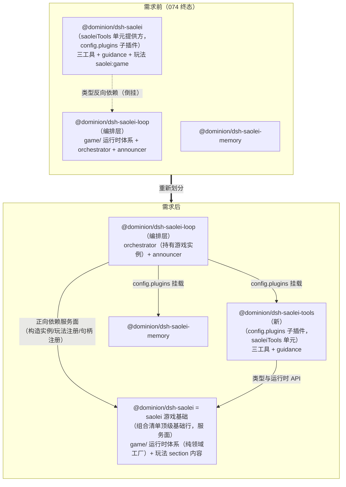

# Feature Specification: saolei 游戏基础与智能体工具解耦（dsh-saolei / dsh-saolei-tools）

**Feature Branch**: `075-saolei-game-foundation`

**Created**: 2026-10-01

**Status**: Draft

**Input**: User description: "依赖内容，saolei游戏对象（游戏状态和游戏玩法等提示词）划分在了 dsh-saolei 插件中，挂载在 player 角色下。这个架构层级上有些混乱，现在计划解决。1. 将 dsh-saolei 插件定义为saolei游戏基础，仅持有saolei游戏这个领域内的功能，包括但不限于游戏实例/状态持有、游戏玩法 prompt等，作为saolei-loop 的基础依赖；而原有的 saolei 游戏工具则改到插件dsh-saolei-tools 当中，通过 dsh-saolei 提供的 api 操作游戏。将saolei游戏和为智能体提供的工具解耦。074遗留问题，planner 系统提示词无法看到游戏玩法的问题也能得到解决（即074遗留 planner 无法看到游戏玩法提示词不会在将来被作为基线）。本需求是功能的重新划分，没有新增或删除功能，所以需要在文档中显式列出需求前后功能/模块是如何重新划分和移动的。"（依赖：specs/074-dsh-grpc-runtime/）

**决策基线**（2026-10-01 用户四项裁定）：

1. **dsh-saolei 为 cordis 顶级插件，不挂在 saolei-loop 下**：saolei 游戏领域内容作为基础服务提供给 saolei-loop（"saolei-loop 建立在 dsh-saolei 之上"）。按 specs/074-dsh-grpc-runtime/research.md D14 的依赖方式判据，游戏基础对编排层是**服务**（编排代码直接调用的 API、组合级共享、无场景部署 config）→ 正向依赖形态（组合清单顶级行 + 服务面），区别于能力单元的 config.plugins 子插件形态。
2. **saolei:game（游戏玩法提示词）由编排按角色注册**：dsh-saolei 持有玩法内容（领域知识归游戏基础），saolei-loop 编排在 player 与 planner 的成员 setup 中注册——planner 仅 saolei:game，player 为 saoleiTools 工具单元 + saolei:game。保持 074 收敛的"成员生效面经编排注册"统一模式（specs/074-dsh-grpc-runtime/contracts/team-assembly.md §4）。
3. **游戏领域全迁**：game/ 运行时体系（runtime/board/geometry/text）整体从 saolei-loop 迁入 dsh-saolei——判据"游戏对象/状态/文本渲染 = 游戏基础"；announcer（播报成员，编排领域）留 saolei-loop，改从 dsh-saolei 导入 gameStatsText。
4. **游戏实例归编排持有、player 只持句柄**（2026-10-01 plan 阶段裁定，Clarifications（游戏实例所有权裁定））：游戏局（棋盘状态/游戏日志/终局记录）是 team 级领域对象——TeamOrchestrator materialize 时经基础面工厂构造并持有（生命周期 = 物化周期）；player setup 仅将实例注册为 agent ctx 上的**句柄**（`isolate("saoleiGame").provide`，memory face 同型），工具解析路径零变化；编排读终局直读自身字段。游戏运行时实现**不再是 cordis Service**（scope 自动注销机制随所有权转移而消失，清理责任在编排 dispose）。

## Clarifications

### Session 2026-10-01

- Q: 游戏运行时实例为什么还挂在 player setup（agent scope）？游戏实例不应被 dsh-saolei-loop 持有、player 只持句柄吗？还有多少 saolei 游戏领域的东西在 player 角色下？ → A: **用户裁定（plan 设计评审）：游戏实例归编排持有、player 只持句柄**。游戏局（棋盘状态/日志/终局记录）是 team 级领域对象，不是 player 私有 agent 状态：TeamOrchestrator materialize 时经基础面工厂构造实例并保存于编排字段（生命周期 = 物化周期，refresh 重建——与现状行为等价）；player setup 仅把该实例以 `agentCtx.isolate("saoleiGame").provide("saoleiGame", runtime)` 注册为**句柄**（memory face 同型），工具 execute 的 `exec.agent.ctx.saoleiGame` 解析零变化；编排读终局事件直读自身字段（`this.game.peekGameEvent()`，移除 `members.player.game` 挖取路径与 `MountPlayerRuntime` seam）。配套盘点（完整表见本 session 记录）：错位项 = 玩法提示词（初版已修正）+ 游戏实例所有权与编排终局读取路径（本裁定修正）；正当项 = 三工具与 guidance（操作者角色的能力）、announcer 播报动作（团队协作动作，文本函数已归基础）。修正后 player 名下只剩：角色能力（工具+guidance）与游戏句柄——纯"操作者"形态。

- Q: planner 恢复游戏玩法可见性（saolei:game）后，大型测试的验收锚定应采用哪种方式？ → A: **显式 prompt 断言（Option B）**：在 testplan 既有用例中增加 GetTeamMember.system_prompt 显式断言——planner prompt 含 saolei:game 标题片段、player prompt 兼含玩法与 guidance、planner prompt 不含 guidance（060 契约 §5 三个断言的显式化）；fake-llm 夹具锚点（team-planner-opening 恢复命中）作为夹具语义恢复核实项，不作为验收依据。理由：074 T018 曾在 planner 已失去玩法时记录全绿，隐式夹具锚点作为回归断言不可靠；`TestAgentV2TeamGameStatsPromptFaces` 已有同型 GetSystemPrompt 断言先例。

## 需求前后功能/模块重新划分清单 *(mandatory，本特性核心交付物)*

本特性为**功能的重新划分**：无功能新增、无功能删除（除 074 遗留问题修复——planner 系统提示词恢复游戏玩法可见性）。全部移动均以"等价迁移、行为零变化"为硬约束。

### 内容移动总表

| # | 功能/模块内容 | 需求前（074 终态） | 需求后 | 约束 |
|---|---|---|---|---|
| M1 | 游戏运行时体系：GameRuntime/`createGameRuntime`/终局事件（GameEventRecord）/游戏日志（`common/js/dsh-plugins/saolei-loop/src/game/runtime.ts`，440 行） | `@dominion/dsh-saolei-loop`（编排层内） | `@dominion/dsh-saolei`（游戏基础） | 文件级等价迁移，行为契约零变化（specs/051-agent-v2-dsh-migration/data-model.md §2.5、specs/062-team-game-end-handoff、specs/064-memory-split-fold-remain） |
| M2 | 棋盘 API 与识别（`game/board.ts`，344 行，依赖 `@dominion/game-saolei-board`）、窗口几何（`game/geometry.ts`，72 行）、结果文本渲染与游戏统计文本（`game/text.ts`，144 行，含 gameStatsText） | `@dominion/dsh-saolei-loop` | `@dominion/dsh-saolei` | 同上；gameStatsText 供 announcer 消费（M7） |
| M3 | 游戏玩法提示词 saolei:game（`SAOLEI_GAME_RULES`，order 50，specs/060-agent-v2-team-optimize/contracts/prompt-sections.md §1 内容边界） | `@dominion/dsh-saolei` 的 saoleiTools 单元 sections（仅随 player 注册） | `@dominion/dsh-saolei` 持有 section 内容；由 saolei-loop 编排按角色注册（player + planner） | 名/order/文本零变化；074 遗留修复的载体 |
| M4 | 三工具定义（saolei_init / saolei_operate / saolei_remain）、双形式参数校验（normalizeOperateArgs 与 v1 拒绝字面量）、`{result}` 输出声明、缺运行时 fail-loud 解析（resolveRuntime/executeOutcome） | `@dominion/dsh-saolei`（saoleiTools 单元） | `@dominion/dsh-saolei-tools`（**新包**，`common/js/dsh-plugins/saolei-tools/`） | 工具 schema/描述/文案/行为零变化；工具经 dsh-saolei 的类型与运行时 API 操作游戏 |
| M5 | 工具使用指导 saolei:guidance（`SAOLEI_GUIDANCE`，order 100） | `@dominion/dsh-saolei`（saoleiTools 单元） | `@dominion/dsh-saolei-tools`（saoleiTools 单元 sections） | 名/order/文本零变化；**单元不再含 saolei:game**（M3 拆出） |
| M6 | dsh-saolei 挂载形态 | saolei-loop `config.plugins` 子插件（能力提供方，provide saoleiTools） | 组合清单**顶级基础行**（`projects/game/agent_v2/cordis.yml`，与 grpc-runtime 基建行同级的领域基础行），提供游戏基础服务面 | 服务面形态（API 命名在 plan 阶段定稿） |
| M7 | announcer（播报成员）及其 gameStatsText 消费 | saolei-loop（本地 `./game/text.js` 导入） | announcer 留 saolei-loop；gameStatsText 改从 `@dominion/dsh-saolei` 导入 | 播报行为零变化 |
| M8 | `saoleiGame` agent-scoped 服务的 Context 类型增强（declare module）与全部游戏类型导出（SaoleiGame/OperateInput/ToolOutcome/GameEventRecord 等） | `@dominion/dsh-saolei-loop` 导出面 | `@dominion/dsh-saolei` 导出面（单一出口，saolei-loop 不再再导出） | 消费方（saolei-loop/宿主 session.ts/dsh-saolei-tools）改为从游戏基础导入 |
| M9 | 依赖方向 | dsh-saolei **类型反向依赖** saolei-loop（`import type { OperateInput, SaoleiGame, ToolOutcome } from "@dominion/dsh-saolei-loop"`，倒挂） | saolei-loop 依赖 dsh-saolei、dsh-saolei-tools 依赖 dsh-saolei（依赖单向：编排/工具 → 游戏基础；游戏基础不依赖任何上层） | 层级归位是本需求的架构目标本身 |
| M10 | 组合清单 saolei-loop 行 config.plugins | `[@dominion/dsh-saolei, @dominion/dsh-saolei-memory]`（21 行清单） | `[@dominion/dsh-saolei-tools, @dominion/dsh-saolei-memory]`；另增顶级 `saolei` 行（清单 22 行） | manifest 断言与 070 契约同步修订 |
| M11 | planner 成员系统提示词 | 无 saolei:game（074 遗留：060 契约 §1"全员生效"被打破） | 含 saolei:game（**唯一的预期行为变化**） | 060 契约 §5 断言语义恢复（planner prompt 含玩法 section） |
| M12 | 游戏运行时**实例**的所有权与生命周期 | player agent scope 的 cordis 服务（`createAgentGameRuntime` 在 player setup 构造 `GameRuntimeService` 注册到 `agent.ctx.isolate("saoleiGame")`，随 agent scope 卸载注销） | **TeamOrchestrator 字段持有**（materialize 时经基础面工厂 `createGameRuntime(sessionName, desktopBridge)` 构造，生命周期 = 物化周期，refresh 重建；GameRuntimeService 的 cordis Service 继承移除——实例为普通类，清理责任在编排 dispose/回滚） | 行为零变化：工具解析/终局时序/回滚/dispose 语义等价（Clarifications 2026-10-01（游戏实例所有权裁定）） |
| M13 | player 对游戏实例的持有形态 | 实例本体（scope 注册即所有权） | **句柄**：player setup 将编排持有的实例以 `agentCtx.isolate("saoleiGame").provide("saoleiGame", runtime)` 注册（memory face 同型）；工具 execute 的 `exec.agent.ctx.saoleiGame` 解析零变化 | player 名下只剩角色能力（工具+guidance）与游戏句柄——纯"操作者"形态 |
| M14 | 编排终局事件读取路径 | `members.player.game?.peekGameEvent()`（从 player 成员上挖游戏事实；`MemberRuntime.game` 字段 + `MountPlayerRuntime` seam + session.ts 透传） | 编排直读自身字段 `this.game.peekGameEvent()`；`MemberRuntime.game`/`MountPlayerRuntime` seam/session.ts 透传删除 | 终局事件时序零变化（同一实例、同一读取时点）；编排测试注入改经基础面 stub |

### 不变项（零变化边界）

- player 成员的最终生效面：三工具 + saolei:guidance + saolei:game + 游戏运行时挂载——prompt 组装输出与工具行为零变化。
- memory 体系（@dominion/common-js-memory / @dominion/dsh-saolei-memory）、preset 体系（registry/authoring/模板）、team 群聊原语：零改动。
- orchestrator 编排状态机（specs/059-agent-v2-team-mode/contracts/dsh-plugins.md §2 的行为契约）、announcer 播报协议（specs/065-agent-v2-team-refine/contracts/game-stats-broadcast.md）：零行为变化。
- 游戏运行时全部行为契约（识别/校验 triage/终局收束/remain 语义，specs/051 §2.5、062、064 契约）：零变化。
- experimental/dsh/demo 组合：不引用 saolei 体系，零改动。

## User Scenarios & Testing *(mandatory)*

### User Story 1 - dsh-saolei 游戏基础插件：游戏领域归位 (Priority: P1)

现状游戏领域本体（游戏实例/状态持有的 GameRuntime 体系，约 1,000 行）位于编排层包 saolei-loop 内部，而名义上的"saolei 插件"（dsh-saolei）反而只持有面向智能体的工具，且类型反向依赖 saolei-loop——架构层级倒挂。本故事：**game/ 运行时体系（runtime/board/geometry/text 及其测试）从 saolei-loop 等价迁入 dsh-saolei**（含形态改造：Service 继承移除、纯领域工厂——M12）；游戏玩法提示词（saolei:game）内容继续由 dsh-saolei 持有（从 saoleiTools 单元拆出）；dsh-saolei 挂载形态从 saolei-loop config.plugins 子插件改为**组合清单顶级基础行**，提供游戏基础服务面（游戏运行时工厂、终局事件类型、玩法 section spec；`saoleiGame` 句柄解析的 Context 类型增强随迁）——"saolei-loop 建立在 dsh-saolei 之上"（实例所有权归编排，见 US3/M12）。

**Why this priority**: 游戏基础是另两个故事的结构前提（工具插件与编排消费都以它为依赖底座）；游戏领域行为契约（specs/051 §2.5 / 062 / 064）的等价迁移是"重新划分零行为变化"的载体；独立于其他故事可先行交付且可独立验证（迁移测试等价全绿）。

**Independent Test**: game/ 测试（runtime.test.ts 1,097 行 / text.test.ts）随迁移等价全绿；游戏基础服务面单测（面存在性、导出内容）；dsh-saolei 包内无 saolei-loop 依赖（静态检查）；旧世界（saolei-loop 现状）在此故事期间保持可构建（并行准备，参照 074 research.md D11 迁移分步模式）。

**Acceptance Scenarios**:

1. **Given** saolei-loop 的 `src/game/`（runtime.ts/board.ts/geometry.ts/text.ts 及 runtime.test.ts/text.test.ts），**When** 迁移至 dsh-saolei 包内，**Then** 逻辑零改动（文件级搬运，仅 import 路径与注释引用终态化），全部既有游戏行为用例等价通过。
2. **Given** dsh-saolei 以组合清单顶级行挂载（apply 提供游戏基础服务面），**When** 消费方（saolei-loop）声明消费该面，**Then** 获得游戏运行时工厂（纯领域构造，无 scope 注册副作用）、游戏玩法 section spec 与全部游戏类型；面缺失时组合启动 fail-loud（正向依赖语义，与 ctx.grpc 同构）。
3. **Given** dsh-saolei 的依赖声明，**Then** 其依赖仅为游戏领域所需（`@dominion/game-saolei-board`、desktop-bridge 类型、cordis），MUST NOT 依赖 saolei-loop / saolei-tools / saolei-memory 任何上层包（M9 依赖方向归位）。
4. **Given** 游戏运行时实例（游戏局状态），**Then** 其为普通类对象（非 cordis Service）：由编排（TeamOrchestrator）materialize 时经基础面工厂构造并持有（生命周期 = 物化周期，refresh 重建），player setup 仅将实例注册为 agent ctx 上的句柄（`isolate("saoleiGame").provide`，memory face 同型）——游戏实例的所有权与清理责任在编排（dispose/物化回滚），player 是操作者（Clarifications 2026-10-01（游戏实例所有权裁定））。
5. **Given** 游戏玩法提示词 saolei:game，**Then** 其内容（SAOLEI_GAME_RULES）、名、order 50 由 dsh-saolei 持有且零变化；内容边界继续遵循 specs/060-agent-v2-team-optimize/contracts/prompt-sections.md §1（玩法 + 可用操作，不含工具调用形态）。

---

### User Story 2 - dsh-saolei-tools 工具插件：游戏与智能体工具解耦 (Priority: P1)

现状三工具（saolei_init/saolei_operate/saolei_remain）与工具使用指导（saolei:guidance）位于 dsh-saolei 的 saoleiTools 单元中，与游戏玩法提示词耦合在同一单元随 player 角色整体注册。本故事：**新建插件 `@dominion/dsh-saolei-tools`**（`common/js/dsh-plugins/saolei-tools/`），三工具定义、双形式参数校验（normalizeOperateArgs 与 v1 拒绝字面量）、`{result}` 输出声明、缺运行时 fail-loud 解析整体迁入；以 saolei-loop `config.plugins` 子插件挂载并 `ctx.provide("saoleiTools", ...)` 提供单元（延续 074 能力提供方模式），单元 sections 仅含 saolei:guidance；工具操作游戏的类型（OperateInput/SaoleiGame/ToolOutcome）与运行时解析（`exec.agent.ctx.saoleiGame`）改为经 dsh-saolei（游戏基础）提供。

**Why this priority**: 与 US1 共同构成解耦的两侧（基础/工具）；工具是 player 角色的能力单元，其内容零变化迁移保证模型可见行为零回归；独立于编排改造可先行交付（提供方就绪、编排未切换时旧世界并行）。

**Independent Test**: 新包单测全绿——saoleiTools 单元提供面内容断言（三工具 schema 逐字、guidance 名/order/文本逐字、单元内无 saolei:game）、无全局注册副作用断言（074 既有测试等价迁移）、工具 execute 缺运行时 fail-loud 断言；`@dominion/dsh-saolei` 包对工具的持有清零（静态检查）。

**Acceptance Scenarios**:

1. **Given** 新包 `@dominion/dsh-saolei-tools`（cordis 插件，`config.plugins` 子插件形态），**When** saolei-loop apply 挂载并读取提供面，**Then** `ctx.provide("saoleiTools", { tools: [三工具], sections: [saolei:guidance] })`——工具定义/schema/描述文案与 guidance 名/order/文本零变化。
2. **Given** saoleiTools 能力单元，**Then** 其 sections MUST NOT 含 saolei:game（玩法已拆归游戏基础，M5）——单元 = 工具 + 工具指导的完整自洽集合。
3. **Given** 任一 saolei 工具执行，**When** 调用方 agent scope 无 `saoleiGame` 服务（非编排驱动的调用/注册前窗口），**Then** fail-loud 报错且文案不变（specs/051-agent-v2-dsh-migration/contracts/saolei-plugins.md §3 的既有语义）。
4. **Given** 工具的类型与运行时依赖，**Then** 全部从 `@dominion/dsh-saolei` 导入（游戏 API 消费方），MUST NOT 依赖 saolei-loop（M9）。
5. **Given** 组合级挂载的插件 apply，**Then** MUST NOT 全局注册工具或 section（组合级注册泄漏给全员——074 FR-020 既有约束随迁移保持）。

---

### User Story 3 - saolei-loop 编排消费与 planner 游戏玩法可见性恢复（074 遗留修复） (Priority: P1)

现状编排（saolei-loop）内嵌游戏运行时实现，游戏实例挂在 player agent scope（编排从 `members.player.game` 挖终局事件），且 planner 成员 setup 仅注册 memory 单元——planner 系统提示词不含游戏玩法（074 遗留：060 契约 §1 原设计"saolei:game 全员生效"被 074 收进 player 角色单元后打破，074 Phase 7 commit 3c7f2686 记录为"遗留挂起：planner 终态失去 saolei:game 可见性……060 prompt-sections 修订、fake-llm team-planner-opening 锚点语义……待裁决"）。本故事：saolei-loop 改为**正向依赖游戏基础服务面**（编排建立在 dsh-saolei 之上）——materialize 时经基础面工厂构造游戏实例并由**编排持有**（M12），player setup：saoleiTools 单元注册（三工具 + guidance）+ saolei:game 注册 + **游戏句柄注册**（实例注册进 player agent ctx，工具解析零变化），planner setup：**saolei:game 注册** + memory 单元（既有）；编排终局事件直读自身字段（M14）；announcer 留编排层，gameStatsText 改从游戏基础导入；`src/game/` 从 saolei-loop 移除。

**Why this priority**: planner 游戏玩法可见性是 074 遗留问题的直接修复（用户明示"不会在将来被作为基线"），且是本特性唯一预期行为变化；依赖 US1（基础面）与 US2（工具单元）就绪后激活。

**Independent Test**: 编排单测重写——planner 分支断言 sections 含 saolei:game + memory 三 section、无工具无 guidance；player 分支断言三工具 + guidance + saolei:game + 游戏句柄注册、注册序不变；游戏实例构造经基础面（依赖注入 stub）；编排终局读取直读自身字段；大型测试（US4）中 planner system prompt 断言恢复 060 §5 语义。

**Acceptance Scenarios**:

1. **Given** planner 成员物化，**When** setup 执行，**Then** 注册 saolei:game（名/order 50/文本与 060 基线一致）+ memory 能力单元（faces → tools → sections → ready，074 既有序不变）；planner MUST NOT 获得任何 saolei 工具、saolei:guidance 与游戏句柄。
2. **Given** team 物化（materialize），**Then** 编排经基础面工厂构造游戏实例并保存于编排字段（生命周期 = 物化周期：materialize 构造、dispose/物化回滚丢弃、refresh 重建——与现状实例随成员 scope 的行为等价）。
3. **Given** player 成员物化，**When** setup 执行，**Then** 注册 saoleiTools 单元（三工具 + guidance）+ saolei:game + **游戏句柄**（编排持有的实例注册进 player agent ctx `isolate("saoleiGame")`——工具 `exec.agent.ctx.saoleiGame` 解析零变化，desktop-bridge 会话键语义不变）；player 最终系统提示词与工具面与改造前逐字等价。
4. **Given** 编排终局事件读取（nextStep 的 gameEnded 判定），**Then** 直读编排自身持有的实例（`this.game.peekGameEvent()`，同一实例、同一读取时点——时序零变化）；`MemberRuntime.game` 字段与 `MountPlayerRuntime` seam 删除，宿主 session.ts 的透传清理。
5. **Given** saolei-loop 的游戏基础消费，**When** 组合清单缺顶级 saolei 行（基础面缺失），**Then** 组合启动 fail-loud（正向依赖语义；错误信息指明缺失面）。
6. **Given** 编排包 saolei-loop，**Then** 其 `src/game/` 目录消失，游戏运行时/棋盘/几何/文本实现清零（M1/M2）；编排仅经基础面消费游戏 API（orchestrator 状态机行为零变化——终局事件读取、round-stop、播报时序均不变）。
7. **Given** announcer（播报成员），**Then** 仍属 saolei-loop，gameStatsText 从 `@dominion/dsh-saolei` 导入（M7），播报文本与 record 级去重语义零变化。

---

### User Story 4 - 组合切换、宿主适配与终态化（契约/文档/测试/大型测试验收） (Priority: P2)

重新划分落地需要组合清单与宿主依赖声明切换（+顶级 saolei 行、config.plugins 换单、依赖声明与 BUILD 同步）、受影响契约修订至终态（060 prompt-sections 的 saolei:game 归属与注册路径、074 team-assembly 的 saoleiTools 单元定义与行为差异表补正、070 composition-manifest 行集合、051/064 saolei 契约的包边界）、README/注释终态化与旧导出路径引用清零、单测重组（迁移等价 + 新形态重写）、大型测试显式 prompt 断言新增（planner 玩法可见性的直接验证——Clarifications 2026-10-01 Option B）与 fake-llm 夹具核实（team-planner-opening 锚点恢复命中，夹具文本预期零改动）、四 suite 大型测试全绿验收。

**Why this priority**: 保证交付物一致性与后续 spec 引用有效性（宪章原则 VII 终态表述）；依赖前序故事定形；大型测试是行为面的最终验收（宪章原则 VI）。

**Independent Test**: 静态检查（旧路径引用清零、依赖方向断言）+ 契约 diff 审阅 + 重组后单测全绿 + testplan skill 实际执行四 suite 全部用例通过。

**Acceptance Scenarios**:

1. **Given** `projects/game/agent_v2/cordis.yml`，**Then** 终态：新增顶级 `saolei` 行（`@dominion/dsh-saolei`，基础服务行）；saolei-loop 行 `config.plugins` = `[@dominion/dsh-saolei-tools, @dominion/dsh-saolei-memory]`；清单 22 行且 manifest 断言（`projects/game/agent_v2/src/dsh.test.ts`）与 `specs/070-dsh-upgrade/contracts/composition-manifest.md` §2 同步终态化。
2. **Given** 宿主与包依赖声明（package.json / BUILD.bazel / tsconfig），**Then** dsh-saolei 依赖 game-saolei-board 等、dsh-saolei-tools 依赖 dsh-saolei、saolei-loop 依赖 dsh-saolei（+既有）；dsh-saolei 对 saolei-loop 的依赖声明消失。
3. **Given** 受影响契约（specs/060-agent-v2-team-optimize/contracts/prompt-sections.md、specs/074-dsh-grpc-runtime/contracts/team-assembly.md、specs/070-dsh-upgrade/contracts/composition-manifest.md、specs/051-agent-v2-dsh-migration/contracts/saolei-plugins.md、specs/064-memory-split-fold-remain/contracts/saolei-plugins.md 及其他引用 saolei 导出面/包归属的契约），**Then** 修订至终态：saolei:game 归属游戏基础、编排按角色注册（player+planner）、saoleiTools 单元 = 三工具 + guidance、包边界与依赖方向新形态；074 team-assembly §5 行为差异表补正（074 遗留挂起项的文档收口）。
4. **Given** 仓库内对旧导出路径的引用（`@dominion/dsh-saolei-loop` 的游戏类型导出、saolei-loop `src/game/` 路径），**Then** 代码与文档清零或改写为终态表述（README、注释、契约）。
5. **Given** testplan 既有用例的 system_prompt 读面（`getAgentV2TeamMember(...).GetSystemPrompt()`，`TestAgentV2TeamGameStatsPromptFaces` 同型先例），**Then** 新增三个显式断言（060 契约 §5 断言意图的显式化，Clarifications 2026-10-01 Option B）：planner system_prompt 含 saolei:game 标题片段、player system_prompt 兼含玩法与 guidance、planner system_prompt 不含 guidance——断言只增不改既有用例语义。
6. **Given** fake-llm 夹具 `projects/game/fake-llm/service/testdata/team_planner.yaml` 的 team-planner-opening system_keywords（含"扫雷玩法"锚点），**Then** 落地后 planner prompt 恢复含 saolei:game，锚点恢复命中——夹具语义核实项（预期夹具文本零改动），不作为验收依据（验收以场景 5 的显式断言为准）。
7. **Given** 大型测试（`projects/game/testplan/system_test.yaml` 四 suite：game-system / game-disconnect / game-memory-down / game-stall），**Then** 经 testplan skill 实际执行全部用例通过——覆盖 planner 记忆回路、player 游戏回路、物化 fail-loud/回滚、preset 闭环在重新划分后零回归。

### Edge Cases

- **迁移中间态双重注册**：saolei:game 若同时存在于 saoleiTools 单元（旧）与编排注册（新），player 会被注册两次（同名 section 覆盖或重复）——组合切换必须原子（工具单元上线与编排激活同批，参照 074 Phase 6 原子切换模式：模板行与编排注册并存会双重注册的先例）。
- **基础行缺失**：组合清单漏顶级 saolei 行 → saolei-loop 消费基础面失败 → 组合启动 fail-loud（不静默降级为无游戏运行时）。
- **config.plugins 漏 dsh-saolei-tools**：saoleiTools 提供面缺失 → saolei-loop apply fail-loud（074 既有语义，不变）。
- **玩法文本漂移**：迁移导致 SAOLEI_GAME_RULES/SAOLEI_GUIDANCE 或工具文案任何字面变化 → 模型可见行为回归——迁移以逐字等价为验收（单测逐字断言）。
- **planner 行为变化的影响面**：planner 恢复看到游戏玩法后，其模型输入多一个 section——fake-llm 锚定机制下 planner 回路（开局策略/复盘/记忆写入）预期不变（锚点恢复命中不改变模板选择优先级）；大型测试若出现 planner 相关断言失败，须区分"显式断言/锚点核实未达"与"行为回归"再处置。
- **类型再导出的双出口**：若 saolei-loop 继续再导出游戏类型（兼容旧导入），会形成双出口与归属含糊——M8 单一出口为硬约束，消费方一次性切换。
- **dsh.test.ts manifest 断言与契约锁步**：清单 21 → 22 行变化须与 `specs/070-dsh-upgrade/contracts/composition-manifest.md` §2 同批修订（074 T005 的契约/代码锁步先例）。
- **迁移分步可构建**：每步保持 `bazel build //...` 与 `bazel test //...` 可通过（074 research.md D11 门禁模式）；旧世界（saolei-loop 内嵌 game/）与新世界（dsh-saolei 基础）并行准备期不得互相破坏。
- **编排持有游戏实例的清理边界**：materialize 失败（成员 setup throw）→ 编排丢弃本次构造的实例（回滚不留残留引用）；dispose → 实例引用丢弃（游戏局无外部资源，无需显式关闭）；refresh（宿主 dispose 旧编排 + 物化新编排）→ 新实例（与现状"实例随成员 scope 重建"行为等价——游戏局不跨 refresh 存留）。
- **句柄与实例的生命周期差**：player agent dispose（编排存续，如未来单成员重建场景）后句柄随 agent scope 注销，实例仍在编排——工具解析在无句柄 agent 上 fail-loud（现状语义）；实例的可用性以编排持有为准。
- **experimental/dsh/demo 零改动**：demo 组合不引用 saolei 体系，不在改动范围。

## Requirements *(mandatory)*

### Functional Requirements

**游戏基础（US1）**

- **FR-001**: `@dominion/dsh-saolei` MUST 重新定义为 saolei 游戏基础插件：以组合清单**顶级行**挂载（`projects/game/agent_v2/cordis.yml`，领域基础行），MUST NOT 再以 saolei-loop `config.plugins` 子插件形态挂载；其持有内容 MUST 限于 saolei 游戏领域（游戏实例/状态的领域实现与工厂、游戏玩法提示词、游戏领域 API 与类型——实例本身归编排持有，M12）。
- **FR-002**: 游戏运行时体系 MUST 从 saolei-loop 等价迁入 dsh-saolei：`runtime.ts`（GameRuntime 接口与实现、终局事件 GameEventRecord、游戏日志 GameLogEntry、ToolOutcome 等）、`board.ts`（棋盘 API，依赖 `@dominion/game-saolei-board`）、`geometry.ts`、`text.ts`（结果文本渲染与 gameStatsText）及其测试（runtime.test.ts/text.test.ts）；游戏行为契约（specs/051 data-model §2.5、specs/062 turn-conclude、specs/064 remain 语义）MUST 零变化，迁移内含的形态改造（`GameRuntimeService` 的 cordis Service 继承移除、scope 注册型工厂 `createAgentGameRuntime` 改造为纯领域工厂 `createGameRuntime(sessionName, desktopBridge)`——M12/D10）MUST 以行为等价为验收。
- **FR-003**: dsh-saolei MUST 提供游戏基础服务面供上层正向消费：游戏运行时工厂（`createGameRuntime`，纯领域构造）、游戏玩法 section spec、终局事件与操作类型；服务面命名与形态在 plan 阶段定稿（对齐 ctx.grpc/desktopBridge 的基础服务先例——specs/074-dsh-grpc-runtime/research.md D14 正向依赖判据）。`saoleiGame` 的 Context 类型增强（声明合并，句柄解析类型面）MUST 随迁 dsh-saolei。
- **FR-004**: 游戏玩法提示词 saolei:game（SAOLEI_GAME_RULES，order 50）MUST 由 dsh-saolei 持有，名/order/文本零变化；内容边界继续遵循 specs/060-agent-v2-team-optimize/contracts/prompt-sections.md §1（MUST NOT 混入工具调用形态——guidance 域）。
- **FR-005**: dsh-saolei MUST NOT 持有智能体工具、工具使用指导（saolei:guidance）或任何面向模型的能力单元（迁至 dsh-saolei-tools）；MUST NOT 依赖 saolei-loop、dsh-saolei-tools、dsh-saolei-memory（依赖方向单向：上层依赖游戏基础）。

**工具插件（US2）**

- **FR-006**: MUST 新建插件 `@dominion/dsh-saolei-tools`（`common/js/dsh-plugins/saolei-tools/`）：以 saolei-loop `config.plugins` 子插件挂载（074 能力提供方模式延续），apply 内 `ctx.provide("saoleiTools", ...)` 提供静态单元 `{ tools: [saolei_init, saolei_operate, saolei_remain], sections: [saolei:guidance] }`；工具定义/schema/描述文案与 guidance 名/order/文本零变化。
- **FR-007**: saoleiTools 单元 sections MUST NOT 含 saolei:game（玩法归游戏基础，编排另行注册）；单元保持"tools + prompt 整单元产出、不可部分消费"的 074 既有约束（specs/074-dsh-grpc-runtime/spec.md FR-015）。
- **FR-008**: 工具 MUST 经 dsh-saolei 提供的类型与 API 操作游戏：`OperateInput`/`SaoleiGame`/`ToolOutcome` 等从 `@dominion/dsh-saolei` 导入；execute 的 `exec.agent.ctx.saoleiGame` per-agent 解析与 fail-loud 语义不变；dsh-saolei-tools MUST NOT 依赖 saolei-loop。
- **FR-009**: dsh-saolei-tools MUST NOT 在组合级 apply 中全局注册工具或 section（泄漏约束，074 FR-020 语义延续）。

**编排与遗留修复（US3）**

- **FR-010**: saolei-loop MUST 正向依赖游戏基础服务面（顶级 saolei 行提供）：materialize 时经基础面工厂构造游戏实例并由**编排持有**（M12——生命周期 = 物化周期：materialize 构造、dispose/物化回滚丢弃、refresh 重建，与现状行为等价）；player setup 完成游戏**句柄**注册（编排持有的实例注册进 player agent ctx 的 `isolate("saoleiGame")`，M13——工具 `exec.agent.ctx.saoleiGame` 解析零变化）与 saolei:game 注册；saolei-loop 的游戏类型消费改从 `@dominion/dsh-saolei` 导入（M8 单一出口）。
- **FR-011**: planner 成员 setup MUST 注册 saolei:game（074 遗留修复）：planner 系统提示词 MUST 含游戏玩法 section（名 `saolei:game`、order 50、文本与 060 基线一致）；planner MUST NOT 注册任何 saolei 工具、saolei:guidance 与游戏句柄。
- **FR-012**: player 成员最终生效面 MUST 与改造前等价：三工具 + saolei:guidance + saolei:game + 游戏句柄可达（工具解析同一实例）——prompt 组装输出与工具行为零变化（注册点与所有权重组不改变模型可见结果）。
- **FR-013**: saolei-loop MUST 移除内嵌游戏实现与实例的 agent-scope 所有权：`src/game/` 目录消失；游戏实例为普通类对象（`GameRuntimeService` 的 cordis Service 形态随所有权转移移除，工厂改造为 `createGameRuntime(sessionName, desktopBridge)` 纯领域构造，无 scope 注册副作用）；编排终局事件读取 MUST 直读自身持有字段（`MemberRuntime.game` 字段、`MountPlayerRuntime` seam 与 session.ts 透传删除，M14）；编排状态机行为（specs/059-agent-v2-team-mode/contracts/dsh-plugins.md §2）与 announcer 播报协议（specs/065 game-stats-broadcast）零变化；gameStatsText 消费改从 dsh-saolei 导入。

**切换与终态（US4）**

- **FR-014**: 组合清单与宿主声明 MUST 终态化：顶级 saolei 行新增、saolei-loop config.plugins 更新为 `[@dominion/dsh-saolei-tools, @dominion/dsh-saolei-memory]`（清单 22 行）；`projects/game/agent_v2` 与各包的 package.json / BUILD.bazel / tsconfig 依赖声明同步；`projects/game/agent_v2/src/dsh.test.ts` manifest 与组装断言终态化。
- **FR-015**: 受影响契约 MUST 修订至终态（完整清单以 `specs/075-saolei-game-foundation/research.md` D7 表**八份**为准，逐份）：specs/060-agent-v2-team-optimize/contracts/prompt-sections.md（saolei:game 归属 dsh-saolei、编排按角色注册 player+planner、§4 组装顺序表、§5 断言语义恢复）、specs/074-dsh-grpc-runtime/contracts/team-assembly.md（§3.1 saoleiTools 单元定义——sections 收窄、§5 行为差异表补正 saolei:game 注册路径）、specs/070-dsh-upgrade/contracts/composition-manifest.md（§2 行集合 22 行）、specs/051-agent-v2-dsh-migration/contracts/saolei-plugins.md 与 specs/064-memory-split-fold-remain/contracts/saolei-plugins.md（包归属与导出面新形态；行为条款零改动）、specs/062-team-game-end-handoff/contracts/saolei-turn-conclude.md（§1/§2 实现归属路径改 `@dominion/dsh-saolei`/`@dominion/dsh-saolei-tools`，语义条款零改动）、specs/065-agent-v2-team-refine/contracts/game-stats-broadcast.md（gameStatsText 归属改 `@dominion/dsh-saolei` 导出，播报协议零改动）、specs/059-agent-v2-team-mode/contracts/dsh-plugins.md（`createAgentGameRuntime` → `createGameRuntime` 等 game 路径引用终态化，编排行为条款零改动）。
- **FR-016**: 旧路径引用 MUST 清零：仓库内对 `@dominion/dsh-saolei-loop` 游戏类型导出、`saolei-loop/src/game/` 的代码与文档引用改写为终态表述；README 与注释只表述终态（宪章原则 VII）。
- **FR-017**: 测试 MUST 随形态重组：game 测试随迁等价迁移；dsh-saolei 单测重写为游戏基础面测试；dsh-saolei-tools 新增单元提供面测试（含单元无 saolei:game 断言）；saolei-loop 编排测试更新（planner 分支 + saolei:game、player 分支注册序、基础面注入 stub）；重组后语义覆盖 MUST NOT 低于现状。
- **FR-018**: 大型测试 MUST 实际执行验收（宪章原则 VI）：经 testplan skill 完整执行 `projects/game/testplan/system_test.yaml` 四 suite，全部用例通过；且 testplan 既有用例 MUST 新增三个显式 prompt 断言（Clarifications 2026-10-01 Option B，经 `GetSystemPrompt()` 读面，`TestAgentV2TeamGameStatsPromptFaces` 同型先例，断言只增不改既有用例语义）：planner system_prompt 含 saolei:game 标题片段、player 兼含玩法与 guidance、planner 不含 guidance；fake-llm 夹具锚点恢复命中作为核实项（夹具零改动前提下核实，不作为验收依据）。

### Key Entities *(include if feature involves data)*

- **saolei 游戏基础（@dominion/dsh-saolei）**: saolei 游戏领域功能的持有者与基础服务提供方（组合清单顶级行）。关键属性：游戏运行时体系（领域类与纯工厂、棋盘识别、结果文本渲染）、游戏玩法提示词内容（saolei:game section spec）、游戏领域 API 与类型导出（单一出口）、`saoleiGame` 句柄解析的类型增强。关系：被 saolei-loop（正向依赖服务面）与 dsh-saolei-tools（类型与运行时 API）消费；不持有游戏实例（实例归编排）；不依赖任何上层。
- **工具插件（@dominion/dsh-saolei-tools）**: 面向智能体的 saolei 工具能力提供方（saolei-loop config.plugins 子插件）。关键属性：saoleiTools 静态单元（三工具定义 + saolei:guidance）、双形式参数校验、缺运行时 fail-loud 解析。关系：依赖 dsh-saolei（游戏 API）；由编排挂载并按角色（player）消费。
- **游戏运行时（GameRuntime，编排持有的领域对象）**: 游戏局实例/状态持有（普通类：识别棋盘、init/operate/remain 游戏操作、游戏日志、终局事件 GameEventRecord）。所有权：TeamOrchestrator 字段持有（生命周期 = 物化周期）；player agent ctx 上仅注册**句柄**（`isolate("saoleiGame")`，工具 `exec.agent.ctx.saoleiGame` 解析调用）；编排直读终局事件驱动复盘。
- **saolei:game / saolei:guidance（prompt sections）**: 提示词三层所有权的两个域（specs/060 prompt-sections §1/§2）——玩法（游戏规则 + 可用操作，全员游戏事实）与工具守则（调用形态/结果形状/拒绝语义，工具使用者事实）。关系变化：玩法内容归游戏基础、注册点为编排（player + planner）；守则归工具插件、注册点为编排（player 单元注册）。
- **编排层（@dominion/dsh-saolei-loop）**: team 循环编排（状态机、成员物化、驱动时序、播报）。关系变化：从"内嵌游戏实现 + 游戏实例住 player scope"变为"建立在游戏基础之上 + 游戏实例由编排持有"（正向依赖 + 领域所有权归位）；成员 setup 的注册面增加 planner 的 saolei:game 与 player 的游戏句柄。

## Success Criteria *(mandatory)*

### Measurable Outcomes

- **SC-001**: 行为零回归：四 suite 大型测试（projects/game/testplan/system_test.yaml：game-system / game-disconnect / game-memory-down / game-stall）经 testplan skill 实际执行全部用例通过；player 游戏回路、planner 记忆回路、物化 fail-loud/回滚、preset 闭环均不回归。
- **SC-002**: 074 遗留修复达成：planner 成员系统提示词含 saolei:game（名/order/文本与 060 基线一致）——以编排单测断言与大型测试显式 prompt 断言（planner 含玩法标题、player 兼含玩法与 guidance、planner 无 guidance——Clarifications 2026-10-01 Option B）双重验证；该状态作为后续基线（不再以"planner 无游戏玩法"为基线）。
- **SC-003**: 依赖方向归位：`common/js/dsh-plugins/saolei/` 内对 `@dominion/dsh-saolei-loop` 的引用清零（静态检索零命中）；依赖图为 dsh-saolei-tools → dsh-saolei、saolei-loop → dsh-saolei，无反向边。
- **SC-004**: 迁移完整性：game/ 四文件及其测试（runtime 440 / board 344 / geometry 72 / text 144 行 + runtime.test 1,097 / text.test 64 行）等价迁入 dsh-saolei（`GameRuntimeService` Service 继承移除与工厂签名改造为迁移内含变化）；saolei-loop `src/game/` 目录不存在且 `MountPlayerRuntime`/`MemberRuntime.game` 清零；三工具 + 校验逻辑 + saolei:guidance（dsh-saolei 现有 index.ts 中除玩法外的主体）等价迁入 dsh-saolei-tools、玩法内容（SAOLEI_GAME_RULES）留存 dsh-saolei；仓库内旧导出路径引用清零。
- **SC-005**: 组合清单终态：顶级 saolei 行存在；saolei-loop config.plugins = [dsh-saolei-tools, dsh-saolei-memory]；清单 22 行且 dsh.test.ts 断言与 070 契约 §2 一致。
- **SC-006**: 模型可见面零漂移：三工具 schema/描述、saolei:guidance 与 saolei:game 的名/order/文本逐字不变（单测逐字断言全过）；player 最终系统提示词与改造前逐字等价；游戏工具回路行为零变化（同一实例的句柄解析——工具调用/终局收束/识别失败路径等价）。
- **SC-007**: 契约终态化：060/074/070/051/064 受影响契约修订至新形态（074 遗留挂起项——060 prompt-sections 修订与行为差异表补正——全部收口）；README/注释无旧形态表述。

## Assumptions

- 四项用户裁定（2026-10-01）构成本 spec 的既定约束：dsh-saolei 顶级插件形态（正向依赖服务面）、saolei:game 编排按角色注册（player + planner）、游戏领域全迁（runtime/board/geometry/text 整体 + announcer 留编排改导入）、游戏实例归编排持有 player 只持句柄（Clarifications（游戏实例所有权裁定））。
- 游戏基础服务面的具体命名与 API 形态（如 `ctx.saolei` 或等价 provide 面）、dsh-saolei-tools 的 saoleiTools 提供面是否沿用现名，在 plan 阶段定稿；本 spec 只约束归属与依赖方向。
- 074 组装契约（specs/074-dsh-grpc-runtime/contracts/team-assembly.md）中 memory 相关条款全部继续有效；本特性只动 saolei 侧（saoleiTools 单元定义收窄 + 游戏基础新面），memoryMount 通路零改动。
- planner 恢复 saolei:game 是唯一预期行为变化；验收锚定为 testplan 显式 prompt 断言（Clarifications 2026-10-01 Option B，断言只增不改既有用例语义）；fake-llm 夹具（team_planner.yaml 等）预期零改动（锚点恢复命中为核实项），若执行中发现夹具语义偏差，仅修正锚点不改变用例语义。
- 060 契约 §2（saolei:guidance 收缩）与 §3（persona 去重）的内容边界条款继续有效；本特性只修订归属与注册路径表述。
- 单测迁移遵循"语义用例等价迁移、形态用例按新形态重写"的仓库惯例（074 先例）；大型测试沿用 projects/game/testplan 既有四 suite，不新增测试计划。
- 迁移分步期间每步保持仓库可构建可测试（`bazel build //...` / `bazel test //...`）；切换步骤（组合清单终态 + 编排激活 + 旧实现删除）原子合入（双重注册风险，见 Edge Cases）；最终验收按宪章原则 VI 以 testplan 实际执行为准。
- 桌面桥接（desktop-bridge）、grpc-runtime 基建、team 群聊原语的形态与契约零改动；saolei-game 识别库（projects/game/pkg/saolei-board）零改动（仅依赖声明随迁）。
