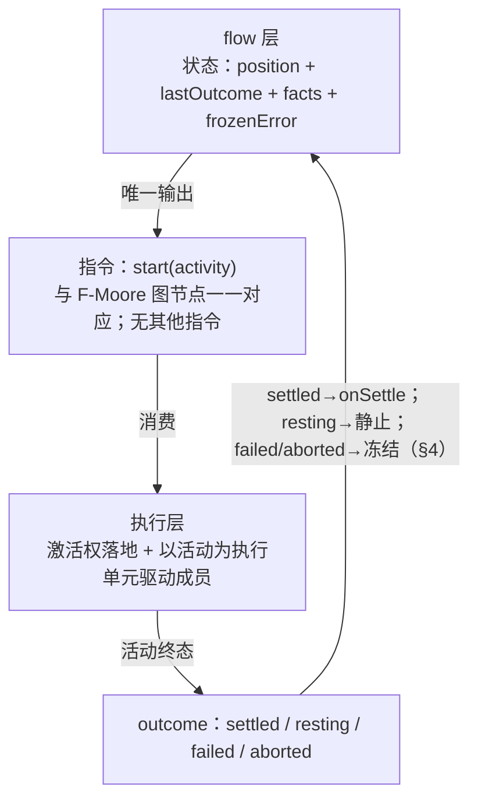
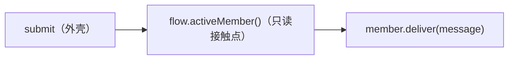

# Contract: saolei-loop flow 编排契约（活动图 / 指令 / 成员接口 / outcome / 错误 / 操作路径）

**Feature**: [../spec.md](../spec.md)（FR-101–FR-113）| **结构定义**: [../data-model.md](../data-model.md) §2/§3 | **设计语义依据**: `survey/saolei-member-switch-flow.md`（裁定 1–24）
**实现锚点**: `common/js/dsh-plugins/saolei-loop/src/`（orchestrator 重组为 flow/执行层/成员适配器；自研 minimal runtime，research.md D1）
**基线契约**: `specs/059-agent-v2-team-mode/data-model.md` §5（切换锚点——被本契约取代）、`specs/059-agent-v2-team-mode/contracts/dsh-plugins.md` §2（编排行为）、`specs/063-llm-reliability-opencode-go/contracts/orchestrator-turn-outcome.md`（origin 二分保持）、`specs/068-wiki-round-pause/contracts/saolei-loop-round-stop.md`（自然停语义保持）、`specs/061-team-queue-steer/contracts/orchestrator-input.md`（在途投递语义沿用）/`web-queue-ui.md`（web 面整体沿用）

## 1. 分层与指令词汇



义务：

1. **start(activity) 的效果**：① 激活权归属 `activity.member`（呈现/日志/驱动权）——成员切换即 start 不同 member 的活动，无独立"切换"指令；② 执行层驱动该成员完成活动并保证到达终态（rest 活动不驱动——静止是活动语义）。
2. **动作边界**：F-Moore 图上的一切动作 = 指令发射 + 纯计算（guard 求值/事实读取）；流程事实写入（onSettle）是 flow 层内部状态更新，不经指令通道；执行层不读 flow 内部状态，flow 层不触碰执行细节（成员驱动、消费锚点、执行完整性）。
3. **图创作规则**：F-Moore 活动节点图是唯一创作结构；成员流转图（F-Mealy）为派生视图仅作 coding 参考，不单独创作、不承载条件。

### 边表（saolei 实例化；边判定仅在活动 settled 后求值）

| 边 | guard | start 目标活动的效果 |
|---|---|---|
| plan → play | planner settle，无条件 | 激活权→player；驱动 player（空输入则静止） |
| play → announce | player settle + `terminal ≠ null && terminal ≠ reviewed` | 激活权→announcer；驱动 announcer（播报语义） |
| play → play（停留） | player settle + 无新记录 | 激活权不变；续驱（空输入则静止） |
| announce → review | announcer settle，无条件 | 激活权→planner；驱动 planner（播报产出已入广播流，输入保证非空） |
| review → play | review settle + rounds < 5 | 激活权→player；驱动 player |
| review → rest | review settle + rounds ≥ 5 | 激活权→player；无执行；rounds 清零；planner 产出保留不消费 |
| rest → announce | rest 下驱动 settle 后 + 新记录 | 激活权→announcer；驱动 announcer |
| rest → play | rest 下驱动 settle 后 + 无新记录 | 激活权→player；驱动 player |

跳局不补发：guard 对**最新**终局记录求值（对象恒等），被新局覆盖的旧记录永不满足 guard。

## 2. 成员接口（loop 层唯一执行词汇；类型差异下沉适配器）

```ts
interface Member {
  /** 闭环：输入构造（默认 drain；input 显式覆盖 = 重试持有集重放）→ 执行 → 完成判定 → 终态。
      不 throw 契约：一切内部失败转译 failed 返回。 */
  drive(input?: DriveInput): Promise<Outcome>;
  /** 用户消息投递：在途 → steer 入 inbox 随执行区间消费；静止 → 装配驱动开 turn。
      投递不经 flow 决策；仅 consumes 成员适用。 */
  deliver(message: UserMessage): void;
}
```

### 2.1 LLM agent 成员适配器（player/planner 共用单一实现）

| 职责 | 机械（dsh-agent 0.2.0-rc.2 原生 API，research.md D3） |
|---|---|
| 输入构造 | `drain(member)`（team 服务 exactly-once 拉动装配）；空 → resting |
| 驱动 | `inject(除末条) + followup(末条)` 单步预声明；三重守卫（输入非空/无并发在途/目标 idle）保持 |
| 完成等待 | `agent.whenIdle()`（whole-agent quiescence；取代编排器手写 idleWaiters） |
| 失败标记 | `agent/error` 订阅（先于 idle 到达）→ idle 时读取并清零 → failed（错误码映射见 §5） |
| deliver 分流 | 在途：`agent.steer(message)`（下一 step 边界 claim / turn 收束自愈）；静止：`[drain(自己)..., flushLanded(), message]` 装配开 turn |
| 执行完整性 | 失败后的持有输入重放（drain 锚点已消费无法重读故持有；重试触发 = flow 冻结重启 start(当前)，对 flow 层不可见） |
| landed flush | 任何开 turn 前统一 flush（来源无关规则） |

完成判定的精确语义：完成 = **agent 静止**（turn 已结束——不再有新的模型调用——且 inbox pending 为空，含经 deliver 投递未消费消息），即本次驱动引发的整个执行区间收束（涵盖区间内经 deliver 投递的一切消息）。

### 2.2 Announce-only 成员适配器（announcer）

同步执行：`announce(text)` 返回即 settled（exactly-once 守卫 `statsSentFor` 对象恒等；时间戳严格递增保证产出排输入集末位——`specs/065-agent-v2-team-refine/contracts/game-stats-broadcast.md` §3 保持）；渲染/播报异常 → failed{INTERNAL}。产出经 team 广播自然流入其他成员待消费列表。

## 3. 用户消息投递（独立机制，不经 flow 决策）



1. 编排 FIFO 与 queue gate **不存在**：消息要么进成员 inbox（在途）、要么立即装配驱动（静止）。
2. 投递静止路径开的 turn 对 flow 不可见（不触发 onSettle、不消费流程事实）；该 turn 完成后泵唤醒决策入口——判定依据始终是事实（新广播/新终局记录），不是投递动作。
3. 在途 steer 的消息形态/进入点/同边界多条/relay 边界：沿用 `specs/061-team-queue-steer/contracts/orchestrator-input.md` §1 义务 1–4（其静止分支的装配位置移入成员适配器，语义不变）。
4. 两类输入分层：用户消息 = 推进式（deliver）；团队广播 = 拉动式（驱动装配时 drain），并叠加在途广播快路（relay message 单元时经接收方投递面提前投递同一消息、pending 锚点照常追加为可靠基线）（`specs/077-announcer-member-unification/contracts/inflight-broadcast-fastpath.md` §2/§5）。
5. **插入式产出的投递时机**：非激活成员在他人 turn 内的 message 产出（插入式产出）经上述同一路径投递。现状生产者是 announcer 的终局统计播报（成员收束后、无在途成员 → 快路惰性、pending drain）；**hook 播报**是 player turn 内的插入式产出（每次有棋盘变动且非终局的 `operate` 后由 hooks 引擎经 announcer 生产），在途 player 经快路不唤醒注入、下一 step 边界认领，静止成员经 pending drain——投递、锚点闭包与边缘路径全部按 077 契约执行（`specs/077-announcer-member-unification/contracts/inflight-broadcast-fastpath.md`；需求来源 `specs/078-saolei-js-hooks/spec.md` FR-009、`specs/078-saolei-js-hooks/contracts/hook-announcement.md` §1/§3）。
6. 完成定义自包含：inbox 空 + 无在途回合统一涵盖一切用户消息消费；外壳与 flow 层均不查询队列状态做完成判断。

## 4. outcome 四态与冻结

| outcome | 语义 | flow 层动作 |
|---|---|---|
| settled | 活动成功完成 | onSettle（若有）→ 边判定 → start |
| resting | 无可执行内容（未开始执行；rest 活动本身） | 泵静止收束；唤醒后回决策入口 |
| failed | 穷尽成员自愈后的上报（§5） | 冻结：记录 lastError、不 onSettle、不边判定、位置保持 |
| aborted | 被取消/释放打断（调用方意图，非故障） | 冻结：不写失败事实，其余同 failed |

冻结规则：冻结由 last-outcome 单字段承载；冻结期间 flow 不发射 start、唯一驱动源是 deliver（其静止装配驱动冻结成员**就是**恢复动作——现状同成员重驱语义）；恢复链两次驱动 = deliver 恢复驱动 + flow 重启当前活动（持有集重放），"投递先于重试"由执行顺序结构保持。两种欠账自然区分：settled 后被打断（cancel 竞态）→ 唤醒后**边判定**；failed → 唤醒后**重启当前活动**。lastError 清除 = 重启活动 settle 成功后。

## 5. 错误契约（member ↔ loop 层接口）

`failed { code, detail }`；`detail = { engineCode?, message }`（loop 层透传呈现/日志，不解读）：

| code | 同输入重试 | 恢复主体 | 呈现指导 |
|---|---|---|---|
| TRANSIENT | 时移可能成功 | 现状 = 冻结等 deliver；演进位 = 自动退避重试 | "服务暂不可用，稍后重试" |
| QUOTA | 补充前必败 | 用户充值/配额重置 | "配额耗尽" |
| CREDENTIAL | 必败 | 用户修正凭证 | "检查 API 凭证" |
| CONFIG | 必败 | 用户修正配置后**重新物化**（流程位置不保留） | "模型配置错误" |
| INPUT_TOO_LARGE | 同输入必败，缩减后可 | 成员 L1 自愈（演进位）/ 用户缩减输入 | "上下文超限" |
| INTERNAL | 大概率失败 | 开发者介入 | "内部错误" |

分层：L0 引擎重试瀑布（`@deepseek-ai/dsh-llm-retry`，吸收 RATE_LIMIT/SERVER/TIMEOUT/TRANSPORT/EMPTY_RESPONSE）对上层不可见 → L1 成员适配器自愈（现状留空位）→ L2 loop 层只消费上报 → L3 用户。六码的现状执行行为统一为冻结（§4）；契约即时价值 = 呈现指导与诚实分类（宿主按码产出用户动作文案，loop 层不产出文案）。

**成员承诺**：自愈最大化；最小上报；按恢复路径选码（映射表 §2.1/数据模型 §3.2）；failed 返回后成员处于可重驱一致状态；drive() 不 throw（技术性 throw 由执行层在 start 调用点兜底转译 failed{INTERNAL, orchestration}）。

**loop 层承诺**：按码执行恢复绑定、不解读 detail；failed 后不弃成员（位置冻结 + 同成员恢复）；取消走 aborted 独立通道；loop 自身异常不经成员接口（直接进冻结通道，code 恒 INTERNAL、origin=orchestration——流收束按 `specs/063-llm-reliability-opencode-go/contracts/orchestrator-turn-outcome.md` §2 的 origin 二分保持）。

## 6. 操作路径（自顶向下：目标 → 实现）

**cancel**：目标 = 可恢复的静止——① 终止在途回合（已生成内容保留历史）；② 未消费**用户**输入落地为消息历史（landed，不静默丢弃）——团队广播（`team-broadcast`）inbox 残留**不落地**，其可靠性由 pending 基线单一承载（`specs/077-announcer-member-unification/contracts/inflight-broadcast-fastpath.md` §3/§6）；③ 流程位置冻结（事实不消费）；④ 等待 deliver 恢复；幂等；已 frozen 时 no-op；不产生失败呈现（宿主 markOutcome CANCELED、干净收束）。
实现：执行层 `agent.cancel({kind:"user"})` → 在途 drive 闭环返回 aborted → flow 冻结（不 onSettle——现状 cancel 打断 review 在途时记录被错误消费的竞态据此消除）；inbox 未消费**用户**消息收编 landed（`team-broadcast` 残留放行给 `agent.cancel` 默认清 inbox）；取消收敛窗口内 deliver 到达由统一 flush 规则以不变应万变。

**dispose/refresh**：目标 = 彻底释放进入终态——① 在途回合 aborted **不转交**；② 释放成员句柄/退订信号/撤销团队注册（allSettled，部分失败不阻塞，首个失败上报）；③ 流程状态全清（flow 无生命周期：纯状态对象随引用消失；refresh 不保留 reviewed/rounds）；④ 幂等；宿主先 markOutcome ABORTED；dispose 期间 submit 同步 throw DISPOSED（保持）。materialize 原子性保持（全就绪或全回滚）。

## 7. 宿主联动面（`projects/game/agent_v2/src/session.ts`）

| 联动点 | 契约 |
|---|---|
| 快照派生 | `phase` ← 活动（plan→planning、review→reviewing、play/rest→playing）；`activeMember` ← `active ?? activation`（060 §1 保持）；`paused` ← frozen；`queued` ← inbox pending + steered-unclaimed |
| 静止判定（watchQuiescence） | `frozen \|\| (active === null && inboxPending === 0)`——冻结短路取代 paused 短路；流收束按 lastError.origin 二分（063 §2） |
| Send 接入 | submit → deliver（快照先行判断排队帧的逻辑按 061 `web-queue-ui.md` 的帧语义沿用） |
| 错误呈现 | code → 用户动作文案映射归宿主（快照/失败帧携带；web 沿既有错误渲染路径显示文本） |
| 成员事件消费 | 宿主（`projects/game/agent_v2/src/session.ts`）经 team 统一成员事件流单路消费（`specs/077-announcer-member-unification/contracts/member-event-stream.md` §5）；loop 侧 `orchestrator.announcer` 读取面保留（仍供成员读取与 loop 测试使用，非宿主订阅路径）。announcer 更名见 [announcer-member.md](announcer-member.md) |

## 8. 验收基准

1. `common/js/dsh-plugins/saolei-loop/src/orchestrator.test.ts` 全量用例通过，两点显式基准调整（spec FR-113）：多消息时序按 061 SC 方向重写（mid-turn 进入）；cancel 打断 review 在途竞态按 aborted 冻结语义修正断言。
2. 现状 S1–S10 场景映射保持（survey §9 表 10/10）。
3. 扩展演示（SC-007）：以测试形态新增示例活动/边（不改 flow 运行时与执行层）即被编排。
