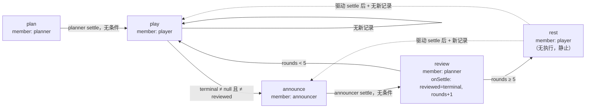
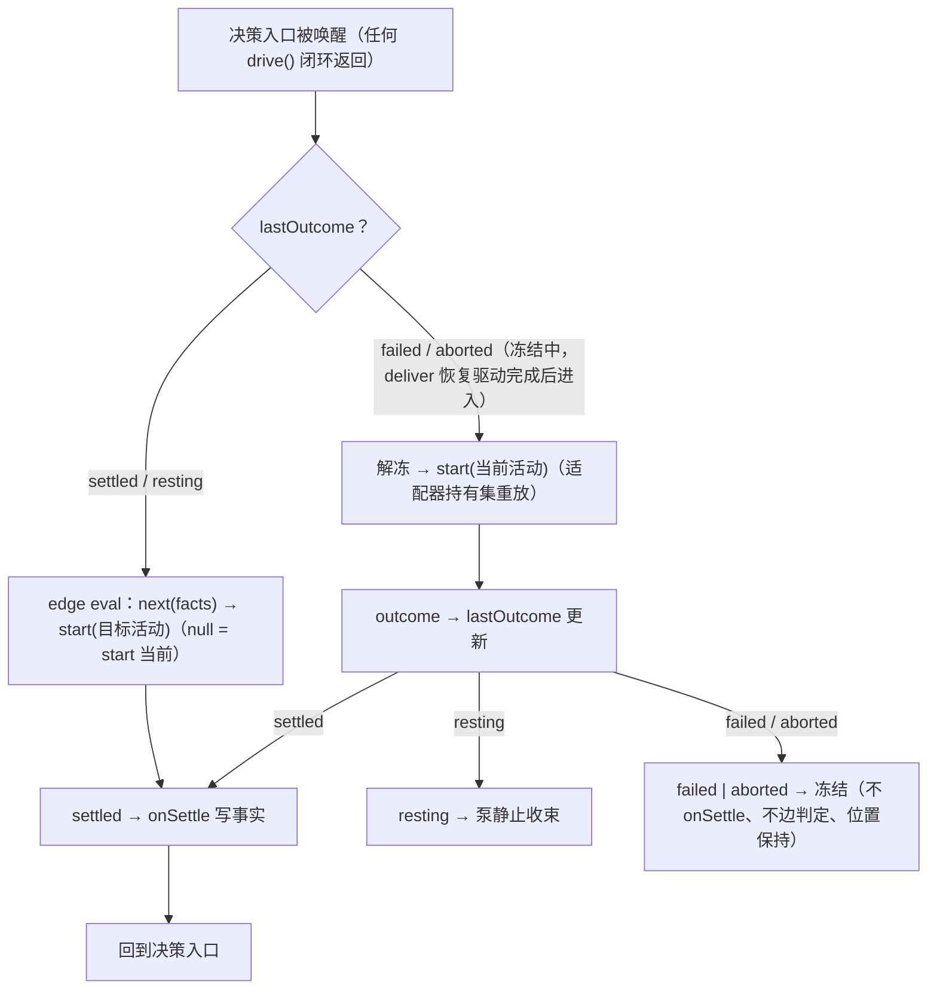

# Data Model: agent_v2 优化——wiki 注入收敛、team 成员流程标准化与 announcer 成员化

**Feature**: [spec.md](spec.md) | **契约**: [contracts/flow-orchestration.md](contracts/flow-orchestration.md)、[contracts/memory-library-layering.md](contracts/memory-library-layering.md)、[contracts/announcer-member.md](contracts/announcer-member.md)

本文件定义目标终态的结构与状态语义。设计裁定依据 `survey/saolei-member-switch-flow.md`（裁定 1–24）；落地批次（research.md D2）：批1 §1、批2 §4、批3 §2/§3。

## 1. memory 库两层结构（批1）

### 1.1 功能单元层

| 实体 | 定义 | 关键字段/产物 |
|---|---|---|
| **CapabilityUnit**（能力单元） | 可独立挂载的原子四件套 | `faces: {key, value}[]`；`tools: ToolDefinition[]`；`sections: PromptSection[]`；`ready(): Promise<void>` |
| **MemoryUnit**（memory 单元） | `buildMemoryUnit({ scope, memoryClient, callUnary })` 产出 | faces: `[{key:"memory", value: MemoryFace}]`；tools: `memory` ×1；sections: `memory:snapshot`(200)——**无 guidance section**（单工具说明由工具 description 承载）；`ready` = fail-loud prefetch |
| **WikiUnit**（wiki 单元） | `buildWikiUnit({ template, wikiClient, callUnary })` 产出 | faces: `[{key:"wiki", value: WikiFace}]`；tools: `wiki_search`/`wiki_get`/`wiki_write` ×3；sections: `wiki:guidance`(120)（三工具协作工作流）；`ready` = no-op |

单元独立性规则（spec FR-002）：

- `MemoryStore` 只持 memoryClient；`WikiStore` 只持 wikiClient（现状合并 store 拆分）。
- **unary 调用策略为注入 seam**（spec FR-006；research.md D10）：`callUnary` 是结构类型策略函数（与 `ctx.grpc.callUnary` 结构兼容），随 client 一起由组装方传入——库内不自持策略副本（现状 `common/js/memory/src/store.ts:357-431` 私有副本删除）；策略实现唯一归属 grpc-runtime。
- memory 工具经 `exec.agent.ctx.memory` 解析；wiki 工具经 `exec.agent.ctx.wiki` 解析——任一单元单独挂载时其工具全部可用。
- wiki scope 只有 template 半边（一模板一 wiki 集，`specs/069-wiki-template-web/contracts/wiki-service.md` §1）；memory scope 为 `(template, preset)` 全对（`specs/071-memory-preset-scope/`）。
- 领域语义冻结：memory 操作（content ≤1024 rune、batch 两阶段、id=sha256[:32]）、wiki 语义（校验/分页/单条上限/两阶段 upsert）、工具 schema 与文案、section 名/order 全部不变。

### 1.2 组合层

| 实体 | 定义 | 产物 |
|---|---|---|
| **CompositionUnit**（组合单元） | 组合工厂将 memory 单元 + wiki 单元合并 + 注入组合层自有的分工 section | 等价于现状 `buildMemoryCapabilities` 输出：tools ×4、sections `memory:guidance`(110, **跨存储分工文本**——组合层自有) / `wiki:guidance`(120) / `memory:snapshot`(200)、ready = memory prefetch |

guidance 归属规则（spec FR-003）：memory 单元不携带 guidance section（单工具说明由 `MEMORY_TOOL_DESCRIPTION` 承载，`common/js/memory/src/tool.ts:40-49`）；wiki 单元保留 `wiki:guidance`（三工具协作工作流）；组合层自有分工 section `memory:guidance`(110)，仅组合挂载时注入——任何挂载形态的 prompt 均不引用不在场工具。

### 1.3 saolei-memory 适配器（批1）

适配器只构造 MemoryService client（WikiService client 构造移除），`memoryMount.build(scope)` 产出 **MemoryUnit**；组装时把 `ctx.grpc.callUnary` 随 client 一起传入（策略注入 seam，research.md D10）。结构类型 seam 不变（`MemoryCapabilities` 四件套形状，消费方 saolei-loop 为结构类型引用）。

## 2. flow 层结构（批3）

### 2.1 F-Moore 活动图（saolei 实例化，唯一创作结构）

### 2.2 实体定义

| 实体 | 字段 | 规则 |
|---|---|---|
| **ActivityId** | `"plan" \| "play" \| "announce" \| "review" \| "rest"` | 与 F-Moore 图节点一一对应 |
| **Activity**（活动） | `id: ActivityId`；`member: MemberId`（激活权归属）；`onSettle?: (facts) => void`（流程事实写入，仅 settled 后）；`next(facts): ActivityId \| null`（纯谓词出边，null = 停留续驱） | 边判定仅在活动 settled 后求值；rest 活动无执行语义 |
| **Facts**（事实） | `terminal: GameEventRecord \| null`（最新终局记录，拉取式）；`reviewed: GameEventRecord \| null`（已复盘，**对象恒等**判据）；`rounds: number`（已完成轮计数）；`statsSentFor: GameEventRecord \| null`（已播报，对象恒等） | 边判定只读；活动钩子可写；不含排队信息 |
| **Command**（指令） | `start(activity: Activity)` | flow 层唯一输出；激活权落地 + 执行层驱动为该指令的两项效果 |
| **Outcome**（活动终态） | `{kind:"settled"} \| {kind:"resting"} \| {kind:"failed", code: LoopErrorCode, detail} \| {kind:"aborted"}` | `drive()` 闭环返回；resting = 无可执行输入（未开始执行）；aborted = 取消/释放打断（非故障，不写失败事实） |
| **FlowState**（flow 层状态） | `position: ActivityId`；`lastOutcome: Outcome \| null`；`facts: Facts`；`frozenError: {code, detail} \| null` | last-outcome 单字段承载冻结分流；frozen = lastOutcome ∈ {failed, aborted} 期间 |

### 2.3 状态归属（survey §5.5）

| 状态 | 归属 | 内容 |
|---|---|---|
| 流程位置 / last-outcome / 失败事实 / 流程事实 | flow 层 | §2.2 FlowState 全部字段；执行层无 paused 概念 |
| 活动执行状态 | 执行层与成员适配器内部 | 持有输入集（复盘重放）、装配细节——对 flow 层不可见 |
| 未消费用户消息 | 成员域 | inbox（在途/静止待消费）；landed（取消落地，装配点统一 flush） |

### 2.4 决策入口分流（运行语义）

冻结规则（spec FR-106）：冻结期间 flow 不发射 start，唯一驱动源是 `deliver` 的静止装配驱动（= 恢复动作）；恢复链两次驱动——投递恢复驱动 → 唤醒 → flow 重启当前活动（重放持有输入集）；"投递先于重试"由执行顺序结构保持。

## 3. 成员接口与适配器（批3）

### 3.1 Member 接口（loop 层唯一词汇）

| 方法 | 语义 |
|---|---|
| `drive(input?): Promise<Outcome>` | 闭环调用：输入构造（默认 drain；可选 input 显式覆盖 = 重试持有集重放）→ 执行 → 完成判定 → 返回终态；**不 throw 契约**（内部失败转译 failed） |
| `deliver(message)` | 在途（本成员 drive 未返回）→ `agent.steer` 入 inbox 随执行区间消费；静止 → 装配 `[drain(自己)..., flushLanded(), message]` 开 turn。仅对 `consumes` 成员有意义 |

完成判定（LLM 成员，survey §7.1）：**agent 静止** = turn 已结束（dsh 语义：不再有新的模型调用）且 inbox pending 为空（含经 deliver 投递未消费消息）——机械 = `agent.whenIdle()` + 失败标记（`agent/error` 先于 idle 到达时置位）。

### 3.2 成员适配器（类型学）

| 适配器 | 完成判定 | 内部机械（hook 封装处） |
|---|---|---|
| **LLM agent 成员适配器**（player/planner 共用单一实现） | agent 静止 | `whenIdle` 等待；`agent/error` → failed（错误码映射表）；deliver 分流（steer/装配）；持有输入集重放；landed flush |
| **Announce-only 成员适配器**（announcer） | 播报同步返回 | `announce()` 返回即 settled；异常 → failed{INTERNAL} |

引擎错误码 → loop 码映射（在 LLM 适配器内，survey §7.1 表）：

| 引擎码（`LlmError.code`） | loop 码 |
|---|---|
| RATE_LIMIT / SERVER / TIMEOUT / TRANSPORT / EMPTY_RESPONSE（L0 穷尽后） | TRANSIENT |
| QUOTA / ACCOUNT_QUOTA | QUOTA |
| INVALID_CREDENTIAL / MISSING_CREDENTIAL / AUTH | CREDENTIAL |
| NO_ADAPTER / 模型不存在 / 端点错误 | CONFIG |
| CONTEXT_WINDOW_EXCEEDED / IMAGE_OFFLOAD_REQUIRED（未自愈穿透） | INPUT_TOO_LARGE |
| INVARIANT / 非 LlmError / 适配器自身异常 | INTERNAL |

### 3.3 错误契约码表（member ↔ loop 接口词汇）

`LoopErrorCode = "TRANSIENT" | "QUOTA" | "CREDENTIAL" | "CONFIG" | "INPUT_TOO_LARGE" | "INTERNAL"`——每码绑定恢复三维度（同输入重试可行性 / 恢复主体 / 呈现指导），完整表见 [contracts/flow-orchestration.md](contracts/flow-orchestration.md) §5。

## 4. announcer 成员名册项（批2）

`TeamMemberView`（宿主视图，`projects/game/agent_v2/src/session.ts:100-116`）新增第三项：

| 字段 | 值 | 说明 |
|---|---|---|
| `name` | `templates/{template}/sessions/{session}/team/members/announcer` | 资源名由 role 构造 |
| `role` | `"announcer"` | 原 `"saolei"` 全量更名（导出 `ANNOUNCER_MEMBER_ROLE`） |
| `preset` | `""`（空） | 非 LLM 成员无 preset |
| `model` | `""`（空） | 非 LLM 成员无模型 |
| `systemPrompt` | `""`（空，GetTeamMember 的 output-only 值） | 无 system prompt 组装 |

角色类型：宿主 `MemberRole` 与编排 `TeamRole` 纳入 `"announcer"`；`UpdateTeam` 请求侧仍只接受 player/planner 两成员配置（preset 必填校验不变）——announcer 由服务端进入名册。

## 5. 宿主快照派生（批3）

| 快照字段 | 派生规则 |
|---|---|
| `phase` | 活动映射：plan→planning、review→reviewing、play/rest→playing |
| `active`（在途回合成员） | 执行层驱动中的成员；静止时 null |
| `activation`（激活权） | 当前活动的 `member` |
| `activeMember`（合并值） | `active ?? activation`（060 §1 保持）——可为 announcer |
| `paused` | ← flow 冻结态（frozen） |
| `failed`/`lastError` | ← flow 失败事实（code 透传；宿主映射 code → 用户动作文案） |
| `queued` | ← 成员 inbox pending + steered-unclaimed（`specs/061-team-queue-steer/research.md` R4；landed 不计，R5） |
| 静止判定（watchQuiescence） | `frozen \|\| (active === null && inboxPending === 0)`——冻结短路取代 paused 短路 |
