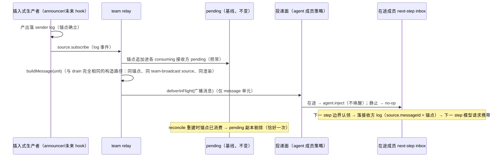

# Contract: team 插件——在途广播快路（插入式产出 → 在途成员下一 step）

**Feature**: [../spec.md](../spec.md)（FR-007–FR-012；US3）| **决策依据**: [../research.md](../research.md) D4–D6/D10 | **设计语义**: `survey/saolei-hook-scripts.md` §2.2.4/§2.2.5（用户裁定形态）
**实现锚点**: `common/js/dsh-plugins/team/src/{team,broadcast}.ts`（relay 扩展 + source 投递面）、`common/js/dsh-plugins/saolei-loop/src/{orchestrator,agent-member}.ts`（投递面供给与策略）
**基线契约修订**: 本契约落地时同步修订 `specs/065-agent-v2-team-refine/contracts/team-member-source.md`（§2 增补：投递面与快路投递规则）、`specs/059-agent-v2-team-mode/contracts/dsh-plugins.md` §1（行为规范第 3 条增补投递时机）、`specs/076-agent-v2-optimize/contracts/flow-orchestration.md`（§3 两类输入分层与 §7 宿主联动的"广播投递时机"增量）——修订为终态表述，引用本 feature spec。

## 1. 触发定义（发送方视角）

**插入式产出（insertion production）**：发送方不是当前在途 turn 执行者、却输出了 message（`assistant/message`，非空正文）。现状唯一生产者是 announcer 的播报；未来任何场景的非激活成员 message 产出（如 hook 播报）复用同一路径，无需新机制。

- 触发粒度 = **message 单元**（`BroadcastUnit.kind === "message"`）；tool 单元不触发（其发送者即在途成员本人，relay 已排除 sender，触发面恒空）。
- **接收方 = 当前在途成员，且仅此一个**（"至多一个成员在途驱动"不变量保证）。非在途成员不是快路接收方——静止成员感知不到插入消息，等下次驱动时经 pending drain 消费（既有语义，正是其接收广播的正确方式）。
- 启用条件是**接收方存在性**（存在当前在途成员），非发送方身份：终局统计播报时无在途成员 → 无快路、pending drain，现状不变。

## 2. 机械契约

### 2.1 投递面（成员种类的结构性属性）

```ts
interface TeamMemberSource {
  /** 在途投递面（可选）：与 consumes 同级的结构性属性——类型可缺省、语义非配置项。
   * agent 成员适配器统一供给（无 per-member 配置维度）；announce-only 成员结构性缺席。 */
  readonly deliverInFlight?: (message: UserMessage) => void;
}
```

agent 成员策略（单一实现，所有 LLM 成员共用）：

```text
AgentMember.deliverInFlight(message: UserMessage): void   // loop 侧成员适配器的投递面方法
  适配器在途（busy）→ agent.inject(message)   // 不唤醒驱动；下一 step 边界认领
  适配器静止        → no-op                    // "我不是接收方"
  inject 抛出       → 捕获 + warn 日志；回落 pending 基线（不向 announce 路径传播）
```

供给点：orchestrator `createMember` 组合装配（source 与 AgentMember 适配器同域）——注册的 source 对象携带 `deliverInFlight` 闭包**委托**该适配器方法（announcer 注册项不带）；team relay 时对每个**带投递面的 consuming 接收方**调用——机械遍历与语义单一接收方不矛盾（策略过滤后实际生效的只有当前在途成员）。

**投递面归属**（`specs/059-agent-v2-team-mode/contracts/dsh-plugins.md` §1 行为规范第 7 条「team 只投递不驱动」保持成立）：team 只调用成员供给的 `deliverInFlight` 闭包，**不直接调用** `agent.inject`——实际 inject 发生在成员适配器（loop 侧）内，team 对 agent 细节保持不感知。

**接收侧 inbox 卫生（同一适配器的结构性义务，D10）**：成员每次开启新 turn（`startTurn` 守卫通过后、装配批注入前）将 pending inbox（`nextStep`/`nextTurn`）中 `source.kind === "team-broadcast"` 的未认领消息清除（`agent.inbox.remove`，dsh 结构面 `Inbox`——普通移除即 durable cancel）。依据不变量：**未认领 ⇒ 锚点未消费 ⇒ pending 派生必含该锚点**、新批经 drain 重投（registration 存续期间恒成立；registration dispose 后不存在后续 turn）——清扫使 pending 成为 team-broadcast 的唯一可靠性载体，杜绝「inbox 残留 + 新批」在 turn 边界被原子地一并认领（dsh-agent-loop turn 开启认领 "pending next-step input plus one queued prompt"）。用户消息（steer 残留）不在清扫范围——随 turn 边界照常认领（`specs/061-team-queue-steer/contracts/orchestrator-input.md` §1 义务 2 既有语义）。

### 2.2 relay 的快路扩展（叠加，不改基线）



义务：

1. **pending 恒为基线**：relay 的锚点追加无条件发生；快路是叠加的提前投递，任何失败（注入异常/取消丢弃）自动回落基线语义。
2. **单一构造路径**：快路消息经 `buildMessage`（→ `buildBroadcastMessage`，`common/js/dsh-plugins/team/src/broadcast.ts:271-289`）构建——与 drain 完全相同；**不存在快路特制消息形态**（无独有 source kind、无独有渲染）。
3. **回读语义**：构造时从 sender log 回读锚点内容——relay 时事件已在 log 中；读取失败按既有 fail-loud（corruption 同 drain 错误面，不新增错误种类）。

## 3. exactly-once（锚点闭包，零新记账）

- 消费闭包：接收方 log 出现 `source.messageId === 锚点` 的 `user/message` 注入即闭包（`consumedAnchors`，`broadcast.ts:160-173`）。
- **双向自愈**：快路被认领 → drain 前置 reconcile 重建 pending 时剔除 relay 副本（去重）；快路被取消/丢弃（cancel 清 inbox）→ 锚点未消费 → pending 照常 drain（重投）。
- `drained` 集合继续保护 drain 路径"已弹出未落 log"窗口；快路不使用 `drained`（不弹出 pending）。
- **单一可靠性载体（同批唯一性，D10）**：锚点闭包是 log 观测式去重——只能跨认领批次去重（重投侧），无法拦截同一批内的双源喂入；同批唯一性由机械保证：任一时刻同一 `team-broadcast` 锚点至多存在于一个可认领位置，**pending 列表是其唯一可靠性载体**——inbox 残留由成员 turn 起点清扫（§2.1 inbox 卫生）、cancel 的 landed 收编排除广播（§6）。`specs/076-agent-v2-optimize/contracts/flow-orchestration.md` §4 恢复链"fresh drain 与 landed 不共存"不变量在快路下的维持正依赖此规则：inbox 的 team-broadcast 注入源不回流 landed/inbox 残留，恢复装配的两源（drain + landed）对任一锚点至多其一持有。

## 4. 顺序一致性

- **发言级（assistant message）跨成员完全一致**：快路接收方与其他成员看到的共享消息相对顺序相同（= 生产顺序）。机制：drain 序按 `compareUnits` 生产坐标；快路消息落点 = 下一 step 边界认领，位于其生产时刻所属 step 窗口内。
- **工具单元级有界偏差（披露，不消除——用户裁定 2026-10-16）**：接收方 log 中快路消息位于同 step 全部工具结果之后（step 边界认领），其他成员的生产序中它可能先于同 step 后继兄弟工具单元（其 `tool/call` 锚点时间晚于 announce）。偏差被限制在单个 step 窗口内、仅涉及插入消息与兄弟工具单元的相对位置，发言级顺序不受影响。消除方案（工具单元锚点改 result 时间 / drain 按认领位置归并）会改变既有 drain 排序保证，不在本 feature 范围。

## 5. 与驱动 / flow / 投递排队的关系（零影响）

| 维度 | 契约 |
|---|---|
| 驱动 | `inject` 不唤醒驱动——不开新 turn、不延长在途 turn、不触发任何 flow 决策；在途 turn 的下一步（处理工具结果的那一步，本来就会发生）认领该消息 |
| 完成判定 | `whenIdle`/agent 静止语义不变（inject 非唤醒输入，turn 收束即 idle） |
| 输入记账 | 快路消息不计入 steered/queued 快照（呈现 chip 生命周期由 `member_view` 帧驱动，现状语义） |
| 驱动输入构成 | drain + landed + 用户消息不变；"编排不合成驱动消息"保持——快路投递的是成员真实广播产出（同锚点），非合成文本 |
| steer 共存 | 与用户 steer 消息共享 nextStep inbox 与 step 边界认领——同边界多条按插入序 FIFO；投影分离（steer → `user`；快路 → `team-broadcast`，均为 `appendMemberViewUser` 既有处理种类，零新增投影规则） |

## 6. 边缘路径

- **turn 收束边缘（`concludesTurn`/模型停止）**：announce 在收束前发生 → 在途成员仍是接收方、快路成立；turn 随即收束 → 循环停止条件 `turnEnds && inbox.nextStep.length === 0`（`@deepseek-ai/dsh-agent-loop` 0.2.0-rc.2 `lib/index.js:998-1005`）使收束 turn 延展一步认领 next-step 残留——锚点消费、闭包成立，时序等价 drain。
- **turn 失败残留（非 cancel）**：失败 turn 不清 inbox（dsh-agent-loop 仅 cancel 清 pending work），快路副本残留 next-step；该成员下一次 turn 起点的 inbox 清扫（§2.1）移除残留，新批经 drain 重投恰一份——同批双认领结构性不存在。
- **cancel**：`orchestrator.cancel()` 既有顺序 `landUnclaimed` 先于 `agent.cancel`（默认清 inbox）保持；`landUnclaimed`（`common/js/dsh-plugins/saolei-loop/src/orchestrator.ts`）只收编**用户**未消费消息为 landed，`team-broadcast` 残留不落地、放行给 inbox 清除——锚点未消费 → pending 重建自愈重投恰一份（§3 单一载体；不丢失、不重复）。landed 因此只承载用户输入；`specs/076-agent-v2-optimize/contracts/flow-orchestration.md` §6 cancel ②「未消费输入落地」的范围据此收窄为用户消息（修订随 tasks.md T011 落盘）。
- **刷新 teardown**：registration dispose 清空 pending；在途快路残留随 inbox 清理——无跨生命周期重投（旧团队已不存在）。
- **announce-only 接收方**：`consumes: false` 非 relay 接收方且无投递面——announcer 的播报不回流给自己。

## 7. 验收面（对应 spec SC-003/SC-004/SC-005）

- team 单测：①在途接收方收到快路广播（同锚点、同 drain 构造——消息逐字段等价断言）；②快路认领后 drain/pending 重建剔除副本（恰好一次）；③静止接收方无投递（no-op）、pending 照常；④tool 单元不触发快路；⑤投递面抛出 → warn 日志、pending 基线不受扰、relay 不上抛；⑥终局统计播报场景（announcer 生产、无在途接收方，spec SC-003 第④项）——各接收方投递面策略 no-op、pending 照常 drain（现状行为不变）；⑦同 step 窗口多条播报（US3 场景 6）：投递面按生产序 FIFO 收到多条、`source.messageId` 各异；其一被认领后其余锚点 pending 独立存活（各锚点独立闭包、无重排与重复）。
- loop 单测（AgentMember 策略）：busy → inject（不唤醒断言：无新 turn、whenIdle 不变）；静止 → no-op；注入后 steered/queued 计数不变。
- loop 单测（cancel 双向自愈，US3 场景 5/spec SC-003 第⑤项，`common/js/dsh-plugins/saolei-loop/src/orchestrator.test.ts`）：在途注入的广播副本与 pending 副本共存时 cancel——`dropped` 与 landed 不含 `team-broadcast` 副本；恢复装配（submit → deliver，或 flow 重启 drive）对该锚点恰出现一份（drain 副本、位于用户消息之前）。
- loop 单测（turn 失败残留清扫，spec SC-003 第⑤项，`common/js/dsh-plugins/saolei-loop/src/agent-member.test.ts`）：drive 在途 → `deliverInFlight` 注入 → turn 失败（残留存活 inbox）→ 恢复 drive（drain 含同锚点副本）——turn 起点清扫移除残留、新批恰一份；同窗口用户消息残留不被清扫。
- 顺序断言：快路接收方 log 的发言级序 = 其他成员 drain 序（生产序）；工具单元级偏差仅出现在单 step 窗口内。
- 大型测试：既有套件全量回归（快路生产行为惰性——现状唯一插入式生产者 announcer 播报时无在途成员；spec Clarifications 2026-10-16 裁定：不新增快路专用大型场景，真实端到端场景由后续 hook feature 携带）。
