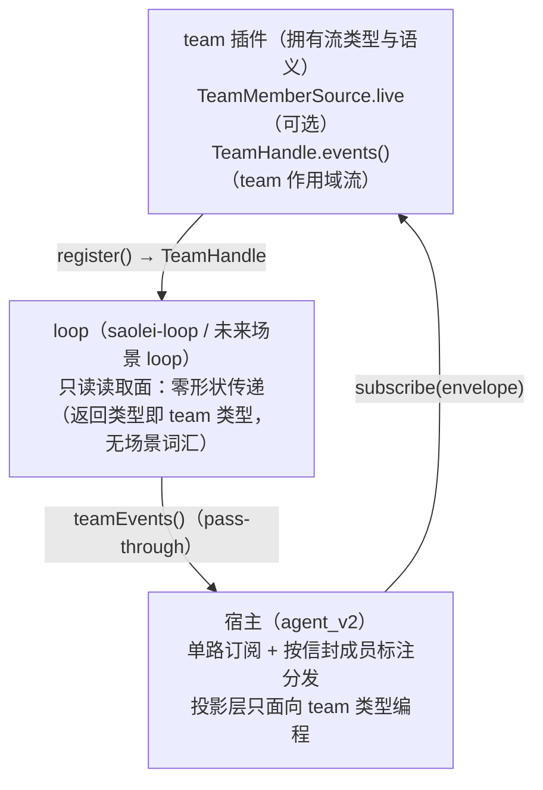

# Contract: team 插件——统一成员事件流（TeamMemberSource live 面 + TeamHandle.events）

**Feature**: [../spec.md](../spec.md)（FR-001/FR-002/FR-013；US1）| **决策依据**: [../research.md](../research.md) D1–D3
**实现锚点**: `common/js/dsh-plugins/team/src/team.ts`（`TeamMemberSource`/`agentMemberSource`/`Team`/`TeamHandle`）
**基线契约修订**: 本契约落地时同步修订 `specs/065-agent-v2-team-refine/contracts/team-member-source.md`（§1 接口增量：live 面；§2 传输语义增补：流同源扇出）与 `specs/059-agent-v2-team-mode/contracts/dsh-plugins.md` §1（服务面：TeamHandle.events）——修订为终态表述，引用本 feature spec。

## 1. 分层与所有权



义务：

1. **team 拥有**：统一成员事件流的类型（信封/流）与语义（通道词汇、同源扇出、生命周期）归 team 插件；角色为开放字符串，未来场景角色零改动流通。
2. **loop 零形状传递**：loop 的读取面不定义自有事件形状，直接返回 team 的流对象；未来场景 loop 同样一行传递。
3. **宿主单路**：宿主对成员事件的消费只有 team 统一流一个入口；不再存在按 dsh session id 的散布过滤或成员专属订阅路径。
4. **依赖倒置保持**（065 §1）：team 的成员抽象不感知"成员是 agent 还是系统角色"——live 面与 `TeamLiveEvent` 属 agent 适配层（`agentMemberSource` 旁），announce-only 成员结构性缺席该面。

## 2. 接口契约

### 2.1 TeamMemberSource 扩展

```ts
interface TeamMemberSource {
  // 既有字段（id/events/subscribe/sectionTarget/consumes）语义零变化。

  /** 成员活动事件面（可选）：agent 适配层实现——订阅 dsh 根事件
   * agent/assistant-stream | agent/status | agent/error，按 agent 身份过滤转发；
   * announce-only 成员结构性缺席。订阅随成员 scope 存续。 */
  readonly live?: {
    subscribe(onEvent: (event: TeamLiveEvent) => void): () => void;
  };
}
```

`agentMemberSource` 的 live 实现剥离 agent 身份（成员归属由信封承载）；事件类型联合 `TeamLiveEvent = assistant-stream 帧 | status 迁移 | error`——team 服务只标注转发、不解释。

### 2.2 TeamHandle.events() 与信封

```ts
interface TeamHandle {
  dispose(): void;                 // 既有
  events(): TeamEventStream;       // team 作用域成员事件流
}

interface TeamEventStream {
  subscribe(consumer: (event: TeamMemberEvent) => void): () => void;
}

type TeamMemberEvent =
  | {
      readonly role: string;                 // 注册角色（开放字符串）
      readonly memberId: string;             // source id
      readonly channel: "log";               // log = 成员 log 产出
      readonly event: SessionEvent;
    }
  | {
      readonly role: string;
      readonly memberId: string;
      readonly channel: "live";              // live = 成员活动事件
      readonly event: TeamLiveEvent;
    };
```

信封按 `channel` 判别：两个分支字段同名同义（role/memberId/channel/event），判别联合只把 `event` 的载荷类型与通道绑定——消费者据 `channel` 收窄后无需断言即可读 `SessionEvent` 或 `TeamLiveEvent`。

## 3. 传输语义

1. **同源扇出（log 通道）**：team 既有 `source.subscribe` 订阅（relay 的输入）是 log 通道的唯一生产源——同一事件先经 relay 处理再扇出给流订阅者（或等价的同源双消费者），两类消费者看到同一事件、同一序；流不是第二条订阅。
2. **live 通道**：source 的 live 面事件经成员标注进入流；无 live 面的成员只产生 log 通道事件（announce-only 成员的全部产出都是 log 通道）。
3. **顺序**：流内事件按成员生产序到达（per-member FIFO；跨成员序为到达序，不承诺全局排序——投影层的跨成员序由历史归并的 `seq` 承载，现状不变）。
4. **生命周期**：流随 registration 存续——register 幂等刷新不中断流；成员移除/团队 dispose 后该成员不再有事件；退订归消费者（宿主 entry teardown）。
5. **错误面**：流转发不吞 relay 的既有 fail-loud 语义（corruption 上抛路径不变）；live 面订阅异常按 dsh 根事件既有行为（不新增错误种类）。

## 4. loop 侧传递（saolei-loop）

`TeamOrchestrator` 新增只读读取面 `teamEvents(): TeamEventStream`——实现为 `this.teamRegistration.events()` 的直接返回（零形状；`orchestrator.ts` 既有 `teamRegistration` 持有）。物化未完成/disposed 后调用按 orchestrator 既有状态错误语义（`OrchestratorStateError`）。

## 5. 宿主消费（agent_v2）

1. **单路订阅**：entry 物化时经 `orchestrator.teamEvents()` 订阅一次，detach 存入 entry（取代 `announceOff`）；teardown 在编排释放**收敛之后**退订——ABORTED 终态帧本身经该统一流到达 `MemberCollector`，先退订会丢帧、违反 spec FR-003 行为等价基准（实现顺序见 `projects/game/agent_v2/src/session.ts` 的 `teardownEntry`）；编排 `dispose()` 内部丢弃团队注册的全部成员订阅（含 announcer），故旧生命周期此后没有任何产出到达旧投影。
2. **信封分发**：按 `role` 分发到成员记账结构——agent 成员的唯一入口是 `MemberCollector.applyEvent(envelope: TeamMemberEvent): void`（log 通道 → 会话事件处理、live 通道 → 流式/状态/错误处理；既有记账机械保留，构造不再订阅根事件）；announcer 的 log 通道 `assistant/message` → `history.appendAnnouncement`（方法保留，触发源收敛）。
3. **投影对外行为零变化**：web ChatEvent 帧序与内容、`ListTeamMessages`/`ListMemberMessages` 同源同值、成员视角消费时点、turn 收束帧、刷新/关闭 teardown 无帧泄漏（spec FR-003 行为等价基准，非逐字实现保持）。

## 6. 验收面（对应 spec SC-001）

- team 单测：信封标注正确（role/memberId/channel）；log 通道与 relay 同源同序（同一事件双消费者断言）；live 面事件只从 agent source 到来；announce-only 成员无 live 通道事件；dispose 后无事件。
- loop 单测：`teamEvents()` 传递零形状（返回 team 流对象）；未物化/disposed 状态错误。
- 宿主单测：`session.test.ts` 全量投影断言经统一流驱动通过（驱动面切换、断言不变）；`projects/game/agent_v2/src/` 无逐成员 dsh 根事件订阅与 announcer 独立订阅残留。
