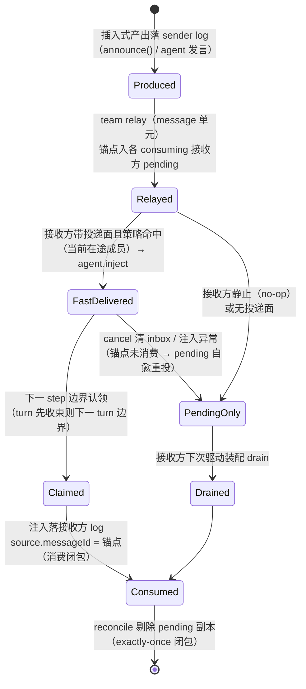
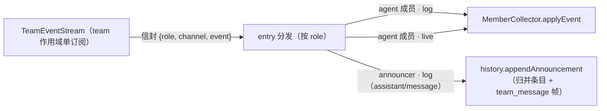
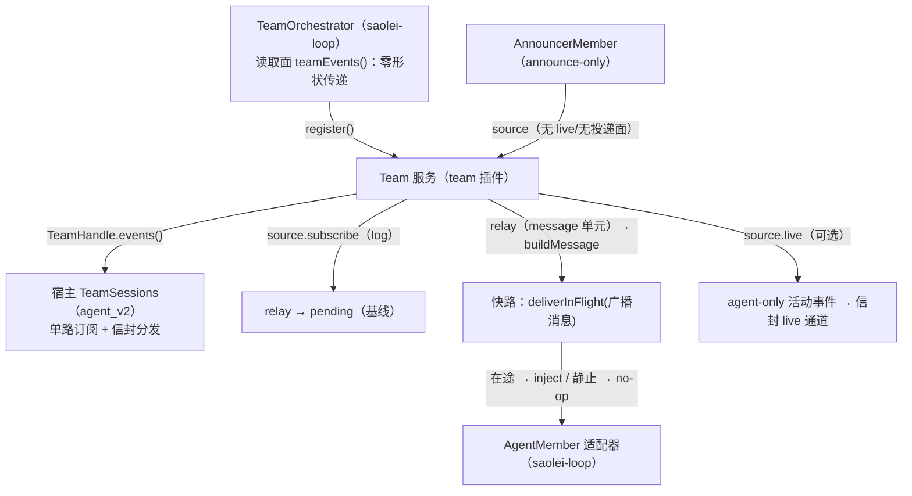

# Data Model: 077 成员统一性补缺

**Spec**: [spec.md](spec.md) | **决策依据**: [research.md](research.md) D1–D9
**实现锚点**: `common/js/dsh-plugins/team/src/{team,broadcast}.ts`、`common/js/dsh-plugins/saolei-loop/src/{orchestrator,agent-member,announcer}.ts`、`projects/game/agent_v2/src/{session,history}.ts`

会话状态保持进程内存态（stateful + owner 亲和），本 feature 无持久化存储变更。

## 1. team 插件面（类型定义）

### 1.1 TeamMemberSource（扩展；既有字段语义不变）

```ts
interface TeamMemberSource {
  readonly id: string;              // 既有：成员稳定标识（agent = dsh session id）
  readonly events: readonly SessionEvent[];   // 既有：产出 log 快照
  subscribe?(onEvent: (event: SessionEvent) => void): () => void;   // 既有：产出实时通知（relay 输入）
  readonly sectionTarget?: TeamSectionTarget; // 既有：prompt 注入目标
  readonly consumes?: boolean;      // 既有：false = announce-only

  // 新增（D2）：成员活动事件面——agent 适配层实现（agent/assistant-stream、agent/status、
  // agent/error 按 agent 身份过滤转发）；announce-only 成员结构性缺席。
  readonly live?: {
    subscribe(onEvent: (event: TeamLiveEvent) => void): () => void;
  };

  // 新增（D4）：在途投递面——agent 成员种类的结构性属性（类型可缺省、语义非配置项）；
  // team relay message 单元时调用；策略：在途 → 不唤醒注入，静止 → no-op。
  readonly deliverInFlight?: (message: UserMessage) => void;
}
```

### 1.2 TeamLiveEvent（agent 适配层类型联合；team 成员抽象不解释）

```ts
type TeamLiveEvent =
  | { kind: "assistant-stream"; frame: <dsh agent/assistant-stream 帧载荷> }
  | { kind: "status"; status: <dsh agent/status 载荷> }
  | { kind: "error"; error: <dsh agent/error 载荷> };
```

agent 身份由适配器过滤剥离——成员归属由信封（1.3）承载，载荷不再携带 agent 字段语义。

### 1.3 TeamMemberEvent（统一流信封）与 TeamEventStream

```ts
type TeamMemberEvent =
  | {
      readonly role: string;     // 注册角色（开放字符串：player/planner/announcer/未来场景角色）
      readonly memberId: string; // source id
      readonly channel: "log";
      readonly event: SessionEvent;
    }
  | {
      readonly role: string;
      readonly memberId: string;
      readonly channel: "live";
      readonly event: TeamLiveEvent;
    };

interface TeamEventStream {
  subscribe(consumer: (event: TeamMemberEvent) => void): () => void;
}
```

信封按 `channel` 判别：两分支字段同名同义（role/memberId/channel/event），判别联合把 `event` 的载荷类型与通道绑定——消费者据 `channel` 收窄后无需断言即可读 `SessionEvent` 或 `TeamLiveEvent`。

- "log" 通道与 relay **同源**：team 既有 source 订阅扇出两路消费者（relay + 流），同一事件、同一序。
- "live" 通道：source live 面事件标注转发；无 live 面的成员（announcer）只产生 log 通道事件。
- 生命周期：流随 registration 存续（成员移除/dispose 后无事件）；订阅退订归消费者。

### 1.4 TeamHandle（扩展）

```ts
interface TeamHandle {
  dispose(): void;                    // 既有
  events(): TeamEventStream;          // 新增（D3）：team 作用域事件流
}
```

## 2. 快路消息生命周期（状态转移）



不变量：

- **每锚点每成员恰好一次**：接收方 log 出现 `source.messageId === 锚点` 的 `user/message` 即闭包（`common/js/dsh-plugins/team/src/broadcast.ts` `consumedAnchors`）；`drained` 集合保护"已弹出未落 log"窗口（drain 路径）。
- **pending 恒为基线**：relay 锚点追加无条件发生；快路是叠加的提前投递，任何失败自动回落基线（注入异常捕获 + warn 日志，D4）。
- **顺序**：drain 序 = `compareUnits` 生产坐标序；快路消息落点在其生产时刻所属 step 窗口内——发言级跨成员一致；工具单元级偏差有界于单 step 窗口（D6 披露，不消除）。

## 3. 宿主成员运行时统一

### 3.1 MemberRuntime（判别联合，取代 `Record<AgentMemberRole, MemberRuntime>` + announceOff 旁路）

```text
MemberRuntime =
  | { kind: "agent"; role: "player" | "planner"; preset; model; handle: AgentHandle; collector }
  | { kind: "announce-only"; role: "announcer" }

TeamEntry:
  members: MemberRuntime[]（或按 role 索引的统一映射）——容纳全部注册成员
  streamOff: () => void——统一流单路退订（取代 announceOff）
  （其余字段不变）
```

### 3.2 派生规则（属性派生取代角色字符串特判）

| 投影面 | `kind: "agent"` | `kind: "announce-only"` |
|---|---|---|
| 名册项（GetTeam/UpdateTeam 视图） | preset/model 实值 | 空 preset/model（空形态） |
| GetTeamMember | assembly 读取路径（generation 重试） | 同步空形态视图（`system_prompt` 空值） |
| 成员视图（ListMemberMessages） | 既有视角投影 | NOT_FOUND（无成员视角） |
| collector/turn 记账 | 有 | 无 |
| teardown | collector.dispose + 释放 | 随统一流退订与成员列表释放 |

在途成员判定：`snapshot().active`（MemberId）经成员 kind 过滤——取代 `isAgentMemberRole`/`activeAgentMember` 角色串判定（`projects/game/agent_v2/src/session.ts:1041-1058`）。

### 3.3 投影输入分发（单路）



`MemberCollector.applyEvent(envelope: TeamMemberEvent): void` 是 agent 成员的唯一信封入口：`log` 通道 → 既有 `onSessionEvent`（会话事件），`live` 通道 → 既有 `onAssistantStream`/`onStatus`/`onError`（载荷为 `TeamLiveEvent`，非会话事件）；记账机械保留、构造不再订阅根事件。对外投影（ChatEvent 帧、归并历史、成员视角、turn 收束）零变化（spec FR-003 行为等价基准）。

## 4. 实体关系



依赖方向：宿主 →（orchestrator 读取面）→ team 拥有的流类型；loop 对 team 只有 register/drain/流传递；team 不感知 agent 词汇与场景语义（065 §1 依赖倒置保持）。
