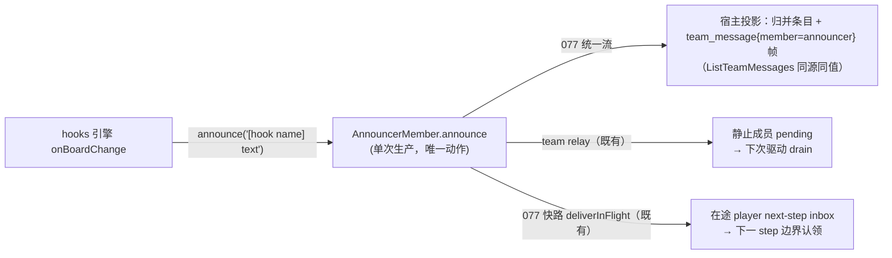

# Contract: hook 播报回流（统一播报 + 快路复用）

**Feature**: [../spec.md](../spec.md)（FR-008–FR-011；US1）| **决策依据**: `survey/saolei-hook-scripts.md` D2/D7（§2.2.4/§2.2.5 十轮裁定）+ [../research.md](../research.md) D6 | **数据模型**: [../data-model.md](../data-model.md) §3.3–§4
**实现锚点**: `common/js/dsh-plugins/saolei-loop/src/announcer.ts`（`announce(text)`，零改动预期）、`specs/077-announcer-member-unification/` 交付的 relay/快路/投影链（零改动预期——本契约是**消费方契约**）
**基线契约修订**: `specs/076-agent-v2-optimize/contracts/flow-orchestration.md`（§3 广播投递时机增量表述追加 hook 播报场景注记）；`specs/065-agent-v2-team-refine/contracts/game-stats-broadcast.md` §3（announcer 产出通道追加 hook 播报为第二生产来源——该节是 announcer 生产协议的原文位置）；`specs/076-agent-v2-optimize/contracts/announcer-member.md` §2（proto 面：第二来源沿用同一消息形状，零变更）。

## 1. 播报通道（零新机制）

hook 结果播报**只做一件事**：调用 unit 持有的 announce seam（= `AnnouncerMember.announce(text)`）。此后全部投影由既有机制承载：

- hook 播报 = announcer 在 player turn 内的**插入式产出**——正是 `specs/077-announcer-member-unification/contracts/inflight-broadcast-fastpath.md` §1 预留的接入位（"未来任何场景的非激活成员 message 产出（如 hook 播报）复用同一路径，无需新机制"）；快路的接收方唯一性、恰好一次（锚点闭包双向自愈）、发言级顺序一致、驱动零影响全部按该契约执行，**本 feature 不修订其任何语义**。
- `saolei_operate` 工具结果保持纯领域结果（不含 hook 输出）——hook 分析回流唯经本播报通道（spec FR-010；additionalContexts 备选不启用）。

## 2. 播报文本格式（research D6；**本表是本 feature 播报文本的唯一权威来源**——spec FR-011、[../data-model.md](../data-model.md) §3.3、tasks 只引用不重述）

| 情形 | announce 正文 |
|---|---|
| 正常输出 | `[hook <name>] <result>` |
| 输出截断 | `[hook <name>] <result 前 4096 字符> ...[truncated]` |
| 运行期错误 | `[hook <name>] error: <message>` |
| 超时 | `[hook <name>] timeout after <EXECUTION_TIMEOUT_MS>ms`（当前常量 = 500ms） |
| 输出不可序列化（`undefined`（无 `return`）/循环引用等） | `[hook <name>] error: output is not serializable` |
| 空字符串输出 | **不播报**（零条目；spec FR-008） |

- 前缀 `[hook <name>]` 使 web/成员侧可按名称归因；多 hook 逐条播报（注册序），一次事件产生 0..N 条（N = 非空输出数）。
- announce 正文不添加任何其他包装（announcer 身份已由 `member="announcer"` 标签承载）。

## 3. 可见性语义（验收基准）

| 观察者 | 可见时机 | 载体 |
|---|---|---|
| web 用户 | 即时（播报同步落账） | `team_message` 帧 + 归并条目（077 统一流） |
| player（在途，多 step 回合内 operate） | **同回合下一 step** | 077 快路：不唤醒注入 → step 边界认领 → 下一 step 模型请求携带；锚点闭包剔除 relay 副本（恰好一次） |
| planner（静止） | 下次驱动装配时 | pending → drain（`<announcer-message>` 广播） |
| player（回合已收束后的事件不可能存在） | — | 事件只在 operate 工具调用路径内同步发生，operate 属于 player 自己的在途 turn；`concludesTurn` 边缘按 077 契约 §6（收束 turn 延展一步认领，时序等价 drain） |

顺序保证：发言级 = 生产序（跨成员一致，077 契约 §4）；工具单元级有界偏差维持 077 披露（单 step 窗口内、仅插入消息与兄弟工具单元相对位置，不消除）。

## 4. 边缘路径（全部继承 077 契约 §6，以 hook 播报为载荷复验）

- turn 收束边缘（终局前最后一次有效 operate 的 hook 播报）→ 收束 turn 延展一步认领（`turnEnds && inbox.nextStep.length === 0`）——锚点消费、闭包成立。
- turn 失败残留 → 下一 turn 起点 inbox 清扫 + pending 重投恰一份。
- cancel → `team-broadcast` 残留不落地 landed；锚点未消费 → pending 自愈重投。
- 刷新 teardown → 注册表随 unit 丢弃；在途回合 abort；无跨生命周期重投。
- announcer `consumes: false` → hook 播报不回流给 announcer 自身。

## 5. 验收面（对应 spec SC-001/SC-002）

1. 单测（saolei-hooks）：announce seam 收到的文本格式表逐行断言；空输出零调用；注册序逐条。
2. 单测（saolei-loop 编排装配）：unit 的 announce 绑定到 orchestrator 持有的 announcer（mock 断言转发）。
3. 大型测试（fake-llm 驱动，spec FR-018/SC-001/SC-002；场景脚本以 `specs/078-saolei-js-hooks/quickstart.md` §3 为准）：planner set 脚本 → player 非终局 operate → ①web 消息列表与实时流出现 `[hook ...]` 播报；②快路下一 step 携带——fake-llm 无请求体读取面，以**播报文本为锚定关键词的模板命中**间接断言，且该锚定模板驱动的后续行为必须是 player 下一 step 的唯一成功路径（缺播报即失败；fake-llm 对无匹配请求回退随机文本模板，故不得以"模板未命中"本身为判据）；③同锚点恰一次（锚定模板驱动链只出现一次）；④planner 下次驱动经其锚定模板命中同一播报（drain 可见）；⑤跨成员发言级顺序一致；⑥无变动/终局批量路径零播报。
