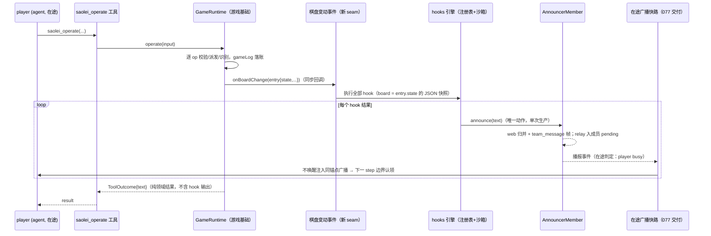

# Feature Specification: saolei JS hook（planner 固化策略脚本 + 棋盘变动后执行播报）

**Feature Branch**: `078-saolei-js-hooks`

**Created**: 2026-10-17

**Status**: Draft

**Input**: User description: "为 @projects/game/agent_v2/ saolei 支持 js hook 功能，前期调研 @survey/saolei-hook-scripts.md 。其中K4部分已经实现，现在完成其余功能"

## 背景与调研基线

本 feature 为 `projects/game/agent_v2/` 增加 JS hook 能力：planner 经工具设置 JS 脚本（可多个，不做持久化），player 每次执行扫雷棋盘批量操作后以棋盘状态为输入执行全部 hook 脚本，脚本输出（字符串或可转字符串的对象）经 announcer 播报。目的：允许 planner 把策略/分析路径固化为代码——如每步输出确定性安全格，对 player 形成持续指导通道。

**调研基线**为 `survey/saolei-hook-scripts.md`（2026-10-16 十轮裁定/澄清）；下表为其决策终态（编号取自 survey §4）。本 feature 的 plan 阶段裁定另成一套编号（[research.md](research.md) D1–D9），引用时以 `survey D#` / `research D#` 前缀区分：

| 决策（survey 编号） | 状态 |
|---|---|
| survey D1 JS 执行引擎 | ✅ `node:vm`（plan 阶段裁定，见 [research.md](research.md) D1；候选对比 survey §2.3.2） |
| survey D2 播报可见面 | ✅ 全广播（`announcer.announce()`，web 展示链 + team relay 链） |
| survey D3 棋盘状态获取 | ✅ 经游戏基础新增的棋盘变动事件载荷（`GameLogEntry.state`） |
| survey D4 触发面 | ✅ 游戏领域"棋盘批量操作变动"事件（一次 operate 批量落账后同步触发；init 不触发；仅实际变动（`executed > 0`）且对局仍在进行（条目 `status: "playing"`）触发——全 skip 批量与终局批量都不触发） |
| survey D5 工具形态 | ✅ 单 action 工具 `saolei_hook`（set/remove/list，memory 先例） |
| survey D6 插件命名与挂载 | ✅ `@dominion/dsh-saolei-hooks`（`common/js/dsh-plugins/saolei-hooks/`），经 saolei-loop `config.plugins` 挂载 |
| survey D7 hook 结果回流形态 | ✅ 统一播报 + 在途广播快路（announcer 单次生产；快路承担"player 同回合下一 step 可见"） |
| survey D8 宿主分层补缺（K4）范围与时机 | ✅ 已由 **077** 落地为"独立 feature 先行"并交付 |

**K4 部分已实现（077，`specs/077-announcer-member-unification/spec.md`）**：team 统一成员事件流与宿主单路投影、announcer 宿主统一 member 化、**在途广播快路**（`deliverInFlight` 投递面，`specs/077-announcer-member-unification/contracts/inflight-broadcast-fastpath.md`）均已交付且验收通过。该契约 §1 明确预留了本 feature 的接入位："未来任何场景的非激活成员 message 产出（如 hook 播报）复用同一路径，无需新机制"——hook 播报的"下一 step 可见"**零新投递机制**，直接复用 077 交付物。077 同时将"真实端到端快路大型测试场景"显式推迟到本 feature 携带（077 spec Assumptions）。

**本 feature 剩余范围**（survey 全部裁定的功能落地）：

1. **游戏基础棋盘变动事件 seam**：`@dominion/dsh-saolei` 的 `GameRuntime` 增加事件（survey §2.1 选项 C，已裁定）——每次 operate 批量操作落账（`common/js/dsh-plugins/saolei/src/game/runtime.ts` 的 `GameRuntime.operate` 落账段）后同步回调，载荷为该 `GameLogEntry`（含 `state: GameState`、`status`、`operations`）。触发职责由领域事件承担，hooks 引擎为纯订阅方。
2. **新插件 `@dominion/dsh-saolei-hooks`**：hook 领域全部内容——注册表（set/remove/list，进程内存态）、JS 沙箱执行器、planner 侧工具（说明经工具 describe 承载，无 prompt section）、事件处理器（`onBoardChange` → 顺序执行全部 hook → 逐条经 announcer 播报）。
3. **工具面 `saolei_hook`**（planner 专属，单 action）+ 组合挂载（saolei-loop `config.plugins`、`projects/game/agent_v2/cordis.yml`）。
4. **真实端到端大型测试**（fake-llm 驱动 planner 设置 hook + player operate + 播报三面投影 + 快路下一 step 携带）。

## Clarifications

### Session 2026-10-17

- Q: 一次 operate 批量调用全部操作被跳过（无结构拒绝、有落账但 `executed = 0`）时，是否也要触发 hook 执行与播报？ → A: 仅实际变动触发（`executed > 0`）：全 skip 批量不触发事件、零播报（选项 A；对齐 survey 二轮倾向"变动后"字义）。
- Q: 游戏结束（终局批量）是否触发 hook？ → A: 不触发——游戏开始与结束都不触发 hook（plan 阶段用户补充）。
- Q: hook 无持久化，脚本需要跨局保留时如何处理，说明写在哪里？ → A: 由 agent（调用方）自行保存脚本并重新注册；该特性写入工具 describe，但不与 memory 产生耦合、不指向任何特定存储工具（plan 阶段用户补充）。
- Q: hook 的输出是空字符串时是否播报？ → A: 不播报——播报只含有内容的信息；该行为写入 describe，引导 agent 编写低噪音的 JS 代码（plan 阶段用户补充）。
- Q: hook 是否需要额外的 prompt section？ → A: 单工具形态下不需要——全部说明经工具 describe 承载，不新增任何 prompt section（plan 阶段用户补充）。

## User Scenarios & Testing *(mandatory)*

### User Story 1 - 棋盘批量操作变动后自动执行 hook 并统一播报 (Priority: P1)

作为 web 用户与 team 成员（player/planner）：player 每次执行有棋盘变动的批量操作后，全部已注册 hook 以该次变动后的棋盘状态为输入自动执行，每个结果经 announcer 单次生产播报——web 消息列表与实时流即时可见（`member="announcer"` 标签）、静止成员（planner）下次驱动时经 drain 可见、在途成员（player 本人）同回合下一 step 即可见并可据此调整后续落子。

**Why this priority**: 本 feature 的核心价值闭环——planner 固化的策略代码对 player 形成实时指导通道（survey D7=b：hook 分析需在 player 同一回合内生效）。触发面（US4）与工具面（US2）是其组成切片，但闭环本身是需求本质。

**Independent Test**: 可独立于工具面验证——单测直接构造注册表 + 事件载荷（`GameLogEntry`），断言执行顺序、逐条播报与三面投影（web 帧、pending relay、快路下一 step 认领）；大型测试经 fake-llm 驱动完整链路（见 FR-018）。

**Acceptance Scenarios**:

1. **Given** planner 已注册至少一个 hook、player 在途执行 `saolei_operate` 且批量含成功操作（`executed > 0`）且对局未因此结束，**When** 批量结果落入 gameLog，**Then** 同步回调棋盘变动事件，hooks 引擎按注册序执行全部 hook（输入 = 该条目 `state` 的棋盘 JSON），每个非空输出经 `announcer.announce()` 播报一条。
2. **Given** player 为在途成员（多 step 回合内），**When** hook 播报发生，**Then** 该广播以正常广播消息形态（同锚点、`<announcer-message>` 渲染）经 077 快路不唤醒注入 player 的 next-step inbox，下一 step 边界认领进 session log、下一 step 模型请求自动携带；relay 侧 pending 副本被锚点闭包剔除（恰好一次）。
3. **Given** planner 静止，**When** 同一播报发生，**Then** planner pending 照常累积，下次驱动装配时 drain 消费（既有语义不变）。
4. **Given** web 用户，**When** hook 播报发生，**Then** 归并消息列表与实时流出现该播报（`member="announcer"` 帧），与 `ListTeamMessages` 同源同值（077 统一流路径，零新增投影规则）。
5. **Given** operate 调用无棋盘变动或属排除路径（结构拒绝、全 skip 批量、空批量、识别失败、派发失败、终局批量），**When** 调用完成，**Then** 不触发事件、零播报（`ToolOutcome` 返回既有纯领域结果）。
6. **Given** 终局 operate（成功操作导致 won/lost），**When** 批量落账，**Then** 不触发事件、hook 不执行、零 hook 播报——游戏开始与结束都不触发 hook；终局统计播报仍走 flow announce 活动路径（现状不变）。
7. **Given** 注册了多个 hook，**When** 事件触发，**Then** 按注册序执行、逐条播报，前序 hook 失败不中断后续 hook。
8. **Given** 某 hook 本次执行返回空字符串，**When** 事件处理器收集输出，**Then** 该条不产生播报（播报只含有内容的信息），其余 hook 的非空输出照常播报。

---

### User Story 2 - planner 经 saolei_hook 工具固化与管理 JS 策略脚本 (Priority: P1)

作为 planner 成员：经专属工具 `saolei_hook` 以三种动作管理策略脚本——set（注册/更新脚本）、remove（移除）、list（查看已注册项）；注册期即获得语法校验反馈，脚本环境约束、生命周期与低噪音引导全部经工具 describe 说明（无额外 prompt section）。注册表不持久化：随 team 物化存在，刷新（UpdateTeam 重建）/dispose 即清空——需要跨局保留的脚本由调用方自行保存并重新注册。

**Why this priority**: planner 侧的写入面是闭环的入口；"允许 planner 把策略/分析路径固化为代码"是需求的原始表述（survey 需求转写）。工具形态沿用 memory 单 action 先例（survey D5 裁定），与 saolei 双形式入参拒绝惯例一致。

**Independent Test**: 可独立于执行闭环验证——工具单测（动作互斥校验、注册期编译校验、上限校验、list 输出）+ 注册表生命周期单测（物化/刷新清空）。

**Acceptance Scenarios**:

1. **Given** planner 调用 `saolei_hook` set 动作提交合法脚本，**When** 工具执行，**Then** 脚本注册进注册表，结果文本确认注册成功（含名称），list 动作可见该项。
2. **Given** set 提交的脚本存在语法错误，**When** 工具执行，**Then** 注册被拒绝，编译错误以普通文本结果反馈给 planner（模型可据此修正，非 error outcome）。
3. **Given** set 与 remove/list 动作参数同时出现（或均缺失），**When** 工具执行，**Then** 以普通文本结果拒绝（动作互斥，memory 先例的 XOR 校验形态）。
4. **Given** 注册数量或脚本长度超出上限，**When** set 执行，**Then** 以普通文本结果拒绝并说明上限（schema 子集无数值约束关键字，上限在 execute 内自校验——survey §1.5）。
5. **Given** remove 一个已注册名称，**When** 执行，**Then** 该 hook 不再于后续事件中执行；remove 未注册名称以文本结果告知不存在。
6. **Given** team 刷新（UpdateTeam 重建）或 dispose，**When** 新 team 物化完成，**Then** 注册表为空（无跨生命周期残留——进程内存态语义）。
7. **Given** planner 的 `saolei_hook` 工具定义，**When** planner 阅读 describe，**Then** 可获得全部指引（唯一实现清单 = `specs/078-saolei-js-hooks/contracts/saolei-hooks-plugin.md` §3.2，对应 FR-006）：输入 `board` 的字段形状（width/height/grid\[y\]\[x\] 符号语义/mineCounter）、函数体式脚本与 `return` 输出契约、空字符串输出不播报（引导仅在有价值时输出，编写低噪音脚本）、注册表不持久化且随 team 刷新清空（需要跨局保留由调用方自行保存并重新注册——说明不与 memory 耦合、不指向任何特定存储工具）、同步纯函数要求、无宿主 API、超时与输出上限、每次棋盘批量操作变动后自动执行并播报（游戏开始与结束不触发）、多 hook 按注册序执行。

---

### User Story 3 - 沙箱化执行与失败隔离 (Priority: P2)

作为系统维护者：hook 脚本在受约束的环境中执行——同步纯计算、无宿主 API（无 require/process/fetch/timer/网络）、有界执行时间与输出长度、跨执行无共享状态；任何运行期失败（错误/超时/输出超限）以播报形式反馈，绝不影响游戏流程、operate 工具结果或其他 hook 的执行。

**Why this priority**: 安全包络决定特性可用性——hook 作者是 planner（第一方 LLM），威胁模型是防失控资源（死循环/爆内存/超长输出）而非对抗逃逸（survey §2.3.2）；"事件触发 + 超时保护 + 失败不阻塞主流程 + 结果反馈"是社区共识形态（Claude Code hooks 四要素）。优先级低于 US1/US2 因其为闭环的安全边界而非入口。

**Independent Test**: 完全可独立验证——沙箱执行器单测（globals 白名单、超时中断、输出截断、运行期错误捕获）+ 事件处理器单测（失败后继续执行后续 hook、operate 路径不受扰）。

**Acceptance Scenarios**:

1. **Given** 已注册脚本在执行中抛出运行期错误，**When** 事件触发执行，**Then** 该 hook 的错误以播报形式反馈（含 hook 名称与错误信息），后续 hook 照常执行，operate 工具结果不受影响。
2. **Given** 已注册脚本包含死循环或超时计算，**When** 执行超过时间预算，**Then** 执行被中断，以播报形式反馈超时，游戏流程不挂死（operate 调用正常返回）。
3. **Given** 脚本输出超过长度上限，**When** 执行完成，**Then** 输出被截断后播报（截断有标识），不产生超长播报。
4. **Given** 脚本尝试访问宿主 API（require/process/fetch/timer 等白名单外全局），**When** 执行，**Then** 访问不可得（未定义/抛错），以播报形式反馈失败。
5. **Given** 两次连续事件触发执行同一脚本，**When** 第二次执行，**Then** 脚本不感知第一次执行的任何局部状态（每次执行独立）。
6. **Given** 某 hook 脚本在函数体内改写 `board` 的字段，**When** 执行完成，**Then** 领域状态不受影响（脚本拿到的是该条目 `state` 的 JSON 快照，落账条目与后续 gameLog 读取面同值不变）。

---

### User Story 4 - 游戏基础棋盘变动事件（领域事实推送 seam） (Priority: P2)

作为游戏基础 `@dominion/dsh-saolei` 与下游订阅方的维护者：`GameRuntime` 增加棋盘变动事件——每次 operate 批量操作落账后同步回调一次，载荷为该 `GameLogEntry`；"棋盘批量操作变动"作为领域事实由所有者推送（由拉改推），订阅方（hooks 引擎）与工具层、编排细节解耦。

**Why this priority**: 触发面的结构正确性切片（survey K1 修订裁定：hook 锚定游戏领域事件，不与 `saolei_operate` 工具耦合）。独立于 hooks 引擎交付——事件 seam 是游戏基础的纯增量，先有事实推送再有订阅方。

**Independent Test**: 完全可独立验证——`@dominion/dsh-saolei` 单测断言事件触发时机（operate 落账后同步、init 不触发、拒绝/无变动路径不触发）与载荷内容（与 gameLog 条目同源同信息）。

**Acceptance Scenarios**:

1. **Given** 订阅方已接入事件 seam，**When** 一次 operate 批量操作落账（gameLog push），**Then** 同步回调一次，载荷即该条 `GameLogEntry`（`operations`/`state`/`status` 与 gameLog 读取面同值）。
2. **Given** `saolei_init` 调用或终局批量（operate 导致 won/lost），**When** 对应条目落账，**Then** 不触发事件——游戏开始与结束都不触发 hook（init 非批量操作，survey D4 裁定；终局批量条目 `status` 为 won/lost，排除触发）。
3. **Given** operate 因结构拒绝/识别失败/派发失败提前返回（无 gameLog 条目），**When** 调用完成，**Then** 不触发事件。
4. **Given** 未接入订阅方（无事件处理器的既有消费方），**When** 游戏运行时构造与 operate，**Then** 行为与现状完全一致（seam 缺省无副作用，既有 `SaoleiGame` 契约面不变）。
5. **Given** 事件回调，**When** 回调内执行（含抛错），**Then** 不改变 operate 的返回值语义——hook 侧失败不进入领域结果（回调异常由订阅方边界处理，survey §3 时序）。

---

### User Story 5 - 组合挂载与双角色装配（hooks 插件接入） (Priority: P2)

作为组合维护者：新插件 `@dominion/dsh-saolei-hooks` 经 saolei-loop `config.plugins` 挂载并暴露能力面；planner setup 消费工具（全部说明经工具 describe 承载，零 prompt section），player setup 接入事件处理器，播报 seam 由编排在物化时装配——hook 是首个"一次产出、双角色共同消费"的 team 级能力单元；hooks 插件与 saolei-tools 零耦合（两者只共享游戏基础上游）。

**Why this priority**: 接入面收口。现有先例均为单角色消费（saoleiTools→player、memory→planner），hook 的双角色协作是新结构点（survey §2.1）；分层边界（游戏基础=领域事实所有者、hooks 插件=hook 领域、编排=组装权威）按 074 契约不变量保持。

**Independent Test**: 可独立验证——组合单测（挂载 fail-loud、能力面读取）+ 编排单测（planner/player setup 装配面）+ 依赖方向静态检查（hooks 与 saolei-tools 无依赖边）。

**Acceptance Scenarios**:

1. **Given** `projects/game/agent_v2/cordis.yml` 的 saolei-loop 行 `config.plugins` 含 hooks 行（包进闭包），**When** 组合装载，**Then** hooks 插件挂载、能力面 provide；读取面 fail-loud——挂载行存在而能力面缺失即组合装载失败（`saoleiTools`/`memoryMount` 同型的装载期校验）。
2. **Given** team 物化，**When** planner setup 执行，**Then** planner 获得 `saolei_hook` 工具（全部说明经工具 describe 承载，无新增 prompt section）；player setup 构造游戏运行时时接入事件处理器（同一运行时实例，工具经 `exec.agent.ctx.saoleiGame` 解析不变）。
3. **Given** 物化装配，**When** hooks 引擎需要播报，**Then** 经编排持有的 announcer 引用（`orchestrator.announcer` 读取面）完成——hooks 引擎不自行构造播报通道。
4. **Given** 依赖图，**When** 审查 hooks 插件的依赖，**Then** 只依赖游戏基础（`GameState`/`GameLogEntry` 类型与事件 seam）与框架面，不依赖 saolei-tools，也不被 saolei-tools 依赖（零耦合裁定）。
5. **Given** 组合未挂 hooks 行（其他消费方仅用 saolei-loop + saolei-tools），**When** 组合装载，**Then** 现状行为完全不变（hooks 是可选能力行——能力与单元整体生效不变量下，缺席即无 hook 面）。

---

### Edge Cases

- **无 hook 注册时的变动**：事件照常回调，处理器空转（零 hook 执行、零播报、有界开销）——事件是领域事实，不因订阅方空而改变。
- **全 skip 批量（`executed = 0` 但落账）**：不触发事件、零播报——"变动后"字义（chord/flag 成功即变动；见 Clarifications）。
- **`saolei_init`、终局批量与 `(game-end)` 条目**：均不触发事件——游戏开始与结束都不触发 hook：终局批量虽有实际变动（`executed > 0`），其 `saolei_operate` 条目 `status` 为 won/lost，排除触发；`(game-end)` 追加条目自然排除；终局统计播报仍走 flow announce 活动路径，与 hook 无关。
- **空输出 hook**：脚本返回空字符串 → 该次执行不产生播报（播报只含有内容的信息）；工具 describe 明示该行为，引导 agent 编写低噪音脚本（仅在有价值结论时返回内容）。
- **同名 set**：默认覆盖脚本内容（更新语义，注册序位置保持）——具体语义 plan 细化确认。
- **事件回调内的执行时长**：全部 hook 执行发生在 operate 工具调用的同步路径上，总时长受逐 hook 超时预算约束（预算具体值留 plan）；player 在途期间播报经快路不唤醒（077 契约 §5 零影响保证）。
- **播报异常**：announce 路径异常不向 operate 返回传播（hook 侧失败不进领域结果——US4 场景 5）；错误吞噬策略细节留 plan。
- **刷新 teardown 中的在途回合**：终止（aborted）语义现状不变；注册表随 dispose 清空，无跨生命周期 hook 执行。
- **脚本返回非字符串**：可 `JSON.stringify` 的对象 → 确定性转字符串播报；`undefined`（无 `return`）与不可转换值（循环引用等）→ 以播报形式反馈 `output is not serializable`（不视为空输出——空输出仅指空字符串，不播报）。
- **快路边缘路径**（077 契约 §6 全量适用于 hook 播报）：turn 收束边缘（收束 turn 延展一步认领）、turn 失败残留（下一 turn 起点清扫 + pending 重投恰一份）、cancel（team-broadcast 残留不落地 landed、pending 自愈重投）——本 feature 不新增机制、不修订语义，验收时以 hook 播报为载荷复验。

## Requirements *(mandatory)*

### Functional Requirements

**A. 触发面：游戏领域事件（US4）**

- **FR-001**: 游戏基础 `@dominion/dsh-saolei` 的 `GameRuntime` MUST 增加棋盘变动事件 seam：一次 `operate` 批量操作落账（gameLog push）后同步回调一次，载荷为该 `GameLogEntry`（含 `state: GameState`、`status`、`operations`）；仅实际变动（`executed > 0`）且对局仍在进行（条目 `status: "playing"`）才触发——全 skip 批量、终局批量（导致 won/lost 的 operate）不触发，`saolei_init` 与 `(game-end)` 条目不触发：**游戏开始与结束都不触发 hook**；无落账的路径（结构拒绝/识别失败/派发失败/空批量）不触发。事件 seam 的具体 API 形态（deps 回调 vs 订阅面）留 plan 裁定。
- **FR-002**: 事件 seam MUST 保持游戏基础边界：既有 `SaoleiGame` 契约面（init/operate/remain/peekGameEvent）与 `ToolOutcome` 语义不变；seam 缺省（未接入订阅方）时行为与现状完全一致；订阅方（hooks 引擎）与工具层（saolei-tools）、编排细节解耦——触发职责由领域事件承担。

**B. 工具面：hook 注册与管理（US2）**

- **FR-003**: 系统 MUST 提供 planner 专属单 action 工具 `saolei_hook`：set（名称 + 脚本源码）/ remove（名称）/ list 三动作互斥（XOR 校验，memory 先例），且非适用动作的多余字段 MUST 以普通文本结果拒绝（列出多余字段名，如 list 带 name、remove 带 script）；参数 schema 遵守 `@deepseek-ai/dsh-tools` 的 enforced JSON Schema 子集（无数值约束关键字），数量/长度上限在 execute 内自校验并以普通文本结果拒绝（saolei 双形式 operate 的 refusal 惯例）；工具输出为普通结果文本（`{result: string}` 形态先例）。工具 describe MUST 承载全部行为引导，逐项清单见 FR-006（其中两项：① 无持久化与调用方自行保存；② 空输出不播报的低噪音引导）。
- **FR-004**: set 动作 MUST 在注册期做脚本编译校验：语法错误导致注册拒绝，错误信息以普通文本结果反馈给 planner（模型可据此修正脚本）。
- **FR-005**: hook 注册表 MUST 为 team 物化生命周期的进程内存态，不做任何持久化：刷新（UpdateTeam 重建）与 dispose 清空注册表；注册项含名称与脚本源码，按注册序保持。
- **FR-006**: hook 能力 MUST NOT 新增任何 prompt section：单工具形态下，全部指引经 `saolei_hook` 工具 describe 承载——输入 `board` 的字段形状（`GameState` JSON 结构：width/height/grid\[y\]\[x\] 符号语义（`INITIAL`、`0`–`8`、`FLAG`、`HIT_MINE`、`MINE`、`UNKNOWN`）/mineCounter 字段形态（`{decoded: true, value}` 或 `{decoded: false}`，未解码时缺席；value = 雷数 − 旗数，过度插旗时为负））、函数体式脚本形态与 `return` 输出契约、空字符串输出不播报与低噪音引导、无持久化与调用方自行保存（不与 memory 耦合、不指向特定存储工具）、同步纯函数要求、无宿主 API、超时与输出上限、触发语义（每次有棋盘变动的批量操作后自动执行并播报；游戏开始与结束不触发；player 在途时同回合下一 step 经广播快路可见）、多 hook 按注册序执行。该清单是本 feature 的唯一说明面基准；实现级展开见 `specs/078-saolei-js-hooks/contracts/saolei-hooks-plugin.md` §3.2（与本节冲突时以本节为准）。
- **FR-007**: 双侧 MUST 零新增 prompt section：planner 侧说明全部在 `saolei_hook` describe 中（FR-006）；player 侧 hook 播报以既有 `<announcer-message>` 广播格式到达（team section 的格式说明已覆盖），零新增投影规则；`SAOLEI_GUIDANCE` 与 saolei-tools 保持零改动。验收 MUST 含集成面断言：注册进 agent 的 sections 集不含任何 hook 来源项；`saolei-tools` 提供的工具定义与 `SAOLEI_GUIDANCE` 文本与基线逐字相同。

**C. 执行与播报闭环（US1）**

- **FR-008**: hooks 引擎 MUST 订阅棋盘变动事件：事件发生时按注册序顺序执行全部已注册 hook，每个 hook 以该次变动后的棋盘状态（载荷 `state` 的 `GameState` JSON）为输入；脚本输出（字符串或可确定性转字符串的对象）逐条播报；**空字符串输出的 hook 不播报**（播报只含有内容的信息）；空输出仅指空字符串——`undefined`（无 `return`）与不可序列化值（循环引用等）不属于空输出，以 `error: output is not serializable` 播报反馈。
- **FR-009**: hook 结果播报 MUST 走 `announcer.announce()` 全广播单次生产（survey D2/D7 裁定）：web 展示链（统一流投影）+ team relay 链同时生效；在途成员（player）的下一 step 可见性复用 077 在途广播快路（同锚点、同 drain 构造路径、不唤醒注入、锚点闭包恰好一次）——零新投递机制、零新增消息形态；静止成员照旧 pending drain。
- **FR-010**: `saolei_operate` 工具结果 MUST 保持纯领域结果（不含 hook 输出）：hook 分析回流唯经统一播报通道（survey D7=b 终态；工具结果挂载 `additionalContexts` 为已否决的备选，不启用）。
- **FR-011**: hook 执行 MUST 发生在事件同步回调内且受有界预算约束：逐 hook 超时预算，多 hook 逐条播报（注册序）；总执行开销有界（上界 = 上限数量 × 逐 hook 预算，最坏 8 × 500ms = 4s，为已接受上界）且不挂死 operate 调用。播报文本格式为 `[hook <name>]` 前缀（plan 裁定 research D6，见 Assumptions）。

**D. 沙箱与失败隔离（US3）**

- **FR-012**: hook 脚本 MUST 在受约束环境执行：无宿主 API 访问（上下文仅见 ECMAScript 内建与数据参数 `board`，无 require/process/fetch/timer/网络）、同步纯计算、有界执行时间（超时中断，且中断窗口 MUST 覆盖函数体执行——包装源码内联调用，见 [contracts/saolei-hooks-plugin.md](contracts/saolei-hooks-plugin.md) §4）、有界输出长度（超限截断）、单次执行无跨执行共享状态；脚本形态为函数体源码，宿主包装为以 `board` 为输入的函数调用并取 `return` 值——`board` 为该条目 `state` 的 JSON 快照，脚本对 `board` 的改写不触达领域状态。
- **FR-013**: 失败隔离 MUST 完整：运行期错误/超时/输出不可用以播报形式反馈（含 hook 名与错误信息），不影响游戏流程、不改变 operate 工具结果、不中断后续 hook 执行、不向 operate 调用路径传播异常。
- **FR-014**: JS 执行引擎选型（survey D1）留 plan 阶段裁定（候选：`node:vm` / quickjs-emscripten / `dsh-ptc-runtime-node`，对比矩阵 survey §2.3.2）；本 spec 只约束语义边界（FR-012/FR-013），不锁定实现——威胁模型为第一方 LLM 作者的失控资源防护，非对抗逃逸。

**E. 组合挂载与边界（US5）**

- **FR-015**: 新插件 `@dominion/dsh-saolei-hooks`（`common/js/dsh-plugins/saolei-hooks/`）MUST 经 saolei-loop `config.plugins` 挂载：`ctx.provide` 暴露能力面——team 级工厂（`buildHooksUnit`：按 team 物化产出 planner 工具面 + 事件处理器 + 共享注册表 + 播报 seam 的单元）；读取面 fail-loud——挂载行存在而能力面缺失即组合装载失败（`saoleiTools`/`memoryMount` 同型），行缺席 = 可选能力缺席（编排零 hook 装配，现状行为不变）；包声明进 `projects/game/agent_v2/package.json` 闭包，`projects/game/agent_v2/cordis.yml` 的 saolei-loop 行增加 hooks 行。
- **FR-016**: hooks 插件与 saolei-tools MUST 零耦合：hooks 只依赖游戏基础上游（`GameState`/`GameLogEntry` 类型与事件 seam）与框架面；两者间无任何依赖边（用户关切确认，survey §2.1）。
- **FR-017**: 编排 MUST 承担双角色装配（hooks 能力面在场时）：planner setup 注册 hook 工具（零 section，说明经 describe）；player setup 把事件处理器接入游戏运行时构造（`createGameRuntime` 的事件 seam）；播报回调经编排持有的 announcer 引用在物化时装配——编排不感知 hook 内部语义，只做组装（074 分层不变量保持）；能力单元整体生效（工具面与事件处理器同源于一个 unit，team-assembly §6 不变量在零 section 形态下的对应）。

**F. 验收与文档**

- **FR-018**: 大型测试 MUST 携带真实端到端 hook 场景（077 显式推迟项）：fake-llm keyword 模板驱动 planner 调 `saolei_hook` set 脚本 → player 调 `saolei_operate`（测试自带 desktop half 回执仍 `playing` 的棋盘截图——won 拓扑的 fake-desktop 执行器开局即终局，不能承载本场景）→ hook 执行 → 播报三面投影断言（web 帧/成员 pending/在途快路下一 step 携带）+ 跨成员发言级顺序一致断言；既有大型测试套件全量回归通过。
- **FR-019**: 受影响契约与文档 MUST 修订：游戏基础契约（`specs/075-saolei-game-foundation/contracts/saolei-foundation.md` 与 `team-loop-assembly.md` 的事件 seam 增量）、组装契约（`specs/074-dsh-grpc-runtime/contracts/team-assembly.md` 的 hooks 能力行与双角色单元增量）、播报路径注记（`specs/076-agent-v2-optimize/contracts/flow-orchestration.md` 的广播投递时机、`specs/065-agent-v2-team-refine/contracts/game-stats-broadcast.md` §3 的 announcer 产出通道第二生产来源、`specs/076-agent-v2-optimize/contracts/announcer-member.md` §2 的消息形状零变更）、`projects/game/agent_v2/README.md`（hook 能力说明）；修订处以本 feature spec 为引用来源。

### Key Entities *(include if feature involves data)*

- **hook 注册表（hook registry）**: team 物化生命周期的进程内存态注册表——注册项 =（名称，脚本源码），按注册序保持；set/remove/list 为唯一写读面；刷新/dispose 清空，无持久化。
- **棋盘变动事件（board-change event）**: 游戏基础 `GameRuntime` 的领域事实推送——一次 operate 批量落账后同步回调，载荷为该 `GameLogEntry`（`tool`/`operations`/`state: GameState`/`status`）；由拉改推的信息边界（与 `peekGameLog()` 同源同信息）。
- **hook 脚本（hook script）**: 函数体式 JS 源码——宿主包装为以 `board`（`GameState` JSON）为输入的函数调用，`return` 字符串或可确定性转字符串的对象（空字符串 = 无内容，不播报）；同步纯计算、无宿主 API、单次执行无状态。
- **统一播报（unified announcement）**: announcer 单次生产 + 三面投影——web 展示链（统一流）、team relay 链（pending drain）、在途广播快路（077 交付，下一 step 认领）；锚点闭包保证每成员恰好一次；播报只含有内容的信息（空输出不产生播报条目）。

## Success Criteria *(mandatory)*

### Measurable Outcomes

- **SC-001**: 核心闭环端到端达成：planner 经 `saolei_hook` set 注册脚本后，player 每次有棋盘变动且非终局的 operate 触发全部 hook 按注册序执行并逐条播报；web 消息列表与实时流出现 hook 播报（`member="announcer"`）；拒绝/无变动/空批量/终局批量路径零播报；空字符串输出不产生播报（大型测试断言）。
- **SC-002**: 在途快路真实场景达成（077 推迟项）：player 在途多 step 回合内 operate 后，下一 step 的驱动携带 hook 播报——以播报文本为锚定关键词的 fake-llm 模板命中（fake-llm 无请求体读取面；断言以"锚定模板驱动的后续行为出现即通过、缺失即失败"的方式验证，见 `specs/078-saolei-js-hooks/quickstart.md` §3），同锚点恰好一次；planner 于下次驱动 drain 可见同一播报；跨成员发言级顺序一致（快路接收方与其他成员看到的共享消息相对顺序相同）。
- **SC-003**: 失败隔离达成：脚本语法错误在 set 时以文本结果反馈；运行期错误/超时以播报形式反馈且游戏流程、operate 工具结果、后续 hook 执行均不受影响（单测 + 大型测试断言）。
- **SC-004**: 沙箱边界达成：宿主 API 白名单外访问不可得（上下文仅见 ECMAScript 内建与数据参数 `board`）、超时中断生效且覆盖函数体执行、超长输出截断、跨执行无共享状态、脚本改写 `board` 不影响领域状态（沙箱执行器单测断言全部通过）。
- **SC-005**: 边界与挂载达成：hooks 插件与 saolei-tools 无依赖边（静态检查）；组合挂载 fail-loud；刷新后注册表清空（单测断言）；seam 缺省时游戏基础行为与现状一致（回归）。
- **SC-006**: 大型测试验收：既有全套件（`projects/game/testplan/system_test.yaml` 各 module）+ 新增 hook 场景经 testplan skill 实际执行（部署→测试→清理闭环）全部用例通过（宪法 VI：任何失败/flaky 即验收未通过）。
- **SC-007**: 契约与文档落盘：游戏基础契约事件 seam 增量、组装契约 hooks 能力行、agent_v2 README 更新完成，修订处引用本 spec（可追溯）。
- **SC-008**: 工具说明完备且零 section：`saolei_hook` describe 承载全部指引（board 输入形状、输出契约、空输出不播报与低噪音引导、无持久化与调用方自行保存且不指向特定存储工具、同步纯函数、无宿主 API、超时与输出上限、触发语义含游戏开始/结束不触发、注册序执行）；代码面无 hook 专属 prompt section（单测断言注册的 sections 集不含 hook 项）。

## Assumptions

- **调研基线权威性**：`survey/saolei-hook-scripts.md` 十轮裁定为本 feature 设计语义基线；K4 两项缺口与在途广播快路已由 `specs/077-announcer-member-unification/spec.md` 交付（含 `specs/077-announcer-member-unification/contracts/inflight-broadcast-fastpath.md` 的快路契约），本 feature 直接消费、零投递机制改动；工具单元级有界偏差维持 077 裁定（披露不消除）。
- **plan 阶段裁定项已裁定**（2026-10-17，[research.md](research.md) D1–D9；以下编号均为 research 编号）：JS 执行引擎 = `node:vm`（D1，包装源码内联调用以便 `runInContext({ timeout })` 覆盖函数体）；上限值（数量 8/脚本 16384 字符/输出 4096 字符/超时 500ms，D4）；播报文本前缀 `[hook <name>]`（D6）；事件 seam = `GameRuntimeDeps` 可选回调（D5）；同名 set 覆盖保序（D3）；沙箱无宿主 API 注入（仅数据参数 `board` 快照）+ banned-pattern（D7）；零 prompt section、说明经 describe（D2/D9）；空输出仅指空字符串——`undefined`（无 `return`）与不可序列化值以 `error: output is not serializable` 播报。
- **有界预算总上界**：全部 hook 串行同步执行于 operate 调用路径，总上界 = `MAX_HOOKS × EXECUTION_TIMEOUT_MS` = 4s；该上界与逐 hook 预算共同构成"不挂死 operate 调用"的可验收口径（research D4）。
- **上下文增长为已接受代价**：hook 播报使成员上下文增长加速（每次 operate × N hooks 条广播）；compact 已明确排除（`specs/059-agent-v2-team-mode/spec.md` FR-018 已知限制叠加，survey D2 裁定记录）。
- **无持久化为明确需求**：hook 注册表为 team 物化进程内存态（用户需求转写"不做持久化"），与 team 生命周期语义一致（`projects/game/agent_v2/README.md` 已知限制）；跨局保留由调用方自行保存脚本并重新注册，该说明经工具 describe 承载且不与 memory 耦合、不指向任何特定存储工具。
- **威胁模型**：hook 作者是本系统 planner 成员（第一方 LLM），防护目标是失控资源（死循环/爆内存/超长输出）而非对抗性逃逸——与 survey §2.3.2 的界定一致；若未来 hook 面向外部用户开放，隔离等级需另行评估升级。
- **对外 API 与 web 零变更**：proto 消息形状、RPC 语义、ChatEvent 帧形状不变；web 前端零改动（hook 播报沿用 `member="announcer"` 既有渲染路径）。
- **验收方式**：按宪法 VI，大型测试验收经 testplan skill 实际执行（部署→测试→清理闭环）且全部用例通过；编译+单测随每次代码变更执行（宪法 IV）。
