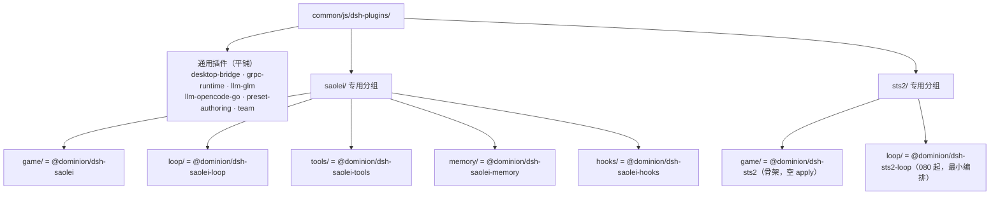

# Data Model: sts2 场景模板脚手架与 dsh-plugins 通用/专用分层

> Feature: [specs/079-sts2-template-scaffold/spec.md](spec.md) | 设计决策依据：[research.md](research.md)（D1-D9）

本期无存储层变更（MongoDB 各集合已按 template 键分区，`projects/game/session/runtime/mongo/model.go:14-20`、`projects/game/memory/runtime/mongo/model.go:13-30`、`projects/game/proxy/runtime/mongo/owner_store.go`），数据模型变化集中在**代码级常量集合与场景定义表**。

## 1. Template（场景模板）固定集合

| 字段 | 值 |
|---|---|
| 合法集合 | `{saolei, sts2}` |
| Go 事实源 | `projects/game/pkg/gameconst/const.go`：`SaoleiTemplate`、`Sts2Template`（`game.TemplateName`）→ `knownTemplateIDs` |
| TS 镜像 | `projects/game/agent_v2/src/server.ts` `KNOWN_TEMPLATES`——键集派生自场景表（`Object.keys(SCENES)`，见 §2），注释锚定 gameconst |
| 资源形态 | `templates/{template}`（AIP-122 资源名；无 CRUD、无 List RPC，specs/031 FR-001/FR-024） |

**校验规则**：

- Go：`ValidateTemplateName(name)` / `IsKnownTemplateID(segment)`——非集合成员一律 `ErrInvalidTemplate`（语义不因扩容弱化）。
- TS：`parseSessionResource`/`parseTeamResource`/`parsePresetResource`/`parseTemplateParent` 均经 `KNOWN_TEMPLATES` 闸门，未知模板解析失败 → `INVALID_ARGUMENT`。
- 校验通过即数据面接受：Session/Memory/Wiki CRUD 与会话流按模板分区正常工作，行为与 saolei 同构（spec FR-002）。Memory 仅做资源名结构校验，不校验 preset 是否存在。

## 2. SceneSpec（agent_v2 宿主侧场景表）

新实体，落点 `projects/game/agent_v2/src/scenes.ts`（`specs/079-sts2-template-scaffold/research.md` D2）。按 template id 索引的只读记录：

| 字段 | 类型 | 语义 | saolei | sts2（080 起） |
|---|---|---|---|---|
| `roster` | `readonly string[]` | team 物化的固定成员角色集合（顺序即编排成员顺序；空 = 无 team 编排） | `["player","planner"]` | `["main"]` |
| `presetRoles` | `readonly string[]` | preset 角色词表（空 = 该场景无 preset 词汇） | `["player","planner"]` | `["main"]` |
| `rolePoolTemplate` | `Readonly<Record<string, string>>` | 角色 → preset-authoring 池模板 id（`cordis.yml` `preset-authoring` 行 `templates` 快照的键） | `{player:"player", planner:"planner"}` | `{main:"main"}` |
| `orchestratable` | `boolean` | team 编排是否接线（false = materialize 入口拒绝） | `true` | `true`（080 开放） |
| `teamGoal` | `string` | 共享 team section 任务目标文案（编排物化输入） | 现文案原文（`projects/game/agent_v2/src/scenes.ts:84-85`，零变化） | `""`（无 team section，不消费） |
| `faceMembers`（080 新增） | `readonly string[]` | face 可见成员名清单（含服务端附加成员；仅用于成员名预检/roster 错误文案，不含能力/行为声明） | `["player","planner","announcer"]` | `["main"]` |
| `createOrchestration`（080 新增，可选） | `(ctx: DshContext, deps: SceneRegistrationDeps) => SceneOrchestration` | 编排工厂：构造本场景的会话编排；`scenes.ts` 以闭包注入本场景数据，场景模块不 import `scenes.ts` | saolei 适配器（包装 `TeamOrchestrator`） | sts2 工厂（`Sts2Orchestrator`） |

> 080-host-main-sub-model 起 sts2 由场景注册接入最小编排（`@dominion/dsh-sts2-loop`）；后续 sts2-loop feature 的房间角色/工具面扩展不改本表语义。不变式：`orchestratable === true` ⇔ `createOrchestration` 存在（`specs/080-host-main-sub-model/contracts/scene-registry.md` §1）。

**派生关系**：

- `roster` ↔ `UpdateTeam` 物化：成员数/角色集合校验、成员查找与编排成员键（`memberFor`/`orchestrator.member`/`createMemberRuntime`）均取自本字段；成员名预检与 roster 错误文案 080 起由 `faceMembers` 派生（含服务端附加成员；saolei 产出字符串逐字节不变，`projects/game/agent_v2/src/session.ts:1065-1084` 的 `validateSceneRoster` 与 `:1200-1213` 的 `isMemberRole`/`memberRoster` 语义平移）。
- `presetRoles` ↔ PresetService 入参校验（Create 必填 role、List 可选 role 过滤）；`rolePoolTemplate` ↔ `authoring.create({template, role, ...})` 的池模板选择。
- `faceMembers` ↔ host 成员名预检与 roster 错误文案（080 起由注入 registry 派生；含服务端附加成员名）；与编排 `members()` 投影一致，仅名称面。
- `orchestratable = false` ⇒ `UpdateTeam`（`sessions.materialize`）在结构/roster 校验之前即拒绝（`INVALID_ARGUMENT`，见 [contracts/scene-dispatch.md](contracts/scene-dispatch.md) §3）。
- `teamGoal` 仅为 `orchestratable = true` 的场景消费。

**校验规则（保持不变的部分）**：saolei roster 恰为 `{player, planner}` 两成员、preset 存在性与角色一致、model 目录校验——逻辑与错误文案零变化（`projects/game/agent_v2/src/session.ts:1025-1084` 的 `validateMemberStructure`/`validateSceneRoster` 语义平移，角色来源改经场景表 `roster`）。

## 3. Preset 资源命名与存储边界

| 属性 | 终态 |
|---|---|
| 资源名 | `templates/{template}/presets/{preset}`——`template` 段由**请求 parent** 决定（泛化后不再硬拼常量；saolei 产出字符串不变，`projects/game/agent_v2/src/server.ts:294` 的 `presetToProto`） |
| 存储 | preset-authoring store 全局单库，无 template 维度（`specs/079-sts2-template-scaffold/research.md` D4） |
| 终态边界 | saolei（`player`/`planner`）与 sts2（`main`，080 起）各自按场景词表创建；其他模板与未接线场景在入口层拒绝；存储模型零改动、零分区（spec FR-004/FR-009、080 FR-009） |

## 4. dsh-plugins 目录布局实体

**不变量**（详见 [contracts/dsh-plugins-layout.md](contracts/dsh-plugins-layout.md)）：

- 包名与目录路径解耦：目录移动不改包名（`@dominion/dsh-saolei*`、`@dominion/dsh-sts2`、`@dominion/dsh-sts2-loop`）；组合清单按**裸包名**解析（宿主 node_modules）。
- 分组目录本身不是 Bazel 包（无 BUILD.bazel）、不是 pnpm 包（无 package.json）；每个插件子目录是完整 workspace 包。
- 依赖方向保持 075 裁定：上层（loop/tools/hooks）→ 游戏基础（game），基础不依赖上层。

## 5. 组合清单（cordis.yml）行集

| 属性 | 值 |
|---|---|
| 行数 | 24（080-host-main-sub-model 起；`dsh.test.ts` id+name 双列表 pinned 断言同步） |
| 新增行 | `- { id: sts2, name: '@dominion/dsh-sts2' }`（079 惰性行）+ `- { id: sts2-loop, name: '@dominion/dsh-sts2-loop' }`（080 最小编排惰性行）——均空 `apply`、`inject: []`、无 provide/工具/section |
| 契约 | `specs/070-dsh-upgrade/contracts/composition-manifest.md` 同步为 24 行终态 |

## 6. 错误语义（场景化操作 fail-loud）

| 触发面 | 条件 | gRPC code | 文案模式（句式锚 `projects/game/agent_v2/src/scenes.ts:138` 的 `sceneNotWiredMessage` 与 `projects/game/agent_v2/src/server.ts:265` 的 `noPresetVocabularyMessage`） |
|---|---|---|---|
| `UpdateTeam` | session template 的 `orchestratable = false` | `INVALID_ARGUMENT` | `scene "{template}" is not wired for team orchestration yet` |
| `CreatePreset`/`ListPresets` | parent template 的 `presetRoles` 为空 | `INVALID_ARGUMENT` | `template "{template}" has no preset vocabulary (scene not wired)` |
| `GetPreset`/`UpdatePreset`/`DeletePreset` | 资源名 template 段无 preset 词汇 | `INVALID_ARGUMENT` | 同上句式 |
| 任意资源解析 | template 段 ∉ `KNOWN_TEMPLATES`（与现状一致） | `INVALID_ARGUMENT` | 现有 `must be a ... resource name` 句式 |

不引入新错误码；`TeamSessionErrorCode`（`projects/game/agent_v2/src/session.ts:99`）维持 `INVALID_ARGUMENT | NOT_FOUND | FAILED_PRECONDITION`。

> 080 起 `saolei`/`sts2` 均已接线（sts2 为单 `main` 成员），本表仅覆盖未知模板与未来未接线场景；sts2 的成功语义见 [080 data-model.md §4/§5](../080-host-main-sub-model/data-model.md)。
