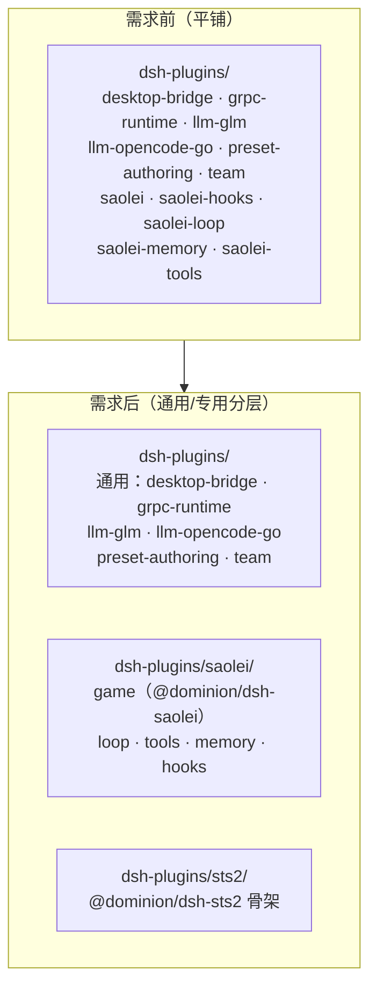

# Feature Specification: sts2 场景模板脚手架与 dsh-plugins 通用/专用分层

**Feature Branch**: `079-sts2-template-scaffold`

**Created**: 2026-10-22

**Status**: Draft

**Input**: User description: "为 @projects/game/ 引入新的 template sts2，游戏为杀戮尖塔2，前期调研 @survey/sts2-* 。本需求为初始化和脚手架工作，为新的场景创建脚手架、目录等等，为后续引入新的场景做准备。另外将 @common/js/dsh-plugins 下目录中的属于saolei 的插件移动到 @common/js/dsh-plugins/saolei 目录下，以区分通用插件和专用插件。"

> **后续说明（080-host-main-sub-model）**：本 spec 的"本期"范围已结束。sts2 场景自 `specs/080-host-main-sub-model/spec.md` 起接入（roster/preset 词汇 `main`、`UpdateTeam` 与 sts2 preset CRUD 开放、最小编排 `@dominion/dsh-sts2-loop`）。本 spec 中涉及 sts2 行为/数据模型的历史条款（如 FR-002/SC-001/Assumptions 的"无 preset 词汇"）以 079 [contracts/scene-dispatch.md](contracts/scene-dispatch.md) 与 [data-model.md](data-model.md) 的终态及 080 契约为准。

**决策基线**（2026-10-22 用户三项裁定）：

1. **sts2 可用性边界 = 注册 + 泛化 + 骨架**：系统全面接受 `sts2` 为合法场景 id；saolei 场景差异硬编码泛化为按 template 决定（saolei 行为零变化）；本期不承诺 sts2 任何端到端可玩行为——正式场景接入（工具面、desktop 桥 relay、fake-sts2 等）由后续 feature 承载。
2. **骨架组成 = 含插件包骨架**：创建 `common/js/dsh-plugins/sts2/` 专用分组与 `@dominion/dsh-sts2` 最小可编译骨架包；**不含** preset 池模板占位、fake-sts2 服务、fake-llm sts2 fixture、testplan sts2 suite（均属后续场景 feature）。
3. **saolei 基础包落位 = `saolei/game`**：归组布局为 `common/js/dsh-plugins/saolei/{game,loop,tools,memory,hooks}`，全部包名不变。

## User Scenarios & Testing *(mandatory)*

### User Story 1 - sts2 成为系统可识别的场景模板 (Priority: P1)

作为后续 sts2 场景 feature 的开发者，我希望 `sts2` 在本阶段就成为全系统合法的场景模板 id（数据面资源 `templates/sts2/...` 被所有按模板校验的服务接受），这样后续场景功能开发可以直接在该命名空间下创建与操作资源，而无需先做"让系统认识 sts2"的基础改动。

**Why this priority**: 场景 id 注册是"引入新场景"这一目标的最小可用切片，也是其余工作的挂载点；没有它，骨架与泛化都无从验证。

**Independent Test**: 通过既有 API 在 `templates/sts2/` 下创建 session/wiki 资源成功（memory 按 `(template, preset)` 作用域结构接受，见 SC-001），行为与 saolei 同构（模板分区隔离生效）；saolei 既有流程不受影响。

**Acceptance Scenarios**:

1. **Given** gameconst 白名单已包含 `sts2`（agent_v2 TS 镜像随 US2 场景表同批加入），**When** 经 gateway 以 `templates/sts2/sessions/{id}` 形式创建/读取/列出/删除 session（及该模板下的 wiki 资源；memory 按 `(template, preset)` 键结构接受（不校验 preset 存在性）），**Then** 各服务按模板校验通过，数据落在 sts2 分区，与 saolei 数据互不可见。
2. **Given** 任一按模板校验的服务，**When** 收到 `templates/未知模板/...` 形式的资源请求，**Then** 仍被明确拒绝（白名单语义不因扩容而弱化）。
3. **Given** desktop 前端的本地模板常量集合已包含 `sts2`，**When** 打开模板切换下拉，**Then** 列出 saolei 与 sts2 两个选项，且可对 sts2 模板列出 session（结构能力，不承诺场景行为）。

---

### User Story 2 - 场景差异按 template 泛化（saolei 行为零变化） (Priority: P2)

作为维护 `projects/game/agent_v2` 的开发者，我希望目前散落在通用路径中的 saolei 场景假设（成员 roster 校验、preset 角色词表、preset 资源父名、web 角色选项等）被收敛为"按 template 决定的场景表（`SceneSpec`）"，使 saolei 的全部行为零变化，而后续场景只需声明自己的场景表条目即可挂接，无需再修改通用代码。

**Why this priority**: 这是"为后续引入新的场景做准备"的核心结构性工作；不泛化则每个后续场景都要改动（并回归）saolei 混杂其中的通用路径。

**Independent Test**: saolei 端到端全链路（单测全量回归）通过；既有大型测试全部用例通过由 FR-010 的终验收覆盖；代码中不再存在通用路径上的 saolei 专属硬编码（场景差异集中于按 template 索引的定义处）。

**Acceptance Scenarios**:

1. **Given** 泛化完成后的 agent_v2，**When** saolei session 执行 team 物化（`player` + `planner` + announcer roster）、preset 创建与派生、成员系统提示词组装，**Then** 全部行为与泛化前逐项一致（组合清单、工具面、编排、prompt sections 均不变）。
2. **Given** agent_v2 的 TS 模板镜像已包含 `sts2` 且场景表已就位，**When** 对 sts2 模板的 session 发起场景化操作（team 物化、preset 派生等需要场景编排/池模板的动作），**Then** 得到明确的"场景未接入"类失败（fail-loud），不会误用 saolei 编排或产生半成品状态；而该模板下的数据面资源（session/wiki CRUD）正常接受。
3. **Given** web 管理界面（preset/wiki/memory 视图），**When** saolei 场景下使用，**Then** 行为与现状一致；场景词扫描表覆盖 sts2 后管理视图的"场景无关"约束仍然成立。

---

### User Story 3 - dsh-plugins 通用/专用分层（saolei 插件归组） (Priority: P3)

作为 common/js 插件体系的维护者，我希望 5 个 saolei 专用 dsh 插件（游戏基础 `@dominion/dsh-saolei` 及 hooks/loop/memory/tools）归入专用分组目录 `common/js/dsh-plugins/saolei/`（基础包落位 `saolei/game`，用户裁定），通用插件保留顶层，使目录结构直接表达"通用 vs 场景专用"的边界，为 sts2 专用插件同样归组（`dsh-plugins/sts2/`）建立先例。

**Why this priority**: 目录分层是纯结构性重组、可独立验证，且是 sts2 骨架包落位的布局前提。

**Independent Test**: 迁移后全仓构建（bazel）、相关包单测、agent_v2 部署闭包与既有大型测试全部通过；包名、公开 API、运行时加载行为零变化。

**Acceptance Scenarios**:

1. **Given** 迁移完成后的 `common/js/dsh-plugins/`，**When** 查看目录结构，**Then** 顶层仅剩通用插件（desktop-bridge、grpc-runtime、llm-glm、llm-opencode-go、preset-authoring、team）与专用分组目录 `saolei/`（含 `game/loop/tools/memory/hooks` 五个子包）；包名、各包导出面不变。
2. **Given** 仓库工作区与构建配置（pnpm lockfile、Bazel label、`.bazelignore`、tsconfig 相对路径）已同步迁移，**When** 执行全仓构建与相关测试、agent_v2 服务部署与既有大型测试，**Then** 全部通过，服务运行时行为与迁移前一致（插件按包名解析加载，不受目录影响）。
3. **Given** 迁移涉及的历史遗留（如 `.bazelignore` 中指向已不存在目录的条目），**When** 同步清理，**Then** 构建校验（node_modules 忽略检查）无残留告警。

---

### User Story 4 - sts2 插件包骨架就位 (Priority: P4)

作为后续 sts2 场景 feature 的开发者，我希望 `common/js/dsh-plugins/sts2/` 专用分组与最小骨架包 `@dominion/dsh-sts2` 已就位（可编译、含 README 与测试骨架、纳入 agent_v2 依赖与打包通道），使场景 feature 从"填充实现"开始，而不是从"建包接线"开始。

**Why this priority**: 骨架包是脚手架的收尾件，价值依赖 US1-US3 的注册、泛化与布局就位，故优先级最低。

**Independent Test**: 骨架包可独立构建与测试；agent_v2 的依赖闭包与部署产物包含它；组合清单机制具备挂载 sts2 行的能力（本期是否实际挂载行及其形式由 plan 裁定）。

**Acceptance Scenarios**:

1. **Given** `dsh-plugins/sts2/` 分组下的骨架包，**When** 构建与运行其测试骨架，**Then** 通过；包内不注册任何工具、prompt section 或服务（空实现），README 说明包定位与后续演进入口（引用 survey 调研结论）。
2. **Given** agent_v2 声明了对骨架包的 workspace 依赖与打包通道接入，**When** 构建 agent_v2 部署产物，**Then** 骨架包按既有 workspace 包规则进入 `node_modules/@dominion/dsh-sts2`（不进入 npm registry 依赖通道）。

---

### Edge Cases

- 组合清单行数变化的同步：`projects/game/agent_v2/src/dsh.test.ts` 对组合清单有逐行精确断言、`specs/070-dsh-upgrade/contracts/composition-manifest.md` 为其契约——任何清单行变化（含本期可能的 sts2 骨架行）必须同步断言与契约，否则测试必红。
- 迁移后的本地开发环境：目录移动改变 pnpm 链接路径，开发者本地需重新 `pnpm up`/install 刷新 node_modules；CI 全新检出不受影响。
- `common/js/dsh-plugins/saolei/` 现为包根（`@dominion/dsh-saolei`）：归组时基础包必须整体下移到 `saolei/game`，禁止其余 saolei-* 包直接嵌入现包目录内造成"包中包"结构。
- 已提交文档/代码注释中的旧目录路径：随迁移同步到终态路径（宪法原则 VII）；`specs/`、`survey/` 历史文档不改写，除非该文档被实质修订。
- sts2 session 被创建但场景未接入：所有场景化操作必须给出明确错误语义（US2 场景 2），不得出现"创建了 team 但行为未定义"的中间态。
- web 场景词扫描：sts2 成为合法模板后，管理视图"场景无关"扫描表需覆盖 sts2 场景词，避免文案约束出现盲区。

## Requirements *(mandatory)*

### Functional Requirements

- **FR-001**: 系统 MUST 在双端注册点接受 `sts2` 为合法 template id：Go 侧 `projects/game/pkg/gameconst/const.go` 的已知模板集合与 TS 侧镜像 `projects/game/agent_v2/src/server.ts` 的 `KNOWN_TEMPLATES`，并保持"未知模板拒绝"语义不变（参照 `specs/031-team-template-mode/spec.md` FR-001 的 Template 资源模型：无 CRUD、无 List RPC）。
- **FR-002**: 凡按模板校验的服务（session、wiki、memory、proxy；判据为经 `ValidateTemplateName`/`IsKnownTemplateID` 校验）对 `templates/sts2/...` 资源 MUST 提供与 saolei 同构的行为：session/wiki 接受 CRUD 并按模板分区隔离；memory 按 `(template, preset)` 资源名结构接受（服务不校验 preset 是否存在；sts2 本期无 preset 业务词汇，不会由 preset 派生流程产生 memory，但结构上允许写入）；proxy 的 owner 模板校验接受 sts2；gateway 路由由 proto 通配生成，不感知模板枚举。
- **FR-003**: agent_v2 中位于通用路径的 saolei 场景假设（成员 roster 校验、preset 角色词表与池模板映射、preset 资源父名等）MUST 泛化为按 template 索引的场景表（`SceneSpec`）定义；saolei 的全部行为（组合清单、工具面、编排、prompt sections、preset 派生）MUST 零变化。
- **FR-004**: sts2 模板的场景化操作（team 物化、preset 派生等依赖场景编排/池模板的动作）在本期 MUST 以明确的"场景未接入"类语义失败（fail-loud），MUST NOT 误用 saolei 编排或产生半成品状态。
- **FR-005**: desktop 前端本地模板常量集合 MUST 包含 `sts2`（模板切换下拉自动呈现）；web 前端的模板常量 MUST 参数化为集合形式（为后续场景切换预留），本期不新增 web 场景切换 UI，且场景词扫描表覆盖 `sts2`。
- **FR-006**: 5 个 saolei 专用插件（`@dominion/dsh-saolei` 及 `-hooks`/`-loop`/`-memory`/`-tools`）MUST 迁移至 `common/js/dsh-plugins/saolei/` 分组目录，布局为 `saolei/{game,loop,tools,memory,hooks}`（用户裁定基础包落位 `saolei/game`）；全部包名、公开 API、依赖方向（上层 → 游戏基础，`specs/075-saolei-game-foundation` M9）MUST 不变；通用插件保留 `dsh-plugins/` 顶层。
- **FR-007**: 迁移 MUST 同步更新全部受影响的结构性配置：pnpm lockfile（经 pnpm 重新生成，禁止手改）、Bazel label 引用（`projects/game/agent_v2/BUILD.bazel`、组内互引）、`.bazelignore`（含清理指向已不存在目录的残留条目）、各包 tsconfig 相对路径映射；迁移方式 MUST 保留 git 历史（目录移动而非复制重建）。
- **FR-008**: MUST 创建 `common/js/dsh-plugins/sts2/` 专用分组，并在其 `game/` 子目录（`common/js/dsh-plugins/sts2/game/`）提供 `@dominion/dsh-sts2` 最小骨架包：可编译、空实现（不注册工具/section/服务）、含定位说明的 README 与测试骨架，并纳入 agent_v2 的 workspace 依赖与部署打包通道（runtime 闭包，不进 npm registry 依赖通道）。
- **FR-009**: 本期 MUST NOT 实现（属后续场景 feature 的负向边界）：sts2 游戏工具面、desktop 桥 HTTP relay / `FlowPart` 新 kind、fake-sts2 服务、fake-llm sts2 fixture、sts2 preset 池模板、testplan sts2 用例。
- **FR-010**: 既有大型测试（`projects/game/testplan`，经 testplan skill 完整执行部署→测试→清理闭环）MUST 全部用例通过，作为 saolei 行为零变化与迁移无回归的验收。

### Key Entities

- **Template（场景模板）**：资源名命名空间 `templates/{template}`（`projects/game/game.proto`），固定集合、无 CRUD；本期后合法集合 = `{saolei, sts2}`。
- **场景表 / `SceneSpec`（按 template 的场景定义）**：某模板的角色词表、roster 约束、preset 池模板映射等场景差异的集中定义处（泛化引入的结构概念；具体形态由 plan 定稿）。
- **dsh 插件分组目录**：`common/js/dsh-plugins/` 下的专用分组（`saolei/`、`sts2/`）与顶层通用插件；分组仅是目录布局约定，不改变包名与加载机制（组合清单按包名解析）。
- **场景化操作 vs 数据面操作**：前者依赖场景编排/池模板（本期 sts2 fail-loud），后者为模板分区下的资源 CRUD（本期 sts2 正常接受）。

## Success Criteria *(mandatory)*

### Measurable Outcomes

- **SC-001**: `templates/sts2/` 下的 session/wiki 资源经 API 全生命周期（创建/读取/列出/删除）可用，且与 saolei 分区数据相互隔离；memory 在 `(template, preset)` 作用域下结构接受（不校验 preset 存在性；sts2 无 preset 业务词汇）。
- **SC-002**: saolei 端到端行为零变化：全仓构建与单测通过，且 FR-010 的大型测试验收达成（全部用例通过，无 failed/flaky）。
- **SC-003**: 迁移后 `common/js/dsh-plugins/` 布局满足 [contracts/dsh-plugins-layout.md](contracts/dsh-plugins-layout.md) §1/§2（顶层 6 个通用插件 + `saolei/` + `sts2/` 两个分组；saolei 组内 5 个子包），包名与导出面不变。
- **SC-004**: `@dominion/dsh-sts2` 骨架包独立构建与测试通过，并出现在 agent_v2 部署产物 `node_modules/@dominion/dsh-sts2`。
- **SC-005**: agent_v2 通用代码路径中不再存在 saolei 专属字面量：roster、角色词表、模板父名与任务目标集中于按 template 索引的场景表 `SceneSpec`（`projects/game/agent_v2/src/scenes.ts`），检查面为 `server.ts`/`session.ts` 的请求解析、物化前校验与成员视图错误文案（quickstart V7）；saolei-loop 编排接线的成员模型（`projects/game/agent_v2/src/history.ts` 的 `MemberRole` 类型与成员视图记录）属编排层词汇，不在本项检查范围。

## Assumptions

- sts2 正式场景接入的全部内容（工具面、desktop 桥 relay、`game.proto` `FlowPart` 扩展、fake-sts2、preset 池模板、角色最终设计、testplan、seed 确定性开局等）由后续场景 feature 承载，依据 `survey/sts2-game-control.md` §5、`survey/sts2-mod-poc.md` §5 的调研裁定。
- sts2 本期不声明独立角色词表：场景表 `SceneSpec.sts2` 的 `roster`/`presetRoles` 均为空、`orchestratable=false`（`specs/079-sts2-template-scaffold/data-model.md` §2）；最终角色设计属场景 feature。
- 迁移仅动目录与结构性配置，包名（`@dominion/dsh-saolei*`、`@dominion/dsh-sts2`）与组合清单引用名不变；pnpm workspace glob（`common/js/**` 递归匹配，`pnpm-workspace.yaml`）无需改动（已核实现有嵌套包先例）。
- desktop 模板下拉出现 sts2 选项即满足 FR-005（本地常量扩展，`specs/031` FR-024 禁止模板列表请求的约束继续成立）；对 sts2 列出 session 为同一 API 的结构能力（由 quickstart V3 覆盖）；web 不新增场景切换 UI。
- `fake-desktop` 默认模板仍为 saolei；fake-llm/testplan 无 sts2 fixture（FR-009 边界）。
- gateway、session、memory、proxy 服务的业务代码零改动（白名单扩容自动生效，以 `projects/game/pkg/gameconst/const.go` 为唯一 Go 侧事实源）；`projects/game/proto_test.go` 等既有契约测试随注册扩展补充 sts2 用例属实现细节。
- 迁移执行顺序（先归组后建骨架包，或反之）与是否在组合清单实际挂载 sts2 骨架行，由 plan 阶段裁定；本 spec 不预设。
