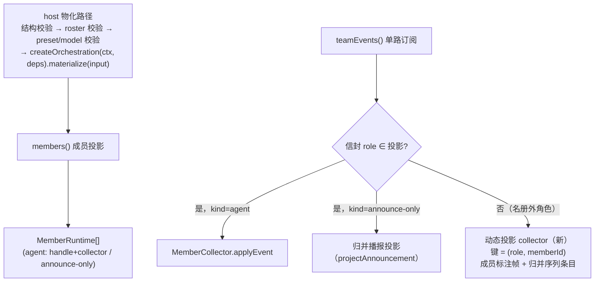

# Contract: agent_v2 场景注册与中立编排 seam

> Feature: [spec.md](../spec.md)（FR-001~FR-005）| 数据模型：[data-model.md](../data-model.md) §1-§3 | 决策：[research.md](../research.md) D1-D4/D7
> 本契约定义 host（`projects/game/agent_v2`）与场景编排之间的接口：场景注册的形态、中立编排 seam（`SceneOrchestration`）、成员投影与事件分发、host 通用路径的职责边界（宪法 III：接口优先）。

## §1 场景注册（SceneSpec 行为级演进）

场景注册 = `projects/game/agent_v2/src/scenes.ts` 的场景表条目（079 数据字段 + `faceMembers`）+ 每个场景一个注册模块（`scene-saolei.ts`/`scene-sts2.ts`）提供编排工厂：

```ts
// scenes.ts（场景表，SceneSpec 唯一落点）——079 字段 + faceMembers + 编排工厂
interface SceneSpec {
  roster: readonly string[];                  // 物化 roster（成员序）
  presetRoles: readonly string[];             // preset 词表（空 = fail-loud）
  rolePoolTemplate: Readonly<Record<string, string>>;
  orchestratable: boolean;
  teamGoal: string;                           // 场景数据（编排消费与否由场景定）
  faceMembers: readonly string[];             // 必填：face 可见成员名（含服务端附加成员；仅名称，不含能力/行为）
  createOrchestration?(ctx: DshContext, deps: SceneRegistrationDeps): SceneOrchestration;   // 仅 orchestratable=true 时必需
}
```

`DshContext` = host 的 cordis 组合上下文（`projects/game/agent_v2/src/dsh.ts`），工厂用它构造编排实例（与 `TeamOrchestrator(this.ctx, …)` 同型）。

`SceneRegistrationDeps`（`projects/game/agent_v2/src/orchestration.ts` 定义；与 `TeamSessionsDeps` 的 seam 字段同源，host 注入）：

```ts
interface SceneRegistrationDeps {
  readonly compose: SceneCompose;              // preset 派生（authoring.compose 的结构化面）
  readonly agents: SceneAgentCreationSeam;     // agent 创建 seam（默认 ctx.agents）
  readonly logger: SceneLogger;                // 失败上报
  readonly provider: string;                   // 部署 provider 路由
  readonly team?: SceneTeamSeam;               // 群聊中继 seam（仅 saolei 消费；sts2 不声明）
}
```

`SceneRegistry = Readonly<Record<string, SceneSpec>>`——host 经 `TeamSessionsDeps.scenes`（默认模块级 `SCENES`）注入，测试可注入合成场景。

`SceneCompose`/`SceneAgentCreationSeam`/`SceneLogger`/`SceneTeamSeam` 是 host 侧**结构化窄类型**（形状等价于 saolei-loop 的 `ComposePreset`/`AgentCreationSeam`/`OrchestratorLogger`/`TeamSeam`），使 `session.ts` 不再 import 场景插件包（quickstart V3 硬门禁）。

seam 接口与输入类型定义在 `projects/game/agent_v2/src/orchestration.ts`（§2）。

- **接线门唯一**：`orchestratable`；工厂存在性与该门等价（`scenes.test.ts` 断言 `orchestratable === true ⇔ createOrchestration !== undefined`），工厂不承担第二重门语义。
- **face 成员名**：`faceMembers` 仅承载 face 成员名（saolei `["player","planner","announcer"]`、sts2 `["main"]`），用于成员名预检与 roster 错误文案；成员运行时/kind 仍由编排的 `members()` 投影派生，场景能力（team 中继、announcer 行为、memory 挂载）不在该字段声明。
- **场景数据绑定**：工厂签名保持 `(ctx, deps)`；`scenes.ts` 以闭包绑定自身条目数据调用 `createSaoleiOrchestration(ctx, deps, spec)`。场景注册模块 MUST NOT import `scenes.ts`，避免 `scenes.ts ↔ scene-*.ts` 循环依赖。

- 工厂 deps = `SceneRegistrationDeps`（上）；host 只注入场景无关 seam，saolei 适配器自取 `team`，host 不感知场景差异。场景注册模块（host 内）实现工厂；插件包（`@dominion/dsh-saolei-loop`/`@dominion/dsh-sts2-loop`）只结构化满足 seam，不 import host（§7）。
- `wiredScene`/`scenePresetRoles` 等派生门不变：数据驱动，sts2 开放即收缩（[specs/079-sts2-template-scaffold/contracts/scene-dispatch.md](../../079-sts2-template-scaffold/contracts/scene-dispatch.md) §3 的机制保留；本 feature 后无未接线场景）。

## §2 SceneOrchestration seam

| 成员 | 签名 | 语义（host 消费点） |
|---|---|---|
| `materialize(input)` | `(input: SceneMaterializeInput) => Promise<void>` | host 校验全部通过后调用一次；失败抛错且编排自行回滚（无半物化） |
| `members()` | `() => readonly SceneMember[]` | 物化后 host 据此构建 `MemberRuntime` 列表（§3）；未物化 = 空数组 |
| `member(role)` | `(role: string) => AgentHandle \| undefined` | `GetTeamMember` 的 system prompt 读取、成员运行时归属校验 |
| `teamEvents()` | `() => TeamEventStream` | host 物化成功后**单路订阅**，按信封 role 分发（§3）；随条目 teardown 取消订阅 |
| `snapshot()` | `() => SceneSnapshot` | queued 首帧预读、quiescence watcher（`paused`/`active`/`queued`/`lastError.origin`）、TeamView 投影 |
| `submit(text)` | `(text: string) => void` | `Send` 的驱动入口（在途 = steer；静止 = 开 turn）；host 以 snapshot 预读决定 queued 帧，不消费返回值 |
| `cancel()` | `() => void` | `Cancel`（幂等；冻结语义） |
| `whenQuiescent()` | `() => Promise<void>` | 静止判定循环 |
| `dispose()` | `() => Promise<void>` | 刷新 teardown / shutdown（幂等；在途回合收敛后释放全部成员） |

`SceneMaterializeInput = {session, template, members: readonly {role, preset, provider?, model?}[]}`——preset 为 id、provider/model 为拆分后的路由（host 的 model 校验返回值直接前向）。**seam 输入不携带 goal/memoryScope/成员槽位**：场景专属派生在场景注册内部（saolei 适配器从自身 `teamGoal` 与 planner 成员配置派生 `memoryScope`，见 §6）。成员投影只承载 `{role, kind}`；`GetTeam`/成员视图所需 preset/model 由 host 用本输入的 members 按 role 关联（announce-only = 空串）。

`SceneSnapshot = {materialized, active: string|null, activation: string, paused: boolean, queued: number, failed: boolean, lastError: SceneFailure|null}`、`SceneFailure = {message, member: string|null, code, origin: "member-turn"|"orchestration", detail}`——**不含 phase**（saolei 相位是场景词汇；适配器丢弃）。`code` ∈ 六码 `SceneLoopErrorCode`（`TRANSIENT/QUOTA/CREDENTIAL/CONFIG/INPUT_TOO_LARGE/INTERNAL`）——host `LOOP_ERROR_TEXT`（用户动作文案）的 key 类型从 saolei-loop `LoopErrorCode` 改锚本联合，文案零变化。

状态错误：seam 抛带 `code` 的状态错误（`UNMATERIALIZED`/`ALREADY_MATERIALIZED`/`DISPOSED`）；host 按 `code` **结构化**映射 `FAILED_PRECONDITION`（不依赖 `instanceof`）。host 侧类型名 `SceneStateError`（`orchestration.ts`）：saolei 适配器把包内 `OrchestratorStateError` 转为它；sts2 包内抛同 `code` 的同构错误（包不 import host）。

## §3 成员投影与事件分发



- **投影内成员**：名册/成员读取/成员视角/teardown 按成员 kind 派生——行为与现状一致（saolei：player/planner/announcer 三成员，077 契约延续）。
- **名册外角色**（FR-007 机制面）：host 对信封 role 不做名册闭集丢弃；按 **`(role, memberId)` 键**惰性创建动态 collector（首个信封到达时；同 role 的不同 memberId——如多个房间子代理——各自独立，不合并、不互相吞事件），产出成员标注帧与归并序列条目（member 标签 = 信封 role）；**无成员资源**（`GetTeamMember`/`ListMemberMessages` 对该角色 NOT_FOUND）、不进 `GetTeam.members`、无成员视角。动态 collector 由会话条目持有并以 `MemberCollector` 的 **viewless 模式**（`recordView=false`）复用（其自身按 `memberId` 过滤）：只写归并序列、产出成员标注帧，**不写 `TeamHistory.views`、不发 `member_view` 帧**；条目 teardown 时销毁，刷新（重建）后旧动态投影不跨代保留。
- 信封词汇 = `TeamMemberEvent`（`common/js/dsh-plugins/team/src/team.ts:154`：`{role, memberId, channel: "log"|"live", event}`，role 开放串）。非 team 场景（sts2）仅类型复用，不注册 `ctx.team`。

## §4 host 通用路径职责边界

host 通用路径（`session.ts`/`server.ts`/`history.ts` 通用部分 + 新 seam 模块 `orchestration.ts`）只保留场景无关职责：

1. 资源名解析与模板白名单（`KNOWN_TEMPLATES`）；
2. 物化两层 fail-fast 校验（先于任何 teardown）：结构层（members 非空、role 非空、preset 为同模板资源名、model 可空）+ 场景层（roster 形状由场景表供给、preset 存在且 role 匹配、model 在目录）——错误码 `INVALID_ARGUMENT`，saolei 文案逐字节不变；
3. 会话条目生命周期（物化串行、刷新 teardown、流收束 quiescence watcher、shutdown）；
4. 历史投影（归并序列/成员视角/ChatEvent 帧）与成员事件单路消费；
5. 成员名校验与 roster 错误文案：由注入 registry 的 `faceMembers` 派生（含场景附加成员名），不保留 host 侧角色字面量。

以下内容**不得出现**在通用路径（FR-001/FR-005 的 grep 验证面，见 [quickstart.md](../quickstart.md) V3；`orchestration.ts` 同样零命中）：announcer 成员或不变式、恰双成员 roster 断言、`player`/`planner` 字面量、`memoryScope`/`goal` 计算、`TeamOrchestrator` 直构、saolei 相位词汇。

## §5 saolei 场景注册（`scene-saolei.ts` 适配器）

适配器包装 `TeamOrchestrator`（`@dominion/dsh-saolei-loop`）满足 seam：

- `materialize`：把中立输入映射为 `TeamMaterializeOptions`（`player`/`planner` 槽位、`goal` = 传入 `spec.teamGoal`、`memoryScope = {template, preset: planner 成员 preset}`——[specs/071-memory-preset-scope/contracts/dsh-plugins.md](../../071-memory-preset-scope/contracts/dsh-plugins.md) §4 派生不变）。
- 日志：适配器包装 host logger 以保留自己的 `phase` 字段（`OrchestrationFailureContext`），该字段不进入通用 seam/`SceneLogger`。
- `members()`：`[player, planner]` agent 投影 + announcer announce-only 投影；**announcer 不变式**（物化后 `announcer === undefined → 整体回滚抛错）移入适配器物化路径（saolei 场景内部事务，FR-002）。
- `member(role)`/`teamEvents()`/`snapshot()`/`submit`/`cancel`/`whenQuiescent`/`dispose`：直通（snapshot 丢弃 `phase` 字段）；状态错误按 §2 转成 `SceneStateError`。
- saolei 全部对外行为（组合清单、工具面、编排时序、prompt sections、错误文案、流与广播语义）逐字节不变（FR-008；验证面 = 既有全部大型测试 suite + 单测全量）。

## §6 sts2 场景注册（`scene-sts2.ts`）

工厂直接构造 `Sts2Orchestrator`（[sts2-loop-minimal.md](sts2-loop-minimal.md)）；`roster = ["main"]`、`faceMembers = ["main"]`、preset 词汇/池模板 `{main: "main"}`（cordis.yml `templates` 快照新增）。sts2 无 team/announcer/memory——适配层无额外派生。

## §7 泛化不变量（可验面）

- 依赖方向：host import 场景包（`@dominion/dsh-saolei-loop`/`@dominion/dsh-sts2-loop`），场景包不 import host；seam 接口定义在 host（`orchestration.ts`）。
- 每场景一个注册模块 + 场景表一个条目；新增场景 = 新增两者（不修改通用路径）。
- 场景注册模块不得 import `scenes.ts`；场景数据由 `scenes.ts` 以闭包/显式参数注入（避免模块循环）。
- 类型引用：host seam 模块（`orchestration.ts`）引用 `scenes.ts` 的 `SceneSpec` MUST 使用 `import type`（类型擦除，不构成运行时环）；该豁免不改变上一条对场景注册模块的运行时 import 禁令。
- sts2 开放后，079 scene-dispatch §3 的 fail-loud 仅对真未接线面成立（本 feature 后无此形态场景；机制保留）。
