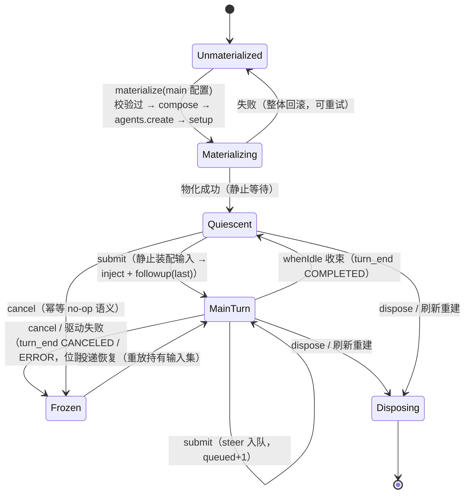

# Data Model: agent_v2 host 层场景化重构支持主子模型

> Feature: [spec.md](spec.md) | Plan: [plan.md](plan.md) | 决策依据：[research.md](research.md)（D1-D8）
> 契约细化：[contracts/scene-registry.md](contracts/scene-registry.md)、[contracts/face-main-sub.md](contracts/face-main-sub.md)、[contracts/sts2-loop-minimal.md](contracts/sts2-loop-minimal.md)
> 类型签名的**规范源**是 [contracts/scene-registry.md](contracts/scene-registry.md) §1/§2；本文只描述字段语义与状态转移，不重复定义签名。

本 feature 无存储层变更（Mongo `game_agent_v2.presets` 结构不变；preset 池模板为 cordis.yml 快照条目）。数据模型变化集中在 **host 代码级结构实体**（场景注册/编排 seam/成员投影）与**测试物料实体**（fixture/suite）。

## 1. SceneSpec（场景注册，`projects/game/agent_v2/src/scenes.ts` 演进）

按 template id 索引的宿主侧场景定义。079 的数据字段语义不变，新增**编排工厂**（行为级演进）：

| 字段 | 类型 | 语义 | saolei | sts2（本 feature 后） |
|---|---|---|---|---|
| `roster` | `readonly string[]` | 物化 roster（顺序即成员序） | `["player","planner"]` | `["main"]` |
| `presetRoles` | `readonly string[]` | preset 角色词表（空 = 无词汇，fail-loud） | `["player","planner"]` | `["main"]` |
| `rolePoolTemplate` | `Readonly<Record<string,string>>` | 角色 → preset-authoring 池模板 id | `{player:"player", planner:"planner"}` | `{main:"main"}` |
| `orchestratable` | `boolean` | 编排接线门 | `true` | `true`（本 feature 开放） |
| `teamGoal` | `string` | 场景目标文案（编排物化输入数据） | 扫雷协作目标（原文零变化） | `""`（无 team section，不消费） |
| `faceMembers`（新增） | `readonly string[]` | face 可见成员名清单（仅用于成员名预检/roster 错误文案；含服务端附加成员，不含能力/行为声明） | `["player","planner","announcer"]` | `["main"]` |
| `createOrchestration`（新增，可选） | `(ctx: DshContext, deps: SceneRegistrationDeps) => SceneOrchestration` | 编排工厂：构造本场景的会话编排；`scenes.ts` 以闭包注入本场景 `SceneSpec`，场景模块不 import `scenes.ts` | saolei 适配器（包 `TeamOrchestrator`） | sts2 工厂（`Sts2Orchestrator`） |

不变式：`orchestratable === true` ⇔ `createOrchestration` 存在（`scenes.test.ts` 断言）。`orchestratable` 是唯一接线门，工厂不承担第二重门语义；未接线场景（入口拒绝）不声明工厂。`faceMembers` 只承载成员名/文案面，成员运行时与 kind 仍由编排的 `members()` 投影派生；场景注册模块不得 import `scenes.ts`，场景数据由 `scenes.ts` 以闭包/显式参数注入。

派生关系不变项：`KNOWN_TEMPLATES`（`server.ts`）= `Object.keys(SCENES)`；`wiredScene` 门与 `scenePresetRoles` 空词表拒绝均数据驱动（sts2 开放后自动收缩；未接线场景的拒绝机制保留给未来场景——本 feature 后无未接线场景）。

## 2. SceneOrchestration（场景中立编排 seam，`projects/game/agent_v2/src/orchestration.ts` 新模块）

host 通用会话路径消费的编排契约面（接口定义在 host；saolei 经 `scene-saolei.ts` 适配器包装 `TeamOrchestrator`，sts2 经 `Sts2Orchestrator` 直接实现；TS 结构化类型 + 契约文档双锚定）：

| 成员 | 签名 | 语义 |
|---|---|---|
| `materialize` | `(input: SceneMaterializeInput) => Promise<void>` | 物化；失败整体回滚保持未物化（无半物化） |
| `members` | `() => readonly SceneMember[]` | 物化后的成员投影（未物化 = 空数组） |
| `member` | `(role: string) => AgentHandle \| undefined` | agent 成员句柄（system prompt 读取/归属校验） |
| `teamEvents` | `() => TeamEventStream` | 统一成员事件流（信封 `TeamMemberEvent`，`common/js/dsh-plugins/team/src/team.ts:154`） |
| `snapshot` | `() => SceneSnapshot` | 快照（见下） |
| `submit` | `(text: string) => void` | 用户消息驱动（在途 = steer 入队；静止 = 开 turn） |
| `cancel` | `() => void` | 取消在途回合 + 冻结（幂等） |
| `whenQuiescent` | `() => Promise<void>` | 静止等待 |
| `dispose` | `() => Promise<void>` | 全量释放（幂等） |

`SceneMaterializeInput = {session, template, members: readonly SceneMemberConfig[]}`；`SceneMemberConfig = {role, preset, provider?, model?}`（preset 为 id、provider/model 为已拆分路由——host 完成两层校验后交付）。goal/memoryScope 等场景专属派生在场景注册内部（D3）。

`SceneMember = {role: string, kind: "agent" | "announce-only"}`——announcer 是 saolei 投影的 announce-only 成员（不变式自检在 saolei 适配器内）；sts2 投影 = 单 agent 成员 `main`。成员投影只承载 `{role, kind}`；`GetTeam`/成员视图所需的 `preset`/`model` 由 host 以已验证的 `SceneMaterializeInput.members` 按 role 关联得到（announce-only 成员 = 空串）。

`SceneSnapshot = {materialized, active: string|null, activation: string, paused, queued, failed, lastError: SceneFailure|null}`；`SceneFailure = {message, member: string|null, code: SceneLoopErrorCode, origin: "member-turn"|"orchestration", detail}`。**不含 phase**（saolei 相位词汇不进 seam；saolei 适配器丢弃）。`SceneLoopErrorCode = "TRANSIENT"|"QUOTA"|"CREDENTIAL"|"CONFIG"|"INPUT_TOO_LARGE"|"INTERNAL"`（六码，host `LOOP_ERROR_TEXT` 的 key 类型改为本联合）。

状态错误沿用 `SceneStateError` 语义（`UNMATERIALIZED`/`ALREADY_MATERIALIZED`/`DISPOSED`，host 映射 `FAILED_PRECONDITION`）。

## 3. MemberRuntime（host 会话条目成员，`session.ts` 演进）

```mermaid
flowchart LR
    ENV["teamEvents() 信封<br/>(role, channel, event)"]
    ENV -->|role ∈ members() 投影| KNOWN["成员投影派生运行时"]
    KNOWN --> AGENT["kind: agent<br/>handle + MemberCollector"]
    KNOWN --> ANN["kind: announce-only<br/>归并播报投影"]
    ENV -->|role ∉ 投影（名册外，<br/>如未来子代理）| DYN["动态投影 collector<br/>键 = (role, memberId)（本 feature 新增机制）"]
    AGENT --> FRAMES["成员事件帧 + 双视图投影"]
    ANN --> FRAMES
    DYN --> FRAMES2["成员标注帧 + 归并序列条目<br/>（无成员资源，face 名册不变）"]
```

- 投影内成员（agent/announce-only）：进入 `GetTeam.members` 名册、成员读取、成员视角——行为与现状逐字节一致（saolei 三成员）。
- 名册外角色（FR-007 机制面）：按信封 **`(role, memberId)`** 动态创建 collector（同 role 的不同 memberId 各自独立），产出成员标注帧与归并序列条目（member 标签 = 信封 role）；**无成员资源**（`GetTeamMember`/`ListMemberMessages` 对该角色 NOT_FOUND）、不进名册。动态 collector 使用 `MemberCollector` 的 **viewless 模式**（`recordView=false`）：只写归并序列，不写 `TeamHistory.views`、不发 `member_view` 帧——成员视角（`MemberViewEntry`）不为其构建（无消费路径——子代理不接收用户输入）。

## 4. 主子会话形态（sts2 最小接线）

| 实体 | 值 |
|---|---|
| 物化输入 | `UpdateTeam.members = [{role: "main", preset, model?}]`（单成员） |
| preset 词汇 | role `main`；池模板 `main`（`cordis.yml` preset-authoring `templates` 快照新增，persona 行含锚串"sts2 主 agent"） |
| face 成员名 | `["main"]`（`SceneSpec.faceMembers`；与 `members()` 投影一致） |
| preset persona | 测试/验收创建 preset 时 MUST 传空 persona（空 persona 保留池模板 prefix base——锚串"sts2 主 agent"；非空 persona 会覆盖 prefix，fake-llm `system_keywords` 失配。语义见 `common/js/dsh-plugins/preset-authoring/src/derive.ts`） |
| 编排成员投影 | `[{role: "main", kind: "agent"}]`（无 announcer） |
| agent 会话 id | `${session}/main`（对齐 saolei `${session}/{role}` 惯例） |
| 初始激活 | `activation = "main"`（物化后静止等待，用户首条消息驱动） |
| 组合 | 无 team 注册、无 memory 挂载、无 hooks、无游戏运行时、无 desktop flow |

### 状态转移（单主 agent 驱动，`Sts2Orchestrator`）



- 在途排队：`queued` = steered-in-flight 计数（无广播 inbox）；`turn_end{ABORTED}` 于刷新/销毁终止在途回合。
- 刷新（再次 `UpdateTeam`）：终止在途回合 → 释放 main agent（含历史）→ 按新配置重建；`create_time` 保留、幂等（既有契约同构）。

## 5. 验证与错误规则（不变项）

- 两层 fail-fast（先于任何 teardown）：结构层（场景无关）+ 场景层（roster 形状、preset 存在且 role 匹配、model 在 ListModels 目录）——错误码 `INVALID_ARGUMENT`，saolei 文案逐字节不变。
- 未物化：`Send`/`Cancel` = `FAILED_PRECONDITION`；`GetTeam`/`GetTeamMember`/List 面 = `NOT_FOUND`（含名册外角色）。成员名预检与 roster 错误文案由场景注册的 `faceMembers` 派生（saolei = `player/planner/announcer`，sts2 = `main`），保持 saolei 文案逐字节不变。
- 无半物化：物化失败整体回滚（GetTeam NOT_FOUND），可重试；同 session 并发物化串行。
- proto（`projects/game/agent_v2.proto`）零变更。

## 6. 测试物料实体

| 实体 | 落位 | 要点 |
|---|---|---|
| fake-llm fixture `sts2_main.yaml` | `projects/game/fake-llm/service/testdata/` | 新增 1 条消息模板（总数 41→42）：`responses_only: true` + `system_keywords: ["sts2 主 agent"]`（persona 锚串）+ 触发词 `sts2-ping`（不与既有触发词子串冲突）；`service/BUILD.bazel` `embedsrcs` 与 `message_store_test.go` 嵌入断言同步 |
| 部署 `deploy_sts2.yaml` | `projects/game/testplan/` | `mongo + session + fake-llm + proxy + agent-v2-test(GLM_LLM_TARGET=fake-llm) + gateway`；省略 web/fake-desktop/memory |
| suite `game-sts2` | `projects/game/testplan/system_test.yaml` suites 末尾 | cases: `//projects/game/testplan:sts2_conversation_test`（bazel target 粒度） |
| 用例 binary `sts2_conversation_test.go` | `projects/game/testplan/` | 4 用例：物化名册 / 对话回合 / 静止与刷新 / 非名册角色 NOT_FOUND |
| 组合清单 | `projects/game/agent_v2/cordis.yml` | 新增 `sts2-loop` 行（`@dominion/dsh-sts2-loop`，空 config 惰性行）；`dsh.test.ts` 逐行断言同步 |
