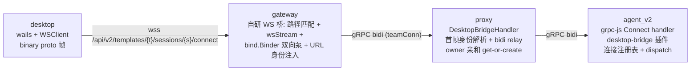
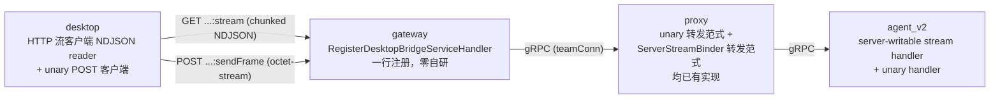

# 调研：DesktopBridgeService.Connect 拆分与 grpc-gateway streaming 支持再评估

> **状态**：调研完成，决策已拍板，待立项进入方案设计
> **日期**：2026-09-18
> **目标服务**：`projects/game/gateway/`、`projects/game/proxy/`、`projects/game/agent_v2/`、`common/js/dsh-plugins/desktop-bridge/`、`projects/game/desktop/`
> **范围**：评估将 `DesktopBridgeService.Connect`（bidi）拆分为 server-streaming + unary 两接口、并删除 gateway 自研 ws↔gRPC 转换工具的可行性；含大文件上行编码的社区实践调研与历史 fix 迁移分类
> **说明**：本文为调研材料，供后续制定方案（spec / plan）时使用；非 SDD spec 文档。

---

## 1. 背景与问题

`agent_v2` 的 `DesktopBridgeService.Connect` 是 bidi stream（`projects/game/agent_v2.proto:207-215`）：

```proto
rpc Connect(stream projects.game.UserFrame) returns (stream projects.game.TeamFrame);
```

早期开发调研结论是"grpc-gateway 对双向 stream 接口支持不足"，因此在 gateway 自研了从 WebSocket 到 gRPC stream 的转换工具（`projects/game/gateway/cmd/main.go:185-397`：路径匹配 / `wsStream` 适配器 / `pumpWebSocketConnect` 双向泵 / 关闭码分类）。

本次调研重新评估两个问题：

1. **grpc-gateway 对 grpc service stream（server streaming）的支持现状**——若可支持，自研转换工具即可删除；
2. **Connect 能否拆分**为一个 server-streaming（SSE 形态）接口用于接收服务端推送 + 一个普通 unary 接口用于发送请求。

仓库内的观察出发点：gateway 只有 `Connect` 一个方法走 WS（`projects/game/gateway/cmd/main.go:185-191` 的 `/api/v2/.../connect` 分支），而 `AgentService.Send`（server-streaming，`projects/game/agent_v2.proto:114-119`）没有任何特殊处理、直接经 grpc-gateway 提供——**该观察经验证属实**。

---

## 2. 当前架构现状（代码分析）

### 2.1 完整链路



### 2.2 各层现状

| 层 | 文件 | 现状 |
|---|---|---|
| gateway | `projects/game/gateway/cmd/main.go:173-397` | rootMux 对 connect 路径做 WS 分支：7 段路径手工匹配（`:199-229`）、`wsStream` 适配（`:240-277`，binary proto 编解码 + URL→template/session 逐帧注入）、`pumpWebSocketConnect` 双向泵（`:315-387`，10MiB 读限、关闭码分类） |
| proxy | `projects/game/proxy/handler/bridge.go:67-` | `Connect` bidi relay：预读首帧取身份 → 校验 → owner get-or-create → `bind.WithFirstFrame` 重放首帧 + `bind.Binder` 双向泵 |
| agent_v2 | `projects/game/agent_v2/src/server.ts:971-977`、`common/js/dsh-plugins/desktop-bridge/src/wire.ts:151-159`、`bridge.ts` | 单个 bidi handler；插件侧 `BidiStream` 结构接口（on data/error + write/end）；连接注册表含**新连接接管 + 旧连接晚到断开 compare-and-delete no-op**；dispatch 故障路径（无连接→FAILED "desktop disconnected"、20min backstop、abort→"aborted"） |
| desktop | `projects/game/desktop/internal/api/websocket.go` | `WSClient`：WS dial + binary proto 帧收发、10MiB 读限、CloseNow 规避 close handshake 死锁（spec 035 R5） |
| 共享 | `projects/game/pkg/bind/` | `binder.go`（bidi 四 goroutine 泵）、`first_frame.go`（首帧重放）——生产使用点仅 gateway 与 proxy 两处；`server_stream.go`（`ServerStreamBinder`，Send 在用） |

### 2.3 已在位的相关配置

- gateway 四条 gRPC 连接中 `teamConn`（承载会话面）已配 `WithLongLivedClientKeepalive`，与 proxy 的 `WithLongLivedServerKeepalive` 配对（`projects/game/gateway/cmd/main.go:88-95`）；
- gateway→proxy hop 已 bump `MaxCallRecvMsgSize`/`MaxCallSendMsgSize` 至 8MB（`projects/game/gateway/cmd/main.go:63-69`，spec 025 §5）；
- gateway `http.Server` 仅设 Addr+Handler、无 WriteTimeout（长流安全）；
- ingress 为 K8s Gateway API 纯路径前缀路由（`projects/game/deploy.yaml`），Send 的 chunked 流已在该链路生产验证。

---

## 3. grpc-gateway v2.27.6 streaming 支持矩阵

结论基于本地模块缓存 v2.27.6 源码逐行验证 + 官方文档/issue 交叉确认（仓库 `go.mod` 锁定 v2.27.6）：

| RPC 形态 | 支持情况 | 依据 |
|---|---|---|
| unary | ✅ 完整 | 仓库大量在用（team/preset/session/memory 全部） |
| **server streaming** | ✅ **原生支持** | [runtime/handler.go `ForwardResponseStream`](https://github.com/grpc-ecosystem/grpc-gateway/blob/v2.27.6/runtime/handler.go)：每消息 marshal + delimiter（默认 `\n`）+ `http.NewResponseController(w).Flush()` 逐消息刷新；每消息信封 `{"result": <msg>}`；流异常终止时最后一块为 `{"error": ...}` |
| client streaming / bidi | ❌ 不支持 | 官方 README 明确列为 non-feature（"True bi-directional streaming"，https://github.com/grpc-ecosystem/grpc-gateway#non-features ）——**当年自研 WS 桥的结论对 bidi 依然成立** |
| SSE（`text/event-stream`） | ❌ 无内建 | v2.27.6 与 v2.28.0 runtime 源码均无 `text/event-stream`；[issue #26](https://github.com/grpc-ecosystem/grpc-gateway/issues/26) 自 2015 开放至今未实现；社区方案为 ~30 行自定义 marshaler（`WithMarshalerOption("text/event-stream", ...)` + `data: ...\n\n` 帧，见 [issue #2786](https://github.com/grpc-ecosystem/grpc-gateway/issues/2786)） |
| 二进制 proto（`application/octet-stream`） | ✅ 内建 `ProtoMarshaller` | [runtime/marshal_proto.go](https://github.com/grpc-ecosystem/grpc-gateway/blob/v2.27.6/runtime/marshal_proto.go)：unary 请求 body / unary 响应可用；**流式响应不可用**（`ForwardResponseStream` 传 `map{"result": msg}` 信封，非 proto.Message 会 marshal 失败；仅 `google.api.HttpBody` 可旁路，见 https://grpc-ecosystem.github.io/grpc-gateway/docs/mapping/httpbody_messages/ ） |

### 3.1 关键行为细节（源码级验证）

1. **断连取消链路**：生成 handler 以 `ctx, cancel := context.WithCancel(req.Context())` 为父 ctx 调 gRPC（`request_AgentService_Send_0` 生成代码）→ HTTP 客户端断连即取消后端 gRPC 流，服务端 ctx cancel 感知。
2. **path 参数覆盖 body**：生成代码先 decode body、后赋值 path 参数字段（`protoReq.Session = ...` 在 decode 之后）——URL 身份天然覆盖客户端 body 值。
3. **首消息前无响应头**：Content-Type 在首个消息写入时才落盘；生成代码还会阻塞在 `stream.Header()` 等后端 header——长生命周期订阅流应在打开时立即推一帧。
4. **marshaler 按 MIME 注册**：[runtime/marshaler_registry.go](https://github.com/grpc-ecosystem/grpc-gateway/blob/v2.27.6/runtime/marshaler_registry.go)——按请求 `Content-Type`（inbound）/`Accept`（outbound）精确匹配，注册 `application/octet-stream` 不影响 JSON 路由。
5. **流错误处理**：`WithStreamErrorHandler` 可定制错误尾块（https://grpc-ecosystem.github.io/grpc-gateway/docs/mapping/customizing_your_gateway/ ）。

### 3.2 仓库内生产先例

`AgentService.Send` 即 server-streaming 经 grpc-gateway 以 chunked NDJSON 提供的活先例：gateway 仅一行 `RegisterAgentServiceHandler`（`projects/game/gateway/cmd/main.go:134-136`），proxy 侧用 `bind.ServerStreamBinder` 转发（`projects/game/proxy/handler/agent.go:272-`），web 前端以 fetch + ReadableStream 消费 NDJSON（`projects/game/web/frontend/src/api/conversation.ts`，注释明确记录 "EventSource 不适用——POST body"）。

---

## 4. 拆分可行性结论：可行 ✅

将 `Connect` 拆为两个带 HTTP 注解的 RPC 后，全链路均为 grpc-gateway 原生支持形态，自研 WS 桥可整体删除：



| 层 | 拆分后 |
|---|---|
| gateway | `RegisterDesktopBridgeServiceHandler` 一行注册；WS 桥（main.go 约 230 行）及对应测试删除；rootMux 回归纯 gwmux 子树 |
| proxy | 两种转发范式均已存在：unary（`GetTeam` 等 owner lookup 转发）、server-streaming（`Send` 用 `bind.ServerStreamBinder`）；`DesktopBridgeHandler` 的 bidi relay + 首帧身份解析删除 |
| agent_v2 | grpc-js 单 bidi handler → server-writable stream handler + unary handler；插件 `BidiStream` 接口改为"写面 + 入站 RPC" |
| desktop | `WSClient` → HTTP 流 reader（NDJSON）+ unary POST 客户端（复用 proto.Marshal 产 octet-stream body） |

**结论要点**：grpc-gateway 的 server streaming 已在本仓库生产验证（Send）；bidi 不支持的旧结论仅对 bidi 成立，拆分后不存在 bidi；SSE 无内建支持，但 Go 客户端用 NDJSON 即可，无需 SSE。

---

## 5. 语义差异与设计要点

拆分不是纯等价替换，以下差异需在方案中定义（调研发现项）：

1. **连接锚点转移**：server-streaming 连接（`:stream`）成为唯一连接事实源（`desktop_connected`、新连接接管、断开清理走 ctx cancel）；无活跃流时收到 `SendFrame` 需定义语义（已拍板：拒绝 `FAILED_PRECONDITION`）。
2. **首帧探测消失**：现方案首帧 StatusSignal 探测绑定连接；拆分后 RPC 调用即绑定（path 参数携带身份）。需在流打开时立即推一帧 status——同时解决 §3.1.3 的"首消息前无响应头"问题，并充当连接确认（desktop 侧保留首帧超时判定）。
3. **上行顺序不再端到端保证**：独立 unary 调用 + h2 多路复用无序。帧自包含（op result 按 tool_id 关联）应当无碍；方案阶段需确认 hold/release 确认抽屉等无顺序依赖。
4. **载荷大小**：截图（≤5MiB）走 unary body（编码见 §6）；TeamFrame 下行无图片、均为小帧（操作请求/信号），NDJSON 无压力。
5. **长连接**：keepalive 配对、8MB gRPC hop、无 WriteTimeout 均已在位；IDLE 静默期需应用层心跳（已拍板，§7 D5）。
6. **下行信封**：每块为 `{"result": <TeamFrame>}\n`，desktop 客户端解包——与 web 前端消费 Send 相同；异常终止时解析 `{"error": ...}` 尾块。
7. **HTTP 层显式上限守卫**：Go `http.Server` 对请求体默认无限制；spec 025 §4 的守卫意图（oversized 清晰归因、不静默截断）在 HTTP 腿上需显式落点（gRPC hop 8MB 兜底之外，建议 gateway 层 `http.MaxBytesReader` 归因报错）。

---

## 6. 大文件上行编码：社区实践调研（D3）

场景约束：≤5MiB PNG 截图、每次操作一张（高频）、内部 Go 客户端、链路经 grpc-gateway、gRPC hop 已 8MB。

| # | 方法 | 适用场景 | 本场景适配度 |
|---|---|---|---|
| 1 | 调大 gRPC 消息上限、单消息直传 | 文件有界且可控（几十 MB 内） | 仓库已做（8MB）；HTTP 腿编码仍需选型 |
| 2 | client-streaming 分块上传（首条 metadata + 后续 chunk） | 大文件（百 MB~GB）、内存受限 | ❌ grpc-gateway 不支持 client streaming；服务端需分块状态机 |
| 3 | **REST 二进制 body（`application/octet-stream`）** | 中等文件、Go/原生客户端 | ✅ 社区基准中最优（HTTP body 流式无逐消息开销）；对应内建 `ProtoMarshaller` |
| 4 | multipart/form-data | 浏览器表单 | 无浏览器参与，无需引入 |
| 5 | JSON + base64 | 公开 AI API 惯例（Anthropic/OpenAI vision） | ⚠️ 5MiB→~6.7MiB 仅剩 20% 余量；每次操作多付 33% 字节 + 双端 JSON codec CPU |
| 6 | Presigned URL / 对象存储旁路 | 真正大文件、多消费者、需持久化 | ❌ 截图被游戏循环即时消费、无持久化价值，过度设计 |
| 7 | 引用模式（存共享存储、传 key） | 微服务间大载荷 | ❌ 同上 |
| 8 | 压缩（gzip） | 文本类大载荷 | PNG 已压缩，净负收益 |

佐证：

- [kreya 基准（4GB 文件传输：gRPC naive/optimized vs REST/HTTP1.1/HTTP2）](https://kreya.app/blog/transfering-files-with-grpc/)：REST body 直传在时长与内存分配上全面占优，结论原文 *"A REST endpoint for up- and downloading files is still the best option"*；
- [grpc-io 官方讨论](https://groups.google.com/g/grpc-io/c/F7HwE41W9Rs)：单消息直传与分块均为正当方案，"几十 MB 内、双端可控"选单消息直传是共识；
- gRPC 默认 4MiB 上限（"catches everyone exactly once"）——5MiB 截图 > 4MiB，故 8MB bump 为硬需求（与 HTTP 腿编码无关）。

**仓库内部依据**：[specs/025-desktop-image-state-refine/contracts/image-transport-contract.md](../specs/025-desktop-image-state-refine/contracts/image-transport-contract.md) §2 已书面裁定过同一问题——binary proto 直传 ImagePart.data（no base64、no ~33% inflation、去除逐帧 JSON parse 成本）。本次在 HTTP 腿选 octet-stream 是同一意图的延续；选 JSON base64 则是该书面决策的回退。

---

## 7. 已拍板决策记录（2026-09-18）

| # | 决策项 | 结论 |
|---|---|---|
| D1 | 下行流端点形状 | `GET /api/v2/{session=templates/*/sessions/*}:stream`（AIP-136 custom method 风格，与 `:send`/`:cancel` 命名族一致） |
| D2 | 上行发送端点形状 | `POST /api/v2/{session=templates/*/sessions/*}:sendFrame`（custom method） |
| D3 | 上行编码 | 注册内建 `ProtoMarshaller`（`application/octet-stream`），desktop 走原始二进制 proto（零膨胀；JSON 路由不受影响） |
| D4 | 无活跃下行流时的 SendFrame | 拒绝 `FAILED_PRECONDITION`（单一连接事实源；接管间隙由 desktop 重试） |
| D5 | IDLE 静默期 liveness | 应用层 status 心跳（agent 周期推 status 帧，~10s 量级；顺带解决 ingress 空闲超时） |
| D6 | 迁移策略 | 直接切换（一次变更全链路：desktop/fake-desktop/gateway/proxy/testplan；同仓同发布，testplan 兜底） |
| D7 | SSE 预留 | 不做（Go 客户端 NDJSON 足够；未来需要时 ~30 行 marshaler 即可补，无沉没成本） |

## 8. 重构约束：历史 fix 三分类（不过度迁移）

原则：**A 类保留意图（transport 无关的语义修复）；B 类不迁移（旧传输层的机制性 workaround，随 WS 桥删除）；C 类原样（已在位配置，零新增）**。

### A 类 — 意图必须保留

| Fix | 出处 | 新架构落点 |
|---|---|---|
| 二进制效率（no base64/no JSON parse） | [specs/025 §2](../specs/025-desktop-image-state-refine/contracts/image-transport-contract.md) | D3 octet-stream 即延续 |
| 帧大小守卫：10MiB 是 guardrail 非工作点；oversized 清晰归因、不静默截断、不破坏 session | specs/025 §3/§4 | HTTP 层显式上限（`MaxBytesReader` + gRPC hop 8MB 兜底） |
| gRPC hop 8MB | specs/025 §5 | 原样保留（5MiB > gRPC 默认 4MiB，硬需求） |
| 前向兼容 unknown fields | specs/025 §2 | octet-stream 天然保留（`proto.Unmarshal` 语义） |
| 新连接接管 + 旧连接晚到断开 compare-and-delete no-op | [specs/051 desktop-bridge.md §2](../specs/051-agent-v2-dsh-migration/contracts/desktop-bridge.md)、`bridge.ts` | 原样保留（锚点变为 `:stream` 连接） |
| dispatch 故障路径（无连接→FAILED "desktop disconnected"、20min backstop、abort→"aborted"） | specs/051 §2 | 原样保留（游戏逻辑层，与传输无关） |
| 探测意图（连接确认 + 首帧超时判定） | specs/051 §1 | 保留为"流打开即推 status 初始帧 + desktop 首帧超时" |
| 两流独立性（flow 流与对话流独立故障域） | specs/051 契约 | 两条 HTTP 连接天然独立 |

### B 类 — 不迁移（旧传输层机制性 workaround）

| Workaround | 出处 | 为何不迁移 |
|---|---|---|
| URL 身份逐帧注入 | gateway `wsStream.Recv` | **历史意图澄清（用户纠正）**：这是 WS 无 HTTP 注解绑定时的手工参数处理（path/request 参数要自己填），目的不是防伪造；grpc-gateway + 注解原生完成 path→字段映射，机制整体消失（path 覆盖 body 只是免费的副带性质） |
| `CloseNow`（非 `Close`）规避 close handshake 争锁阻塞 5s | spec 035 R5（`projects/game/desktop/internal/api/websocket.go:125-137`） | HTTP 客户端无 close handshake 概念，问题类别消失 |
| `RecvFrame` 锁外读（快照 conn 后释放 mu）防死锁 | spec 035 R5（同上 `:100-104`） | 同上；HTTP reader 用 ctx cancel 即可 |
| WS 关闭码分类（isCleanClose/errProtocol→关闭码映射） | gateway `main.go:364-397` | WS 专属错误分类学 |
| 首帧身份绑定 + proxy 预读首帧重放（`bind.WithFirstFrame`） | proxy `bridge.go` | 身份改由 path 参数承载，机制消失 |
| 7 段路径手工匹配 + `extractConnectIdentity` 防 foreign path | gateway `main.go:199-229` | 生成路由 pattern 原生约束 |
| `OriginPatterns`、单子树防 307 等 WS 分支路由细节 | gateway `main.go` | 分支删除 |
| WS 32KiB 默认读限坑（读限修复的根因） | specs/025 §3 | WS 专属；HTTP 侧对应物是 A 类的显式上限 |
| 043 教训：bidi WS idle 被中间层杀→级联 abort | [specs/043](../specs/043-llm-stream-stall-recovery/spec.md) | D5 应用层心跳正面消除 idle 风险（chunk-idle watchdog 属 LLM 流侧，不在本范围） |

### C 类 — 原样保留（零新增）

- keepalive 配对（teamConn `WithLongLivedClientKeepalive` ↔ proxy `WithLongLivedServerKeepalive`）——`:stream` 走同链路；
- desktop `env` header 透传。

---

## 9. 历史决策上下文（本重构将 supersede 的）

- [specs/049-agent-v2-dsh-init/research.md](../specs/049-agent-v2-dsh-init/research.md)（SSE(GET)+unary POST 否决条目）：该否决针对**对话面**（每条消息自带流，per-send stream 确实更简单）；bridge 面是会话生命周期控制通道，拆分形态天然匹配，推理不迁移。
- [specs/051-agent-v2-dsh-migration/research.md](../specs/051-agent-v2-dsh-migration/research.md)（D8/Q3-A：WS 形态）：当时选 WS 的理由是"复用 desktop 既有 WSClient、desktop 近零改动"——非 grpc-gateway 能力缺口（bidi 不支持是真实的，但拆分后不存在 bidi）。
- 附带清理：`bind.Binder`（bidi 泵）与 `bind.WithFirstFrame` 生产使用点仅 gateway 与 proxy 两处（已 grep 验证），拆分后 `binder.go`/`first_frame.go` 连同测试可整体删除，bind 包只剩 `server_stream.go`；fake-desktop（WS 客户端）与 testplan `desktop_flow_test.go` 需同步改 HTTP。

## 10. 参考资料

**官方文档与源码**

- grpc-gateway README（non-features 列表）: https://github.com/grpc-ecosystem/grpc-gateway#non-features
- grpc-gateway v2.27.6 `runtime/handler.go`（ForwardResponseStream）: https://github.com/grpc-ecosystem/grpc-gateway/blob/v2.27.6/runtime/handler.go
- grpc-gateway v2.27.6 `runtime/marshal_proto.go`（ProtoMarshaller）: https://github.com/grpc-ecosystem/grpc-gateway/blob/v2.27.6/runtime/marshal_proto.go
- grpc-gateway v2.27.6 `runtime/marshaler_registry.go`（MIME 注册）: https://github.com/grpc-ecosystem/grpc-gateway/blob/v2.27.6/runtime/marshaler_registry.go
- grpc-gateway 自定义 marshaler/流错误处理文档: https://grpc-ecosystem.github.io/grpc-gateway/docs/mapping/customizing_your_gateway/
- grpc-gateway HttpBody 文档: https://grpc-ecosystem.github.io/grpc-gateway/docs/mapping/httpbody_messages/

**Issue 讨论（SSE/流式支持的社区现状）**

- SSE 支持开放 issue（2015 至今）: https://github.com/grpc-ecosystem/grpc-gateway/issues/26
- EventSource 消费与自定义 event-stream marshaler 实践: https://github.com/grpc-ecosystem/grpc-gateway/issues/2786
- 流式响应 content-type/缓冲问题: https://github.com/grpc-ecosystem/grpc-gateway/issues/4537

**大文件传输实践**

- kreya：gRPC vs REST 文件传输基准: https://kreya.app/blog/transfering-files-with-grpc/
- grpc-io 讨论：单消息 vs 分块传输大文件: https://groups.google.com/g/grpc-io/c/F7HwE41W9Rs

**仓库内**

- 现链路与契约：`projects/game/agent_v2.proto`、`projects/game/gateway/cmd/main.go`、`projects/game/proxy/handler/{agent,bridge}.go`、`projects/game/pkg/bind/`、`common/js/dsh-plugins/desktop-bridge/src/{wire,bridge}.ts`、`projects/game/desktop/internal/api/websocket.go`
- 历史决策：`specs/025-desktop-image-state-refine/contracts/image-transport-contract.md`、`specs/051-agent-v2-dsh-migration/{contracts/desktop-bridge.md,research.md}`、`specs/049-agent-v2-dsh-init/research.md`、`specs/035-proto-contract-refine/research.md`、`specs/043-llm-stream-stall-recovery/spec.md`
