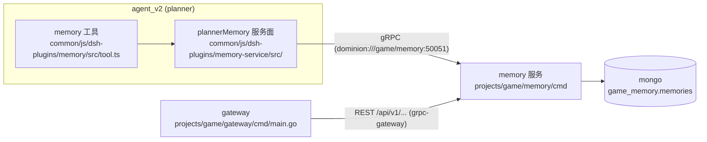
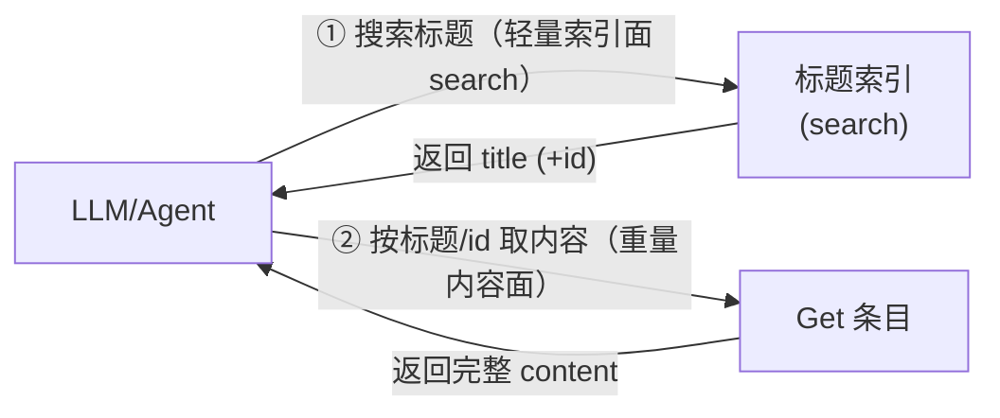

# 调研：game memory 服务的 wiki 知识库功能

> **状态**：调研完成，待审查立项进入方案设计
> **日期**：2026-09-19
> **目标服务**：`projects/game/memory/`（服务端）与 `common/js/dsh-plugins/`（agent 工具面）
> **范围**：为 planner 增加轻量 wiki 知识库——大量、复杂、随用随取的记忆，与现有 memory 工具（全局记忆）区分
> **说明**：本文为调研材料，供后续制定方案（spec / plan）时使用；非 SDD spec 文档。所有外部引用附完整 URL，仓库内引用附相对路径。

---

## 1. 背景与需求定位

### 1.1 wiki 与 memory 的定位区分

| 维度 | memory（现有） | wiki（本次） |
|---|---|---|
| 记忆形态 | 短条目、全局记忆 | 大量、复杂、结构化的知识条目 |
| 进入上下文的方式 | 冻结快照注入 system prompt（top-10，`common/js/dsh-plugins/memory-service/src/snapshot.ts`） | **不注入**，随用随取（on-demand 检索） |
| 检索方式 | List（order_by + 分页全量拉取） | Search 模糊检索（轻量标题面）；List 全量获取（完整资源）；内容单条 Get |
| 单条规模 | 小（单行 content） | 大（title + 长内容 content） |

### 1.2 需求约束（保守方案）

- wiki 条目归属 `template/session` 作用域（与 memory 相同）；
- 条目**平铺**，不做多级目录；
- 每条目 = `title + content`：title 支持模糊搜索与全量检索，content 仅支持 Get；
- 存储继续使用 mongo（现有基础设施，不引入新组件）；
- 关键点 1：title 检索与内容索引在现有基础设施上尽可能高效；
- 关键点 2：wiki 检索 API 的设计（服务端 RPC 面 + agent 工具面）。

### 1.3 已确认的技术决策（2026-09-19 讨论记录，供后续方案起点）

| # | 决策点 | 结论 |
|---|---|---|
| D1 | title 模糊检索存储层技术 | **n-gram 索引预过滤**（写时生成规范化 2-gram 数组 + multikey 复合索引；读时 `$all` 预过滤 + 服务端精确验证与评分；短查询回退 scoped regex） |
| D2 | 资源命名 | 资源类型 `Wiki`，pattern `templates/{template}/sessions/{session}/wikis/{wiki}`，服务 `WikiService` |
| D3 | title 唯一性 | 规范化后的 title 在 `(template, session)` 内**强制唯一**（唯一复合索引兜底，重复返回 ALREADY_EXISTS） |
| D4 | 交付范围 | 服务端（Go）+ agent JS 工具（dsh-plugins）端到端 |
| D5 | List 与 Search 的分工 | **List = 全量获取**：AIP-132 标准语义，返回完整资源（含 content，分页限制单页成本）；**Search = 检索**：AIP-136 自定义方法，轻量响应（`{name, title}`，id 由 `name` 末段承载，不含 content）。仅 Search 裁剪字段，List 不做字段裁剪 |
| D6 | agent 工具面的动作集 | 工具仅提供 search/get/write 动作，**不提供 list**——game memory 工具当前不需要全量获取功能；服务端 ListWikis 保留为标准 API 面（gateway/外部调用方），工具发现一律走 search |
| D7 | Search 分页 | **query 限定的 offset 分页**：`page_token` 编码 `{q: 规范化query, offset}`（不透明 base64url），续页 query 不匹配 → INVALID_ARGUMENT；与 List 的 token 形态独立。实现采用 **redis 结果快照缓存**（按可用假设设计，§5.1.1）：按 query 缓存有序结果 + TTL + 写代际失效，缓存 miss / redis 不可用时降级为逐页重执行——API 契约对缓存/重执行两种实现不变 |
| D8 | List 排序 | **不提供 order_by**，固定 `wiki_id asc`（wiki_id 才是 memory_id 的对标，title 不是排序字段）——排序/游标机制大幅简化（无白名单/无方向解析，固定单键 seek）；仓库先例：`ListSessionsRequest` 亦无 order_by（`projects/game/game.proto`） |
| D9 | 字段上限 | title ≤ 128 rune；content ≤ 64KB（Anthropic 实践量级）；超限 INVALID_ARGUMENT |
| D10 | 工具挂载 | wiki 工具仅挂 planner preset |

---

## 2. 代码库现状与可复用基础设施

### 2.1 memory 服务全貌

`projects/game/memory/` 是 AIP 风格的 gRPC 服务（spec `specs/039-planner-memory-calibration/`，排序分页契约 `specs/065-agent-v2-team-refine/contracts/memory-snapshot-recency.md`）：

| 层 | 文件 | 职责 |
|---|---|---|
| cmd | `projects/game/memory/cmd/main.go` | bootstrap + gRPC server，mongo client（`game/mongo`），db `game_memory`，注册 `MemoryServiceServer` |
| handler | `projects/game/memory/handler/handler.go` | AIP-133/134/135/131/132 CRUD + List（order_by 解析、page token 校验、错误映射） |
| domain | `projects/game/memory/domain/{model,repository,sort,pagination,errors}.go` | 领域模型、仓储接口、**通用排序白名单 + tie-breaker + 游标编解码** |
| runtime/mongo | `projects/game/memory/runtime/mongo/{repository,model}.go` | mongo 仓储；启动时建索引；seek 式 OR 阶梯分页 |

proto 定义在 `projects/game/game.proto`（MemoryService + Memory 资源），与 agent_v2.proto 同属一个 proto_library/codegen 单元（`projects/game/BUILD.bazel`，编译器含 `protoc-gen-go-aip`——资源名解析 `ParseMemoryName` 等为代码生成）。

调用链：

### 2.2 基础设施约束：mongo 为自托管 7.0 社区版

`projects/infra/deploy/k8s.yaml` 使用 `mongo:7.0` 镜像。**社区版没有 Atlas Search**（`$search`、fuzzy、autocomplete 均为 Atlas 专属能力），这是 title 模糊检索方案选型的硬约束（详见 §4）。

### 2.3 可复用基础设施清单

| 能力 | 位置 | 复用方式 |
|---|---|---|
| AIP-132 order_by（白名单 + tie-breaker + 两趟解析） | `projects/game/memory/domain/sort.go` | wiki 不再需要（D8 取消 order_by）——仅作背景参考 |
| AIP-158 游标分页（base64url JSON + seek） | `projects/game/memory/domain/pagination.go`、`runtime/mongo/repository.go` 的 `memorySeekClauses` | wiki 只需该机制的极简子集：List 固定 `wiki_id` 单键 seek（D8），无 order_by 白名单/方向解析部分 |
| 仓储 seam（`collectionOps` 接口：`InsertOne/FindOne/ReplaceOne/DeleteOne/Find/Indexes`） | `projects/game/memory/runtime/mongo/repository.go` | **注意：接口没有 `Aggregate`**——见 §4.4，这影响检索实现位置的选择 |
| fake collection 单测模式（内存 map + 记录 filter 断言） | `projects/game/memory/runtime/mongo/repository_test.go`、`handler/handler_test.go` | wiki 直接仿照 |
| gateway REST 面（grpc-gateway 注册） | `projects/game/gateway/cmd/main.go` | WikiService 同 target（`gameconst.MemoryTarget`）注册即可 |
| JS 插件模式（gRPC client + hermes 式单工具 + preset 挂载） | `common/js/dsh-plugins/memory/`、`common/js/dsh-plugins/memory-service/`、`projects/game/agent_v2/preset-templates/planner/planner/agent.cordis.yml` | wiki 插件仿照 |
| 大型测试（gateway HTTP 端到端） | `projects/game/testplan/memory_test.go` | wiki 仿照新增 |

### 2.4 差距（本功能需要新增的部分）

1. `projects/game/game.proto`：新增 `WikiService` + `Wiki` 资源 + Search 自定义方法契约；
2. mongo：`game_memory` 库新增 `wikis` 集合与索引（含 title 唯一索引与 n-gram 索引）；
3. 检索能力：现有 memory 只有确定性 List，无模糊检索——需新增 n-gram 生成与 `$all` 预过滤 + 验证评分；
4. agent 工具面：新 dsh-plugin（wiki 工具 + gRPC client）与 planner preset 挂载。

---

## 3. 智能体 wiki/知识库架构实践

### 3.1 Letta / MemGPT：分层记忆与 archival memory

Letta（前身为 MemGPT）是 agent 记忆架构的代表实现，三层记忆（[Letta Memory Architecture](https://agentscookbook.com/docs/tutorial/letta/letta-memory-architecture/)、[Letta Docs: Archival Memory](https://docs.letta.com/v1-sdk/memory/archival-memory/index.md)）：

| 层 | 进入上下文方式 | 检索方式 |
|---|---|---|
| Core memory（记忆块） | 常驻 system prompt | 无需检索（agent 可用工具编辑） |
| Recall memory（对话历史） | 按需 | 时间/内容检索 |
| **Archival memory（归档知识库）** | **按需** | **`archival_memory_search` 工具（语义检索）**，条目可带 tags |

与 wiki 对应的是 archival 层：**无限容量、不进上下文、agent 在对话中通过显式工具调用插入（`archival_memory_insert`）与检索（`archival_memory_search`）**。Letta 的实践提醒（[Memory hierarchies](https://theneuralbase.com/letta/learn/advanced/memory-hierarchies/)）：检索必须是按需的（on-demand），不要每轮预取。

**MemFS**（[Letta Docs: MemFS](https://docs.letta.com/concepts/memfs/index.md)）是 Letta 更新的文件式记忆，与本需求高度同构，其关键设计：

- 记忆为 git 仓库中的 Markdown 文件，**文件树（路径/标题索引）常驻 system prompt 作为"路标"（signposts）**，文件内容不进上下文，agent 用普通文件读取工具按需取；
- **默认没有语义/向量索引**——"Agents find memory in its Markdown files with normal file-search and read tools"，关键词检索是可选增强（MemFS Search mod）。

### 3.2 Anthropic memory tool：客户端文件式记忆

Anthropic 的官方 memory tool（`memory_20250818`，[官方文档](https://platform.claude.com/docs/en/agents-and-tools/tool-use/memory-tool)）是 Claude 被专门训练过的记忆工具形态：

- **客户端工具**：Claude 只发出操作请求，应用侧对接任意存储（本地目录、数据库、对象存储）；
- 6 个命令：`view`（列目录/读文件，支持行范围）、`create`、`str_replace`（old_str 必须唯一命中）、`insert`、`delete`、`rename`；
- **没有搜索函数**——发现机制是 `view` 目录列表；内容获取是整文件读取（[分析文章](https://www.shloked.com/claude-memory-tool)指出这是 Anthropic 的明确押注：模型读完整文件优于只读检索碎片）；
- 启用工具后 API **自动注入 memory protocol 系统指令**（"ALWAYS VIEW YOUR MEMORY DIRECTORY BEFORE DOING ANYTHING ELSE"、假设上下文随时被重置）；
- 设计哲学：**just-in-time context retrieval**——学到什么就写下来，需要时再读回，活跃上下文保持聚焦；
- 安全要点：路径校验防目录穿越、单文件与总容量上限（[实践指南](https://apito.ai/en/blog/dev-guides/claude-memory-tool-guide/)建议单文件 ≤64KB）。

### 3.3 生态其他方案（为何不采用）

| 方案 | 检索模型 | 不采用原因 |
|---|---|---|
| OpenAI File Search | 向量检索 + rerank | 需要嵌入模型与向量存储，违反"不引入复杂组件"约束 |
| Zep/Graphiti、Cognee、Mem0 等 memory 框架 | 时序知识图谱 / 向量混合 | 同上；且均为独立服务/框架 |
| MongoDB Atlas Search | Lucene 倒排 + fuzzy/autocomplete | Atlas 专属，自托管 7.0 社区版不可用（§4.1） |

### 3.4 共同模式：两级检索（本需求形态的业界验证）

上述实践收敛出同一检索形态，与需求"title 检索 + content Get"完全同构：

- 轻量面（标题/目录/文件树）成本低，可以全量或模糊检索，让 agent 先"知道有什么"；
- 重量面（内容）只在明确需要时单条获取，避免大内容污染上下文；
- Claude（Anthropic 训练过的工具形态）与 Letta MemFS（文件树路标）都验证了该形态对模型友好。

---

## 4. title 模糊检索技术（mongo 7.0 社区版）

### 4.1 硬约束

自托管 `mongo:7.0` 社区版（`projects/infra/deploy/k8s.yaml`），无 Atlas Search。社区版可用能力：普通索引（含 multikey）、text index（`$text`）、`$regex`、collation 索引。升级 mongo 版本不解决问题（fuzzy/autocomplete 始终是 Atlas 专属）。

### 4.2 候选技术对比

| 技术 | 大小写不敏感 | 任意子串 | 中文 | 索引支撑 | 结论 |
|---|---|---|---|---|---|
| `$text` text index | ✅ | ❌（词级切分） | ❌ | ✅ | **不可行**：官方支持语言列表无中文，`default_language:"none"` 仅按空白切分（[text search languages](https://www.mongodb.com/docs/manual/reference/text-search-languages/)），中文整句成为单 token |
| `$regex` 子串 | ⚠️（`i` 选项不走索引） | ✅ | ✅（UTF-8 字节级） | ❌ | **能兜底不的主力**：[官方文档](https://www.mongodb.com/docs/manual/reference/operator/query/regex/)明确——无锚定子串 = 索引扫描起步；大小写不敏感的 `$regex` 不感知 collation 索引；只有大小写敏感前缀锚定（`/^abc/`）走索引范围扫描 |
| **n-gram 数组 + multikey 索引** | ✅（规范化实现） | ✅ | ✅（rune 级） | ✅ | **采用**（D1 决策）：自托管标准实践 |

n-gram 方案的业界验证来源：

- [Fuzzy search with MongoDB and Python（Xeneta 工程实践）](https://medium.com/xeneta/fuzzy-search-with-mongodb-and-python-57103928ee5d)：写时生成 n-gram 存字段并建索引，读时 query 切 gram 匹配 + 打分；min_size=2（bigram）为经验最优（unigram 误报过多）；
- [How I Built Partial-Word Search in MongoDB With Edge N-Grams](https://hjr265.me/blog/ditching-mongodb-text-indexes-for-edge-n-grams/)：Go 实现——写时生成规范化 n-gram 存数组字段 + 普通数组索引，读时 `$all` 过滤 + 评分排序（词首匹配 > 词中匹配 > 短名惩罚），text index 无法做部分词匹配是该方案的直接动因；
- [quaesitor-textus mongo 包](https://github.com/csillag/quaesitor-textus/blob/main/packages/mongo/README.md)：**规范化全部在应用侧完成**（mongo 查询引擎不做 Unicode fold），存 folded n-grams 数组 + 每模式一个 verify 字符串，查询 = `$all` n-gram 粗过滤 + `$regex` 对 verify 字符串精确验证——"n-gram 是超集预过滤，regex 是精确判定"两段式；
- [fuzzily-mongoose](https://github.com/manisuec/fuzzily-mongoose)：mongoose 插件化实现，证明该模式可产品化；其 equalityPredicate 先缩小范围再文本匹配的性能优化思想，与本需求"先 (template, session_id) 等值、再 gram 匹配"一致；
- [MongoDB 官方博客（Substring Pattern Matching）](https://medium.com/mongodb/mongodb-text-search-substring-pattern-matching-including-regex-and-wildcard-use-search-instead-3633c6f7e604)：官方确认 regex/wildcard 子串匹配导致全索引扫描，推荐"分析/预生成词条"路线；同时提示 n-gram 全量索引的膨胀代价（本需求 title 短、单会话条目有限，膨胀可控）。

### 4.3 n-gram 方案要点（D1 细化，供后续方案直接取用）

**正确性原理**：若规范化 title 包含规范化 query 子串，则 title 的 bigram 集合必然包含 query 的所有 bigram（必要条件）；反之不然（充分性不成立）。因此 **`$all` 只做候选集预过滤，命中后再做子串精确验证**——预过滤走索引，验证在服务端 Go 侧完成，保证结果语义就是"规范化子串匹配"。

**写路径**（Create/Update title 时，服务端 Go 侧）：

1. 规范化：Unicode NFKC（全角→半角等）+ 小写化（`golang.org/x/text`，仓库 `go.mod` 已有 v0.36.0）→ `title_norm`；
2. rune 级 2-gram（bigram）集合去重 → `title_grams` 数组（title ≤ N rune 时 ≤ N-1 个元素，短 title 成本可忽略）；
3. gram 大小取 2 的依据：中文词以双字为主、Latin 部分词匹配需要 2 字符起（Xeneta 实践 min_size=2；unigram 误报过多）。

**读路径**（Search）：

1. query 同样规范化；
2. **query ≥ 2 rune**：切 bigram → mongo `Find({template, session_id, title_grams: {$all: grams}}, 投影不含 content)` —— `(template, session_id, title_grams)` multikey 复合索引支撑，等值前缀 + gram 交集，无集合扫描；
3. **query < 2 rune**（含中文单字查询——单字在中文是有意义的查询单元）：回退 `{template, session_id, title_norm: {$regex: QuoteMeta(query)}}`，成本以会话内条目数为上界（保守方案可接受，文档化即可）；
4. Go 侧验证与评分：`strings.Contains(title_norm, query_norm)` 过滤假阳性；评分建议：精确相等 > 前缀匹配 > 子串匹配，同分按 `title_norm` 升序——确定性排序，结果可复现；
5. 返回当页切片（`{name, title}` 轻量条目，**不含 content**；id 由 `name` 末段承载、资源消息无独立 id 字段——终态契约见 `specs/068-wiki-round-pause/contracts/wiki-service.md` §1/§4）；分页为 query 限定 offset（D7）——首检有序结果按 §5.1.1 缓存（redis 按可用假设），续页从缓存切片，miss 时重执行。

**索引清单**（`game_memory.wikis`，启动时创建）：

| 索引 | 用途 |
|---|---|
| unique `(template, session_id, wiki_id)` | 身份；兜底默认 `[wiki_id asc]` 排序键 |
| unique `(template, session_id, title_norm)` | D3 title 会话内唯一 |
| `(template, session_id, title_grams)` multikey | Search 的 `$all` 预过滤 |

（List 固定 `wiki_id asc`（D8）由唯一身份索引直接支撑，无需额外排序索引。）

**内容索引**（需求中"内容的索引"的实现面）：content 不参与模糊检索（Search 投影排除 content，仅返回 `{name, title}` 轻量条目——id 由 `name` 末段承载）；Get by `(template, session_id, wiki_id)` 唯一索引点查返回完整 content；List 按 AIP-132 完整资源返回（分页限制单页成本，见 §5.1）。

### 4.4 与本仓库实现的契合点

- **`collectionOps` 接口没有 `Aggregate`**（`projects/game/memory/runtime/mongo/repository.go` 的接口定义只有 `InsertOne/FindOne/ReplaceOne/DeleteOne/Find/Indexes`）：n-gram 方案恰好只需普通 `Find`（`$all` 是 filter，不是聚合管道）——评分排序放 Go 侧而非 mongo aggregation，**保持仓储 seam 与 fake 单测模式不变**（`projects/game/memory/runtime/mongo/repository_test.go` 的 fake 只需支持 filter 断言）。若用 aggregation 打分则需扩展接口与 fake，成本陡增；
- 规范化/gram 生成是纯函数，可在 domain 层单测（中文/全角/大小写/emoji 等 case 表驱动）；
- 正则注入安全：`$all` 路径是纯等值匹配无注入面；回退 regex 路径必须 `regexp.QuoteMeta`（Go 侧，语义为 Go regexp，与 mongo PCRE2 无耦合）；
- 新集合无存量数据，无 backfill/双写迁移问题。

---

## 5. 检索 API 设计

### 5.1 服务端 RPC 面（AIP 依据）

| RPC | 依据 | 要点 |
|---|---|---|
| `CreateWiki`（AIP-133，POST） | [google.aip.dev/133](https://google.aip.dev/133) | 调用方提供 `wiki_id`（与 memory 一致，agent 侧生成）；title 重复 → ALREADY_EXISTS |
| `GetWiki`（AIP-131，GET） | [google.aip.dev/131](https://google.aip.dev/131) | **唯一返回 content 的读路径** |
| `UpdateWiki`（AIP-134，PATCH） | [google.aip.dev/134](https://google.aip.dev/134) | title/content 可变（title 变更需重生成 grams 并保持唯一） |
| `DeleteWiki`（AIP-135，DELETE） | [google.aip.dev/135](https://google.aip.dev/135) | — |
| `ListWikis`（AIP-132，GET） | [google.aip.dev/132](https://google.aip.dev/132) | **全量获取**：标准 List 语义，返回完整资源（含 content）；**不提供 order_by，固定 `wiki_id asc`**（D8——wiki_id 是 memory_id 的对标；仓库先例：`ListSessionsRequest` 亦无 order_by）+ AIP-158 分页（[google.aip.dev/158](https://google.aip.dev/158)），固定单键 seek 游标；分页限制单页成本 |
| `SearchWikis`（AIP-136 自定义方法，GET `.../wikis:search`） | [google.aip.dev/136](https://google.aip.dev/136) | **检索**：`query` 参数，轻量响应（`{name, title}`，**不含 content**；id 由 `name` 末段承载），query 限定 offset 分页 + redis 结果快照缓存（D7，详见 §5.1.1）；AIP-136 明确示例"consider a `SearchBooks` with an author field as a search dimension"——带打分/排序的模糊检索正是自定义方法的适用场景，响应形态自定义无 AIP 冲突 |

不采用的两条路线及原因：

- **AIP-160 filter**（[google.aip.dev/160](https://google.aip.dev/160)）：filter 语法（EBNF 解析器）实现成本高，且 AIP-132 要求 List 请求"不应包含 filter/order_by 之外的可选字段"——把模糊查询塞进 List 要么实现完整 filter 语法（重）、要么违反 AIP（轻）；
- **List 加 `query` 参数**：违反 AIP-132 对 List 请求字段的约束（非 AIP 认可的 List 模式字段）。

**排序语义**：List 固定 `wiki_id` 升序（唯一身份索引支撑，天然全序、AIP-158 稳定）；Search 结果按 Go 侧评分降序、同分按 `title_norm` 升序（UTF-8 码点序，非拼音序）——全程确定性排序，locale 排序不追求，需在契约文档声明。

**content 呈现与 AIP 语义**：List 返回完整资源，符合 AIP-132 标准语义（不做字段裁剪）；content 不返回仅发生在 Search——自定义方法的响应形态自定义（AIP-136），无语义冲突。若未来 List 的 content 体积成为问题，AIP-157（[google.aip.dev/157](https://google.aip.dev/157)）提供标准机制：**view enum**（`BASIC`/`FULL`，其官方示例恰好就是"书本返回基本信息不含全文"，List 默认 BASIC）或系统参数级 field mask（read_mask 作为请求字段已被 AIP-157 标记 deprecated）——本次均不引入（YAGNI，轻量优先）。

### 5.1.1 Search 分页：社区实践与方案（D7，redis 按可用假设设计）

**社区实践**（ranked search 分页与"结果快照"的业界处理）：

| 系统 | 用户面搜索分页 | 状态化快照（≈"按 query 缓存结果再分页"的等价物） |
|---|---|---|
| Elasticsearch / OpenSearch | `from`/`size`（offset）为默认，结果窗默认上限 10000（[官方文档](https://www.elastic.co/docs/reference/elasticsearch/rest-apis/paginate-search-results)） | scroll（[官方已不推荐用于用户面分页](https://www.elastic.co/guide/en/elasticsearch/reference/8.19/scroll-api.html)，维护代价高）→ PIT + `search_after`（服务端保留索引状态的上下文，定位 >10k 深分页或一致性场景；无 PIT 时 `search_after` 需 tie-breaker 防漏/重） |
| Algolia | `page`/`hitsPerPage` 或 `offset`/`length`（[offset 参数](https://www.algolia.com/doc/api-reference/api-parameters/offset)）；cursor 式 browse 是独立的全量枚举 API，与搜索分页分离 | — |
| Stripe | Search API 返回不透明 `next_page` token（[考察](https://blog.openreplay.com/api-pagination-patterns/)） | — |
| 通用 API 实践 | offset 适用于小数据集/搜索 UI/需要页码的场景；cursor/keyset 适用于 feed/大列表/无限滚动（[对比](https://apiscout.dev/guides/api-pagination-patterns-cursor-vs-offset-2026)） | 服务端结果上下文昂贵，仅确有需要时启用 |

两点结论：

1. **ranked search 的用户面分页，offset/page 是主流**（ES `from/size`、Algolia `page`、Stripe 不透明 token 内部同为位置语义）；"按 query 缓存结果快照再分页"的业界等价物是 ES scroll/PIT——业界将其严格限定于深分页/一致性需求场景，并因维护成本把 scroll 从用户面分页中淘汰；
2. offset 的两个经典弱点（深页 O(n) 扫描、写入导致页窗漂移）在本场景不构成实质问题：候选集以会话为上界（10²–10³），单次检索 ~ms 级，agent 翻页浅（同 turn 1–2 页）——**重执行因此可以成为天然的降级/兜底路径**，缓存是纯优化而非正确性依赖。

**方案（D7）**——契约与实现分离，缓存是纯服务端内部细节：

- **API 契约（无论是否缓存都相同）**：`page_token` = base64url `{q, offset}`（q 为规范化 query）；续页请求的 query 规范化后必须与 token 内 q 一致，否则 INVALID_ARGUMENT（对齐 AIP-158 "token 须与请求上下文匹配"的精神）；`page_size` 默认 20、上限 100；与 List 的 token 形态完全独立。
- **实现（redis 按可用假设）**：
  - 首次查询执行完整检索（`$all` 预过滤 + Go 侧验证评分排序），有序结果（wiki_id + title 列表）写入 redis：key = `wiki:search:{template}:{session}:{gen}:{hash(q)}`，TTL ~60s（覆盖同 turn 翻页窗口，具体值方案阶段定）；
  - 续页优先从缓存切片——快照内 offset 即游标，翻页在 TTL 窗口内稳定；**缓存 miss（TTL 过期 / 写失效换代 / redis 不可用）一律降级为重执行并重建缓存**——正确性永不依赖缓存；
  - **写失效采用代际计数器**：`wiki:searchgen:{template}:{session}`，任何 wiki 写操作 INCR；cache key 含 gen，写后新查询自然落到新代，旧代 key 等 TTL 回收——避免写时按 pattern 枚举删除缓存 key 的复杂度；
  - 降级路径即"逐页重执行"形态：功能无损，仅翻页一致性回到 offset 语义（写入期间可能漂移，与无缓存方案一致）。
- **多副本与演进**：redis 外置缓存在多副本下行为一致（memory 服务当前单副本，进程内 TTL cache 本可零依赖等价；选 redis 是为多副本扩展与"假设可用"前提）。`{q, offset}` 契约对"无缓存重执行 / 进程内缓存 / redis 缓存"三种实现完全不变——是否缓存、用什么缓存是部署与性能决策，不影响 API，可随时增减。
- **落地前提注记**：redis 基建已由 067 交付（部署资源、Go/JS 公共库 `common/gopkg/redis`、`common/js/redis`），缓存可直接接入；缓存是纯优化，miss/不可用一律降级为逐页重执行（现状与实现注记见 `specs/068-wiki-round-pause/research.md` §5）。

### 5.2 agent 工具面（dsh-plugin）

工具面终态 = **三个独立工具**（`wiki_search`/`wiki_get`/`wiki_write`，对应 D6 动作集 search/get/write），随 planner preset 的 memory 行（`@dominion/dsh-memory`）注册；工具与 prompt 文本终态见 `specs/068-wiki-round-pause/contracts/dsh-plugins.md`：

- **`wiki_search`**：唯一参数 `query`，映射 SearchWikis，返回轻量 title 列表（无 content）；
- **`wiki_get`**：参数 `titles: string[]`，工具层先按 title 精确解析（D3 唯一性保证无歧义）再 GetWiki，批量返回 content；未命中标题列出并引导先 `wiki_search`；
- **`wiki_write`**：单条 `{title, content}` XOR 批量 `{entries[]}`，按规范化 title upsert（存在 → UpdateWiki，不存在 → CreateWiki，`wiki_id` 由 title 摘要确定性生成），批量预检全过才提交；**工具面不提供 list**（D6）——发现一律走 `wiki_search`，ListWikis 仅作为服务端/gateway 的标准 API 面保留（全量获取场景的潜在调用方是外部/运维面，不是 agent 工具）；
- **wiki_id 对 LLM 不可见**：与 memory_id 同策略（`specs/039-planner-memory-calibration/spec.md` FR-008——agent 内部生成，LLM 不感知）；title 即 LLM 侧的自然地址（D3 唯一性是前提）；
- **不做快照注入**：与 memory 的冻结快照（`common/js/dsh-plugins/memory-service/src/snapshot.ts`）相反，wiki 不注入 system prompt——"随用随取"靠工具检索；如需"路标"可后续考虑注入标题摘要（Letta MemFS 式文件树），本次保守不做；
- 写路径引导：批量预检失败/精确解析未命中时，工具结果给出失败条目与原因并引导"先 `wiki_search` 再决定写入"（类似 hermes memory 的 old_text 匹配失败引导）。

---

## 6. 开放问题（已全部关闭）

2026-09-19 第二轮讨论关闭全部开放问题，决策落位于 §1.3 决策表：O1/O2 → D9（字段上限），O3 → D7（Search 分页，含 §5.1.1 社区实践调研），O4 → D8（List 无 order_by、固定 `wiki_id asc`——wiki_id 是 memory_id 的对标），O5 → D10（仅 planner），O6 → §7 验证面建议。

## 7. 对后续方案设计的建议（草案级）

1. 资源 proto：`Wiki { name, title, content, create_time, update_time }`（无独立 id 字段，id 由 `name` 末段承载），pattern `templates/{template}/sessions/{session}/wikis/{wiki}`，`CreateWikiRequest.wiki_id` 沿用 `[a-z0-9_-]+` 字符集（agent 侧生成，与 memory 一致，`projects/game/memory/handler/handler.go` 的 `memoryIDPattern`）；title ≤ 128 rune、content ≤ 64KB 校验（D9）；
2. 存储文档：`{ _id, template, session_id, wiki_id, title, title_norm, title_grams, content, create_time, update_time }`（`_id` 数据库生成不覆盖，`style/mongo.md`；集合名 `wikis`，mongo 库沿用 `game_memory`——同服务同库、服务内集合隔离）；
3. domain 层：**无需 order_by 白名单/解析**（D8）——List 游标为固定 `wiki_id` 单键 seek 的极简实现；Search token 为 `{q, offset}` 编解码 + query 匹配校验（D7）；新增纯函数 `NormalizeTitle`/`TitleBigrams`；
4. handler 层：CRUD/List 仿 memory handler（List 完整资源返回、固定 `wiki_id asc`、无 order_by，AIP-132 标准语义）；`SearchWikis` 新增（query 规范化 + 预过滤委托仓储 + Go 侧验证评分 + offset 分页，响应不含 content）；
5. 检索实现位置：**评分验证在 handler/domain 侧（Go），仓储只做 `$all` 候选查询**——保持 `collectionOps` seam 与 fake 单测模式（§4.4）；Search 结果缓存（redis 快照 + 代际失效 + miss 降级，§5.1.1）作为独立可拆分的实现模块；
6. agent 侧：memory 插件行（`@dominion/dsh-memory`）新增三个 wiki 工具（`wiki_search`/`wiki_get`/`wiki_write`，D6 动作集 search/get/write、无 list），经 memory-service 包扩展的 `plannerMemory` 面访问 WikiService；preset 仅挂 planner（D10）；
7. 验证面：Go 单测（fake collection + 纯函数 case 表 + token 编解码与 query 匹配校验 + 缓存命中/失效/降级路径）+ testplan 大型测试（gateway HTTP：CRUD、List 固定序分页、Search offset 分页与 query 匹配校验，覆盖中文、大小写、子串、短查询回退路径）。

## 8. 参考文献

### 官方文档

- [MongoDB: $regex query operator（Index Use 章节）](https://www.mongodb.com/docs/manual/reference/operator/query/regex/)
- [MongoDB: $text Query Languages on Self-Managed Deployments](https://www.mongodb.com/docs/manual/reference/text-search-languages/)
- [Anthropic: Memory Tool](https://platform.claude.com/docs/en/agents-and-tools/tool-use/memory-tool)
- [Letta Docs: Archival Memory](https://docs.letta.com/v1-sdk/memory/archival-memory/index.md)
- [Letta Docs: MemFS](https://docs.letta.com/concepts/memfs/index.md)
- [AIP-121 Resource-oriented design](https://google.aip.dev/121) / [AIP-131 Get](https://google.aip.dev/131) / [AIP-132 List](https://google.aip.dev/132) / [AIP-133 Create](https://google.aip.dev/133) / [AIP-134 Update](https://google.aip.dev/134) / [AIP-135 Delete](https://google.aip.dev/135) / [AIP-136 Custom methods](https://google.aip.dev/136) / [AIP-157 Partial responses](https://google.aip.dev/157) / [AIP-158 Pagination](https://google.aip.dev/158) / [AIP-160 Filtering](https://google.aip.dev/160)

### 技术文章 / 实践

- [Fuzzy search with MongoDB and Python（Xeneta）](https://medium.com/xeneta/fuzzy-search-with-mongodb-and-python-57103928ee5d)
- [How I Built Partial-Word Search in MongoDB With Edge N-Grams](https://hjr265.me/blog/ditching-mongodb-text-indexes-for-edge-n-grams/)
- [MongoDB 官方博客：Substring Pattern Matching, Use Search Instead (Part 3)](https://medium.com/mongodb/mongodb-text-search-substring-pattern-matching-including-regex-and-wildcard-use-search-instead-3633c6f7e604)
- [quaesitor-textus/packages/mongo（n-gram 预过滤 + verify 两段式）](https://github.com/csillag/quaesitor-textus/blob/main/packages/mongo/README.md)
- [fuzzily-mongoose](https://github.com/manisuec/fuzzily-mongoose)
- [Elasticsearch: Paginate search results（from/size、search_after、PIT）](https://www.elastic.co/docs/reference/elasticsearch/rest-apis/paginate-search-results)
- [Elasticsearch 8.19: Scroll API（官方不再推荐用于深分页）](https://www.elastic.co/guide/en/elasticsearch/reference/8.19/scroll-api.html)
- [Algolia: offset API parameter](https://www.algolia.com/doc/api-reference/api-parameters/offset)
- [OpenSearch Pagination: Search_After, Scroll & PIT](https://opster.com/guides/opensearch/opensearch-how-tos/opensearch-pagination-which-techniques/)
- [API Pagination: Cursor vs Offset in 2026](https://apiscout.dev/guides/api-pagination-patterns-cursor-vs-offset-2026)
- [Pagination Patterns for Modern APIs（含 Stripe Search 不透明 token）](https://blog.openreplay.com/api-pagination-patterns/)
- [Anthropic's Opinionated Memory Bet](https://www.shloked.com/claude-memory-tool)
- [Claude Memory Tool in Practice](https://apito.ai/en/blog/dev-guides/claude-memory-tool-guide/)
- [Letta Memory Architecture（Agents Cookbook）](https://agentscookbook.com/docs/tutorial/letta/letta-memory-architecture/)
- [Letta Memory Hierarchies（The Neural Base）](https://theneuralbase.com/letta/learn/advanced/memory-hierarchies/)

### 仓库内引用

- `projects/game/memory/`（cmd / handler / domain / runtime/mongo 分层实现）
- `projects/game/game.proto`（MemoryService 与资源定义、proto codegen 单元）
- `projects/game/memory/domain/sort.go`、`projects/game/memory/domain/pagination.go`（排序与游标机制）
- `projects/game/memory/runtime/mongo/repository.go`（collectionOps seam 与索引创建）
- `projects/game/gateway/cmd/main.go`（REST 面注册）
- `common/js/dsh-plugins/memory/src/tool.ts`、`common/js/dsh-plugins/memory-service/src/`（工具与服务面插件）
- `projects/game/agent_v2/preset-templates/planner/planner/agent.cordis.yml`（preset 挂载）
- `projects/game/testplan/memory_test.go`（大型测试模式）
- `projects/infra/deploy/k8s.yaml`（mongo:7.0 部署）
- `specs/039-planner-memory-calibration/`（memory 服务 spec 与契约）
- `specs/065-agent-v2-team-refine/contracts/memory-snapshot-recency.md`（排序分页契约）
- `survey/planner-memory-and-agent-communication.md`（前次 planner 记忆调研）
- `style/api.md`、`style/mongo.md`、`style/golang.md`（代码规范）
