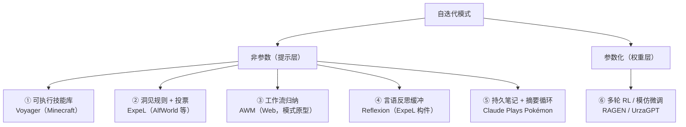

# 调研：LLM 玩游戏的自迭代方案——经验传递与策略提升的实现模式

> 承接 `survey/sts2-llm-agent-landscape.md`（STS2 生态内经验机制，见其 §5）。本文
> 扩大到 LLM 玩其他游戏的代表性项目，聚焦**自迭代机制的实现细节与生效机理**——
> 每一步（捕获/提取/门控/存储/检索/应用/修正）如何实现、为什么起作用、在哪里失效。
> 调研时间：2026-10-21。

## 1. 模式总览

按"经验存放位置"分两大类六种模式（非参数五种 + 参数化两种）：

## 2. 各模式的实现机制

### 2.1 Voyager：可执行技能库（[arXiv:2305.16291](https://arxiv.org/abs/2305.16291)、[代码](https://github.com/MineDojo/Voyager)）

经验 = **可执行代码**。生命周期各环节的实现：

| 环节 | 实现 |
|---|---|
| 写入门控 | **三重反馈迭代**：环境反馈（`bot.chat()` 报中间进度，如"还差 2 块木板"）+ 解释器执行错误 + **self-verification agent**（GPT-4 以 critic 身份看**环境状态**判断任务是否完成，失败则给 critique）。验证者看环境状态而非模型自报。4 轮预算用尽即放弃换任务 |
| 存储 | 向量库（Chroma）：key = GPT-3.5 生成的技能**描述**的 embedding，value = 代码本体 |
| 检索 | 先让 GPT-3.5 生成"解决该任务的一般性建议"作为查询上下文（**不是**拿原始任务文本直接查），再取 top-5 相似技能 |
| 应用 | 检索到的技能代码 + 控制 API 一起进 codegen prompt 作 in-context 示例；执行期整个技能库程序在环境侧可调用 |
| 组合/演进 | prompt 明文要求生成的函数 "generic and reusable"、"will be reused for building more complex functions"——**技能调用技能**形成复合能力，且显式缓解灾难性遗忘（新技能不覆盖旧技能） |
| 课程侧经验 | 自动课程（novelty search 式）的输入包含**已完成/失败任务清单** + QA 缓存——任务清单本身就是"能力前沿"的外置经验 |

**生效机理**：① 代码的成败由执行客观判定（最强验证信号）；② 可组合性让能力滚雪球；
③ 检索进 prompt 使 ICL 有例可循。**失效边界**：依赖环境可给出可执行反馈与可判定
的成功条件；技能描述质量决定检索质量（描述由 LLM 生成，索引与内容同源）。

### 2.2 ExpeL：洞见规则 + 跨轨迹投票（[arXiv:2308.10144](https://arxiv.org/abs/2308.10144)、[代码](https://github.com/LeapLabTHU/ExpeL)）

经验 = **自然语言洞见（insights）+ 成功轨迹库**双通道。

| 环节 | 实现 |
|---|---|
| 捕获 | Reflexion 式重试（每任务至多 Z 次）：失败 → self-reflect 生成反思 → 拼接进下次重试上下文；全部轨迹（成功+失败）入经验池 |
| 提取 | **两种输入构造**：同任务的 fail/success **对**（对比信号——具体差在哪一步）+ 每组 L 条跨任务成功**列表**（共性 good practice） |
| 写入门控 | 洞见操作算子 **ADD / EDIT / UPVOTE / DOWNVOTE**：新洞见 importance 初始为 2，UPVOTE/EDIT 加一、DOWNVOTE 减一，**归零即删除**。对池子做多轮遍历形成事实上的投票。作者明示动机："even successful trajectories can be suboptimal and mislead the generated insights" |
| 存储与检索 | 双通道：全部洞见 concat 进任务指令（**规则通道**）+ Faiss kNN（all-mpnet embedding）按任务相似度取 top-k 成功轨迹做 few-shot（**范例通道**——"closely imitate，less burden on ability extrapolation"） |
| 应用 | 两个通道都由 harness 注入 prompt，非 agent 自主查询 |

**生效机理**：① 对比提取（失败 vs 成功同任务）给出接近因果的信号；② 多轮投票把
单轨迹噪声过滤成跨任务共性；③ 规则（泛化）与范例（模仿）分工。**注意**：洞见
全量 concat 的设计以任务族（AlfWorld 家务类）为前提；STS2 这类长局中洞见必须
按情境检索（AgenticSTS 的 trigger 索引即此修正）。

### 2.3 AWM：工作流归纳（[arXiv:2409.07429](https://arxiv.org/abs/2409.07429)、[代码](https://github.com/zorazrw/agent-workflow-memory)）

域为 Web 导航（Mind2Web/WebArena），但是"程序性经验"的原型模式。

| 环节 | 实现 |
|---|---|
| 表征 | workflow =（子目标描述，参数化步骤序列）。关键实现：**把样例特定值抽象为占位符**（"dry cat food" → `{product-name}`）；模型输出按双换行切段、逐条入库 |
| 提取 | LM 归纳模块：从一条或多条轨迹中抽"反复出现的子例程"，粒度刻意细于任务指令（"在 Amazon 搜索商品"而非"买猫粮"） |
| 写入门控 | offline 模式：从**人工标注/金标准**样本归纳（先验质量高）；online 模式：流式处理，**只有 LM evaluator 判定成功的轨迹**才归纳入库 |
| 演进 | **滚雪球组合**：已归纳 workflow 成为更高层 workflow 的子目标（"按名找地点" → "查地点邮编"） |
| 应用 | workflow 并入 agent memory（M+W），推理时对后续任务生效 |

**证据**：Mind2Web / WebArena 相对提升 +24.6% / +51.1%；跨任务/站点/域泛化
+8.9~14.0 绝对点；online 跨域时反超 offline（归纳分布与测试分布对齐更重要）。
**失效边界**（作者自述）：online 模式中评估器误判会产生**错误 workflow 入库**、
劣化性能——写入门控质量受制于成功判定的质量。

### 2.4 Reflexion：言语反思缓冲（[arXiv:2303.11366](https://arxiv.org/abs/2303.11366)）

ExpeL 的捕获构件，独立成模式：失败轨迹 + 环境评估信号（单测/奖励）→ LLM 生成
言语反馈（"这次失败因为……下次应该……"）→ 存入**有界 episodic buffer** → 下次
尝试拼接进上下文。AlfWorld（文字游戏）任务成功率 +130%。

**生效机理**：把环境的稀疏/延迟反馈转换为语言层的稠密指导；反思针对**具体失败**
而非泛化规则。**边界**：反思只对"可重试的同类任务"有效（局内循环使用），跨任务
泛化需要 ExpeL 式的二次提取；buffer 有界，反思之间无一致性检查（噪声可累积）。

### 2.5 Claude Plays Pokémon：持久笔记 + 摘要循环（工业实战）

[Anthropic 实验回顾](https://www.youtube.com/watch?v=CXhYDOvgpuU)、
[Ars Technica 分析](https://arstechnica.com/ai/2025/03/21/why-anthropics-claude-still-hasnt-beaten-pokemon/)、
[第三方记忆架构拆解](https://michaelyliu6.github.io/posts/claude-plays-pokemon/)、
[独立复现笔记（LessWrong）](https://www.lesswrong.com/posts/8aPyKyRrMAQatFSnG/)。

经验 = **模型自管的纯文本 knowledge base**，配摘要压缩循环：

| 环节 | 实现 |
|---|---|
| 存储 | 纯文本 KB 文件，**模型全权控制**写/更新/清理；内容：目标清单（勾进度）、队伍、徽章、属性克制教训（"electric super effective against water"）、导航笔记 |
| 摘要循环 | 对话轮数超阈值 → Claude 写近期进展总结 → **清空对话历史** → 总结作为新会话首条 assistant 消息；KB 跨摘要持久（连续运行数周、自我摘要数千次） |
| KB 审计 | 每次摘要后由**第二个 LLM 审查 KB**，找不一致/过时/缺失 → 反馈给 Claude 修正（清理循环，对冲自由书写的噪声） |
| 读取 | KB 每轮重新注入上下文——**结构性读取**，非自主查询 |

**失效模式（最有价值的实践教训）**：

- **KB 是唯一跨摘要存活物**："anything not in your knowledge base or not in your
  summary is going to be gone"——删除错误 = 永久失忆；作者承认常见"删了不该删的"；
- **过时笔记误导**（stale notes）：环境已变而笔记未更新，agent 被自己的旧经验带偏；
- **模型无难度感知 → 不记难得的教训**（LessWrong 复现观察）：模型没有时间感，
  不会因为"这个谜题花了两小时"就把它写进笔记——**写什么完全靠模型的元认知**，
  而元认知恰恰缺失；
- 同一 harness 下模型版本是主导变量（3.5 Sonnet 三天找不到楼梯 → 3.5 刷新版稳定
  开局 → 3.7 大幅进步）——机制简单时，能力上限由模型决定；
- 作者最初尝试了 Voyager 式复杂 harness 后 **"stripped back to my own simple
  version"**（按钮 + 截图 + KB + 摘要）——工业实践在复杂技能库与最简笔记之间
  选择了后者。

### 2.6 参数化路线（不适用于 API 模型产品，记录边界）

- **RAGEN / StarPO**（[arXiv:2504.20073](https://arxiv.org/abs/2504.20073)）：多轮
  轨迹级 RL。核心发现 **Echo Trap**——模型在自生成轨迹上过拟合局部受奖模板，
  推理多样性行坍塌（reward std 提前跌落是早期信号；gradient spike 后不可逆）；
  缓解 = 按 reward 方差过滤只训高不确定样本（top 25%）+ critic + 解耦裁剪。另一
  发现：只有任务成功奖励时模型产生**幻觉推理**（thought 与环境状态脱节），需要
  细粒度 reason-aware 奖励。
- **UrzaGPT**（[slaythespire.dev 卡片](https://slaythespire.dev/projects/)）：
  LoRA 微调做轮抽选卡——模仿学习的参数化路线（对齐"从人类/专家选择中学"）。

**对非参数自迭代的警示**（Echo Trap 的普适含义）：agent 在**自生成的经验上自我
强化**会坍塌——这正是 AgenticSTS"多数技能候选被拒或合并"（写入门控）与 sts2-llm
"单局低置信、跨局升格"（生命周期）在非参数侧对应的同一问题。

## 3. 机理综合：三个决定性设计维度

### 3.1 写的可靠性 = 验证信号的客观性梯度

| 强度 | 验证方式 | 项目 |
|---|---|---|
| 最强 | **执行成功**（代码跑通、任务完成可客观判定） | Voyager |
| 强 | **环境状态判定成功**（critic/evaluator 看环境，非自报） | Voyager critic、AWM online |
| 中 | **成功/失败对比提取**（同任务反事实差异） | ExpeL |
| 中 | **跨轨迹投票/统计门**（多轮 UP/DOWN、A/B 重采样、四级门） | ExpeL、AgenticSTS |
| 弱 | **自我报告自由书写**（+事后审计兜底） | Claude Pokémon |

规律：验证信号越客观，经验库越干净；Pokémon 模式的 KB 审计（第二 LLM 清理）是
对"最弱信号"的补丁，但删除错误与漏记（无难度感知）仍无法根治——**写作质量是
自由笔记模式的固有短板**。

### 3.2 读的发生 = 结构注入（所有模式的共同点）

没有任何一个成功项目依赖"模型记得去查询"：Voyager 检索技能进 codegen prompt、
ExpeL 洞见 concat 进指令 + 轨迹做 few-shot、AWM 进 memory、AgenticSTS 固定槽位、
Pokémon KB 每轮重注入。**检索时机与位置全部由 harness 决定**——与
`survey/sts2-llm-agent-landscape.md` §5.4 的结论（读靠结构、写靠调度）在跨游戏
范围内再次成立。

### 3.3 复用性 = 抽象化程度梯度

| 抽象层级 | 形态 | 项目 | 特点 |
|---|---|---|---|
| 低 | 原始成功轨迹 | ExpeL 范例通道 | 模仿用，无泛化 |
| 中 | 占位符化工作流 | AWM | 跨任务复用的子例程 |
| 中 | 键控摘要 / 触发式指南 | AgenticSTS L4/L5 | 按情境精确召回 |
| 高 | 可执行代码技能 | Voyager | **可组合**，能力滚雪球 |
| 最高 | 模型参数 | RAGEN / UrzaGPT | 最彻底但不可审计、需训练权限 |

组合性（技能调技能、workflow 作子目标、课程驱动能力前沿）是"复利"的来源；
dominion 的 saolei hooks（planner 固化 JS 策略脚本、棋盘变动触发执行、注册期
语法/上限/banned-pattern 校验）在形态上已是 **Voyager 技能库的轻量实现**——
可执行、有写前校验（门控雏形）、事件触发（结构性读取）。

## 4. 对 STS2 / dominion 的映射

1. **技能层**：saolei hooks 模式可平移为 STS2 的触发式策略脚本（触发条件 =
   state_type/敌人/节点类），写前校验对应 Voyager 的执行门控思想——但 JS 脚本
   的"执行成功"需要定义可验证的语义（如输出与下一状态的 A/B 对照，即 AgenticSTS
   的 pre-write A/B 检查）。
2. **洞见层**：planner memory 可引入 ExpeL 式轻量投票（important 计数）+
   sts2-llm 式状态机，作为 §5.4 已记 P1 项（B6）的具体实现候选。
3. **笔记模式的风险对照**：若 STS2 player 走 agent 驱动路线（landscape §2.9 的
   方向 B），Pokémon 证明"KB+摘要循环"能让 agent 驱动跑通超长局，但其写质量
   短板（删错/漏记/过时）提示：**摘要循环必须配 KB 审计与结构性重注入**，且
   关键教训的写入应由调度（review 活动）而非模型自觉承担。
4. **Echo Trap 警示**：任何自迭代系统都需要写入门控与多样性保持——自生成经验的
   无门槛自我强化会坍塌（参数侧是 RL 崩溃，非参数侧是过时/错误经验固化）。

## 5. 引用清单

- Voyager：<https://arxiv.org/abs/2305.16291> · <https://github.com/MineDojo/Voyager> · <https://voyager.minedojo.org/>
- ExpeL：<https://arxiv.org/abs/2308.10144> · <https://github.com/LeapLabTHU/ExpeL>
- AWM：<https://arxiv.org/abs/2409.07429> · <https://github.com/zorazrw/agent-workflow-memory>
- Reflexion：<https://arxiv.org/abs/2303.11366>
- Claude Plays Pokémon：访谈 <https://www.youtube.com/watch?v=CXhYDOvgpuU> ·
  Ars Technica <https://arstechnica.com/ai/2025/03/21/why-anthropics-claude-still-hasnt-beaten-pokemon/> ·
  记忆架构拆解 <https://michaelyliu6.github.io/posts/claude-plays-pokemon/> ·
  独立复现 <https://www.lesswrong.com/posts/8aPyKyRrMAQatFSnG/>
- RAGEN/StarPO：<https://arxiv.org/abs/2504.20073> · <https://github.com/RAGEN-AI/RAGEN>
- 本仓库关联：`survey/sts2-llm-agent-landscape.md`（§2/§5 STS2 生态经验机制、
  §5.4 只写不读问题）、`survey/sts2-game-control.md`（操作方案）
