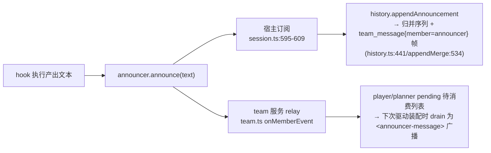
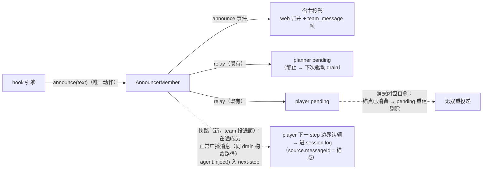
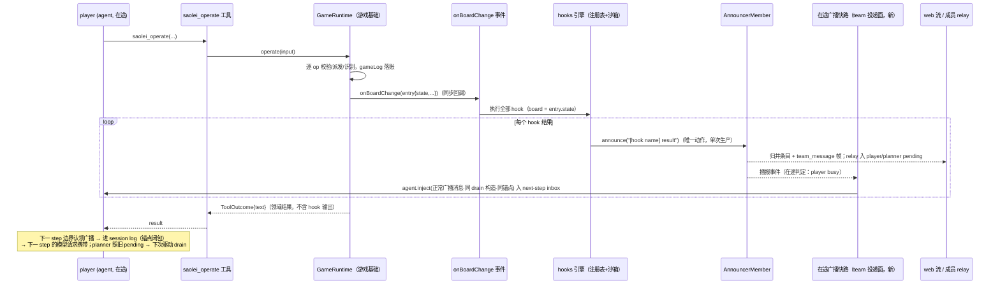

# Research: agent_v2 hook JS 脚本（planner 策略固化 + operates 后播报）

**性质**: spec 前调研（feature 目录未建立）| **Date**: 2026-10-16

**决策基线**（2026-10-16 用户裁定）：D2 播报可见面 = **全广播**（走
`announcer.announce()`，进入 web 展示链与 team relay 链）；D4 触发面 = **仅
`saolei_operate`**（含被拒绝/跳过的调用，只要有已识别棋盘；批量一次触发；init 不触发）；
D5 工具形态 = **单 action 工具**（`saolei_hook`，memory 先例）；D3/D6 默认项确认。
**D1（JS 执行引擎）pending**，留待 plan 阶段裁定（候选对比见 §2.3.2）。

**二轮修订**（2026-10-16 用户追问后裁定/澄清）：

- **K1 修订**：hook 触发锚定在**游戏领域的"棋盘批量操作变动"事件**，不与
  `saolei_operate` 工具耦合——游戏基础 `@dominion/dsh-saolei` 增加棋盘变动事件 seam，
  hook 引擎作为订阅方；hooks 插件与 saolei-tools 插件**零耦合**（两者都只依赖游戏基础）。
  原 D3（读 `peekGameLog()` 尾条）**作废**，棋盘状态由事件载荷（`GameLogEntry`）携带；
  触发职责由领域事件承担——回流（"下一 step 可见"）的实现形态经四至九轮演进，终态为
  统一播报快路（§2.2.4/§2.2.5），工具结果挂载与编排层文本追加均为备选。
- **K2 澄清**：`announce(text)` 是**全同步调用链**（log 追加 → 两个订阅者同步回调：team
  relay 锚点入列 + 宿主归并/帧扇出，`announcer.ts:196-199`）；但 player 的**可见性是下一次
  驱动（turn）装配 drain 时**，**不是下一个 step**——在途回合内播报只累积在 pending 列表
  （§2.2.1）。
- **D7 = b（裁定）**：hook 结果**播报 + 并入 operate 工具结果**——player 同一回合的下一
  step 即可看到 hook 分析并据此调整后续落子；播报通道保持（web 即时 + planner/下一回合
  可见）。回流桥接的实现形态见 §2.2.2。
- **K4（三轮发现，用户裁定需补上）**：宿主层存在两处分层缺口——① announcer 未被宿主当
  作统一 member 处理（多处特例代码）；② 宿主逐成员自行订阅 dsh 根事件，team 插件未提供
  统一的 team/member 消息流。目标方向：team 插件成为宿主消费的成员消息流权威，announcer
  与 agent 成员端到端同权（§2.4）；范围与时机 = D8 pending（spec 编写时裁定）。
- **四轮澄清（原生机制）**：dsh **原生支持**中途插入消息——D7=b 回流的首选通道改为
  `deferContext`/`additionalContexts`（工具结果附加上下文，随 `tool/result` 进派生历史、
  下一 step 携带，与 flow 零交互）；`agent.inject()` 原生但有三个集成皱褶不启用；社区
  （Claude Code additionalContext / system-reminder）与 dsh 收敛于同一形态（§2.2.3）。
- **五轮澄清（挂载自动化 + announcer 单模式）**：回流挂载目标**无需工具名匹配**——
  `tools/execute` around 包装器按"动态包围"相关性自动挂载（hook 只在工具调用的动态
  包围内执行，恒有且恰有一个）；announcer **保持单模式**（常规 message），回流不经
  announcer——两通道由 hook 引擎扇出、归属分离（§2.2.3）。
- **六轮修订（统一播报，用户裁定）**：五轮的"两通道扇出"被否决——announcer 是处理
  独立插入消息的**单一机制**（系统代言人），旁路实现使播报不完整。终态：hook 引擎只调
  `announce()`（单次生产）；下一 step 可见性由**在途广播快路**承担——在途成员经
  `agent.inject()` 收到同一广播的 team-broadcast 线形态（同锚点），team 消费闭包保证
  exactly-once；静止成员照旧 pending drain。工具结果挂载（additionalContexts）降为备选
  （§2.2.4）。
- **七轮澄清（快路三问）**：提供者二选一且与 D8 联动（分层补缺先行 → team 提供；hook
  先行 → loop 编排提供起步）；启用条件 = 目标成员 busy（hook 播报恒启用、终局统计恒
  不启用）；对驱动零影响（inject 不唤醒、不开/不延 turn、flow 决策与完成判定不变、
  取消边缘由 landUnclaimed 先序与锚点自愈兜底）；与排队消息无冲突（共享 nextStep
  认领机制、FIFO 序、记账/投影/锚点三面分离）（§2.2.5）。
- **八轮裁定（快路终态）**：提供者 = **b（team 服务提供、成员侧供策略）**；语义定义改为
  **发送方视角**——快路服务"非激活成员的插入式产出"（announcer 在 player turn 内的
  hook 播报），机制门是逐接收方判定（接收方在途 + 注册了快路回调）；配置维度 =
  **member**（注册时可选能力面，回调存在即支持；缺席 = 现状 pending-only 降级）；
  快路与 pending 是**叠加关系**（pending 恒为基线，锚点闭包恰好一次，快路失败自动
  回落基线）（§2.2.5）。
- **九轮裁定（一致性修正，取消配置维度）**：per-member 配置会造成接收方间语义分叉
  （一个允许一个不允许 → 两边 history 投递形态不一致），**取消配置**——快路是框架统一
  投递规则；**接收方 = 当前在途成员且仅此一个**（非在途成员不是快路接收方，静止中
  感知不到插入消息，等驱动时经 drain 消费）；投递面由成员**种类**结构性提供（agent
  成员统一注册统一策略），非注册选择项；成员间只剩"注入时机"的语义正确差异（在途者
  及时/静止者按驱动节奏），内容同源同锚点每成员恰好一次（§2.2.5）。
- **十轮澄清（顺序一致性定义）**：用户裁定的一致性要求是**消息顺序一致**（快路接收方
  与其他成员看到的共享消息相对顺序相同 = 生产顺序），非内容逐字一致。机制保证：drain
  序按生产事件坐标（`compareUnits`），快路消息落点在下一 step 边界（其生产时刻所属
  step 窗口内）——**发言级顺序跨成员完全一致**；唯一有界偏差在工具单元级（同 step
  后继兄弟工具单元与插入消息的相对位置，单 step 窗口内），是否消除留 plan 评估
  （§2.2.5③）。

**需求转写**（2026-10-16 用户诉求）：为 `projects/game/agent_v2/` 增加 hook 能力——planner
经工具设置 JS 脚本（可多个，不做持久化），player 每次执行 `saolei_operate` 工具后以棋盘
状态为输入执行全部 hook 脚本，脚本输出（字符串或可转字符串的对象）由 announcer 播报。
目的：允许 planner 把策略/分析路径固化为代码。hook 工具以插件形式提供（类似 memory 与
saolei 工具）。三个关键调研点：① saolei-loop 框架与插件间边界划分；② hook 播报与 flow
框架的关系（为播报做 member 切换是否有必要、announcer 是否可为接受推送的特殊 member）；
③ 当前 coding agent 场景对 JS 脚本的支持方法与工具参数/describe 设计。

---

## 1. 现状梳理（代码锚点）

### 1.1 组合与能力插件体系（hook 插件的接入先例）

能力插件经 saolei-loop 的 `config.plugins` 扁平列表挂载（无角色语义），apply 内
`ctx.provide` 暴露能力面，编排（saolei-loop 代码）在成员 setup 按角色消费——三段循环与
不变量见 `specs/074-dsh-grpc-runtime/contracts/team-assembly.md` §1/§4/§6。现有两类先例：

| 先例 | 形态 | 供给物 |
|---|---|---|
| `@dominion/dsh-saolei-tools`（`common/js/dsh-plugins/saolei-tools/src/index.ts`） | **静态单元**（`inject: []`） | 三工具定义 + `saolei:guidance` section，player setup 整单元注册 |
| `@dominion/dsh-saolei-memory`（`common/js/dsh-plugins/saolei-memory/src/index.ts`） | **per-member 工厂**（`inject: ["grpc"]`，config 携带部署连接） | `memoryMount.build(scope)` → faces/tools/sections/ready，planner setup 消费 |

hook 能力同时需要**两侧消费**：planner 侧（设置/管理 hook 的工具 + 说明 section）与
player 侧（operate 后的执行触发）。这与 memoryMount（单一 planner 消费）存在结构差异，
更接近「一次 build 产出、双角色共同消费的 team 级单元」——接入形态与裁定见 §2.1。

### 1.2 编排层：物化路径与游戏运行时的持有关系

`common/js/dsh-plugins/saolei-loop/src/orchestrator.ts` 的 `TeamOrchestrator`：

- 物化时 player setup 内构造并**持有**游戏运行时：
  `this.game = foundation.createGameRuntime(session, desktopBridge())`，随后以 agent-scoped
  句柄注册给 player（`agentCtx.isolate("saoleiGame").provide("saoleiGame", this.game)`），
  工具经 `exec.agent.ctx.saoleiGame` 解析到同一实例
  （`specs/075-saolei-game-foundation/contracts/team-loop-assembly.md` §2）。
- announcer 成员（`common/js/dsh-plugins/saolei-loop/src/announcer.ts`）在物化时同步构造
  并进入三成员名册；编排持有其引用（`orchestrator.announcer` 读取面）。
- flow 层（`common/js/dsh-plugins/saolei-loop/src/flow.ts`）是纯状态对象：5 活动 + 8 边，
  `announce` 活动只服务终局统计（`specs/076-agent-v2-optimize/contracts/flow-orchestration.md`
  §1 边表）。

**关键事实**：`AnnouncerMember.announce(text)` 是**不经 flow 的同步推送 API**——追加一条
`assistant/message` 事件到 announcer 的 source log 并同步通知订阅者；flow 的 announce 活动
只是它的调用方之一（终局统计路径，含 `statsSentFor` 恒等 guard）。announce 的时间戳严格
递增（`announcer.ts:180`），保证产出在其他成员同时刻事件之后排序。

### 1.3 播报投影链路（announce 之后发生什么）

announcer 的一条 announce 同时进入两条投影链：

1. **宿主链**（web 可见）：`projects/game/agent_v2/src/session.ts:595-609` 订阅
   announcer source，`history.appendAnnouncement(role, text)`（`history.ts:441`）追加归并
   条目并扇出 `team_message{member="announcer"}` 帧（`appendMerge`，`history.ts:534`）——
   `ListTeamMessages` 与实时流同源同值。
2. **团队 relay 链**（成员可见）：announcer source 注册于 `ctx.team`，其
   `assistant/message` 产出被 team 服务 relay 进 player/planner 的 pending 列表
   （`common/js/dsh-plugins/team/src/team.ts:409-455`），在成员**下次驱动装配时** drain 为
   `<announcer-message>` XML 广播注入（announcer 自身 `consumes: false`，只播不收）。

即：**播报的"推送机制"已经存在**——announcer 本身就是"接受推送消息的特殊成员"，新增
播报只需调用 `announce()`，不需要新增 member 类型、不需要动 flow 图、不需要 member 切换
（详见 §2.2）。

### 1.4 游戏运行时：operate 路径与棋盘状态

`common/js/dsh-plugins/saolei/src/game/runtime.ts`（`GameRuntime`，纯类非 cordis Service）：

- `operate(input)`：逐 op 校验→派发→识别，最终一次 `gameLog.push({tool:"saolei_operate",
  operations, state, status})`；终局再补 `(game-end)` 条目与 `gameEvent` 记录。**一次
  operate 工具调用 = 一条 gameLog 条目 = 一个终态棋盘**——hook 的自然触发粒度即工具调用
  （非单个 op）。
- `GameState`（`projects/game/pkg/saolei-board/src/core/types.ts:48-62`）是纯 JSON 结构：
  `{ width, height, grid: CellStatus[][]（[y][x]，"INITIAL"|"0".."8"|"FLAG"|"HIT_MINE"|"MINE"|"UNKNOWN"）, mineCounter? }`
  ——可直接作为 hook 输入，无需新造数据形状。
- 状态读取面现状：`SaoleiGame` 契约面只有 init/operate/remain/peekGameEvent；
  `peekGameLog()`（含每步 `state`）在具体类上（"tests and future consumers use the
  concrete class"，`runtime.ts:344-352`）。**二轮修订后本项不再走读取面**：棋盘状态经
  新增的领域事件载荷（`GameLogEntry` 的 `state`）到达 hook（§2.1），无读取面改动需求。

### 1.5 工具 schema 约束（hook 工具参数设计的硬边界）

`@deepseek-ai/dsh-tools` 的 enforced JSON Schema 子集
（`node_modules/@deepseek-ai/dsh-tools/lib/index.js:34` `CONSTRAINT_KEYWORDS`）仅允许
`type/oneOf/properties/required/additionalProperties/items/enum/const` + 注解
（description/title/default/examples）。**无 minLength/maxLength/minimum 等数值约束**——
脚本长度、hook 数量上限等限制只能在工具 execute 内自校验并以普通文本结果拒绝（saolei
双形式 operate 入参的 refusal 惯例，`saolei-tools/src/index.ts:56-104`）。工具输出统一
`{result: string}` 形态（`RESULT_OUTPUT_SCHEMA` 先例）。

### 1.6 大型测试基础设施

fake-llm（`projects/game/fake-llm/README.md`）支持 keyword 匹配模板 + `tool_call` 模板
（驱动 模型→工具→执行 链），可为"planner 调 hook 工具设置脚本""player 调 operate"编写
确定性大型测试；fake-desktop 承接桌面派发。现有 suite 结构
（`projects/game/testplan/system_test.yaml`）可增量挂新断言。

---

## 2. 关键点调研

### 2.1 K1：saolei-loop 框架与插件的边界划分（hook 触发点在哪）

**用户裁定（2026-10-16 二轮）**：hook 发生在**棋盘批量操作变动后**（游戏领域事件），不与
`saolei_operate` 工具耦合。触发点候选与裁定：

| 选项 | 触发位置 | 评价 |
|---|---|---|
| A. 编排层包装 GameRuntime | 包装器委托 operate，完成后触发 hook | 作为**触发**方案不被采纳（触发归领域事件）；其句柄包装形态可作为回流实现的末选备选（文本追加；首选为在途广播快路，§2.2.4） |
| B. saolei-tools 工具层包装 | `saolei_operate` 的 execute 内调 hook | 与工具直接耦合，被否决 |
| **C. 游戏领域事件（已裁定）** | 游戏基础 `@dominion/dsh-saolei` 的 `GameRuntime` 增加棋盘变动事件 seam（如 `GameRuntimeDeps.onBoardChange(entry: GameLogEntry)`，在 `operate` 批量结果落入 `gameLog` 后同步触发，载荷即含 `state`） | "棋盘批量操作变动"是领域事实（与 gameLog 同源同信息，只是由拉改推）；hook 引擎是纯订阅方，与工具、编排细节解耦 |

**边界划分终态**（对齐 `specs/074-dsh-grpc-runtime/contracts/team-assembly.md` §1/§6 分层）：

- **游戏基础 `@dominion/dsh-saolei`**（领域事实所有者）：`GameRuntime` 增加事件 seam——
  每次 operate 批量操作落账（`gameLog.push({tool:"saolei_operate",...})`，
  `runtime.ts:308`）后同步回调一次，载荷为该 `GameLogEntry`（含 `state: GameState`、
  `status`、`operations`）。init 不触发（非批量操作，D4 裁定保持）。事件粒度 = 一次
  operate 批量调用一条（与 gameLog 条目一一对应）。是否仅在实际变动
  （`executed > 0`，全 skip 的批量不触发）待 plan 细化——默认倾向 `executed > 0`
  （对齐"变动后"字义；chord/flag 成功即变动）。
- **新插件 `@dominion/dsh-saolei-hooks`**（`common/js/dsh-plugins/saolei-hooks/`）：hook
  领域全部内容——hook 注册表（add/remove/list，进程内存态、team 物化生命周期）、JS 沙箱
  执行器、planner 侧工具与 section、**事件处理器**（`onBoardChange(entry)` → 顺序执行
  全部 hook → 逐条播报）。经 saolei-loop `config.plugins` 挂载，`ctx.provide` 暴露能力面。
- **saolei-loop 编排**（权威）：player setup 把事件处理器接入游戏运行时构造
  （`createGameRuntime` 的新 seam 参数），planner setup 注册 hook 工具与 section，物化装配
  播报回调（announcer 引用在编排手里）。在途广播快路由 team 服务提供（§2.2.5①），
  编排的职责仅是成员注册时随 agent 成员适配器带上投递面。编排不感知 hook 内部语义，
  只做组装。
- **saolei-tools 零改动、零耦合**（用户关切确认）：hooks 插件与 saolei-tools 之间无任何
  依赖——saolei-tools 依赖 `SaoleiGame` 操作面，hooks 插件依赖 `GameState`/`GameLogEntry`
  类型与事件 seam，两者只共享游戏基础这一上游。

一个新结构点：现有先例中能力单元都是单角色消费（saoleiTools→player、memory→planner），
hook 是**首次双角色协作单元**（planner 设置、player 侧事件触发、announcer 播报）。工厂
形态 `build()` 一次产出 team 级单元（planner 工具面 + 事件处理器 + 共享注册表 + 播报
seam），编排分别装配——保持"能力单元与其配套 section 整体生效"不变量（team-assembly §6）。

### 2.2 K2：announcer 播报机制（无需 member 切换；推送通道已存在）

**结论：不需要为 hook 播报引入 member 切换，也不需要新增机制类型——`AnnouncerMember.
announce(text)` 就是现成的"特殊 member 接受推送"通道。**

论证：

1. flow 的 `announce` 活动存在的原因是**终局统计需要 flow 决策时机**（play settle 后边
   判定有未复盘终局才进入，`flow.ts:251`），不是播报本身需要 member 切换。播报动作本身
   （`announce()`）是同步推送，与 flow 无耦合。
2. 用户类比"coding 当中的关键字/保留字"：关键字不走通用标识符机制而有专门处理通道——
   announcer 在 team 体系里正是这种地位：`consumes: false`（不接收任何广播/投递）、不经
   LLM、无 preset/model，其产出是唯一从"成员名册身份"流出的系统播报通道
   （`specs/076-agent-v2-optimize/contracts/announcer-member.md` §3；
   `specs/065-agent-v2-team-refine/contracts/team-member-source.md` §1）。hook 播报直接
   复用该身份即可，web 侧按 `member="announcer"` 标签渲染的既有路径零改动
   （`specs/076-agent-v2-optimize/contracts/announcer-member.md` §4）。
3. 不引入 flow 改动还避免了与既有不变量的冲突：flow 图是唯一创作结构（5 活动 8 边），
   每 operate 一次的播报若走活动切换会造成 play↔announce 高频往返，破坏"终局播报"边
   语义且毫无收益。

**播报可见面对比**（两条投影链，§1.3；裁定见下）：

| 方案 | 路径 | 效果 | 代价 |
|---|---|---|---|
| **a. 全广播**（走 `announcer.announce()`） | 宿主链 + team relay 链 | hook 分析进入 player/planner 下次驱动输入（`<announcer-message>`）——planner 固化的分析对 player 形成持续指导通道（如每步输出确定性安全格）；planner 复盘时也能看到 hook 历史 | 上下文增长加速（compact 已明确排除，`specs/059-agent-v2-team-mode/spec.md` FR-018 已知限制叠加）；每次 operate × N hooks 条广播 |
| b. 仅展示（host 直调 `history.appendAnnouncement`，不经 announcer source） | 仅宿主链 | 只有 web 用户看到，成员上下文零增长 | 绕过 announcer 成员身份，`ListTeamMessages` 与成员视角出现投影分叉（消息在归并序列但不在任何成员 view 也没被消费）；与"单一 XML 广播格式"体系不一致，需要新的投影规则 |

**已裁定（D2 = 全广播）**：走 `announcer.announce()`——web 展示链 + team relay 链都生效，
planner 固化的分析（如每步确定性安全格）对 player 形成持续指导通道，planner 复盘时也能
看到 hook 历史；上下文增长是已接受代价（compact 已明确排除，`specs/059-agent-v2-team-mode/
spec.md` FR-018 已知限制叠加）。仅展示方案（绕过 announcer 的
host 直调 `history.appendAnnouncement`）被否决：消息不在任何成员视角、与单一 XML 广播
体系分叉。

#### 2.2.1 投递同步性与可见性语义（2026-10-16 追问澄清）

**投递是同步的**：`announce(text)`（`announcer.ts:175-200`）追加 log 事件后**同步遍历
listeners**——team 服务的 relay 回调（注册于 `ctx.team.register`，`team.ts:346-349`）把
锚点同步推入 player/planner pending 列表；宿主订阅回调（`session.ts:595-609`）同步执行
`history.appendAnnouncement` → 归并条目 + `team_message` 帧扇出。即 hook 执行路径返回前，
两链都已落账；web 帧序上 hook 播报帧先于该次 operate 的 `tool_result` 帧到达（announce
发生在工具 execute 内部、结果终态化之前）——呈现次序特性，非一致性问题。

**但 player 的可见性是"下一次驱动（turn）"，不是"下一个 step"**：

- pending 广播列表只在**驱动装配**时 drain：flow 驱动的 `drive()` 输入构造
  （`agent-member.ts:207-213` defaultInput → drain）与静止投递开 turn 的装配
  （`agent-member.ts:227` `[drain, landed flush, message]`）。turn 内没有逐步 drain。
- steer 的"下一 step 边界消费"只属于**用户消息投递路径**（`deliver` → `agent.steer`，
  `agent-member.ts:215-222`）；团队广播不走 steer。编排"不合成任何驱动消息"不变量
  （FR-010）同时禁止把播报伪装成用户消息推送入 inbox。
- 因此一个多 step 的 player 回合内连续多次 operate 时，hook 播报只在 pending 累积，
  该回合的后续 step **看不到**；回合 settle 后 flow 续驱（play→play / review→play）或下次
  投递开 turn 时才 drain 注入（`<announcer-message>` 广播）。planner 同理在其下次驱动
  （通常终局复盘）看到。

#### 2.2.2 D7（已裁定 = b）：hook 结果回流形态

**裁定（2026-10-16）：b——播报 + 并入 operate 工具结果。** hook 分析需实时指导 player 同一
回合内的后续落子：工具结果天然进入该成员历史，下一 step 的模型请求自动携带。两种回流语义
对比留档：

| 方案 | player 可见时机 | 代价 |
|---|---|---|
| a. 仅播报 | 下一回合驱动装配时 | 回合内无指导；上下文经广播注入可控（drain 批量） |
| **b. 下一 step 可见（已裁定）** | **下一 step**（本回合内即生效） | 实现形态经六轮修订为统一播报快路（见下）——原"并入工具结果文本"形态的代价（事实与分析合流、需格式区分）不再适用；快路形态的代价仅为在途成员上下文增长加速 |

**回流桥接的实现形态**：触发仍是领域事件（§2.1），"下一 step 可见"的实现经六轮修订收敛
为**统一播报方案**——announcer 单次生产 + 在途广播快路（§2.2.4 首选）；工具结果挂载
（`tools/execute` + `additionalContexts`）降为备选（快路被证伪时回退）；游戏基础回调带
返回值方案维持否决——观察者内容进领域结果契约，边界最混。

**配套呈现约定**（plan 细化，六轮修订后简化）：回流内容仅在事件触发且存在 hook 时产生
（与 D4 触发语义一致——无 board 变动的拒绝路径无播报）；player 侧**无需新增 section**——
快路消息即既有 `<announcer-message>` 广播格式，team section 的格式说明已覆盖；hooks 单元
的 section 仅 planner 侧（脚本编写指引）。`SAOLEI_GUIDANCE` 与 saolei-tools 维持零改动。

#### 2.2.3 原生插入消息机制与 flow 协作（四轮追问，2026-10-16）

> **取代说明**：本节四轮时点的首选（additionalContexts 工具结果挂载）已被 §2.2.4/§2.2.5
> 的统一播报快路方案取代，additionalContexts 降为备选；但原生机制盘点、社区对照与
> flow 协作分析仍然有效，是快路方案的地基。

**结论（四轮时点，现由 §2.2.4 承继）：当前框架（dsh）原生支持"hook 产出在下个 step 进入
history"——`deferContext`/`additionalContexts`（工具结果附加上下文）零 flow 交互、零收尾
语义风险；`agent.inject()` 亦为原生 next-step 通道但裸用有三个集成皱褶（§2.2.4 的快路
正是携带既有锚点的 inject 用法，皱褶被既有机制消解）。**

**dsh 原生机制盘点**（均不经 saolei-loop flow 层）：

| 机制 | 语义 | 出处 |
|---|---|---|
| **`exec.deferContext(ctx)` / `ToolExecutionResult.additionalContexts`** | 工具执行中或 post-execute 决策附加的上下文（`UserMessage[]`），**loop 在 `tool/result` 之后追加进 session log**——随工具结果进入派生历史，下一 step 的模型请求自动携带；保留各自 source 归属（PTC 先例：`source.kind: "ptc-mode"`；"a leaf tool may mint a fresh plugin-sourced instruction"） | `dsh-tools/lib/types/index.d.ts:298-321,420,469-478`；`tools/post-execute` 决策（accept/replace/block）均可携带 |
| `agent.inject(msg)` | **不唤醒驱动**地把 user-role 上下文放入 next-step inbox，"lands in the next admitted step"；saolei-loop 驱动装配已在用（批量输入 inject 除末条 + followup 末条，`agent-member.ts:342-345`） | `dsh-agent/README.md:47`；"idle drivers leave it pending until follow-up or steering" |
| `agent/pre-step` / `agent/turn-stopping` | 替换进入 step 的消息批次 / turn 收束前保持开启 | `dsh-agent/README.md:67-85` |
| step/turn 认领机 | "At a turn boundary it opens the durable turn, then atomically claims pending next-step input plus one queued prompt; between steps it claims only next-step input" | `dsh-agent-loop/README.md:119` |

**社区对照**（与 dsh 收敛于同一形态）：Claude Code 的 PostToolUse hook 产出处理正是
`additionalContext`（附加到工具结果）/`updatedToolOutput`（替换工具输出）
（https://code.claude.com/docs/en/agent-sdk/hooks ）；Claude Code 的 system-reminder 块
（文件变更通知、todo 状态）同样以"附加在工具结果后"的方式进入下一次模型调用；OpenCode
`tool.execute.after` 可改写工具输出（https://opencode.ai/docs/plugins/ ）。**共识：hook 产
出的中途上下文搭工具结果的便车进入下一 step，而非独立消息。**

**与 flow 框架的协作分析**（本轮核心关切）：

1. **`additionalContexts` 与 flow 零交互**：上下文是 in-flight turn 的 session-log 事实，
   官方 loop 的 step 派生自然携带；不经 inbox、不唤醒、不影响 `whenIdle()` 完成判定、不
   进入驱动输入装配（drain/landed/deliver 记账不受扰）——"编排不合成驱动消息"不变量
   （FR-010）完好。`concludesTurn` 边缘：终局 operate 的结果批次提交后 turn 停止，附加
   上下文仍落历史、由 player 下一 turn 消费；终局播报本身仍走 flow announce 活动路径
   （不变）。
2. **`inject()` 的三个集成皱褶**（故不建议启用）：① turn 在 claim 前收束（operate 为末
   step 且模型停止）时，未认领消息残留在 inbox，被**下一次驱动**的 turn 边界顺带认领
   （agent-loop README:119）——成为 drain/landed/deliver 记账之外的隐形输入，破坏输入
   装配的可审计性；② 投影面：`appendMemberViewUser` 只处理 `user`/`team-broadcast` 两类
   source（`history.ts:456-475`），注入消息需新增 source 种类与投影规则；③ 与 team
   relay 的双通道重复（announcer 播报已入 pending，注入会近实时再投一次同内容）。
3. **播报与下一 step 可见性的时间线（统一设计终态）**：player 在途时经快路收到广播
   （下一 step 见到，pending 副本被锚点闭包剔除——**每成员恰好一次**，§2.2.4）；静止
   成员（planner）在下一次驱动装配 drain 时收到。四/五轮时点曾设计的"player 双通道
   见到同内容（工具结果附属上下文 + 广播）"随两通道方案一并被六轮统一播报取代。

**D7=b 实现形态**（六轮修订后的候选排序，统一播报方案见 §2.2.4）：

1. **在途广播快路（首选，§2.2.4）**：hook 引擎只做一件事——`announcer.announce(text)`；
   播报子系统对**在途成员**追加一条快路投递（消息为**正常广播产出**——与 drain 相同的
   `buildBroadcastMessage` 构造路径、同锚点，无特制形态——经 `agent.inject()` 入
   next-step inbox，下一 step 边界认领），静止成员照旧 pending drain。单一生产、单一
   机制、多面投影；exactly-once 由 team 消费闭包的锚点恒等保证。
2. `tools/execute` 包装器 + `result.additionalContexts`（备选）：挂载目标按动态包围自动
   确定、无需名字匹配；但形成 announcer 之外的第二条插入实现（用户否决的"播报不完整"
   形态），降为快路不可行时的回退。
3. `tools/post-execute` + 工具名匹配 / 编排层文本追加：末选（额外的名字软耦合 / 自造拼接
   格式）。
4. `agent.inject()` 裸用（无锚点广播形态的新种类消息）：不启用——§2.2.4 的快路是 inject
   **携带正常广播消息（既有锚点、既有构造路径）**的用法，三个皱褶（残留认领/投影种类/
   双投递）均由既有机制消解，与裸用新种类消息不同。

**announce 单模式（五轮澄清，六轮强化）**：announcer **不需要**双模式，且回流也不再有
独立实现——hook 结果的下一 step 可见性由播报子系统自身的快路投递承担（§2.2.4），announcer
保持唯一插入消息代言人、单次生产。

plan 阶段细化：flow-orchestration 契约的"广播投递时机"增量表述、hooks section 文案
（planner 侧脚本指引；player 侧无需新增——快路消息即既有 `<announcer-message>` 广播
格式，team section 已说明）。快路投递面的 API 形态见 §2.2.5①。

#### 2.2.4 统一播报机制：在途广播快路（六轮修订，用户裁定方向）

**用户裁定**：announcer 代表处理独立插入消息的**单一机制**（系统/框架代言人），两链路分开
实现使"announcer 播报"不完整——只播了一部分。目标：hook 结果经 announcer **单次生产**，
下一 step 可见性由播报机制自身承担，不再有旁路实现。

**设计：在途广播快路（in-flight broadcast fast-path）**：

1. **单次生产**：hook 引擎对每个结果只调 `announcer.announce(text)`——announcer log 的
   `assistant/message`（MessageId 即广播锚点，`team/src/broadcast.ts:37-45`）。
2. **快路投递（新）**：播报发生时若有成员**在途**（busy），该条广播**作为正常 message
   产出**送达该成员——消息经**与 drain 完全相同的构造路径**（`buildBroadcastMessage`：
   同锚点读回发送方 log、同渲染、同 `source = {kind:"team-broadcast", role, senderSessionId,
   messageId: 锚点, form:"relay"}` 形态）产出，**不存在为快路特制的消息形态**；唯一差别是
   投递时机与通道——经 `agent.inject()` 进入该成员 next-step inbox（不唤醒驱动，下一
   step 边界认领、进 session log、下一 step 的模型请求携带），而非等待驱动装配 drain。
   静止成员照旧 pending → 下次驱动装配 drain。同一锚点的消息至多一次构造生效（快路被
   认领后 drain 重建即剔除，见第 3 点），不会产生两条不同消息。
3. **exactly-once 由既有机制保证**：team 的消费闭包以锚点恒等判定——接收方 log 出现
   `source.messageId === 锚点` 的注入即闭包（`specs/065-agent-v2-team-refine/contracts/
   team-member-source.md` §2.3；`team.ts` reconcile/`consumedAnchors`）；快路消息携带
   同一锚点，被认领后 pending 重建自动剔除 relay 副本（自愈），**无双重投递**。
4. **皱褶消解**（对比裸用 inject 的三皱褶）：① 残留认领——`concludesTurn`（终局）或
   turn 提前收束时消息留存 inbox，被下一次驱动的 turn 边界认领（"claims pending
   next-step input plus one queued prompt"，agent-loop README:119），时序等价于 drain，
   且锚点闭包防重；② 投影种类——team-broadcast 是 `appendMemberViewUser` 既有处理种类
   （渲染 `user: [announcer] ...`），**零新增投影规则**；③ 双投递——见第 3 点锚点闭包。
   `whenIdle()` 不受影响（inject 非唤醒输入，driver 收束即 idle）。
5. **通用语义**：快路不是 hook 专属——规则是"广播锚定时有成员在途，则向该成员追加
   next-step 投递"。当前流程一次至多一个在途成员、且在途期间唯一非驱动的生产者就是
   announcer，故 hook 播报是首个（也是当前唯一的）受益场景；终局统计播报发生在 player
   收束后（flow announce 活动驱动），player 非在途、自然走 pending drain，行为不变。
6. **归属（八轮裁定 = team 服务提供；九轮修正：投递面为成员结构性属性非配置项）**：
   team 注册面增加成员投递面（类型可缺省、语义非配置项——agent 成员适配器结构性提供，
   §2.2.5③），relay 时调用，策略过滤后实际生效的只有当前在途成员。team 保持消息流
   权威、不感知 agent 细节（065 契约增量）；快路与 pending 是**叠加关系**（pending 恒为
   基线，锚点闭包保证恰好一次），细节见 §2.2.5。
7. **被取代的方案**：`tools/execute` 包装器 + `additionalContexts`（降为备选）——它把
   插入内容实现为工具结果上下文，正是"播报不完整"的第二实现形态；仅当快路被证伪时
   回退。工具管线、saolei-tools、`SAOLEI_GUIDANCE` 全部回到零改动。

#### 2.2.5 快路的提供者、启用时机与驱动/排队交互（七轮追问）

**① 提供者（八轮裁定 = b；九轮修正表述）**：**team 服务提供快路投递，成员侧供统一
策略**——team 注册面（`TeamMemberRegistration`/source）增加**成员投递面**（如
`deliverInFlight?: (message: UserMessage) => void`；类型上可缺省，但**语义上非配置项**
——agent 成员适配器结构性提供，非 agent 成员结构性没有，见 ③）；relay 时 team 对每个
带投递面的 consuming 成员**经与 drain 相同的构造路径（`buildBroadcastMessage`）**产出
广播消息并调用，策略过滤后实际生效的只有当前在途成员。
team 保持消息流权威、不感知 agent 细节（065 契约增量）；快路归 team，不依赖 D8 的
broader 分层补缺落地。**快路与 pending 是叠加关系**：relay/pending 恒为可靠基线照常
发生；快路是并发的提前投递；锚点闭包保证恰好一次（快路被认领 → pending 自愈剔除；
快路被取消/丢弃 → pending 照常 drain）——快路任何失败自动回落基线语义。

**② 快路的定义与启用条件（九轮澄清，采纳发送方+单一接收方表述）**：

- **语义定义（发送方视角）**：快路服务**非激活成员的插入式产出**——发送方不是当前在途
  turn 的执行者、却输出了 message（绕过正常 turn 时序的发言）。hook 播报 = announcer 在
  player turn 内的插入式产出；player/planner 自己的产出发生在自己的 turn 内，不属于
  插入式。
- **接收方 = 当前在途成员，且仅此一个**（采纳用户裁定）：快路的接收方不是"逐接收方
  判定"的集合，而是**单一的当前在途成员**（"至多一个成员在途驱动"不变量保证至多一个）。
  非在途成员**不是快路接收方**——它们正在静止，"感知不到插入消息"；等下次驱动时经
  pending drain 消费历史（既有语义），这正是它们接收广播的正确方式。
- **边界情形**：终局统计播报——发送方同样是非激活产出，但此刻无在途成员 → 无快路
  （接收方不存在），走 pending drain，现状不变。`concludesTurn` 边缘：announce 在 turn
  收束前发生 → 在途成员仍是接收方、快路成立；turn 随即收束 → 消息留存其 inbox、下一
  turn 边界认领（时序等价 drain，锚点闭包防重）。

**③ 投递规则统一，无 per-member 配置（九轮裁定，回应一致性关切）**：

- **取消 per-member 配置维度**：快路不是成员可选项，而是**框架统一投递规则**——"插入式
  广播 → 在途成员 next-step"。不存在"一个接收方允许、另一个不允许"的配置形态，也就
  不产生配置异质导致的语义分叉。
- **机械面（team → 成员 inbox 的 seam）由成员种类结构性提供**：agent 成员适配器统一注册
  投递面、统一策略（在途 → `agent.inject()`；静止 → no-op——即"我不是接收方"）；非
  agent 成员（如 announcer，本就 `consumes: false` 非 relay 接收方）结构性无此面。该面
  是成员**种类**的产物，不是注册时的选择项——与 `consumes`（announce-only 位）同为
  成员形态的固有属性。team relay 时对每个 consuming 成员调用投递面，策略过滤后实际
  生效的只有当前在途成员——机械遍历与语义单一接收方不矛盾。
- **成员间顺序一致性（十轮澄清，用户裁定的一致性定义）**：一致性要求是**消息顺序
  一致**——快路接收方与其他成员看到的共享消息相对顺序相同（= 生产顺序），而非内容
  逐字一致（各成员视角本就不同）。机制保证：team pending 按**生产事件坐标**排序
  （`compareUnits`：生产事件 time/seq），drain 序 = 生产序；快路消息在接收方 log 的落点
  = 下一 step 边界认领，位于其生产时刻所属的 step 窗口内。**发言（assistant message）
  级顺序完全一致**——用户示例验证：member1 的 msg2（step N assistant）→ member2 的
  快路msg（step N 工具执行期内生产、N+1 边界认领）→ member1 的 msg3（step N+1
  assistant），接收方 log 序与其他成员 drain 序同为 `msg1, msg2, 快路msg, msg3`。
- **有界偏差披露（工具单元级）**：唯一偏差窗口 = 快路消息相对**同 step 内后继兄弟工具
  单元**的位置——接收方 log 中它在同 step 全部工具结果之后（step 边界认领），其他
  成员的生产序中它在兄弟工具（其 `tool/call` 锚点时间晚于 announce）之前。该偏差被
  限制在单个 step 窗口内、仅涉及插入消息与兄弟工具单元的相对位置，发言级顺序不受
  影响；是否需要消除（如工具单元锚点改用 result 时间、或 drain 按接收方认领位置归并）
  留作 plan/测试阶段评估项。

**④ 与正常 agent 驱动的交互（无影响）**：

- `inject()` **不唤醒驱动**（"adds model-facing context without waking the driver"）——
  不开新 turn、不延长在途 turn、不触发任何 flow 决策；在途 turn 的下一步（处理工具结果的
  那一步，本来就会发生）认领该消息，仅多一条 user 消息。
- flow/泵/完成判定全部不变：不产生 drive；`agent.whenIdle()` 不受影响（inject 非唤醒输入，
  turn 收束即 idle）；"至多一个成员在途驱动"不变量不涉及（快路不驱动任何人）。
- "编排不合成驱动消息"（FR-010）保持：快路投递的是 announcer 的**真实产出**（同锚点），
  驱动输入构成（drain + landed + 用户消息）不变，变化的只是既有广播的投递时机——
  065 与 flow-orchestration 契约需增量表述"广播投递时机"。
- 取消边缘安全：`orchestrator.cancel()` 的既有顺序是 `landUnclaimed`（读 inbox
  nextStep/nextTurn 收编 landed，orchestrator.ts:817-828）**先于** `agent.cancel`
  （默认清 inbox，orchestrator.ts:630-640）——快路残留消息被收编为 landed、下次 turn
  开启时 flush，不丢失；若直接被 inbox 清除（绕过 landUnclaimed 的路径），锚点未消费 →
  pending 重建自愈重投（exactly-once 的双向自愈：认领去重 / 丢弃重投）。

**⑤ 与排队消息（steer/queued）的交互（无冲突）**：

- 两者共享 dsh 的 nextStep inbox 与 step 边界认领机制——这正是 `steer`（唤醒，用户消息）
  与 `inject`（不唤醒，上下文）的设计分工；同边界多条消息按插入序 FIFO 认领，顺序确定。
- 记账分离：`AgentMember.steered`/`pendingInput`（快照 `queued`）只覆盖用户 steer
  （agent-member.ts:203-205）；快路广播不计入（呈现 chip 生命周期由 `member_view` 帧驱动
  ，不由计数驱动——既有表述）；锚点闭包只作用于广播，与用户消息（无锚点）互不相扰。
- 投影分离：steer 消息 → `source.kind: "user"` → 成员视角渲染 `user`；快路广播 →
  `team-broadcast` → 渲染 `user: [announcer] ...`——`appendMemberViewUser` 既有两类全支持。
- 深层失败窗口（如快路残留被 next turn 认领后该 turn 失败的重放交互）属 plan/测试阶段的
  验证项，机制上由锚点闭包与 append-only 历史兜底。

### 2.3 K3：coding agent 对 JS 脚本的支持方法 + 工具设计参考

#### 2.3.1 社区实践形态

| 参考 | 机制 | 与本需求的映射 |
|---|---|---|
| **Claude Code hooks**（https://code.claude.com/docs/en/hooks 、https://code.claude.com/docs/en/hooks-guide ） | 生命周期事件（`PreToolUse`/`PostToolUse`/`Stop`…）→ matcher 过滤 → handler（command/http/mcp_tool/prompt）；`PostToolUse` 在工具成功后运行、**不可阻塞**、stderr 可反馈给模型；每 handler 有 timeout（超时丢弃输出、会话继续不挂死） | 本需求 = agent 内置的 `PostToolUse(saolei_operate)` + handler 由 planner 用 JS 编写。"事件触发 + 超时保护 + 失败不阻塞主流程 + 结果反馈"四要素是社区共识形态 |
| **Anthropic analysis tool / code execution**（https://claude.com/blog/analysis-tool 、https://platform.claude.com/docs/en/agents-and-tools/tool-use/code-execution-tool 、https://simonwillison.net/2024/Oct/24/claude-analysis-tool/ ） | 模型写 JS → 沙箱执行（初代：浏览器锁定 Web Worker + console.log 拦截；现役：服务端容器，无网络、预装库、超时） | "模型写 JS、宿主提供沙箱、结构化输入→执行→结果"的标准范式；初代 Web Worker 方案证明**轻量同进程沙箱对第一方模型代码足够** |
| **OpenCode plugins/custom tools**（https://opencode.ai/docs/custom-tools/ 、https://opencode.ai/docs/plugins/ ） | TS/JS 文件定义工具（`tool()` helper + zod schema），`tool.execute.after` 钩子；execute 返回 string；`tool.definition` 钩子可改 description/parameters | 工具 authoring 形态参考：description 明确说何时用、args 用 schema 约束、execute 返回字符串。本仓库 dsh-tools 的 defineTool 同构 |
| **dsh 家族 PTC runtime**（agent_v2 闭包内 `@deepseek-ai/dsh-ptc-runtime` 0.2.0-rc.2，https://github.com/deepseek-ai/deepseek-harness packages/ptc-runtime） | `ctx.ptcRuntime.run({program, bindings})`：程序= async function body（顶层 await/return 可用），宿主注入 bindings，结果 `{value, logs, error{kind}}`；run 一次性、无跨 run 状态；Node 后端 = 每次新进程 + sandbox policy | **家族内先例**：模型写代码、宿主执行的完整 seam 已存在。但 agent_v2 组合未挂 ptc 行，Node 后端（`dsh-ptc-runtime-node`）不在依赖闭包内；每次 operate 生成新进程成本对高频触发偏重（§2.3.2） |
| **TanStack Code Mode isolates**（https://tanstack.com/ai/latest/docs/code-mode/code-mode-isolates ） | 驱动抽象（isolated-vm / QuickJS-WASM / Cloudflare Workers…），统一接口：内存上限、超时、maxToolCalls、console 捕获 | 证明"沙箱引擎可插拔"是成熟做法；QuickJS-WASM 是其中无原生依赖、可中断的代表 |

#### 2.3.2 JS 执行引擎（沙箱）选型

威胁模型界定：hook 作者是**本系统 planner 成员**（第一方 LLM），非外部攻击者——与
ado-code-mode-mcp ADR（https://github.com/thijs-hakkenberg/ado-code-mode-mcp/blob/main/docs/adr/002-node-vm-sandbox.md ）
的裁定情境一致："代码作者（LLM）本就有 Bash 权限时，目标是防意外副作用而非对抗逃逸"。
本场景 planner 甚至没有 shell 权限，风险主要是**失控资源**（死循环/爆内存/超长输出）而非
恶意逃逸。

| 引擎 | 隔离 | 资源控制 | 成本 | 适配评估 |
|---|---|---|---|---|
| **1. `node:vm`**（vm.Script + createContext + timeout） | 上下文级（官方声明非安全边界，https://nodejs.org/api/vm.html ） | **同步 timeout 可中断纯 JS 死循环**；`codeGeneration:{strings:false}` 禁 eval/Function；冻结最小 globals（Math/JSON）；无内存硬上限 | 零依赖；亚毫秒启动；同步执行阻塞事件循环（受 timeout 预算约束，如 ≤500ms/hook） | 最贴合威胁模型与 bazel/ESM 闭包现状；脚本为纯计算，同步够用 |
| 2. quickjs-emscripten（WASM） | WASM 线性内存边界（最强进程内隔离，https://github.com/justjake/quickjs-emscripten/ ） | 内存硬上限 + interrupt handler 超时 + 栈上限（TanStack 驱动默认 memoryLimit 128MB/timeout 30s） | 新依赖 + ~2MB wasm 资产（bazel 打包需验证）；解释执行（慢 10-50x，对棋盘分析脚本无感）；单 WASM 模块内执行串行 | 安全余量最大；引入 wasm 资产到 bazel 闭包是主要摩擦点 |
| 3. worker_threads | 线程级（event loop 隔离；terminate() 可硬杀） | 超时 terminate；内存无硬限 | 每次数 ms 或常驻池；进程内仍可见 process 全局（非安全边界） | 主事件循环零阻塞是优势；但生命周期/消息协议复杂度高于收益 |
| 4. `dsh-ptc-runtime-node`（家族 seam） | 新进程 + sandbox policy | timeout/worker-exit 错误分类完备 | 新依赖行 + 组合行；每次 run 进程生成（数十 ms 级）× 每次 operate × N hooks | 契约完备但为高频小计算过重；bindings 面向工具调用而非纯函数求值 |

社区共识参考：simonw 的沙箱对比研究（https://github.com/simonw/research/tree/main/javascript-sandboxing-research ）
给出同结论谱系——`node:vm` 单用仅适合半信任代码（正是本场景）；对抗性代码才需要
isolated-vm/QuickJS/容器。**建议默认选 1（node:vm + 同步脚本 + 注册期编译校验 + 执行期
timeout + 输出截断），把 2/4 记录为演进位**（若未来 hook 面向外部用户开放再升级隔离）。

#### 2.3.3 hook 脚本形态与工具参数/describe 设计

**脚本形态**（建议函数体式，PTC 先例"program runs as an async function body, top-level
return works"的同步版）：

- 注册内容 = 函数体源码，宿主包装为 `(function(board) { /* 脚本 */ })(state)`；
  `board` 为输入变量（§1.4 的 GameState JSON 结构），`return` 字符串或可 JSON.stringify
  的对象（对象 → `JSON.stringify` 确定性转字符串）。
- **注册期编译校验**（`new vm.Script`）：语法错误在 set 工具结果中立即反馈给 planner
  （对齐 fake-llm/工具"失败也是普通文本结果"惯例）；执行期错误/超时 → 播报错误文本，
  不影响游戏流程。
- describe 要点（对齐 saolei 工具 description 风格——说清何时用/输入形状/输出契约/约束）：
  输入 `board` 的字段表（width/height/grid[y][x] 符号语义/mineCounter）、同步纯函数要求、
  无宿主 API（无 require/process/fetch/timer）、超时与输出上限、每次棋盘批量操作变动后自动
  执行并播报（player 在途时同回合下一 step 经广播快路可见）、多 hook 按注册序执行。

**工具面**（planner 专属；已裁定 D5 = **单 action 工具** `saolei_hook`，memory 先例
`{action: set|remove|list}` XOR `{operations[]}` 批量互斥校验，schema 受 §1.5 约束，
数量/长度上限在 execute 内校验）：
- section：planner 注册 hook 说明 section（脚本环境/输入形状/约束/播报语义），
  order 落在 memory:snapshot（200+）附近的既有 band 规划内。

**生命周期对齐**："不做持久化" = hook 注册表随 team 物化存在、刷新（UpdateTeam 重建）/
dispose 即清空——与 team 进程内存态语义一致（`projects/game/agent_v2/README.md` 已知限制），
无需任何存储。

### 2.4 K4：宿主层 member 统一性缺口（三轮发现，2026-10-16）

**用户裁定：缺口需要补上。** loop 层（flow 框架）已把 agent 成员与 announcer 统一抽象为
`Member`/`MemberExecution`（`saolei-loop/src/member.ts`；orchestrator 的 `MemberBinding`
对三者同构持有），team 层也有统一抽象 `TeamMemberSource`（`team/src/team.ts:72-90`，
"team 只认成员 = 消息源"，`specs/065-agent-v2-team-refine/contracts/team-member-source.md`
§1）——但**宿主投影层绕过了两套统一抽象**，存在两处缺口：

**缺口 ①：宿主未把 announcer 当作统一 member（特例代码）**——
`projects/game/agent_v2/src/session.ts`：

| 特例点 | 位置 | 内容 |
|---|---|---|
| `TeamEntry.members` 只含 agent 角色 | session.ts:226-227 | `Record<AgentMemberRole, MemberRuntime>`（player/planner）；announcer 无 MemberRuntime，另设独立字段 `announceOff`（session.ts:229） |
| 独立播报订阅 | session.ts:595-609 | `announcer.source.subscribe` → `history.appendAnnouncement`，teardown 单独走 `entry.announceOff()`（session.ts:722） |
| 独立成员视图构造 | session.ts:1086-1094 | `announcerMemberView()` 与 `memberStateView()`（agent 成员）平行；`toTeamView` 名册拼装三成员时特判（session.ts:1107-1111） |
| GetTeamMember 特例分支 | session.ts:409-411 | announcer 提前 return 特例视图，不经 `orchestrator.member()` / `readMemberSystemPrompt` 通道 |
| 角色判定辅助 | session.ts:1041-1057 | `isMemberRole`/`isAgentMemberRole`/`activeAgentMember` 以角色字符串区分成员类别 |

**缺口 ②：宿主逐成员自行订阅，team 插件不提供统一消息流**——

- 每个 agent 成员一个 `MemberCollector`（`history.ts:581`），在 **dsh 根上下文**自行订阅
  四类事件并按 session id 过滤（`session/event`/`agent/assistant-stream`/`agent/status`/
  `agent/error`，history.ts:601-620）；announcer 再加一条独立 source 订阅——宿主共三条
  互不相干的订阅路径。
- team 插件的服务面只有 `register`/`drain`（relay/缓冲权威，`orchestrator.ts:219-223` 的
  `TeamSeam`）；其 `TeamMemberSource.subscribe`（成员产出通知）已对 agent 成员与
  announce-only 成员统一，但**宿主的投影（流式 delta、工具帧、成员视角）不消费它**，而是
  自己下探到 dsh 根事件。

**目标方向（用户指明）**：team 插件提供统一的 team/member 消息流，宿主从该面消费成员
产出，announcer 与 agent 成员端到端同权。设计要点（plan 细化）：

1. **统一流词汇**需覆盖宿主现有三类投影输入：终态产出（`SessionEvent`——两类成员同权，
   `TeamMemberSource.subscribe` 现成）；live delta（`agent/assistant-stream`——agent 成员
   独有）；turn 生命周期（`agent/status`/`agent/error`——agent 成员独有）。统一面 = 成员
   标注的事件流，agent-only 事件自然只从 agent 成员到来，team 插件保持"不感知成员是
   agent 还是系统角色"的依赖倒置（065 §1）不被破坏——契约需增量修订
   （`specs/065-agent-v2-team-refine/contracts/team-member-source.md` 与
   `specs/059-agent-v2-team-mode/contracts/dsh-plugins.md` §1 team 服务面）。
2. **宿主收敛**：两个 MemberCollector + announceOff 三路订阅收敛为经 team 统一面的单路
   投影；`announcerMemberView`/GetTeamMember 特例/`announceOff` teardown 消失——成员视图
   与名册按成员属性派生（如 `consumes: false` ⇒ 无成员视角投影，而非按角色字符串特判）。
3. **与 hook 的关系**：hook 功能把 announcer 流量从"每局一条"放大到"每次 operate × N
   hooks"，特例路径承压放大；按宪法 II（重构式变更——架构调整与功能变更同步交付），
   分层补缺应在 hook 功能落地前或同 feature 内先行完成。

**D8（pending，spec 编写时裁定）**：分层补缺的范围与时机——独立 feature 先行 / 同
feature 内先重构后功能 / 其他划分。

---

## 3. 触发与播报时序（领域事件 + 统一播报快路预览）

要点：hook 执行在棋盘变动事件的同步回调内（operate 工具调用路径中），有界超时；播报 =
announcer 单次生产，web/relay/快路三面投影（§2.2.4）；在途 player 经快路获得同锚点广播
（下一 step 可见、消费闭包防重）；无 board 变动的拒绝路径无事件、无播报。`concludesTurn`
（终局）时快路消息留存 inbox、由 player 下一 turn 边界认领（时序等价 drain）；终局统计
播报仍走 flow announce 活动（不变）。

---

## 4. 决策状态（2026-10-16 十轮裁定/澄清后）

| # | 决策点 | 状态 |
|---|---|---|
| D1 | JS 执行引擎 | **pending（plan 阶段裁定）**：`node:vm`（零依赖、同步可超时、威胁模型匹配）/ quickjs-emscripten（WASM 硬隔离，bazel 打包需验证）/ dsh-ptc-runtime-node（家族 seam，进程成本高）——对比矩阵见 §2.3.2 |
| D2 | 播报可见面 | ✅ 全广播（`announcer.announce()`，web 链 + team relay 链）；投递同步性/可见性语义澄清见 §2.2.1 |
| D3 | 棋盘状态获取 | ✅（二轮修订）经游戏基础新增的**棋盘变动事件载荷**（`GameLogEntry.state`）获得；原"读 `peekGameLog()` 尾条"作废 |
| D4 | 触发面 | ✅（二轮修订）游戏领域"棋盘批量操作变动"事件（operate 批量落账后同步触发，一次批量一条）；init 不触发；是否仅 `executed > 0` 触发（全 skip 批量不触发）默认倾向是，plan 细化 |
| D5 | 工具形态 | ✅ 单 action 工具 `saolei_hook`（set/remove/list，memory 先例） |
| D6 | 插件命名与挂载 | ✅ `@dominion/dsh-saolei-hooks`（`common/js/dsh-plugins/saolei-hooks/`），经 saolei-loop `config.plugins` 挂载；与 saolei-tools 零耦合（仅共享游戏基础上游） |
| D7 | hook 结果回流形态 | ✅ b（统一播报 + 在途广播快路）：announcer 单次生产；快路 = **框架统一投递规则**（插入式广播 → 当前在途成员 next-step，接收方唯一、无 per-member 配置），team 服务提供、agent 成员适配器统一策略；与 pending 叠加、锚点闭包恰好一次；**成员间顺序一致**（发言级 = 生产序，工具单元级有单 step 窗口内的有界偏差，plan 评估）（§2.2.4/§2.2.5）；工具结果挂载降为备选 |
| D8 | 宿主分层补缺（K4）范围与时机 | **pending（spec 编写时裁定）**：team 插件统一 team/member 消息流 + announcer 宿主统一 member 化（§2.4）——独立 feature 先行 / 同 feature 内先重构后功能 / 其他划分。快路已裁定 team 提供（§2.2.5①），不依赖本项的 broader 落地 |

plan 阶段还需细化（非用户裁定项，按仓库惯例由 plan 承载）：hook 数量/脚本长度/输出长度/
超时预算的具体上限值；播报文本格式（`[hook <name>] <result>` 前缀约定）；快路投递面的
具体 API 形态（回调签名/错误吞噬策略）与 065/flow-orchestration 契约增量表述（"广播投递
时机"）；工具单元级有界偏差是否消除（§2.2.5③）；hooks section（planner 侧脚本指引）的
name/order 与文案；游戏基础事件 seam 的具体 API 形态（deps 回调 vs 订阅面）；沙箱
globals 白名单；大型测试断言面（fake-llm 关键词模板驱动 planner 设置 hook + fake-desktop
派发 + 播报三面投影、快路下一 step 携带、**跨成员发言级顺序一致**断言）。

---

## 5. 参考

**仓库内**：

- 组装契约：`specs/074-dsh-grpc-runtime/contracts/team-assembly.md`（§1/§4/§6 能力插件三段循环与不变量；§7 依赖方式边界判据）
- 游戏基础边界：`specs/075-saolei-game-foundation/contracts/saolei-foundation.md`、`specs/075-saolei-game-foundation/contracts/team-loop-assembly.md`
- flow 编排契约：`specs/076-agent-v2-optimize/contracts/flow-orchestration.md`（§1 边表 / §3 投递 / §4 outcome）
- announcer 契约：`specs/076-agent-v2-optimize/contracts/announcer-member.md`、`specs/065-agent-v2-team-refine/contracts/team-member-source.md`、`specs/065-agent-v2-team-refine/contracts/game-stats-broadcast.md`
- 实现锚点：`common/js/dsh-plugins/saolei-loop/src/{orchestrator,announcer,flow,agent-member}.ts`、`common/js/dsh-plugins/saolei-tools/src/index.ts`、`common/js/dsh-plugins/saolei-memory/src/index.ts`、`common/js/dsh-plugins/saolei/src/game/runtime.ts`、`common/js/dsh-plugins/team/src/team.ts`、`projects/game/agent_v2/src/{session,history}.ts`、`projects/game/pkg/saolei-board/src/core/types.ts`、`projects/game/agent_v2/cordis.yml`
- 测试基建：`projects/game/fake-llm/README.md`、`projects/game/testplan/system_test.yaml`、`style/javascript.md`（plan 阶段文档清单需引用）

**仓库外**：

- Claude Code hooks：https://code.claude.com/docs/en/hooks 、https://code.claude.com/docs/en/hooks-guide 、SDK hooks https://code.claude.com/docs/en/agent-sdk/hooks
- Anthropic analysis tool / code execution：https://claude.com/blog/analysis-tool 、https://platform.claude.com/docs/en/agents-and-tools/tool-use/code-execution-tool 、https://simonwillison.net/2024/Oct/24/claude-analysis-tool/ 、https://simonwillison.net/2025/Sep/9/claude-code-interpreter/
- OpenCode 插件/自定义工具：https://opencode.ai/docs/custom-tools/ 、https://opencode.ai/docs/plugins/
- deepseek-harness PTC runtime：https://github.com/deepseek-ai/deepseek-harness （packages/ptc-runtime；本地闭包 `node_modules/@deepseek-ai/dsh-ptc-runtime/README.md`）
- TanStack Code Mode isolates：https://tanstack.com/ai/latest/docs/code-mode/code-mode-isolates
- JS 沙箱对比研究：https://github.com/simonw/research/tree/main/javascript-sandboxing-research 、quickjs-emscripten https://github.com/justjake/quickjs-emscripten/ 、node:vm 非安全边界声明 https://nodejs.org/api/vm.html
- 半信任 LLM 代码沙箱 ADR（node:vm 选型先例）：https://github.com/thijs-hakkenberg/ado-code-mode-mcp/blob/main/docs/adr/002-node-vm-sandbox.md
