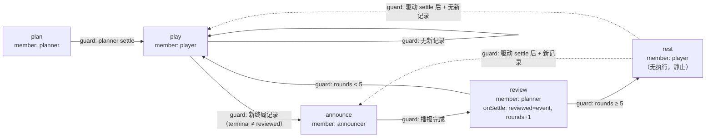
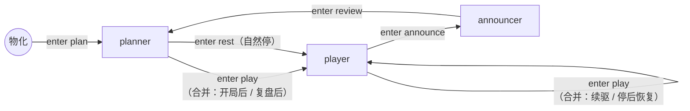
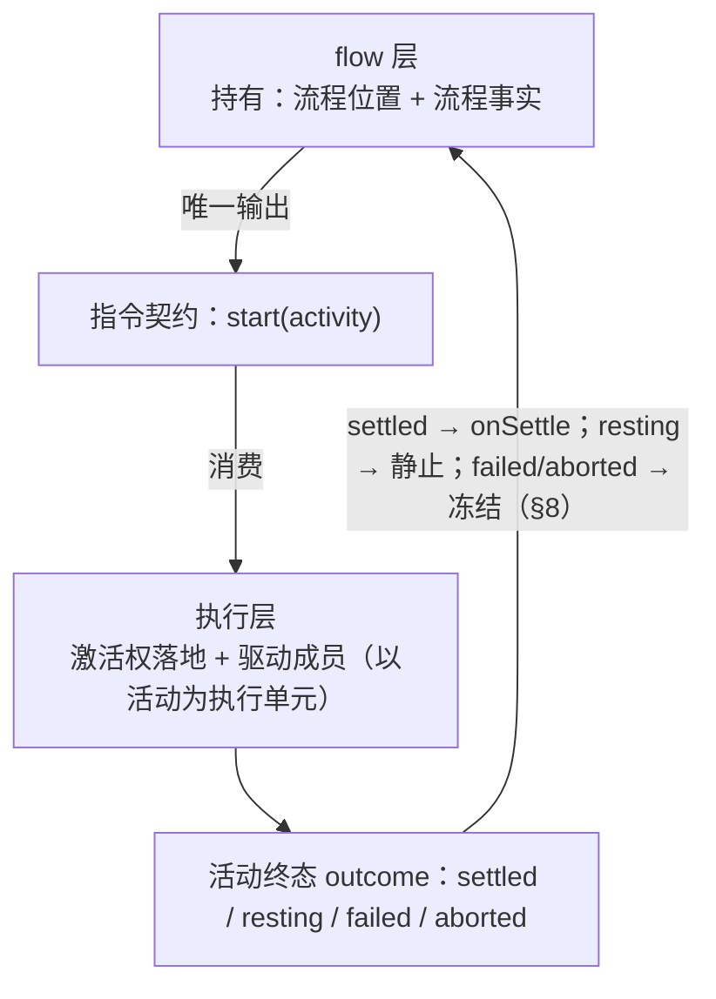
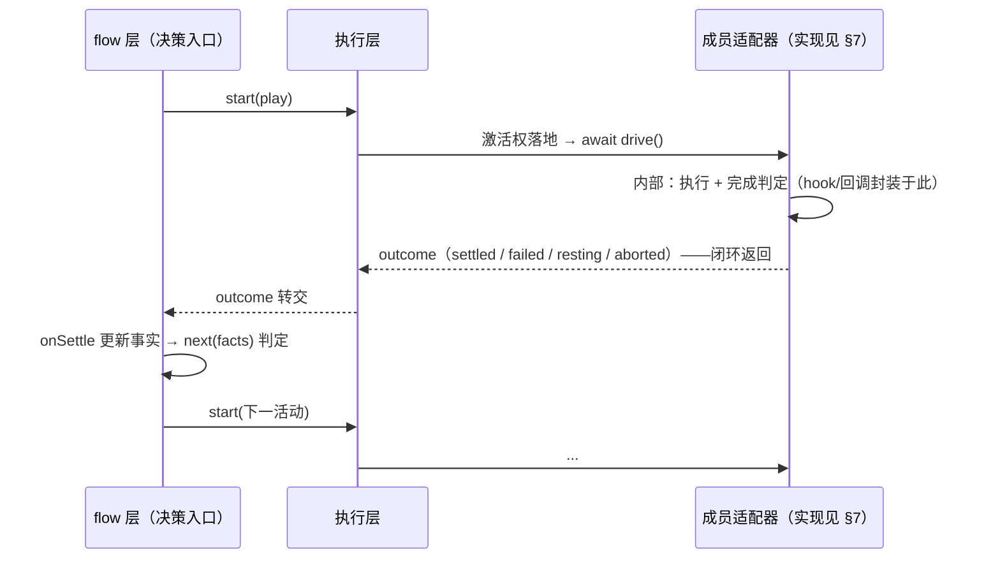
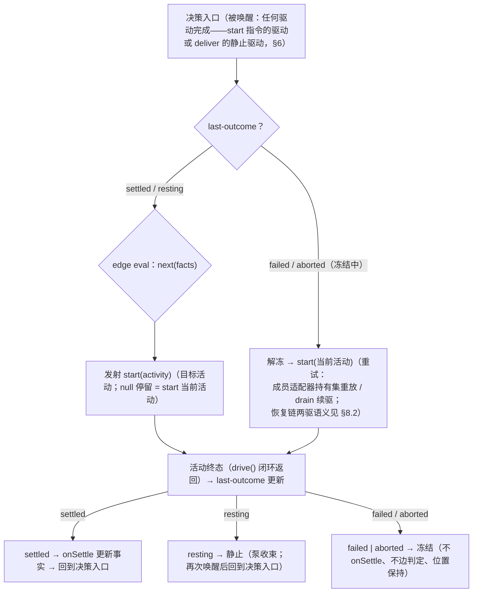
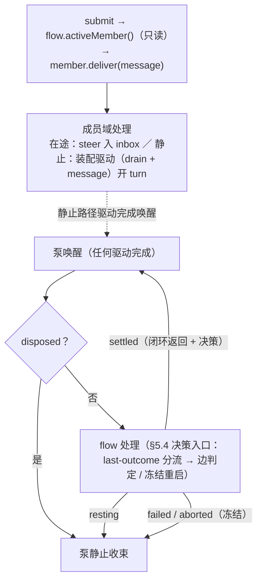

# saolei-loop 成员切换标准化调研（flow 流程控制）

> **性质**：调研与设计讨论的中间产物——现状盘点、主流程（双图关系 F-Moore/F-Mealy、指令边界、层间职责、成员抽象、队列收敛）与异常路径（错误契约、冻结语义、操作路径）均已裁定；技术栈与落地映射待讨论（§12）。
> **代码锚点**：`common/js/dsh-plugins/saolei-loop/src/orchestrator.ts`（切换核心）、`common/js/dsh-plugins/saolei-loop/src/announcer.ts`（系统成员）、`common/js/dsh-plugins/team/src/team.ts`（drain 输入构造）、`projects/game/agent_v2/src/session.ts`（宿主联动）。
> **契约基线**：`specs/059-agent-v2-team-mode/data-model.md` §5（切换锚点）、`specs/059-agent-v2-team-mode/contracts/dsh-plugins.md` §2（编排行为）、`specs/062-team-game-end-handoff/spec.md`（终局收束）、`specs/063-llm-reliability-opencode-go/contracts/orchestrator-turn-outcome.md`（turn 结果观察）、`specs/065-agent-v2-team-refine/contracts/game-stats-broadcast.md` §3（统计播报）、`specs/068-wiki-round-pause/contracts/saolei-loop-round-stop.md`（五轮自然停）、`specs/060-agent-v2-team-optimize/contracts/team-api.md` §1（active_member）。
> **章节分工**：§4 活动指令（定义面）；§5 flow 层与执行层（运行面）；§6 用户消息投递（独立机制，不经 flow 决策）；§7 成员类型与接口实现（实现下沉）；§8 异常路径（错误契约 / 运行异常 / 操作路径）。§4/§5/§7/§8 面向 member 抽象，不出现成员实现类型差异。

## 1. 背景与目标

saolei-loop 的成员切换（player/planner/saolei 交替激活）逻辑集中在 `TeamOrchestrator.nextStep()`（`orchestrator.ts:1119-1174`）：判定、状态赋值、副作用、驱动条件检查混杂在一个函数的四个分支里。引入新切换场景时需要反复描述大量细节（排队交互、静止条件、失败保持）。

标准化目标（2026-10-12 裁定）：**将成员切换作为基本操作**——新切换场景引入时只需声明"何时切换到哪"，不重复描述执行细节。方向：决策升级为 **flow 流程控制**（F-Moore 活动节点图），每次决策研判是否执行流程里的下一个活动；flow 与 agent 驱动分离；**面向代码定义，非自然语言/配置方案，保持简洁**。

**所有 member 一视同仁**（2026-10-12 裁定）：讨论面向 member 而非 member 的实现——用 agent 代替 announce 或用决策树代替 planner 不影响 team 层。终局播报成员（saolei/announcer）的切换同样纳入 flow（实现上 `SaoleiSystemMember` 本就是 `TeamMemberSource` 的 member 实现，`announcer.ts:47-72`）。

## 2. 现状全景

### 2.1 切换的状态载体（orchestrator.ts:488-530）

| 字段 | 语义 |
|---|---|
| `current: TeamRole` | activation——下一条输入的归属成员（对外呈现的激活成员静止值） |
| `phase: "planning" \| "playing" \| "reviewing"` | 工作流相位 |
| `drivingMember` | 在途回合成员（任一时刻至多一个） |
| `queue: UserMessage[]` | 排队用户消息 FIFO |
| `paused` | 取消/失败后的续驱暂停 |
| `pendingReview` | 复盘切换的重试持有（已 drain 输入集 + 终局记录） |
| `reviewedGameEvent` / `statsSentFor` | 已复盘/已播报终局记录（**对象恒等**判据，exactly-once 守卫） |
| `completedRounds` | 自然停计数器 |
| `lastError` | 失败事实（含 `origin: "member-turn" \| "orchestration"` 判别） |

**关键观察——`phase` 与 `current` 是呈现性冗余对**：赋值点全部成对出现（物化 `planning/planner`，orchestrator.ts:606-612；case 3 `playing/player`，:1146-1147；case 4 `reviewing/planner`，:1166-1168），存在不变映射 `{planning, reviewing} ⇔ current=planner`、`playing ⇔ current=player`；`planning` 与 `reviewing` 在决策逻辑中完全等价（:1145 合并判断），仅作日志/快照上下文。F-Moore 图的活动节点即隐含两者，冗余被消除（§5.5）。

### 2.2 决策与执行机制

- **单一决策点**：一切切换/保持决策在 `nextStep()`，仅在 drive settle（idle）后由串行泵 `runPump()`（:1022-1055）求值，无并发路径。
- **优先级**：排队消化（case 1，:1128-1135）> 复盘重试（case 2，:1137-1143）> planner 侧切换（case 3，:1145-1159）> player 侧终局/续驱（case 4，:1161-1173）。
- **统一执行机械** `drive()`（:1210-1247）：三重守卫（输入非空/无并发在途/目标 idle）→ `inject(除末条) + followup(末条)` 单步预声明 → idle 等待先注册后唤醒（:1249-1262）→ 失败标记消费（`agent/error` 订阅 :843-848 在 idle 前写入，drive 返回时读取并清零）。
- **输入零合成**：一切驱动输入 = `drain(目标成员)`（team 服务按锚点派生回读、逐单元消费、exactly-once）+ 排队用户消息；编排层永不构造驱动文本（059 FR-009/FR-010）。
- **上游使能条件**：062 的 `concludesTurn`（工具层收束 seam）使 player turn 在终局工具结果处强制收束，idle 锚点即刻可达——切换链路的事实组成部分（`specs/062-team-game-end-handoff/spec.md` FR-001/FR-004）。
- **现状的 announce 是 S6 的前置副作用**（`announceStats`，:1187-1193）而非流程步骤——标准化后升格为独立活动（§4.2）。

### 2.3 切换/保持场景全景（10 场景）

**真正切换（3 个）**：

| # | 场景 | 触发 | 状态转移 | 驱动 | 特有机制 |
|---|---|---|---|---|---|
| S4 | planner→player 结构切换 | 相位型：planner 静止 | `playing/player` **无条件先行** | 条件性：drain(player) 非空才驱动，空则静止（切换已发生） | 先切状态后看输入 |
| S5 | 五轮自然停 | S4 且 `completedRounds >= 5` | 同 S4 | **不驱动**；计数清零；player relays 不 drain 保留 | 切换无驱动的显式变体；无失败态（`specs/068-wiki-round-pause/contracts/saolei-loop-round-stop.md` §2） |
| S6 | player→planner 终局复盘 | 事实型：`peekGameEvent() !== reviewedGameEvent`（对象恒等） | `pendingReview` 建立 + `reviewing/planner` 三点同帧 | 无条件性：播报保证 drain(planner) 非空 | 前置副作用 `announceStats`（`statsSentFor` 守卫，播报时间戳严格递增排输入集末位）；settle 后在 runPump 消费（:1042-1049，**决策与消费分离**，唯一计数推进点） |

**不切换的保持（7 个）**：

| # | 场景 | 触发 | 机制 |
|---|---|---|---|
| S1 | 物化初始化（:606-612） | materialize 成功 | `planning/planner` 全守卫重置；不驱动，首驱锚定用户首条消息（FR-010） |
| S2 | 排队消化（:1128-1135） | queue 非空（任何相位） | `drain(current)+队首` 驱动当前成员；消化优先于一切切换；失败后排队消息由保持成员 FIFO 消化 |
| S3 | 复盘重试（:1137-1143） | pendingReview 非空 | planner 重放持有输入集；drain 锚点已消费无法重读故必须持有；`statsSentFor` 守卫避免重播报 |
| S7 | player 续驱（:1172-1173） | playing 且无新终局记录 | drain(player) 非空才驱动，无输入静止在 player |
| S8 | 失败保持（:1032-1039, :1070-1093） | drive 失败/步骤 throw | `current` 不动 + `paused` + `lastError`；下次 submit 重驱同成员；`origin` 二分决定流收束方式（063 §2） |
| S9 | 取消（:660-677） | cancel() | `current` 不动 + `paused` + 队列 splice 丢弃落地为历史 + `agent.cancel`；幂等；abort 无 `agent/error` 无失败标记 |
| S10 | 刷新/销毁（:684-725） | dispose | 全部清空成员释放在途回合 cancel；重建即 S1；宿主先 markOutcome ABORTED |

### 2.4 宿主层联动（session.ts——切换状态的消费面，不参与决策）

| 联动点 | 实现 | 语义 |
|---|---|---|
| active_member 呈现 | `toTeamView`（:1009-1021）：`snapshot.active ?? snapshot.activation` | 单一合并值（060 §1） |
| 流收束 | `watchQuiescence`（:777-801）：静止判定 `paused \|\| (active===null && queued===0)`；按 `lastError.origin` 选 `endStreams`（干净）/ `failStreams`（INTERNAL） | 切换驱动的流转承 |
| Send 接入 | `send`（:285-308）：快照先行判断排队帧 → submit → watch | 用户输入是恢复（paused 解除）与首驱的唯一外部来源 |
| Cancel/刷新终态帧 | :318-330 / :674-687 | markOutcome CANCELED/ABORTED 先于编排调用 |

### 2.5 共性与特性

**共性（跨全部场景不变的结构规则）**：单一决策点 + 静止锚点求值；切换 = 状态对原子赋值；输入零合成；空输入即静止；消化优先于切换；至多一个成员在途；失败/取消绝不切换（activation 保持 + paused，恢复靠 submit）；副作用 exactly-once 靠对象恒等守卫；失败重试持有输入；宿主纯派生。

**特性（四个正交差异轴）**：触发源类型（相位型 S4 / 事实型 S6 / 输入型 S2 / 状态型 S3）；切换与驱动耦合（先切+条件驱 S4 / 先切+永不驱 S5 / 副作用保输入+必然驱 S6）；切换前副作用（仅 S6 announceStats）；状态消费位置（nextStep 内同步 S4/S5 vs runPump settle 后 S6——决策与消费分离是失败重试语义的根）。

### 2.6 结构性观察（标准化的动机点）

1. 两种切换模式形态不一致：S4"无条件切状态→条件驱动"vs S6"事实判定→副作用→建持有→必然驱动"。
2. 决策与消费分离：S6 的切换横跨两帧泵迭代。
3. phase/current 冗余对（§2.1）。
4. 自然停是"切换无驱动"特例，复用 S4 状态转移，仅以计数门控驱动步生成；计数推进点却在 S6 消费侧。
5. 上游收束（062）是 S6 可达性的隐含前提，逻辑在工具层不在编排内。
6. announce 作为 review 输入构造的前置副作用存在，saolei 成员未进入切换决策面——与"member 一视同仁"冲突。

## 3. 设计裁定记录（2026-10-12 会话）

1. **整理范围** = 完整链路（orchestrator 状态机 + 宿主联动 + 输入构造）。
2. **标准化目标** = 新切换场景不需重复描述细节，成员切换作为基本操作。
3. **决策/执行分离**：决策（现 flow 层）与执行解耦，经中间媒介连接——初始形态为"切换指令"对象，后升级为 flow 模型（流程位置为决策载体），指令以层间契约形态回归并最终统一为活动指令（裁定 11/12：位置承载决策、指令承载输出）。
4. **排队消化独立**（后续被裁定 17 部分取代）：排队处理不进 flow 逻辑、单独成章（§6）的独立性保持；原"泵第一级 queue gate"的承载机制被裁定 17 取代（deliver 入成员域，queue gate 与编排 FIFO 消失）。
5. **决策升级为 flow 流程控制**：flow 与 agent 驱动分开；面向代码定义，**不做自然语言/配置化方案，保持简洁**；技术栈稍后讨论。
6. **所有 member 一视同仁**：面向 member 而非其实现；announce 成员（saolei）的切换纳入 flow。
7. **双图命名与关系**：**F-Moore 图**（活动节点图，唯一创作结构）——节点 = 活动 + 动作，边 = 条件；**F-Mealy 图**（派生）——从 F-Moore 图衍生，边动作引用 F-Moore 图的节点；**F-Mealy 图移除排队消息消化，仅包含 flow 内容**。成员流转图即 F-Mealy 图，作 coding 参考，不单独创作。
8. **动作位置 = Moore 足够**：全部动作在活动节点上，边纯条件；未来出现跨越特有动作时再引入 transition action（XState 实用主义先例）。
9. **自然停判定在决策层**（最终形态：review→rest 边）；**rest 独立活动节点**（非边携带 suppressDrive 标志）。
10. **接口设计用伪代码**：避免涉及具体实现细节（类型签名、异步形态等留给技术栈裁定后的 plan）。
11. **指令边界**：切换指令仍然存在，作为 flow 层与执行层的**连接**；执行层与 flow 层解耦，**flow 层输出 = 指令**。目的：为 F-Moore 图中的动作划定明确边界——动作 = 指令（或用于生成指令），防止扩张到执行层细节。
12. **活动为唯一操作词汇**（§4 拆分）：指令统一为 `start(activity)`，与 flow 图节点一致；执行层同样以活动为基本单元，**不再使用"切换"概念**（切换 = 进入不同 member 的活动）；活动到具体操作继续下沉执行层。
13. **统一自上而下的调度**（修订：早先"实现与逻辑反过来（控制反转）"的表述是对现状的描述、非目标）：逻辑与实现一致——flow 层 → 指令 → 执行层 → 成员 `drive()` 闭环 → outcome 逐层返回 → flow 决策；hook/回调作为**成员实现的内部**操作（§5.3）。
14. **活动完成保证归执行层**：flow 层不处理"当前活动持有未完成输入"等执行细节；执行层确保每个活动执行到终态（outcome）才回调（§5.4）。
15. **loop 层词汇面向 member 抽象**：活动/指令/执行/投递的对象是 member（"驱动 member"而非"驱动 LLM"）——member 背后不一定是 LLM（announcer 即非 LLM 驱动），team loop 层不关心。**§4/§5/§6 全部以 member 为词汇定义接口；成员类型实现差异单独成章（§7）**，不进入设计面。
16. **活动完成的判断下沉到成员实现层**：执行层只消费 `drive()` 的闭环返回（outcome），不订阅成员内部信号；完成判断集中于各成员类型的**单一适配实现**（LLM agent 成员适配器，§7.1）——不散落到实例或编排场景，team 对 agent loop 插件的复用收敛于一处。
17. **队列收敛到成员域**：用户消息处理完全成员域化——成员接口新增 `deliver(message)`（在途 steer 入 inbox / 静止装配驱动开 turn）；**编排 FIFO 与 queue gate 消失**；完成定义自包含（"inbox 空 + 无在途"涵盖一切用户消息消费，§6.2）；relay 保持 drain 拉动装配（061 FR-005 边界不变）。`specs/061-team-queue-steer/`（已规划未实践）为在途半边的实现方案（steer/inbox/自愈），其静止路径的编排 FIFO（R2）被本裁定取代。

以下为异常路径裁定（2026-10-13 会话，详见 §8）：

18. **错误处理拆分两层**（裁定 16 在错误域的延伸）：成员内部自愈（含引擎 L0）与 loop 层处理（成员上报 + loop 自身）分层——`L0` 引擎（agent-loop llm-retry waterfall，吸收 `DEFAULT_RETRYABLE_CODES` 码集，对上层不可见）→ `L1` 成员适配器自愈（现状留空位）→ `L2` loop 层（只消费上报错误）→ `L3` 用户（permanent 类最终处理）。成员上报的是**穷尽自愈后的最小错误面**。
19. **错误契约：码即分类，每码绑定恢复**（先例：[gRPC status codes](https://grpc.io/docs/guides/status-codes/) 按调用方应做什么选码、[HTTP](https://developer.mozilla.org/en-US/docs/Web/HTTP/Reference/Status) 码绑定恢复 + Retry-After 参数化、dsh-llm 引擎码本就按 fix 分立〔"because the fix differs"〕）：`failed { code, detail }`，code ∈ {TRANSIENT, QUOTA, CREDENTIAL, CONFIG, INPUT_TOO_LARGE, INTERNAL}，每码绑定恢复三维度（同输入重试可行性 / 恢复主体 / 呈现指导）；引擎码 → loop 码映射在 LLM 成员适配器（§7.1）。早先 transient/permanent class 二分被否决（code 退化为无意义标记）。
20. **outcome 四态与冻结**：`aborted` 为第四 outcome（取消/释放打断的闭环诚实返回；gRPC CANCELLED 先例——调用方意图非故障，不写 lastError）；flow 对 failed/aborted 同归**冻结**效果（不 onSettle、不边判定、位置保持）；冻结语义由 **last-outcome 单字段承载**，两种欠账（欠边判定〔settled 后被打断→唤醒后边判定〕vs 欠活动执行〔failed→唤醒后重启当前活动〕）由此自然区分；`aborted` 顺带堵死现状已知竞态（cancel 打断 review 在途时记录被错误消费）。
21. **冻结不门 deliver（恢复零特判）**：frozen 只短路 flow 决策入口；冻结时 deliver 静止装配驱动冻结成员**就是**恢复动作（现状 FR-010 同成员重驱）。恢复链两次驱动：deliver 恢复驱动（= 现状 case 1）+ flow 重启活动重放持有集（= 现状 case 2）——"投递先于重试"由执行顺序结构保持。frozen/lastError 归 flow 层；执行层不再有 paused 概念。
22. **操作路径自顶向下（先定义目标再推导实现）**：cancel 目标 = 终止在途回合（已生成内容保留历史）+ 未消费输入落地为消息历史（不静默丢弃，061 R5 landed）+ 流程位置冻结（事实不消费）+ 等待 deliver 恢复；幂等；**已 frozen 时 cancel 为 no-op**；不产生失败呈现。dispose 目标 = 彻底释放进入终态（在途 aborted 不转交、释放成员/退订/撤销注册、丢弃流程状态——**flow 无生命周期**，纯状态对象随引用消失）；幂等；allSettled 部分失败不阻塞。materialize 目标 = 原子性（全就绪或全回滚，现状满足）。
23. **announcer 统一成员呈现（065 proto 面限制被推翻）**：announcer 是 member 之一——框架支持**统一且完整**的激活成员展示（`active_member` 可为 announcer、入 `GetTeam.members` 名册），不做呈现投影特例；统一逻辑成本更低。激活窗口若无法呈现（announce 成员同步执行、窗口微任务级）是**成员自身问题**与框架无关且可接受。成员 role 名 `saolei` → **`announcer`**（消除与游戏场景名歧义）。现状实现 team 插件层已是 member（`TeamMemberSource` 实现、注册第三成员），proto/宿主面刻意排除（`validateSaoleiMembers` 两成员校验、`toTeamView` 硬编码双成员、`TeamRole` 类型不含）——落地需修改（§12）。
24. 被消解的早期待定项：pendingReview 归属（→ 成员实现内部的执行完整性细节，对 flow 层不可见，§7.1）、决策纯函数化（→ `next` 天然纯、事实更新归活动钩子、`current`/`phase` 赋值被位置迁移取代）、异常路径细化（→ §8 全章）。

## 4. 活动指令（定义面：活动 / 图 / 指令词汇）

> 本章定义静态结构：活动是什么、图怎么画、指令词汇是什么。运行面见 §5；用户消息投递见 §6；成员实现见 §7。

### 4.1 活动定义（伪代码）

```
活动（Activity）—— flow 图的节点，指令的目标单元（BPMN Task / XState state / SFN Task 的对应物）：

  id            活动标识
  member        执行者绑定（激活权归属）
  onSettle()    可选；活动成功后（outcome = settled）的流程事实写入
                （如 review：reviewed 置位、rounds+1）；flow 层内部状态更新，不经指令通道
  next(facts)   出边判定（纯谓词，只读事实）→ 目标活动 或 停留
                （null = 继续当前活动，即续驱）

  活动的执行方式不在此定义——归执行层对成员的驱动（§5.2），成员实现见 §7
```

```
事实（Facts）—— 边判定的只读输入（不含任何排队信息）：

  terminal   最新终局记录（拉取自游戏运行时）
  reviewed   已复盘终局记录（对象恒等判据）
  rounds     已完成轮计数
```

### 4.2 F-Moore 图：活动节点图（唯一创作结构，saolei 实例化，5 活动）



**边表**（边判定仅在活动执行完成（settled）后求值；静止中不求值——物化后、入 rest 后泵直接静止）：

| 边 | guard | start 目标活动的效果 |
|---|---|---|
| plan → play | planner settle，无条件 | 激活权→player；驱动 player（空输入则静止） |
| play → announce | player settle + `terminal ≠ null && terminal ≠ reviewed` | 激活权→announcer；驱动 announcer（播报语义，§7.2） |
| play → play（停留） | player settle + 无新记录 | 激活权不变；续驱（空输入则静止） |
| announce → review | announcer settle，无条件 | 激活权→planner；驱动 planner（announcer 产出已入广播流，输入保证非空） |
| review → play | review settle + rounds < 5 | 激活权→player；驱动 player |
| review → rest | review settle + rounds ≥ 5 | 激活权→player；无执行（静止）；rounds 清零；planner 产出保留不消费 |
| rest → announce | rest 下驱动 settle 后 + 新记录 | 激活权→announcer；驱动 announcer |
| rest → play | rest 下驱动 settle 后 + 无新记录 | 激活权→player；驱动 player |

对照 `specs/068-wiki-round-pause/data-model.md` §8 状态图：其 Counting 不是活动（是 review 的 onSettle）；Stopped 即 rest。announce 独立成活动后：**全部 LLM 活动的输入构造统一为 drain**（成员实现细节，§7.1），review 的输入构造零特例。

**跳局不补发语义**：guard 对**最新**终局记录求值（`peekGameEvent()` 持有 LATEST 记录），被新局覆盖的旧记录永不满足 guard——065 §3 item 4 的"跳局不补发"由 guard 语义自然导出。

### 4.3 F-Mealy 图：派生的成员流转图（coding 参考，不单独创作）

**衍生规则**（标准 Moore→Mealy 变换 + 按 member 商坍缩）：

> 对 F-Moore 图的每条边 u→v，产生 F-Mealy 边 (member(u) → member(v))，**边动作 = 引用被进入的 F-Moore 活动节点 v**；成员对相同且目标活动相同的边**合并**；初始边 INIT → member(初始活动)。**投递产生的驱动不出现在 F-Mealy 图**（仅含 flow 产生的转移；投递是独立机制，§6）。

合并现象正是"条件必须住在 F-Moore"的形式化证明：`plan→play` 与 `review→play` 在 F-Mealy 上合并为一条 planner→player（enter play）——同一 A→B 操作出现在不同阶段，成员流转无法独立表达条件语境。



运行时投影：激活权 = 当前活动的 member——宿主 active_member 呈现、日志、广播 sender/receiver 关系消费的都是这张图的序列。**激活呈现统一且完整**（裁定 23）：announcer 与其他成员同权出现在 active_member 与成员名册（065 proto 面限制被推翻，修订面见 §12）——无呈现投影特例；announce 成员同步执行的激活窗口是否可被呈现观察是成员自身特性，与框架无关。**它作为派生视图存在，永不作为第二个被创作的结构**。

### 4.4 指令词汇（伪代码）

```
指令（Command）—— 以活动为单元，与 F-Moore 图节点一一对应：

  start(activity)    进入并执行一个活动
                     效果：
                       1. 激活权归属 activity.member——"成员切换"的语义载体：
                          start 不同 member 的活动即切换，同 member 即续驱/重试；
                          无独立的"切换"指令
                       2. 执行层驱动该成员完成活动并保证到达终态（§5.2/§5.4）
```

```
活动终态（outcome）—— 成员 drive() 的闭环返回（经执行层转交，§5.3）：

  settled    活动执行成功完成 → 触发 onSettle
  resting    活动进入静止（rest 活动本身 / 成员无可执行输入，未开始执行）
             → 泵收束；再次唤醒后回到决策入口
  failed     活动执行失败（穷尽成员自愈后的上报，§8.1 错误契约）
             → 冻结：携带 { code, detail }，恢复语义见 §8.2
  aborted    活动被取消/释放打断（调用方意图，非故障——gRPC CANCELLED 对应物）
             → 冻结：不写失败事实（lastError），与 failed 同归冻结效果（§8.2）
```

**动作边界规则**（裁定 11 的显式化，随裁定 12/15 统一到活动与 member 词汇）：

1. F-Moore 图上的一切动作 = **指令发射**（以及用于生成指令的纯计算：guard 求值、事实读取）——边永远是纯条件，节点动作永远是"start 哪个活动"；
2. 流程事实写入（onSettle：`reviewed`/`rounds`/`statsSentFor`）是 flow 层内部状态更新，**不经指令通道**；
3. **指令集合即边界词汇表**：新场景需要新的世界效果 = 必须扩展指令契约——扩张点显式、可审查，是"防止动作扩张到执行层细节"的机制化保障；
4. 执行层不读 flow 内部状态（位置/事实），只消费指令与回报 outcome；flow 层不触碰执行细节（成员驱动、消费锚点、执行完整性）。

## 5. flow 层与执行层（运行面）

### 5.1 逻辑视角：flow 层指挥执行层



flow 层职责：边判定（next）、指令发射（start）、事实更新（onSettle）。执行层职责：激活权落地、成员驱动、活动完成保证。

### 5.2 执行层：成员接口与活动执行

```
成员（Member）接口 —— team loop 层的执行单元抽象；loop 不关心成员背后是什么
（LLM agent、播报器、或将来的其他类型，§7）：

  drive(input?)   驱动该成员执行一步——闭环调用：发起（输入注入）→ 成员执行
                  → 完成判定 → 返回 outcome；执行层 await 其返回，
                  不订阅成员内部信号
                  outcome：
                    settled    执行成功完成
                    failed     执行失败——携带 { code, detail }（错误契约，§8.1；
                               成员穷尽自愈后按恢复路径分类上报）
                    resting    无可执行内容（未开始）
                    aborted    被取消/释放打断（操作路径，§8.3）
                  完成的判断是成员实现的内部职责（§7.0 类型学；LLM agent 成员的
                  静止判定见 §7.1）；可选 input 显式覆盖成员默认输入构造
                  （重试路径，§8.2）
                  drive() 不 throw 契约：一切内部失败转译为 failed 返回，
                  闭环不破裂（§8.1 成员承诺）
  deliver(message)  向成员投递一条用户消息——成员保证最终处理（§6）：
                      在途（本成员 drive 未返回）→ steer 入 inbox，随当前
                        执行区间消费（下一 step / 自愈 turn）
                      静止 → 装配驱动（drain + message）开 turn
                    投递不经 flow 决策；仅对可接收输入的成员有意义
                    （announce-only 成员 consumes=false，不适用）
  消费/产出的具体形态由成员类型实现（§7）——同一接口下的不同实现，
  loop 层（§4/§5/§6）无感知
```

```
执行层 —— 以活动为执行单元，驱动对象是 member：

  start(activity) 的执行：
    1. 激活权落地 → activity.member（呈现 / 日志 / 驱动权归属）
    2. 驱动：await activity.member.drive()（rest 活动不驱动——静止是活动语义，
       非成员能力差异）
    3. 将闭环返回的 outcome 转交 flow 层
  执行完整性（失败重试、持有输入重放等）在本层及成员实现内部处理，
  对 flow 层不可见（恢复链与优先级语义见 §8.2）
  执行层不使用"切换"概念：激活权转移只是 start(activity) 的效果之一
```

### 5.3 调度模型：统一的自上而下（hook 下沉为成员实现内部）

**逻辑与实现一致**——统一的自上而下调度链（裁定 13，修订早先"实现与逻辑反过来"的表述：那是对现状的描述，非目标）：

```text
flow 层 → start 指令 → 执行层 → 成员 drive() 闭环（执行 + 完成判定）
        → outcome 逐层返回 → flow 层决策 → 下一条指令
```

- 活动的执行是**闭环**的：`drive()` 从发起（输入注入）到 outcome 返回是一个完整因果区间——本次驱动引发的一切被执行完毕（或明确失败）；这正是"活动完成保证"（裁定 14）的实现基础；
- **hook/回调是成员实现的内部操作**（裁定 16）：完成信号的等待与判定（如 LLM 成员对 agent 静止信号的订阅，§7.1）封装在成员实现内，转译为 `drive()` 的返回值——执行层与 flow 层不感知任何成员内部信号；
- **现状对照**：当前编排器直接订阅成员的 `agent/status`/`agent/error`（orchestrator.ts:832-848），并在编排器内维护 idle 等待机械（:1249-1262）——完成判断物理上位于编排层。目标形态将这段整体下沉到成员适配器（§7.1），编排层不再接触 agent loop 信号。



先例：AWS Step Functions 的 [activity worker](https://docs.aws.amazon.com/step-functions/latest/dg/concepts-activities.html) 拿到任务后**自含执行与完成回报**（运行完毕以 `SendTaskSuccess` 收尾、引擎侧等待）——正是成员闭环的形态（§5.7）。

### 5.4 flow 层内部结构（决策入口，无执行细节）

flow 层状态 = 位置 + **last-outcome**（上次活动终态，冻结语义的载体，裁定 20）：



- **两种欠账由 last-outcome 自然区分**：settled 后被打断（cancel 竞态）→ 唤醒后边判定（065 幸存播报场景由该链承载）；failed → 唤醒后重启活动（review 失败重放持有集，而非按 rounds 边判定跳过）——现状 `nextStep` 重研判 + case 2 优先的隐式结构显式化；
- flow 层**不处理**"当前活动持有未完成输入"之类的执行细节（裁定 14）——执行完整性（含重试、持有输入重放）是执行层与成员实现的职责；flow 层收到的每个 outcome 都已是活动终态。

### 5.5 状态归属（三层）

| 层 | 内容 | 归属 |
|---|---|---|
| 流程位置 | 当前活动 id | flow 层——**取代 `phase`+`current` 冗余对**（活动即隐含激活权与工作流相位） |
| last-outcome | 上次活动终态（settled/resting/failed/aborted） | flow 层——冻结语义与唤醒后动作选择的载体（裁定 20，§5.4） |
| 失败事实 | `lastError`（code/detail/origin 派生）+ 冻结态 | flow 层（裁定 21）——执行层无 paused 概念，宿主快照由此派生（§8.2） |
| 流程事实（跨活动共享） | `reviewed`、`statsSentFor`、`rounds` | flow 层 state 对象，活动钩子可写、边判定只读 |
| 活动执行状态 | 持有输入集等执行细节 | 执行层与成员实现内部（对 flow 层不可见，§5.2/§7.1） |
| 未消费用户消息 | landed（取消落地） | 执行层（裁定 22；装配点统一 flush，§6.1/§7.1） |

呈现兼容：宿主 snapshot 的 `phase` 可由活动 id 派生（plan→planning、review→reviewing、play/rest→playing），激活权 = 活动的 member。

### 5.6 决策入口的唤醒源与外部事实

0. **活动终态 outcome**（settled / resting / failed / aborted）——`drive()` 的闭环返回（经执行层转交），决策入口的唯一唤醒源；驱动的发起者可能是 flow 的 start 指令，也可能是 deliver 的静止路径（§6，对 flow 同样不可见差异）；完成信号的类型相关实现封装在成员内部（§7.0 类型学，裁定 16）；aborted 到达时 flow 同样被唤醒（进冻结分支，§5.4）；
1. **外部事实**：`peekGameEvent()`（orchestrator.ts:1161）——游戏运行时的拉取式事实，与成员类型无关；终局记录在工具执行内、成员完成前写入（062 concludesTurn 保证完成时事实就绪——边判定可达性的上游使能条件）。

用户输入（`submit`）不进 flow——经投递进入成员域（§6）；其静止路径驱动的完成才间接唤醒决策入口（在途路径不产生新唤醒——消费含于在途 drive 的完成语义）。

### 5.7 外部框架先例（检索结论，2026-10-12）

"flow 状态与执行者非一一对应"是流程编排领域的经典结构，成熟框架的共识处理方式：

| 框架 | 图的形态 | 执行者绑定 | 条件位置 |
|---|---|---|---|
| BPMN 2.0（[OMG 规范](https://www.omg.org/spec/BPMN/ISO/19510/PDF) §9.3/§10.3） | 活动（Task）节点 + 顺序流边 | 活动 carry Resource/Performer 绑定；泳道（Lane）是**正交的组织投影**（[Camunda 参考](https://camunda.com/bpmn/reference/)、[Lane 语义](https://processcamp.io/bpmn-elements/swimlanes/lane)）——多活动同执行者合法 | 边/Gateway |
| 工作流视角理论（van der Aalst，[Workflow Resource Patterns](https://www.vdaalst.com/publications/p254.pdf)） | 控制流视角 = 活动 + 排序 | **资源视角正交**，经"活动→资源分配"映射连接 | 控制流视角内 |
| XState（[v4 actions 文档](https://stately.ai/docs/xstate-v4/xstate/xstate/actions)） | 状态节点 + 转移边 | 动作可放状态 entry/exit（Moore 式）或转移上（Mealy 式），按"行为属于状态还是跨越"选择 | guard（`cond`）在边上 |
| AWS Step Functions（[Task state](https://docs.aws.amazon.com/step-functions/latest/dg/state-task.html)） | Task 状态节点 + Next/Choice 边 | Task carry `Resource` 字段（执行者绑定）；[activity worker](https://docs.aws.amazon.com/step-functions/latest/dg/concepts-activities.html) 自含执行、以 `SendTaskSuccess` 完成回报 ≈ 我们的成员闭环（§5.3） | Choice 纯条件 |
| Netflix Conductor（[tasks](https://github.com/conductor-oss/conductor/blob/main/docs/devguide/concepts/tasks.md)） | 工作流图 = 任务引用节点 | task definition / configuration / execution 三概念分离；worker 按 task type 轮询、[与工作流解耦](https://github.com/Netflix/conductor/issues/1905) | 图内表达式 |

**共识模式**：流程图节点是**活动**——携带执行者引用；执行者中心视图（BPMN 泳道）是派生组织投影，从不单独建模；条件在边上；执行是异步握手——执行者自含执行并以完成回报驱动推进（与我们的成员闭环一致，§5.3）。Conductor 的 definition/placement 分离是活动跨流程复用规模化的形态，当前规模（单流程 5 活动）不采用，作为演进位记录。

**两个反例排除"flow 节点 = 成员图边"（线图）方案**：announce 一个活动投影两条成员转移（player→announcer→planner），线图会制造无语义节点；E1/E2 执行语义相同（驱 player），线图会碎片化共享语义的活动。正确关系是 §4.3 的商投影。

## 6. 用户消息投递（独立机制，不经 flow 决策）

> **裁定（2026-10-12）**：用户消息的处理完全收敛到成员域——编排 FIFO 与 queue gate（泵的第一级）消失，外壳只剩投递分发；投递仍然独立于 flow（不经 flow 决策、不触碰 flow 状态）。`specs/061-team-queue-steer/`（已规划未实践）是在途半边的实现方案（steer → 成员 inbox / 自愈），本裁定将其静止半边一并收敛——061 R2 的静止路径编排 FIFO 被取代。

### 6.1 投递路径（成员自适应）

```text
submit（外壳）
  → 查询当前激活成员（flow.activeMember()，只读接触点）
  → member.deliver(message)

member.deliver(message)——成员适配器内部自适应（LLM 成员，§7.1）：
  在途（本成员 drive 未返回）
      → steer：消息入成员 inbox 的 next-step 队列，随当前执行区间消费——
        下一 step 边界随工具结果之后进入（mid-turn），turn 收束则自愈
        （同 turn 延展 / wake 新 turn）【061 R1/R3】
  静止
      → 装配驱动：drain(自己) + message（+ landed flush，统一规则）→ 开 turn
        【原 queue gate 消化的装配逻辑，位置移入适配器】
```

编排 FIFO 与 queue gate 消失：消息要么进 inbox（在途）、要么立即装配驱动（静止）——没有等待轮询的队列。多消息时序随之变化：静止时连发 A、B——A 的 turn 内 B 经 steer mid-turn 进入（或 turn 收束后自愈消费）——**061 已裁定的语义方向**（US1/US2），非新增偏离。

### 6.2 完成定义的自包含性

完成定义（"inbox 空 + 无在途回合"，§7.1）统一涵盖**一切**用户消息消费：

- 在途 steer 的消费含于 idle 语义——dsh 的 running 覆盖 consecutive turns（含 steer 自愈 turn），`drive()` 的 idle 等待直到消费完成才返回（061 R3）；
- 静止装配驱动的完成即该驱动的 idle；
- 外壳与 flow 层均无需查询任何队列状态做完成判断；静止判定的竞态兜底（成员 idle 但 inbox 有残留的极窄窗口，061 R4 的 `inbox.hasPending` 检查）是适配器内部机械。

### 6.3 与 flow 的关系（投递独立于 flow 决策）

- 投递不经 flow：submit → deliver 即时处理（静止路径直接开 turn），flow 不参与；
- deliver 静止路径开的 turn 对 flow 不可见（不触发 `onSettle`、不消费流程事实）——与"驱动不触碰 flow 状态"一致；
- 该 turn 完成后泵唤醒 flow 决策入口——世界状态已变（新广播、可能有新终局记录），flow 重新研判；**判定依据始终是事实，不是投递动作本身**；
- F-Moore 图的 rest 出边 guard 相应为"驱动 settle 后"（任何驱动完成即研判，§4.2）。

### 6.4 两类输入消息的分层

| 消息类型 | 进入方式 | 语义根据 |
|---|---|---|
| 用户消息 | **推进式**：deliver → inbox（在途）/ 装配驱动（静止） | "给成员的输入"——dsh inbox 原生域（next-turn / next-step 双列表、三入口、claim 批语义） |
| 团队广播（relay） | **拉动式**：驱动装配时 drain（exactly-once 锚点） | "驱动装配时的团队上下文快照"；061 FR-005 边界保持（relay 仍在装配边界消费，team 只投递不驱动） |

### 6.5 外壳与执行层结构（queue gate 移除后）



执行层持有：投递分发（submit → deliver）、drive 机械、cancel/dispose 生命周期（§8.3）。泵不再有排队判断级——迭代即 flow 决策；frozen 不门泵（裁定 21：冻结期间 flow 不发射 start，唯一驱动源是 deliver——泵被唤醒必是恢复驱动完成，进 §5.4 冻结分支后重试或再次冻结，无空转）。此结构与现状 `runPump` 的行为对照：现状 case 1（编排 FIFO 消化，orchestrator.ts:1128-1135）的职责整体移入成员适配器与外壳分发；现状 `paused` 短路（while 条件）被 flow 冻结分支取代。

## 7. 成员类型与接口实现

> §4-§6 面向 member 抽象（裁定 15）；本章下沉：不同类型的成员如何实现 §5.2 的成员接口（重点是**活动完成的判断**，裁定 16）。team loop 层不关心这些差异——announce 成员背后不是 LLM，与 LLM agent 成员在同一接口下被同权驱动。

### 7.0 完成判定的类型学（裁定 16 的落点）

| 成员类型 | 完成判定 | 内部机械（hook/回调封装处） |
|---|---|---|
| LLM agent 成员 | agent 静止：inbox 消费完毕 + 无在途回合（精确语义见 §7.1） | 订阅 `agent/status` 的 idle 转移；`agent/error` 先于 idle 到达 → failed |
| announce-only 成员 | 播报同步返回 | `announce()` 返回即 settled |
| （未来）人机交互成员 | 用户操作返回 | 内部等待用户事件 |
| （未来）服务成员 | 服务调用返回 | RPC/HTTP 响应 |

**复用收敛**（对"完成判断下沉是否让 team 对 agent loop 的复用复杂化"的回答）：完成判断的落点不是每个 agent 实例，而是各成员类型的**单一适配实现**——LLM agent 成员适配器是所有 LLM 成员（player/planner/未来）的共用单元，也是 team 对 agent loop 插件的**唯一接触点**；编排场景与 flow 定义零接触 agent loop 信号。现状对照：订阅与 idle 等待机械当前在编排器内（`orchestrator.ts:832-848` / `:1249-1262`，与编排逻辑耦合）；下沉后从"编排器"收敛到"独立成员适配器"——编排器换场景不需重写完成判断，agent loop 升级只动适配器。

### 7.1 LLM agent 成员（player / planner）

`drive()` 的实现——机械沿用现状（`orchestrator.ts`），归属从编排器移入成员适配器：

```
输入构造     drain(member)：team 服务按锚点派生回读成员待消费广播、逐单元标记消费、
             exactly-once（common/js/dsh-plugins/team/src/team.ts）；空 → resting
驱动         inject(除末条) + followup(末条) 单步预声明（:1210-1247 三重守卫：
             输入非空 / 无并发在途 / 目标 idle）；完成等待在注入前注册
             （:1249-1254，防丢失 idle 转移）
投递分流     deliver(message)（§6.1）：
               在途（drive 未返回）→ member.agent.steer(message)：消息入 dsh inbox
               的 next-step 队列，下一 step 边界 claim（工具结果之后的独立用户
               消息块）；turn 收束时 dsh 原生自愈（pending 使 turn 延展或
               wake 新 turn）【061 R1/R3】
               静止 → 装配 [drain(自己)..., message] → inject + followup 开 turn
               （原 queue gate 消化装配移入，061 R2 的 FIFO 路径被取代）
             landed flush（取消落地消息，061 R5）：任何开 turn 前统一 flush
             （来源无关的解耦规则，位置随装配点）
执行完整性   失败后的持有输入重放在本层（drain 锚点已消费无法重读故持有，对 flow 层
             不可见；重试触发 = flow 冻结重启的 start(当前)〔§8.2〕，投递先于重试
             由执行顺序结构保持）
```

**错误码映射（引擎最终失败码 → loop 契约码，裁定 19 的 LLM 成员落点；穿透上来的必然是 L0 waterfall 穷尽后的最终失败——063 §1）**：

| 引擎码（`LlmError.code`） | loop 码 | 依据（恢复路径） |
|---|---|---|
| `RATE_LIMIT` / `SERVER` / `TIMEOUT` / `TRANSPORT` / `EMPTY_RESPONSE`（穷尽后） | `TRANSIENT` | 时移重试可能成功 |
| `QUOTA` / `ACCOUNT_QUOTA` | `QUOTA` | 充值/配额重置前必败 |
| `INVALID_CREDENTIAL` / `MISSING_CREDENTIAL` / `AUTH` | `CREDENTIAL` | 修正凭证前必败 |
| `NO_ADAPTER` / 模型不存在 / 端点错误 | `CONFIG` | 修正配置（重新物化）前必败 |
| `CONTEXT_WINDOW_EXCEEDED` / `IMAGE_OFFLOAD_REQUIRED`（未自愈穿透） | `INPUT_TOO_LARGE` | 同输入必败，缩减后可重试（L1 自愈留空位） |
| `INVARIANT` / 非 LlmError / 适配器自身异常 | `INTERNAL` | 大概率重试失败，开发者介入 |

**完成判定的精确语义**（活动完成标准在 LLM 成员上的形态）：

1. **完成 = agent 静止，而非单个 turn 结束**：一次 drive 注入的消息集可能引发连续多个 turn（steer 自愈 turn、agent inbox 内的排队输入）——完成是**本次驱动引发的整个执行区间收束**（drive 的因果闭环，§5.3），且涵盖该区间内经 deliver 投递的一切消息（§6.2）；
2. **静止的精确定义**（按 061 FR-006 修正后的表述，替换 059 §5 的旧触发源枚举——"工具调用引发的后续 turn"在 dsh 语义中不存在，工具欠账延续同 turn 的下一个 step）：**turn 已结束（dsh 语义：成员本轮全部工作完成、不再有新的模型调用）且无待消化输入**（inbox pending 为空——含经 deliver 投递未消费的消息）；
3. **机械信号**：`agent/status` 的 idle 转移——running 覆盖连续排队 turn 与 turn-close checkpoint，idle 即整个区间 settled（dsh-agent-loop 0.2.0-rc.2 语义，`orchestrator.ts` 头注释 :36-41 锚定）；
4. **失败边界**：`agent/error` 是失败 turn 的活跃边界、**先于 idle 到达**（063 §1）——idle 时读取失败标记，有标记则完成形态 = failed；
5. **收束使能**：062 concludesTurn 使终局工具结果强制收束 turn——完成时点不依赖模型自律停手（"player 玩到终局即完成"可靠成立的上游条件，`specs/062-team-game-end-handoff/spec.md` FR-001/004）。

### 7.2 announce-only 成员（announcer）

`drive()` 的实现（`common/js/dsh-plugins/saolei-loop/src/announcer.ts`，role 名 `saolei` → `announcer`，裁定 23）：

```
恒等守卫     statsSentFor 记录恒等判据——同记录不重复播报（065 §3；冻结重试的
             exactly-once 由守卫保证，恢复链推演见 §8.2）
执行         gameStatsText(record) 渲染统计文本 → announcer.announce：
             内存 log 追加 assistant/message 形态事件（唯一 MessageId、单 text block）
             + 同步通知订阅者（announcer.ts:87-112；时间戳严格递增，保证产出排在
             下游成员输入集末位）
完成语义     同步完成 → settled（激活窗口微任务级，是否可被呈现观察是成员自身
             特性，与框架无关——裁定 23）
错误上报     渲染/播报异常 → failed{code: INTERNAL}（实现错误）
广播机制     产出经 team 广播自然流入其他成员待消费列表（source 即为此设计，
             announcer.ts:47-72）——因此 announce→review 后 planner 输入保证非空，
             无需任何输入构造特例
```

### 7.3 扩展位（未来成员类型）

人机交互成员（drive = 等待并回收用户操作）、工具/服务成员（drive = 调用外部服务）等——实现成员接口（§5.2）即可被 flow 编排（新活动 + 边定义，§10），flow 层与执行层零改动；错误上报直接按 loop 契约码选码（§8.1）。

## 8. 异常路径（错误契约 / 运行异常 / 操作路径）

> 裁定 18-23（2026-10-13）。本章分两节：**运行异常**（§8.2，系统正常运行中成员上报 failed 与 loop 自身异常）与**操作路径**（§8.3，cancel/dispose 等宿主操作——自顶向下：先定义操作目标，再推导实现）。错误契约（§8.1）是两者的接口词汇。

### 8.1 错误契约（member ↔ loop 层接口）

**设计原则**（检索先例）：码按"消费方接下来该做什么"划分，不按故障成因划分——[gRPC status codes](https://grpc.io/docs/guides/status-codes/) 的 FAILED_PRECONDITION 选码指导明示三分（"client can retry just the failing call" → UNAVAILABLE / "retry at a higher level" → ABORTED / "not retry until the system state has been explicitly fixed" → FAILED_PRECONDITION）；[HTTP](https://developer.mozilla.org/en-US/docs/Web/HTTP/Reference/Status) 码绑定恢复并以参数细化（429/503 + `Retry-After`、413 "might return Retry-After"、431 "resubmitted after reducing"）；引擎 dsh-llm 的规范码本就按 fix 分立（`INVALID_CREDENTIAL` vs `MISSING_CREDENTIAL` "because the fix differs"、`EMPTY_RESPONSE` "safe to repeat"、`IMAGE_OFFLOAD_REQUIRED` 携带恢复参数 `offloadImages`，`error.d.ts`）。**恢复相同即同码，成因差异进 detail。**

```
错误自愈分层（由内到外，裁定 18；错误处理拆分两层的落点）：

  L0  引擎层（agent-loop llm-retry waterfall）——吸收 DEFAULT_RETRYABLE_CODES
      = [EMPTY_RESPONSE, RATE_LIMIT, SERVER, TIMEOUT, TRANSPORT]（dsh-llm
      index.js:251）+ 指数退避；未决不 throw、无 agent/error，对上层不可见
      ——覆盖大部分 LLM 瞬时错误（063 §1 实证）
  L1  成员适配器内部——成员类型相关自愈（现状留空位；演进位：
      INPUT_TOO_LARGE 的压缩/offload 重试——引擎已有 image offload 机械）
  L2  loop 层（flow + 执行层）——只消费成员上报的 failed{code}（§8.2）
      + loop 自身异常（不经成员接口）
  L3  用户——QUOTA/CREDENTIAL/CONFIG 类的最终处理
```

**码表与恢复绑定**（`failed { code, detail }`；detail = {engineCode?, message}，loop 层透传呈现/日志不解读）：

| code | 语义 | 同输入重试 | 恢复动作与主体 | 呈现指导 |
|---|---|---|---|---|
| `TRANSIENT` | 瞬时故障（L0 穷尽后） | **可能成功**（时移） | 重试同活动；现状 = 冻结等 deliver 恢复；演进位 = 执行层自动退避重试 | "服务暂不可用，稍后重试" |
| `QUOTA` | 配额/余额耗尽 | 补充前**必败** | 用户充值或等配额重置 | "配额耗尽" |
| `CREDENTIAL` | 凭证无效/缺失 | **必败** | 用户修正存储的凭证值 | "检查 API 凭证" |
| `CONFIG` | 配置/路由错误 | **必败** | 用户修正配置后**重新物化**（流程位置不保留——裁定确认） | "模型配置错误" |
| `INPUT_TOO_LARGE` | 输入超出可执行范围 | 同输入**必败**，缩减后可 | 成员 L1 自愈（演进位）；不能自愈时用户缩减输入 | "上下文超限" |
| `INTERNAL` | 实现错误/不变量违反/不可分类 | 大概率失败 | 开发者介入（日志 + detail 诊断） | "内部错误" |

每码回答三个维度：同输入重试可行性 / 恢复主体（成员 L1、执行层、用户、开发者）/ 呈现指导。**诚实标注**：现状 loop 层对六码的执行行为统一为冻结（§8.2）——契约的即时价值在呈现指导（宿主按码告知用户该做什么）与成员诚实分类的对齐目标；差异化执行（TRANSIENT 自动重试、INPUT_TOO_LARGE 自愈）是演进锚位，绑定先于实现。

**双方承诺**：

```
成员承诺：1. 自愈最大化（L0/L1 吸收，自愈过程对上层不可见）
          2. 最小上报（failed 一定是穷尽自愈后的最终失败）
          3. 码即恢复（按恢复路径选码；映射表是成员实现的一部分，LLM 成员见 §7.1）
          4. 状态一致（failed 返回后成员处于可重驱一致状态——恢复语义的前提）
          5. drive() 不 throw（一切内部失败转译 failed 返回，闭环不破裂；
             技术性 throw 由执行层在 start 调用点兜底转译）

loop 层承诺：1. 按码执行恢复绑定；不解读 detail
             2. failed 后不弃成员（位置冻结 + 同成员恢复）
             3. 取消走 aborted 独立通道（不伪装 failed）
             4. loop 自身异常不经成员接口：直接进冻结通道，
                code 恒为 INTERNAL、origin=orchestration（快照判别保持 063 §2
                流收束：member-turn → endStreams 干净 / orchestration →
                failStreams INTERNAL）
```

### 8.2 运行异常

**failed/aborted 的冻结语义**（裁定 20/21；状态与图见 §5.4/§5.5）：

- 冻结效果：不 onSettle（流程事实不消费——rounds 不加、reviewed 不置位）、不边判定、位置保持；flow 记录 last-outcome + lastError（aborted 不写失败事实）；
- 唤醒后动作由 last-outcome 分流：settled/resting → 边判定；failed/aborted → 解冻重启当前活动（start(当前)——同 member 同活动即重试，§4.4）；
- **恢复链 = 两次驱动**（与现状逐点等价）：冻结时 submit → deliver 静止装配驱动冻结成员（= 现状 case 1 消化，"投递先于重试"由执行顺序结构保持）→ 唤醒 → flow 重启活动（成员适配器持有集重放 = 现状 case 2）→ settle → onSettle → 边判定；
- 065 幸存播报场景由"欠边判定"链承载：play settle 后（微任务间隙）cancel → 冻结于 settled → 恢复 → 边判定 → 新记录 → announce——记录不丢失；
- lastError 清除 = 重启活动 settle 成功后（对应现状 :1041）。

**执行层保持的（很少，裁定 18 的 L2 薄层）**：start 调用点的兜底转译（技术性 throw → failed{INTERNAL, orchestration}）、deliver 装配异常（同转冻结通道；disposed/unmaterialized 状态校验保持同步 throw——调用方错误非故障）、cancel/dispose 生命周期（§8.3）。

**宿主联动**：快照 `paused` ← 冻结态、`failed`/`lastError`（code 透传）← flow 失败事实、`queued` ← steered-unclaimed（061 R4；landed 不计，R5）；code → 用户动作文案的映射归宿主/前端（loop 层不产出文案）。

### 8.3 操作路径（自顶向下：目标 → 实现）

**cancel（裁定 22）**

> 目标：用户请求停止当前进行中的工作，使系统进入**可恢复的静止**——① 终止在途回合（已生成内容保留为历史，log 不回滚）；② 未消费输入**落地为消息历史**（不静默丢弃——061 R5 landed：dsh durable cancel 清 inbox + 未消费消息收编执行层 landed 列表）；③ 流程位置冻结（进度不回退、不推进，流程事实不消费）；④ 等待用户以新输入恢复（deliver 即恢复，§8.2 链）。幂等；不产生失败呈现（用户意图非故障——宿主 markOutcome CANCELED、干净收束）。

实现：执行层持有（生命周期归属，§6.5）——`agent.cancel({kind:"user"})` 终止在途 → 在途 drive 闭环返回 **aborted** → 转交流程 → flow 冻结（不 onSettle——顺带堵死现状已知竞态：cancel 打断 review 在途时 idle 返回后 step.review 消费仍执行、记录被错误消费 ：1042-1049）；inbox 未消费收编 landed（执行层，§5.5）；**已 frozen 时 cancel 为 no-op**（幂等，无在途无未消费）；取消收敛窗口内 deliver 到达由 061 R5 统一 flush 规则以不变应万变（任何装配/steer 前 flush landed，§7.1）。

**dispose / refresh（裁定 22）**

> 目标：彻底释放会话占用的资源并使对象进入终态——① 终止在途回合（aborted，**不转交**——流程状态已丢弃）；② 释放成员句柄、退订信号、撤销团队注册；③ 丢弃流程状态（位置/事实全清——**flow 无生命周期**：纯状态对象无资源无订阅〔信号订阅已随裁定 16 下沉成员适配器〕，随引用消失即销毁；refresh 明确意味着从头开始，reviewed/rounds 不保留）；④ 幂等；部分成员释放失败不阻塞其余（allSettled，首个失败上报）；宿主先 markOutcome ABORTED。dispose 期间 submit 同步 throw DISPOSED（保持现状）。

**materialize（确认现状）**

> 目标：原子性——要么全部成员就绪进入 plan 静止（S1），要么全部回滚无残留。现状实现满足（created 数组回滚 + catch dispose）——记录，无改动。

## 9. 现状场景 → 目标结构映射验证（10/10 通过）

| 现状场景 | 目标结构归属 |
|---|---|
| S1 物化初始化 | flow 构造：初始位置 = plan，静止 |
| S2 排队消化 | 用户消息投递（§6，成员域 deliver——在途 steer / 静止装配驱动；F-Mealy 图亦不含） |
| S3 复盘重试 | LLM 成员实现的执行完整性细节（§7.1，对 flow 层不可见；重试触发 = 冻结重启 start(当前)，投递先于重试由结构保持——§8.2） |
| S4 结构切换 | edge：plan→play / review→play（start 目标活动） |
| S5 自然停 | edge：review→rest（start(rest)：激活权→player、无执行、rounds 清零） |
| S6 复盘切换 | edge：play→announce→review（两跳；announce 独立活动；review 的 onSettle 消费记录/计数） |
| S7 续驱 | play 停留（next=null → start(play)；resting 即静止） |
| S8 失败保持 | failed{code} → 冻结（last-outcome 承载）+ deliver 恢复链两驱（§8.2；错误契约 §8.1） |
| S9 取消 | aborted → 冻结（目标与实现：§8.3 cancel——终止在途 + 未消费落地 landed + 幂等） |
| S10 刷新/销毁 | flow 无生命周期（随引用消失）；执行层全清（§8.3 dispose） |

测试锚点：`common/js/dsh-plugins/saolei-loop/src/orchestrator.test.ts` 9 个 describe（transitions / announcement / queue-priority / cancel-dispose / failure / rollback / natural-stop 等，约 40 用例）与场景一一对应，重构落地时作为行为保持的验收面。

## 10. 扩展模型（标准化的兑现）

新切换场景 = **一段活动/边定义代码** + （若引入新成员类型）**一份成员接口实现（§7）**，运行时（执行层两级结构 + flow 运行时）零改动。成员切换 = `start(不同 member 的活动)`——"成员切换作为基本操作"在活动指令下的形态。新成员引入 = 新活动节点 + 成员接口实现 + F-Mealy 投影自动扩展（派生图无需手工维护）。

`specs/076-wiki-detach-switch-pattern/` 目录已预置（空骨架）；其 wiki-detach 部分需求尚未进入讨论，预期作为本框架的新场景消费者。

## 11. 设计演进的被否决方案（仅记录防重复踩坑）

- **切换指令作为决策/流程位置的载体**：早期形态中指令是决策层的一次性输出、以指令生命周期（issued/settled/failed-held）承载重试语义。被否决——流程位置（flow 层内的活动节点）才是决策状态的正确载体；指令以层间契约形态保留（裁定 11）。
- **独立指令词汇 activate/drive/announce**：中间形态的三条指令（切换/驱动/播报分立）。被活动指令取代（裁定 12）——`start(activity)` 单一词汇与 F-Moore 节点一致，"切换"概念从指令面消失。
- **按成员实现类型分类活动执行器（LLM / announce / rest 三分）**：把成员实现细节泄漏进执行层设计面（turn、播报、守卫等词汇进入 loop 层）。被 member 抽象取代（裁定 15）——执行层只见成员接口 `drive()`，类型差异下沉 §7；rest 的静止是活动语义而非成员类型。
- **held gate（持有输入重放）设在 flow 层**：flow 层因此需要感知执行细节（"当前活动持有未完成输入"）。被裁定 14 否决——执行完整性归执行层与成员实现。
- **控制反转（执行层 hook 回 flow 层决策）作为目标形态**：对现状（编排层订阅成员 agent 信号并维护 idle 等待）的准确描述，曾被误当作设计目标。被否决——目标为统一自上而下调度（裁定 13 修订）：hook/回调下沉为成员实现内部操作（裁定 16），`drive()` 闭环返回 outcome；完成判断集中于成员适配器。
- **静止排队保留编排 FIFO + queue gate（061 R2 原案）**：队列双轨（编排 FIFO + 成员 inbox）需要双计数（061 R4 的 `FIFO + steered-unclaimed`）与泵级排队判断。被裁定 17 取代——deliver 完整形态将装配逻辑移入成员适配器，队列单一化（仅 inbox），完成定义自包含。
- **错误契约 transient/permanent class 二分 + 自由 code**：class 只有两种处理方式、code 对处理无意义退化为标记（与 message 无差别）。被裁定 19 取代——class → code：六码码表按恢复路径聚合，每码绑定恢复三维度（同输入重试 / 恢复主体 / 呈现指导）。
- **announcer 激活呈现投影（跳过 consumes=false 成员）**：为兼容 065 proto 面"active_member 不含 saolei"而为呈现边界增加投影规则 / 或 announce 活动不转移激活权。被裁定 23 否决——065 proto 面限制本身被推翻：announcer 是 member 之一，框架统一且完整展示激活成员（入名册、active_member 可为 announcer），无特例；统一逻辑成本更低，激活窗口的呈现可达性是成员自身问题与框架无关。
- **flow 节点 = 纯 ID + 动作放成员图边（线图方案）**：被 §5.7 两个反例否决（announce 双转移 / E1E2 同语义碎片化）。
- **条件放 F-Mealy 边上**：被合并现象否决——同一成员转移在不同阶段复用，条件语境只能由 F-Moore 图承载。
- **Mealy+Moore 双轨接口**：当前无用例支撑跨越特有动作，徒增复杂度；Moore-only，保留扩展位。
- **排队消化与 flow 混排于单一执行结构**：对 flow 讨论构成干扰，被 §6 独立成章取代。

## 12. 待讨论清单（Open items）

> **阶段归属**（review 2026-10-13）：设计语义已完备（裁定 1-24 闭环，技术栈无关）——下列各项除标注 **spec 级**外均可留 plan 阶段决策，不阻塞进入 SDD 流程。

1. **flow 实现技术栈**〔plan 首个决策点〕：自研 minimal runtime vs 状态机库（如 XState——其 Moore/Mealy 双支持与 actor 模型与本研究形态契合，届时调研）。设计语义（F-Moore 图、指令、outcome 四态、冻结）均技术栈无关，选型只影响实现结构与工作量。
2. **announcer 成员化落地**〔**spec 级**——对外 proto 契约变更，需契约修订文档，不可仅在 plan 内改〕（裁定 23 的修改面——现状 team 插件层已是 member，proto/宿主面刻意排除，需修改否则特殊处理破坏 team 模型架构）：
   - proto：`GetTeam.members` 纳入 announcer（三成员名册）、`active_member` 可为 announcer、`UpdateTeam` 成员校验放宽（announcer 无 preset/模型配置——名册形态与 LLM 成员有差异）；
   - 宿主：`validateSaoleiMembers`（session.ts:880-891）两成员校验放宽、`toTeamView`（:1016-1017）硬编码双成员名册移除、`TeamRole` 类型纳入 announcer；
   - web 前端：名册/激活成员渲染 announcer（无 preset 展示形态）；
   - 065 契约 §3 item 4 / §4 的"proto 面零改动、不含 saolei"条款修订；
   - role 名 `saolei` → `announcer` 全量更名（`SAOLEI_MEMBER_ROLE`、summary、id 前缀 `${session}/saolei`、测试与契约文档）；
   - **与切换重构的顺序依赖**：重构后激活权真实短暂归属 announcer——proto 名册放宽应先行或同批（名册未放宽期间依赖"同步窗口不可观察"保证，用户已裁定可接受，但不作为长期状态）。
3. **落地映射**〔plan〕：现有 `orchestrator.ts` 行为保持重构映射（每个函数/分支去哪里；含成员适配器提取——现状 `agent/status`/`agent/error` 订阅（:832-848）与 idle 等待机械（:1249-1262）从编排器下沉到 LLM 成员适配器、成员接口从现有 `AgentHandle`/`SaoleiSystemMember` 提取、`runPump` 循环重组〔queue gate/case 1 移除，FIFO → deliver；paused 短路 → flow 冻结分支〕、错误码映射表〔§7.1〕与 aborted 通道〔§8.3〕落地），验证改造成本；`orchestrator.test.ts` 全量用例作为行为验收（注意两点基准调整：队列收敛改变多消息时序语义——061 方向，按 061 spec 的 SC 调整；cancel 打断 review 在途的现状竞态〔记录被错误消费〕按 §8.3 aborted 语义修正而非逐字保持）。
4. **宿主联动面适配**〔plan〕：`watchQuiescence` 静止判定（061 R4 inbox pending 扩展 + 冻结短路取代 paused）、snapshot 的 `phase` 派生、`active_member` 呈现链与激活权落地的对接、错误码 → 用户动作文案映射（§8.2，归宿主/前端）。
