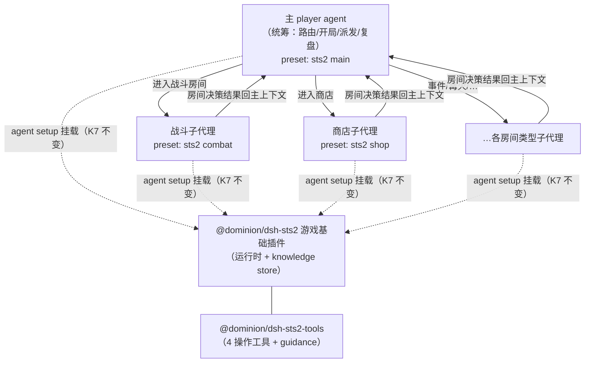

# 设计：STS2 agent 形式（主子模型与 host 场景化）

> 阶段：SDD 前方案讨论产物（2026-10-25，与需求方裁定后成文）。姊妹篇：
> [survey/sts2-decision-tools.md](sts2-decision-tools.md)（操作工具面）、
> [survey/sts2-knowledge-layers.md](sts2-knowledge-layers.md)（知识面，本文关闭其 K2 的
> agent 形式部分）、[survey/sts2-fake.md](sts2-fake.md)（测试替身）。

## 0. 裁定记录（2026-10-25 需求方）

| # | 决策点 | 裁定 |
|---|---|---|
| A1 | agent 模型 | **主子模型**：一个主 player agent，按房间类型派发子代理（每种房间一个子代理类型；"agent 配置"在本仓库 dsh 术语中即 **preset**，`projects/game/agent_v2/README.md`「preset 分池」） |
| A2 | team 插件 | sts2 **暂不使用** team 群聊模型（主子模型经 dsh-agent 原语直接驱动，见 §2） |
| A3 | host 落位 | **agent_v2 场景化重构先行**：把 saolei 场景校验/编排从 host 抽出为场景注册（saolei team 场景 + sts2 非 team 场景），sts2 在重构后的多场景 host 上落地（宪法 II：架构随新场景需求演化，而非并行补丁面） |
| A4 | 子代理派发机制 | 延后到 spec（候选：工具派发——主 agent 持"派发房间代理"工具；编排层派发——loop 按房间变化物化；见 §1.1） |

## 1. agent 模型：主子（裁定 A1/A2）

- 主 agent 负责 run 级统筹（开局、地图路线、派发、跨房间复盘）；子代理负责单房间内
  的决策序列（战斗回合/商店购买/事件选择…），经工具面（`sts2_choose`/
  `sts2_combat_turn`）操作游戏。
- 每种房间类型一个 preset（L1 persona 由 preset 提供，K7 已裁定；房间类型即
  preset 池模板的新维度——cordis.yml `templates` 快照新增 main + 各房间类型模板）。
- 子代理间不互通（无群聊）：子代理结果回主 agent 上下文，由主 agent 续接统筹。

### 1.1 派发机制（A4 延后，候选形态）

| 形态 | 描述 | 特征 |
|---|---|---|
| 工具派发 | 主 agent 持"派发房间代理"工具（sts2-tools/loop 提供），execute 体内按房间类型创建子 agent（`parentAgent` + `origin:'subagent'` + 房间 preset）驱动至完成，结果作工具结果回主 agent | harness 标准 task 模式；主 agent 自主决定派发时机 |
| 编排层派发 | loop 监听决策上下文 `state_type` 变化，按房间类型物化子 agent 驱动，结果注入主 agent | 主 agent 不感知派发机制；编排层状态机更重 |

## 2. dsh 层可行性：不依赖 team（证据）

- **agent 创建/驱动独立于 team**：`ctx.agents.create`（dsh-agent 注册表）与 `ctx.team`
  （群聊中继插件）分立；saolei-loop 的驱动路径本身只走 dsh-agent 原语——
  `common/js/dsh-plugins/saolei-loop/src/agent-member.ts` 头注释：驱动 =
  `inject(*)+followup(last)` 预注入批 + `agent.whenIdle()` + `steer`（dsh-agent
  0.2.0-rc.2 基 API）；team 仅提供广播 drain/名册。
- **主子模型是一等公民**：`CreateAgentOptions`（`@deepseek-ai/dsh-agent`
  `lib/types/index.d.ts`）原生支持 `parentAgent`（父 agent 运行时所有权）、
  `meta.origin:'subagent'`、`meta.delegationDepth`（递归预算）、`meta.agentPreset`
  （物化来源 preset）、`seed`（fork 继承历史）。
- 每房间一子代理（动态物化）与 team 的固定名册（物化时定死）不合——A2 不用 team
  同时也是结构性必然。

## 3. host 层耦合分析（重构对象清单）

现状 host（`projects/game/agent_v2/src/session.ts`）是"saolei 场景的 team host"，
场景化重构需抽出的耦合点：

| 耦合点 | 现状 | 场景化后 |
|---|---|---|
| roster 校验 | `validateSaoleiMembers`：恰 2 成员且 role 集 `{player, planner}` | 场景提供校验器（saolei：双成员 team；sts2：单主 agent 物化） |
| 场景目标 | `TEAM_GOAL` 硬编码扫雷文案 | 场景提供 |
| 编排工厂 | `createOrchestrator()` = saolei-loop team flow | 场景提供编排（saolei：team flow；sts2：主子驱动 loop） |
| announcer 不变式 | 物化后 announcer 缺失即 throw | saolei 场景内部事务，host 不硬编码 |
| memory 挂载 | planner preset 作用域（saolei 专属）挂载逻辑在物化路径 | 场景决定（sts2 是否/挂谁的 preset 待 spec） |
| AgentService face | proto 为场景无关 team 原语（`projects/game/agent_v2.proto`），但语义入口 `UpdateTeam` 对 sts2 的呈现（物化主 agent？子代理动态物化不经 face？）| spec 时定 face 语义映射 |
| web 双视图 | 团队视图/成员视角按 team 模型 | sts2 呈现（主 agent 视图 + 子代理派发记录）spec 时定 |

## 4. 与既有设计的衔接

- **K7 插件拓扑不变**：`@dominion/dsh-sts2`（基础：运行时+knowledge store+L2/L3
  section）与 `@dominion/dsh-sts2-tools`（4 工具+guidance）照常经 agent setup 挂载
  ——主 agent 与房间子代理各自物化时消费（哪些 agent 挂载哪些能力/section 的分配
  随 A4 派发机制在 spec 定）。
- **知识面 K2 部分关闭**：agent 形式已定为主子（本文 A1–A3）；知识包注入范围在新
  形态下重新表述——主 agent（统筹）与房间子代理（决策主体）各自的 L2/L3 注入分配，
  随 spec 定（[sts2-knowledge-layers.md](sts2-knowledge-layers.md) U4 同源）。
- **fake-sts2 不受影响**：测试链不涉 agent 形式（工具面经 desktop 桥消费 fake）。

## 5. 待定项（spec 输入）

| # | 待定项 | 归属 |
|---|---|---|
| S1 | 场景注册表契约（场景接口：校验器/编排工厂/goal/可选 team/可选 memory 挂载）与 agent_v2 重构切分 | 场景化重构 feature |
| S2 | AgentService face 的 sts2 语义映射（UpdateTeam 对主 agent 物化；子代理是否经 face 可见） | 场景化重构 feature |
| S3 | 子代理派发机制（A4：工具派发 vs 编排层派发）与子代理生命周期（房间结束销毁/归档、同类型房间复用、历史是否跨房间保留） | sts2-loop feature |
| S4 | 主/子 agent 的能力与 section 分配（工具挂载、L2/L3 注入范围——知识面 U4 同源） | sts2-loop feature |
| S5 | web 呈现（主 agent 视图 + 子代理派发记录的 UI 形态） | 场景化/web feature |
| S6 | preset 池模板新增（sts2 main + 各房间类型）与角色词汇 | sts2-loop feature |

## 6. 引用清单

- 姊妹篇：[survey/sts2-decision-tools.md](sts2-decision-tools.md)、[survey/sts2-knowledge-layers.md](sts2-knowledge-layers.md)、[survey/sts2-fake.md](sts2-fake.md)
- host 现状：`projects/game/agent_v2/src/session.ts`（roster 校验/TEAM_GOAL/announcer
  不变式/orchestrator 绑定）、`projects/game/agent_v2/README.md`（team 会话面/preset
  分池/dsh 组合）
- dsh 机制：`@deepseek-ai/dsh-agent` `lib/types/index.d.ts`（`CreateAgentOptions`
  parentAgent/origin/delegationDepth/seed）、
  `common/js/dsh-plugins/saolei-loop/src/agent-member.ts`（team-free 驱动原语先例）
- 相关裁定：[survey/sts2-knowledge-layers.md](sts2-knowledge-layers.md) §0（K2/K7）
