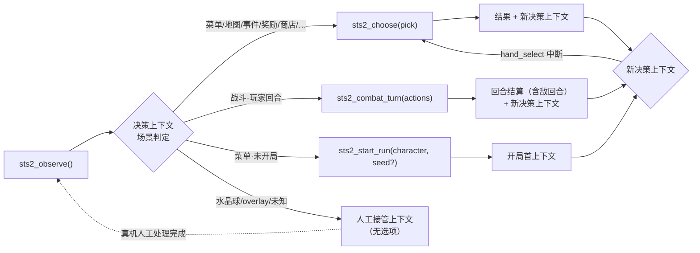

# 设计：STS2 agent 决策工具面（tools 形式与参数定义）

> 阶段：SDD 前方案讨论产物（2026-10-22，与需求方逐项裁定后成文）。
> 背景：[survey/sts2-mod-poc.md](sts2-mod-poc.md) 真机 PoC 全清单通过；需求方裁定 raw API
> 不直接对 agent 开放，由 `@dominion/dsh-sts2` 工具面封装（PoC §5.2）。
> 本文定义该工具面的形式与参数——「让 agent 能玩这个游戏」的**操作面**。
> 知识/wiki 类工具面另行讨论（本文明确不含，见 §8）。

## 1. 定位与设计原则

**为什么不是 raw API 直开**：STS2MCP raw API 是细颗粒度状态机（约 20 种 `state_type`
各带原子动作，[raw-full.md](https://github.com/Gennadiyev/STS2MCP/blob/main/docs/raw-full.md)），
一次「决策」（决定要做什么）往往对应多步原子动作与多次状态读取。PoC 实测的细颗粒度
时序陷阱全部由工具层吸收（PoC §3.3）：`claim_reward` 领取后索引重排、出牌后手牌索引
左移、`play_card` 动画竞态、宝箱两段读取、菜单路径时隐时现等。

**决策粒度对齐**：AgenticSTS 的 decision batching 实证——一个 strategic 调用驱动
多个动作（中位数 67 次 LLM 调用/局，而非每动作一调），是 token 效率的主要来源之一
（[AgenticSTS](https://github.com/AlayaLab/AgenticSTS)，66–90× 更少 fresh tokens/分数点）。

设计原则（均已与需求方裁定）：

| # | 原则 | 内容 |
|---|---|---|
| P1 | 决策粒度 | 工具面以「决策」为单位：非战斗场景一次调用 = 一个原子选择；战斗场景一次调用 = 一个回合的有序行动列表 |
| P2 | act→read 合并 | 每次工具调用的结果自带**下一个决策上下文**（PoC §3.5 裁定：合并优化放 tools 层，mod 保持最小 fork） |
| P3 | 选项键重分配 | 每次上下文呈现重新分配选项键 `[0..N-1]`，工具层内部映射 raw 索引——索引重排/漂移对 agent 不可见 |
| P4 | 通用单工具（选择型） | 非战斗场景用一个通用 `sts2_choose`，选项由上下文动态呈现；不按场景拆分工具族 |
| P5 | 偏差即停 | 行动列表执行中任何偏差（不可打/对账失败/场景中断）立即停止，已执行动作生效，返回原因 + 新上下文；不静默跳过（对齐 `common/js/dsh-plugins/saolei-tools/src/index.ts` 的批量语义与守卫思路） |
| P6 | 单选原子性 | `sts2_choose` 一次调用恰选一个选项；多步场景（商店多买、奖励多领、多选 overlay）多次调用推进 |
| P7 | 人工接管 | 工具面不覆盖的特殊场景（水晶球小游戏、overlay 等）：工具调用立即返回「人工接管」上下文，真机人工处理后经 `sts2_observe` 恢复 |

## 2. 核心抽象：决策上下文

所有工具结果统一以「决策上下文」收尾（`sts2_observe` 的结果就是它）。由工具层从
raw JSON 状态**自渲染**为文本（非 mod markdown 透传）：格式可控、可按场景裁剪
token、可用 fake-sts2 精确断言（PoC §5.4 的 fake 建模要求）。

```
== STS2 决策：<场景名> (<state_type>) ==
<场景头行：幕/层数 | 场景特定摘要（战斗：回合/能量；地图：位置；…）>
<玩家摘要行：角色 | HP | 金币>
<遗物/药水条目：内联效果文本（见下）>
<场景正文：按场景渲染（见 §4 各场景的呈现内容）>
── 选项 ──
[0] <标签> — <补充说明（价格/预览/锁定原因…）>
[1] …
```

渲染要点：

- 手牌/卡列表条目：`键 名称(费用,类型,目标类型) 规则文本摘要 可打性`；
  不可打时给出原因（`can_play=false` + `unplayable_reason`）。
- 遗物/药水条目：内联完整效果文本（状态自带 description 与 keywords）——上下文
  自包含，不依赖任何外部 id:detail 映射。
- 敌人条目：`entity_id 名称 HP/上限 格挡 状态 意图`——`entity_id` 是战斗内稳定
  引用（如 `JAW_WORM_0`），行动列表的 `target` 直接使用它。
- 被禁用/锁定的选项（事件 `is_locked`、篝火 `is_enabled=false`、商店 `can_afford=false`
  等）**照常呈现**但标注不可选及原因；选择它们返回普通拒绝文本。
- 元动作（跳过/继续/确认/取消）作为普通选项呈现于列表尾部（如 `[5] 跳过`）。
- token 体积按 PoC §3.4 实测锚定（markdown 比 JSON 紧凑 4–6 倍；战斗 ~1.3KB、
  地图 ≤2.6KB、商店 ~2.1KB），地图场景保留全 DAG（mod markdown 同款 BFS 路径树）。

## 3. 工具定义（4 个）

命名与形态对齐 saolei 三工具先例（`defineTool` + `{result: string}` 输出）。
非法参数/场景错配返回**普通拒绝文本**（agent 可读可纠正，非异常），对齐
`common/js/dsh-plugins/saolei-tools/src/index.ts` 的拒绝语义。

### 3.1 `sts2_observe()` — 只读观察

| | |
|---|---|
| 参数 | 无 |
| 输出 | `{result: string}` = 当前决策上下文 |
| 语义 | 只读、零副作用。用于首次同步、出错后恢复、人工接管后的恢复（P7）、任意时刻重同步 |
| 拒绝 | 桥/mod 不可达时 fail-loud（错误结果文本，指导排查） |

### 3.2 `sts2_choose({ pick })` — 选择型决策（非战斗）

```
参数：
  pick: integer   // 当前上下文呈现的选项键 [0..N-1]
```

| | |
|---|---|
| 语义 | 一次调用 = 一个原子选择（P6）。执行流程：校验 pick ∈ 当前选项 → 执行映射的 raw 动作 → 等待结算 → 重读状态 → 返回「执行结果行 + 下一个决策上下文」（P2/P3） |
| 拒绝 | pick 越界/指向禁用选项 → 普通拒绝文本（附当前选项重呈现）；当前场景为战斗 → 拒绝并指向 `sts2_combat_turn`；当前场景为人工接管（§5）→ 拒绝并说明恢复路径 |
| 多步场景 | 商店多件购买、奖励多项领取、card_select 多选+确认等：每次 choose 后结果重呈现更新后的选项（已购标售罄、已领移除、已选标注） |

### 3.3 `sts2_combat_turn({ actions })` — 战斗回合行动列表

```
参数：
  actions: Array<                                  // 非空；保序
    | { type: "play_card",      card: integer, target?: string }
    | { type: "use_potion",     slot: integer, target?: string }
    | { type: "discard_potion", slot: integer }
    | { type: "end_turn" }                          // 若存在必须为最后一项
  >
  // card  = 上下文呈现的手牌键 [0..N-1]
  // slot  = 上下文呈现的药水位键
  // target = 敌人 entity_id；target_type 为 AnyEnemy 的卡/药水必填，其余必须缺省
```

| | |
|---|---|
| 语义 | 一次调用 = 当前玩家回合的完整行动计划。工具层逐动作执行：每步前重读状态**对账**（卡牌 id 与键匹配、能量守卫、`can_play` 守卫、目标存活），出牌间等待 `battle.card_in_play` 归 False（Instant Mode 下退化为零等待，PoC §3.5），`end_turn` 后等待敌回合结算到下一玩家阶段或战斗结束 |
| 内部容错 | PoC §3.3 竞态（请求飞行期间手牌变化等）先按 PoC 模式重查重试，穷尽后才判偏差 |
| 停止语义（P5） | 偏差即停：对账失败/不可打/卡牌未结算超时/目标无效——已执行动作生效，返回「停止原因 + 新决策上下文」。我方出牌致敌全灭属正常停止（战斗结束，剩余动作作废；不重复 PoC 的 end_turn 落空错误） |
| `hand_select` 中断 | 出牌/用药触发战斗内选牌提示：剩余动作作废，`hand_select` 以选择型上下文呈现（走 `sts2_choose`：每张可选牌一个选项 + 确认项），确认后回到未结束的玩家回合——agent 重新调用 `sts2_combat_turn` 给后续行动 |
| `end_turn` 语义 | 显式动作；列表耗尽而未含 `end_turn` 时不结束回合，返回当前战斗上下文并提示「回合未结束」（过早结束回合是真实策略损失，不做隐式自动结束） |
| 拒绝 | 非战斗/非玩家阶段 → 拒绝文本；`actions` 空数组 → 拒绝；`end_turn` 非末位 → 拒绝；目标参数与 `target_type` 矛盾 → 拒绝（附当前上下文） |

### 3.4 `sts2_start_run({ character, seed?, mode? })` — 开局聚合

```
参数：
  character: string                  // 上下文呈现的角色标识，如 "IRONCLAD"
  seed?:     string                  // 提供时走 custom 入口（standard 拒 seed，PoC 清单 #4）
  mode?:     "standard" | "custom"   // 缺省 standard；带 seed 时强制 custom
```

| | |
|---|---|
| 语义 | 把开局菜单导航聚合为一次决策：main → singleplayer →（子菜单时隐时现，两路径兼容，PoC §3.3）→ character_select → 选角色 → confirm(±seed) → 自动拒绝 tutorial_prompt → 等待开局离开菜单（PoC 实测 ≤120s）→ 返回首局决策上下文 |
| 拒绝 | 当前不在菜单 → 拒绝（附当前上下文；run 进行中无 API 弃局，PoC §7）；角色不在可选列表 / 模式被锁定（custom 未解锁）→ 拒绝并附可选项 |

### 工具面排除项

- **multiplayer 全部动作面**（`/api/v1/multiplayer`、mp 菜单屏、`undo_end_turn`）：首期单人标准局（[sts2-game-control.md](sts2-game-control.md) 裁定 3）。
- **profiles 切换/删除**：测试隔离属 harness/部署面（PoC 干净档流程由 testplan/运维执行），不进 agent 工具面。
- **`use_potion`/`discard_potion` 仅在战斗行动列表内**：非战斗药水使用 v1 不暴露（PoC 未遇非战斗需求；药水带满时的奖励场景留待实测补充）。
- **wiki/compendium 查询**：不进 v1 工具面——知识包方案替代其定位（裁定 K5，见 [survey/sts2-knowledge-layers.md](sts2-knowledge-layers.md) §5）。

## 4. 场景覆盖矩阵（choose 的选项映射）

`sts2_choose` 的选项构成与 raw 动作映射（场景判定依据 raw `state_type` + `menu_screen`）：

| 场景 | 呈现的选项 | pick → raw 动作 |
|---|---|---|
| `menu`（main/singleplayer/popup/timeline 等） | `options` 数组逐项（含 `blocked_options` 标注） | `menu_select(option)` |
| `map` | `next_options` 逐项（含 `leads_to` 一层前瞻）；正文含全 DAG 与 boss 信息 | `choose_map_node(index)` |
| `event`（`in_dialogue=true`） | `[0] 继续对话` | `advance_dialogue` |
| `event` | `event.options` 逐项（`is_locked` 标注；`event.body` 可能为空属已知行为，选项级 `description` 承载语义，PoC §3.2） | `choose_event_option(index)` |
| `rewards` | 每项奖励逐项 + `继续`（`can_proceed`） | `claim_reward(index)` / `proceed`；领取后索引重排由重读+重映射吸收 |
| `card_reward` | 每张卡逐项 + `跳过`（`can_skip`） | `select_card_reward(card_index)` / `skip_card_reward` |
| `rest_site` | `options` 逐项（`is_enabled=false` 标注）+ `继续`（`can_proceed`） | `choose_rest_option(index)` / `proceed` |
| `shop` / `fake_merchant` | 每件商品逐项（价格/`on_sale`/`can_afford`/售罄标注；含 card_removal 类目）+ `离开`（`can_proceed`）；`error` 未就绪态由工具层等待后呈现 | `shop_purchase(index)` / `proceed` |
| `treasure` | 开箱过渡态（"Opening chest..."）由工具层等待；就绪后每件遗物逐项 + `离开` | `claim_treasure_relic(index)` / `proceed` |
| `card_select` | 每张卡逐项（切换选择；已选标注）+ `确认`（`can_confirm`）+ `取消`（`can_cancel`）；`choose` 型即时生效无确认项 | `select_card(index)` / `confirm_selection` / `cancel_selection` |
| `bundle_select` | 每个 bundle 逐项 + `取消`；选中预览后重呈现为 `确认`+`取消` | `select_bundle(index)` / `confirm_bundle_selection` / `cancel_bundle_selection` |
| `relic_select` | 每件遗物逐项 + `跳过`（`can_skip`） | `select_relic(index)` / `skip_relic_selection` |
| `hand_select`（战斗内） | 每张可选牌逐项（已选标注）+ `确认`（`can_confirm`） | `combat_select_card(card_index)` / `combat_confirm_selection` |
| `game_over` | `[0] 返回主菜单` | `menu_select(main_menu)`；返回后 timeline 自动弹出（PoC §3.3）按普通菜单场景呈现 |
| `crystal_sphere` / `overlay` / `unknown` | **无选项**：人工接管上下文（§5） | — |

交互全景：



## 5. 人工接管点（P7）

工具面不覆盖动作的场景统一进入人工接管：

- **进入条件**：`state_type` ∈ {`crystal_sphere`, `overlay`, `unknown`}。
- **行为**：触发路径上的工具调用（`combat_turn` 行动列表或 `choose`）**立即停止并返回**，
  决策上下文呈现为「人工接管」——含场景摘要（overlay 的 screen_type/描述、水晶球的
  网格与剩余占卜数摘要）、无选项，明确指示：请在真机人工处理；处理完成后调用
  `sts2_observe` 恢复。
- **恢复**：`sts2_observe` 重读状态；人工未完成时仍呈现人工接管上下文（恢复轮询节奏
  归 sts2-loop 编排层，工具面不阻塞等待）。
- 水晶球的**预防性规避**（遗物选项呈现标注「触发不支持的小游戏」）不采用——呈现层
  不做策略引导，是否拾取由 agent 决策。

## 6. 执行引擎义务（tools 层内部机制汇总）

工具层（未来 `@dominion/dsh-sts2` 的 runtime）对 raw API 的全部吸收项，fake-sts2
仿真正确性要求与此一一对应（PoC §5.4）：

| 机制 | 依据 |
|---|---|
| 出牌间等待 `battle.card_in_play` 归 False（+静默期），Instant Mode 下不触发 | PoC §3.2/§3.5，mod 补丁字段 |
| `end_turn` 后轮询敌回合至玩家阶段/战斗结束；我方致敌全灭后 end_turn 落空属正常 | PoC §3.3 |
| 竞态容错：请求飞行期手牌变化 → 重查重试，穷尽后判偏差 | PoC §3.3 |
| `claim_reward` 后重读重映射选项键 | PoC §3.3 |
| 宝箱过渡态等待后呈现 | PoC §3.3 |
| 菜单两路径兼容（singleplayer 直达/经子菜单）、菜单选项随进度增长、tutorial_prompt 自动拒绝（start_run 内） | PoC §3.3 |
| 中文客户端：option 标签已归一化英文，name/description 值为中文——上下文原样呈现 | PoC §3.3 |
| 能量/can_play/target_type 校验前置（Alex5418 能量守卫同思路） | [STS2-Agent](https://github.com/Alex5418/STS2-Agent) |

## 7. 边界与已知限制

- **对战外卡组不可见**：raw API 的 player 对象仅战斗中含 hand/piles（[raw-full.md](https://github.com/Gennadiyev/STS2MCP/blob/main/docs/raw-full.md) Player Object）；非战斗场景 agent 依靠自身历史记忆牌组构成。如需牌组视图，后续走小 fork 端点（mod 已有全池对象代码路径，PoC §5.8），不引入外部数据库。
- **overlay 兜底**：人工接管是唯一路径；desktop 键鼠兜底通道（[sts2-game-control.md](sts2-game-control.md) §5）留后续。
- **seed 复现未验证**（PoC §5.7）：`sts2_start_run` 的 seed 路径依赖 custom 模式解锁，确定性开局需求出现时先补 PoC 清单 #8。
- **药水带满时的奖励场景**：v1 未见实测数据，`discard_potion` 仅战斗内暴露；实测遇到后按行为细节补充（fake-sts2 同步）。
- **token 量级**：决策粒度聚合后预期显著低于 STS2MCP FAQ 的 7–8M tokens/局基线（transcript 直驱形态）；精确预算在 sts2-loop 方案阶段测算。

## 8. 后续讨论与下游输入

- **知识面**：已另文裁定并成文——[survey/sts2-knowledge-layers.md](sts2-knowledge-layers.md)（L2 静态 sections + L3-inline 内联 + L3-prior 开局知识包；wiki 工具不进 v1）。
- **desktop 桥中继（链路已定，同 saolei）**：tools ↔ mod API 经 desktop 桥中继转发（desktop 执行 HTTP → 游戏机 `localhost:15526`）；`projects/game/game.proto` FlowPart 新增游戏 API 转发 part 的**接口设计归 desktop-bridge feature**（传输契约 `specs/066-desktop-bridge-split/contracts/desktop-bridge-v2.md` §1）。
- **fake-sts2**：已另文研究并成文——[survey/sts2-fake.md](sts2-fake.md)（API 实现范围 = 本文消费面、wire 错误语义保真、场景模型与 PoC §3.3 行为映射、v1 场景清单）。
- **sts2-loop 编排**：成员结构（是否 team 双成员）、player/planner 角色分工、人工接管的恢复轮询节奏、决策上下文是否注入复盘——后续 feature（知识面 K2 同源待定）。
- **实现落点（拓扑已定，裁定 K7）**：`@dominion/dsh-sts2` 游戏基础插件（游戏运行时：状态/动作/守卫/knowledge store + `sts2:game`(L2) 与 `sts2:knowledge`(L3) section）+ `@dominion/dsh-sts2-tools` 工具插件（本文 4 工具 + `sts2:guidance` section，静态单元形态对齐 `common/js/dsh-plugins/saolei-tools/`）；L1 persona 由 preset 模板提供；mod fork 源码入 `third_party/github.com/Gennadiyev/STS2MCP` 维护（K6，构建沿用 PoC §4.1）。

## 9. 已裁定与被否决选项记录

| 决策点 | 裁定 | 被否决项 |
|---|---|---|
| 选择型工具粒度 | 通用单工具 `sts2_choose`（P4） | 按场景拆分 8–12 个语义工具（Alex5418 路线：工具面大、错配处理繁琐、guidance 冗长）；混合式 |
| 开局 | 专用 `sts2_start_run` 聚合 | 纯通用菜单导航（每局浪费 3–4 轮往返、路径 quirk 暴露给 agent） |
| 战斗引用 | 呈现键 + entity_id | 卡牌名+出现序（重复牌消歧复杂、解析易错） |
| choose 粒度 | 单选（P6） | 批量 `picks[]`（需定义部分失败语义，复杂度上升） |
| 水晶球/特殊场景 | 人工接管 + observe 恢复（P7） | 行动列表工具泛化覆盖（复杂度）；专用小工具（为非必经场景扩常驻工具面）；预防性规避引导（呈现层不做策略引导） |
| 上下文渲染 | 工具层自渲染 | mod markdown 透传（格式不可控、选项键需并行 JSON 映射、双份状态读取） |

## 10. 引用清单

- PoC：[survey/sts2-mod-poc.md](sts2-mod-poc.md)（§3 行为细节/§5 SDD 输入）
- 调研：[survey/sts2-game-control.md](sts2-game-control.md)（§3 STS2MCP/§4 生态/§5 接入架构）
- raw API：[STS2MCP raw-full.md](https://github.com/Gennadiyev/STS2MCP/blob/main/docs/raw-full.md)
- 实践参考：[AgenticSTS](https://github.com/AlayaLab/AgenticSTS)（decision batching/有界记忆）、
  [Alex5418/STS2-Agent](https://github.com/Alex5418/STS2-Agent)（守卫/单动作防漂移）、
  [ttxtxx1111/sts2-llm](https://github.com/ttxttx1111/sts2-llm)（读状态→验证→执行→重读协议）
- 仓库内对照：`common/js/dsh-plugins/saolei-tools/src/index.ts`（工具形态/拒绝语义/批量
  停止语义先例）、`projects/game/agent_v2/README.md`（dsh 组合与角色能力组装）、
  `specs/075-saolei-game-foundation/contracts/saolei-tools-plugin.md`（静态单元模式）
