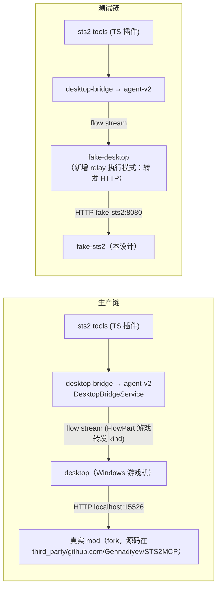

# 研究/设计：fake-sts2（STS2MCP mod API 确定性替身）

> 阶段：SDD 前方案讨论产物（2026-10-22，与需求方逐项裁定后成文）。姊妹篇：
> [survey/sts2-decision-tools.md](sts2-decision-tools.md)（操作工具面）、
> [survey/sts2-knowledge-layers.md](sts2-knowledge-layers.md)（知识面）。
> 定位输入：PoC §5.4——"fake-sts2 设计输入：按 raw-full.md 状态机建模 + §3.3
> 行为细节表（重排/竞态/两段式）作为仿真正确性要求"；fake 家族先例
> `projects/game/fake-desktop/README.md`。

## 0. 裁定记录（2026-10-22 需求方）

| # | 决策点 | 裁定 |
|---|---|---|
| F-a | 场景模型 | **脚本骨架 + 机制模拟混合**（Scenario = 一局固定游戏；不做卡牌效果规则引擎） |
| F-b | 实现语言 | **Go**（fake-desktop/fake-llm 家族一致；独立实现，不与被测 TS 运行时共享类型） |
| F-c | API 范围 | **仅 runtime 消费面**（singleplayer JSON / profiles / compendium / 知识端点；markdown → 400 tripwire，wiki/multiplayer → 404） |
| F-d | v1 场景 | **七个全做**：victory / defeat / combat_full / quirks / manual / knowledge / profiles |

## 0. 定位

fake-sts2 是 game 大型测试专用的**确定性 STS2MCP mod HTTP API 替身**：以固定场景
脚本响应 raw API 请求，替代真实游戏进程内的 mod（游戏机 `localhost:15526`），
承载 sts2 工具面/知识面/编排的端到端测试。仅被 testplan 部署引用，不进生产。

## 1. 测试链路位置

- **fake-sts2 本体独立**：纯 HTTP 服务器，无 flow stream 依赖，不依赖 desktop-bridge
  feature 的进度。
- **接入依赖**：测试链中 fake-desktop 需新增 relay 执行模式（收到游戏转发 FlowPart
  → HTTP 调 fake-sts2 → 回传响应）——依赖 FlowPart 游戏转发 kind 设计
  （desktop-bridge feature，`survey/sts2-decision-tools.md` §8）。在该 feature 落地前，
  fake-sts2 可先行开发与单测（直接 HTTP 驱动场景）。
- **TS 单测不依赖本服务**：sts2 运行时（`@dominion/dsh-sts2`）的 bazel 单测用进程内
  fixture；fake-sts2 只服务大型测试拓扑。

## 2. 进程形态

对齐 fake 家族（fake-desktop/fake-llm）：

- **Go 服务**，`projects/game/fake-sts2/`（`cmd/main.go` + `service/` +
  `service.yaml` + `BUILD.bazel`），HTTP 监听（缺省 `:8080`）+ `/healthz` 探针。
- **独立实现原则**：fake 从 raw-full.md 契约与 mod 源码（fork 入仓后即
  `third_party/github.com/Gennadiyev/STS2MCP`）独立建模，**不共享**被测 TS 运行时的
  类型/代码——避免对同一份实现的 common-mode 误读（fake-llm 与 llm 插件分立同理）。
- 状态为进程内存（单局会话），重启即重置；确定性 = 场景固定 + 无随机（或固定
  抽牌序）。
- 环境变量（testplan 注入）：`FAKE_STS2_SCENARIO`（场景选择）+ 故障注入（§6）。

## 3. API 实现范围（runtime 消费面）

实现范围 = sts2 运行时实际消费的端点（工具面 + 知识组装），非 raw-full.md 全量：

| 端点 | 实现 | 说明 |
|---|---|---|
| `GET /` | ✅ | 握手 `{message, status}`（部署前置检查用） |
| `GET /api/v1/singleplayer?format=json` | ✅ 仅 JSON | 运行时只消费 JSON（决策上下文由工具层自渲染，裁定见 [sts2-decision-tools.md](sts2-decision-tools.md) §2）；`format=markdown` → 显式 400（不实现即 tripwire：运行时不应请求） |
| `POST /api/v1/singleplayer` | ✅ | v1 工具面消费的全部动作（§3.1）；`crystal_sphere_*` 返回 error（人工接管场景无动作面） |
| `GET /api/v1/profiles`、`POST /api/v1/profiles` | ✅ | 含两段式 switch 行为（PoC §3.3） |
| `GET /api/v1/compendium` | ✅ 精简 | `card_library`/`relic_collection` 的 `discovered_ids`（知识包解锁过滤源）；run_history 可为空 |
| fork 知识端点 | ✅ 固定小目录 | 形状跟随 fork 契约（[sts2-knowledge-layers.md](sts2-knowledge-layers.md) U2）；数据 = 若干卡/遗物/敌人 fixture，服务知识组装链路测试 |
| `GET /api/v1/wiki` | ❌ | K5 裁定：wiki 不进 v1 工具面；404 |
| multiplayer 全部 | ❌ | 首期单人标准局；404/409 语义可后补 |

### 3.1 动作集（raw-full.md × 工具面映射全集）

`menu_select`（±seed 校验：standard 拒 seed）/ `play_card` / `use_potion` /
`discard_potion` / `end_turn` / `combat_select_card` / `combat_confirm_selection` /
`claim_reward` / `select_card_reward` / `skip_card_reward` / `proceed` /
`choose_event_option` / `advance_dialogue` / `choose_rest_option` /
`shop_purchase` / `choose_map_node` / `select_card` / `confirm_selection` /
`cancel_selection` / `select_bundle` / `confirm_bundle_selection` /
`cancel_bundle_selection` / `select_relic` / `skip_relic_selection` /
`claim_treasure_relic`。

## 4. wire 语义保真（mod 源码核实）

Fake 必须复刻的 HTTP 语义（依据 [McpMod.cs](https://github.com/Gennadiyev/STS2MCP/blob/main/McpMod.cs)
`HandlePostAction` 与 [McpMod.Actions.cs](https://github.com/Gennadiyev/STS2MCP/blob/main/McpMod.Actions.cs)）：

| 层 | 语义 |
|---|---|
| 动作校验失败 | **HTTP 200 + `{status:"error", error:"..."}`**（`Error()` 结果经 `SendJson` 回传，不落非 200） |
| 协议层错误 | 非 200 仅限：400（invalid JSON / missing `action` / wiki 无 query）、404、405、409（sp/mp 端点混用）、500（服务端异常/状态构建失败） |
| 成功响应 | `{status:"ok", message:"..."}`；**动作响应不含状态**（act→read 分离——工具层的 P2 合并由此才有意义） |
| 错误消息字符串 | **wire 契约的一部分**：工具层竞态容忍匹配 `"Not in combat"`（PoC `cmd_combat`）、`card_index N out of range`、`Card requires a target. Provide 'target' with an entity_id.` 等——fake 逐字复刻关键错误串（清单以 Actions.cs `Error(...)` 调用点为准） |
| 前置守卫 | 无 run → 一切动作 `Error("No run in progress")`；blocking popup 在场 → gameplay 动作被拒（提示 menu_select popup 选项）——fake 的 popup 场景需复刻 |

## 5. 场景模型：脚本骨架 + 机制模拟（裁定 F-a）

**Scenario = 一局固定游戏**（fake-desktop 同构），分两层：

- **脚本层**（每场景固定）：屏幕序列骨架（menu → character_select → map →
  combat → rewards → … → game_over → main_menu[→ timeline popup]）、遭遇与事件
  内容、地图 DAG、商店货架、奖励清单、抽牌序。
- **机制层**（跨场景共用的 API 级行为模拟）：出牌后手牌左移+能量扣减+脚本化伤害、
  `claim_reward` 后剩余项索引重排、宝箱首读过渡态、`card_in_play` 翻转、
  `end_turn` 后敌回合结算至下一玩家阶段/战斗结束、卡牌 `can_play`/`unplayable_reason`
  判定（能量不足/Unplayable）、目标存活校验。

**不做完整卡牌效果引擎**：伤害/效果数值全部来自场景脚本表（每张 fixture 卡的
效果 = 固定数值），不实现真实的 STS2 规则演算——测试对象是工具层契约
（等待/守卫/重映射/上下文渲染），不是游戏规则本身；规则引擎会造成巨大维护面
且引入"fake 与游戏行为偏离"的新风险（v0.111 已有
[sts2-sim](https://slaythespire.dev/projects/sts2-sim/) 社区做真模拟，非本组件目标）。

确定性：无运行时随机；需要"随机感"的内容（地图分支、抽牌）以场景内固定序列表达。

## 6. 行为细节正确性要求（PoC §3.3 全表 → fake 行为）

PoC 实测行为即 fake 的仿真正确性要求（PoC §5.4）：

| PoC 行为 | fake 实现 |
|---|---|
| `claim_reward` 索引重排 | 机制层：领取后剩余奖励数组前移、index 重编 |
| `play_card` 手牌竞态（`card_index out of range`） | 故障注入 `FAKE_STS2_FAULT_RACE_PLAY=N`：前 N 次出牌先返回竞态错误再成功（测工具层重查重试） |
| 战斗结束竞态（敌全灭后 end_turn → `Not in combat`） | 机制层：战斗结束态下 end_turn 返回该错误串 |
| profile-switch 两段式 | 机制层：首调返回提示语并进入 profile_select 屏、再调才切换 |
| 菜单选项随进度增长 | 场景/profile 状态：`has_completed_run` 标志控制 compendium/timeline 选项出现 |
| singleplayer 子菜单时隐时现 | 场景参数：直达 character_select 或经 standard/daily/custom 子菜单（双路径各可测） |
| 中文客户端（option 归一化英文、name/description 中文值） | 场景参数或 fixture 局部使用中文值（测渲染兼容） |
| 宝箱两段读取 | 机制层：treasure 首读 `"Opening chest..."` 过渡态、次读出遗物 |
| game_over → main_menu 后 timeline 自动弹出 | 脚本层：epoch 解锁标志触发首读为 timeline 屏 |
| `event.body` 为空 | 场景 fixture：至少一个空 body 事件（选项级 description 承载语义） |
| Instant Mode（act→read 合并语义） | 缺省开：动作后零等待首读即结算态、`card_in_play` 恒 False；`FAKE_STS2_INSTANT=0` 模拟动画模式（`card_in_play=True` 持续 K 次读取后结算——测工具层等待回退）；`FAKE_STS2_OMIT_CARD_IN_PLAY=1` 模拟旧 mod 无字段（测向后兼容退化） |

## 7. v1 场景清单（裁定 F-d：七个全做）

| scenario | 覆盖 |
|---|---|
| `victory`（默认） | 短局全流程胜利：开局（子菜单路径）→ map → 1–2 场战斗 → rewards/card_reward → 篝火或商店 → boss → relic_select → game_over → main_menu → timeline 弹窗——服务端到端胜利链路 |
| `defeat` | 战斗死亡 → game_over → main_menu |
| `combat_full` | 战斗机制全覆盖：AnyEnemy 目标校验、不可打牌（NotEnoughEnergy/Unplayable）、hand_select 中断与确认、药水 use/discard、多敌 entity_id、敌全灭竞态 |
| `quirks` | 非战斗行为细节：奖励重排、宝箱两段、事件空 body、locked 事件选项、shop 货架（含 card_removal → card_select 链）、bundle_select 两步、菜单增长 |
| `manual` | crystal_sphere 与 overlay 状态（无动作面，人工接管链路） |
| `knowledge` | 知识端点 + compendium discovered_ids + 开局组装链路（与 fork 契约 U2 联动） |
| `profiles` | profiles 列表/两段式切换/删除（harness 面行为） |

场景内可叠加故障注入（§6 env），独立于场景选择——一个场景多种故障态。

## 8. 待定项

| # | 待定项 | 归属 |
|---|---|---|
| F1 | FlowPart 游戏转发 kind 设计 → fake-desktop relay 执行模式（`FAKE_DESKTOP_STS2_URL` 之类） | desktop-bridge feature |
| F2 | fork 知识端点契约（U2 同源）→ fake 知识端点形状 | fork feature |
| F3 | 场景定义为 Go 内嵌（`service/scenarios.go`，fake-desktop 同构）还是数据文件——建议先内嵌，出现"TS 单测也要复用场景"的需求时再抽数据文件 | fake-sts2 实现 |
| F4 | fake 与真实 mod 的偏差清单维护策略（fake 代码注释逐行为标注依据：raw-full.md 章节 / Actions.cs 错误串 / PoC §3.3 行号） | fake-sts2 实现（代码规范） |

## 9. 引用清单

- 姊妹篇：[survey/sts2-decision-tools.md](sts2-decision-tools.md)（工具面消费动作集/执行引擎义务 §6）、[survey/sts2-knowledge-layers.md](sts2-knowledge-layers.md)（知识端点/组装链路）
- PoC：[survey/sts2-mod-poc.md](sts2-mod-poc.md)（§3.3 行为细节表/§5.4 fake 输入/§5.6 fork 归置）
- raw API 契约：[STS2MCP raw-full.md](https://github.com/Gennadiyev/STS2MCP/blob/main/docs/raw-full.md)、[McpMod.cs](https://github.com/Gennadiyev/STS2MCP/blob/main/McpMod.cs)、[McpMod.Actions.cs](https://github.com/Gennadiyev/STS2MCP/blob/main/McpMod.Actions.cs)（wire 错误语义源）
- fake 家族先例：`projects/game/fake-desktop/README.md`（场景/env/确定性模式）、`projects/game/fake-llm/README.md`、`projects/game/testplan/README.md`（拓扑与套件组织）
- 相关裁定：[survey/sts2-knowledge-layers.md](sts2-knowledge-layers.md) §0（K5 wiki 排除/K6 fork 入仓/K7 拓扑）
