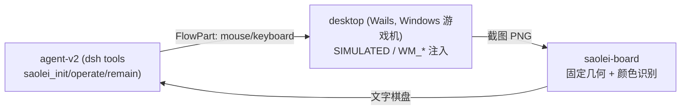
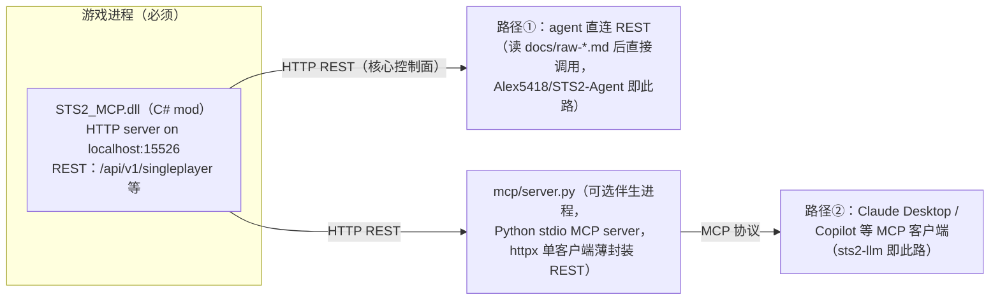
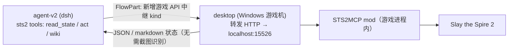

# 调研：杀戮尖塔2（Slay the Spire 2）游戏操作方案

> 背景：`projects/game/` 计划引入杀戮尖塔2（[Steam](https://store.steampowered.com/app/2868840/Slay_the_Spire_2/)）
> 作为扫雷以外的第二个游戏场景。进入 SDD 流程前，需先裁定「如何操作游戏」这一关键前置问题。
> 调研时间：2026-10-21。
>
> **已裁定结论**（与需求方确认）：
> 1. 操作方案：**mod API 路线**（以 [STS2MCP](https://github.com/Gennadiyev/STS2MCP) 为基座）；
> 2. 进入 SDD 前先做**真机 PoC**（见 §7 清单）；
> 3. 首期范围：**单人标准局**（固定角色、seed 可控开局；联机/ascension/全角色留后续）；
> 4. 接入架构探索方向：**扩展 desktop 桥**（SDD 方案阶段细化）。

## 1. 问题定义

现状（扫雷场景）操作与感知链路：

- **操作**：坐标级鼠标/键盘（`projects/game/game.proto` 的 `FlowPart` oneof——
  MouseMove/MouseClick/KeyboardPress/MouseMoveAndClick + 信号）。
- **感知**：截图 + 确定性 CV（`projects/game/pkg/saolei-board/README.md`——经典扫雷
  32×32 固定格子 + 颜色阈值，无 OCR）。

STS2 候选操作方案与裁定：

| 方案 | 评估 | 裁定 |
|---|---|---|
| ① mod / GitHub 项目提供 API 控制入口 | 官方 mod 支持 + 社区标准桥（STS2MCP）成熟，语义级动作 + 结构化状态 | ✅ **采用** |
| ② tools 转换为鼠标/键盘（扫雷同款） | STS2 为 Godot 动态 UI（悬停/拖拽/动态布局/大量文本），感知需 OCR+CV，难度与负载远超扫雷；社区证据负面（GUI agent 玩 STS 效果差，见 STS2MCP FAQ） | ❌ 仅留作 overlay 兜底 |
| ③ agent 自主学习键鼠控制 | 精力将消耗在学操作与调试控制器上 | ❌ 排除 |

## 2. STS2 官方 mod 生态（可行性基础）

- **引擎**：Godot 4.5.1 Mono，游戏逻辑 C#/.NET 9（`sts2.dll`），游戏自带
  `0Harmony.dll`（Harmony 补丁框架）——[STS2 modding tutorial](https://github.com/fresh-milkshake/Modding-Tutorial)、
  [社区教程](https://tutorials.sts2modding.com/en/docs/01-env-setup/)。
- **官方 mod loader day-1 内置**；2026-06-19 Major Update 2（v0.107.1）开启
  **Steam Workshop**，官方发布 [sts2-mod-uploader](https://github.com/MegaCrit/sts2-mod-uploader)
  与 STS2.dll XML 文档（[官方公告](https://steamcommunity.com/app/2868840/announcements/)、
  [Neowsletter #23](https://megacrit.com/news/2026-6-19-neowsletter-issue-23/)）。
- mod 清单（`{modid}.json`）含 `min_game_version`、`affects_gameplay` 等字段；
  Steam 版 mod 优先于本地同 id mod（版本更高时）。modded 存档与 unmodded 存档分离。
- 社区索引 [slaythespire.dev](https://slaythespire.dev/) 收录 53 个项目（含 7 个
  「游戏接口」类）——mod 生态活跃，且官方对 bot/桥接类项目持开放态度
  （[modding 指南](https://slaythespire.dev/modding/)明确引导 "Building a bot or tool"
  走桥接路线）。

## 3. 关键项目：STS2MCP（事实标准桥）

[Gennadiyev/STS2MCP](https://github.com/Gennadiyev/STS2MCP)：MIT 许可、526★/107
forks、2026-03 起活跃维护（最近提交 2026-07-29 修复 v0.107 兼容）。多个 LLM agent
项目构建于其上。

### 3.1 形态与 API 面

游戏内 mod（平台无关 .NET DLL，Win/Linux/macOS 通用），启动后在
`localhost:15526` 开 HTTP 服务（无鉴权、端口可经 `STS2_MCP.conf` 配置）；另附可选
Python MCP server。API 参考
[docs/raw-simplified.md](https://github.com/Gennadiyev/STS2MCP/blob/main/docs/raw-simplified.md)
（详细版 [docs/raw-full.md](https://github.com/Gennadiyev/STS2MCP/blob/main/docs/raw-full.md)）：

| 端点 | 用途 |
|---|---|
| `GET /api/v1/singleplayer?format=json\|markdown` | 读游戏状态（markdown 为 LLM 优化的格式，地图含 BFS 路径树） |
| `POST /api/v1/singleplayer` | 执行动作（`{action, ...}` JSON body） |
| `GET /api/v1/profile(s)` / `POST /api/v1/profiles` | profile 进度 / 3 个档位切换与删除（可开干净测试档） |
| `GET /api/v1/compendium` | Compendium 形态的档案进度（含 run 历史，cap 20 条） |
| `GET /api/v1/wiki?query=...` | 已发现卡牌/遗物的模糊搜索（不倾倒全目录） |

状态读取为 **`state_type` 状态机**（约 20 种：`menu` / `monster|elite|boss` /
`rewards` / `card_reward` / `map` / `event` / `rest_site` / `shop` / `treasure` /
`card_select` / `bundle_select` / `relic_select` / `crystal_sphere` / `game_over` /
`overlay` 等），每种状态带各自可用动作集——战斗中含手牌/抽弃消耗牌堆/敌人意图/
遗物/药水/能量；动作面覆盖 `menu_select`（**支持 seed 参数定开局**）、
`play_card(card_index, target)`、`use_potion`、`discard_potion`、`end_turn`、
`choose_map_node`、`shop_purchase`、事件/篝火/奖励/宝箱/各类选择 overlay、
水晶球小游戏、终局返回主菜单。

### 3.2 组件形态：mod（REST 核心）+ 可选外挂 MCP server

STS2MCP 是**两个独立组件**，mod 本身不 speak MCP：

- **mod（核心，必须安装）**：`STS2_MCP.dll` 进游戏 `mods/`，进程内起 HTTP server；
  这是唯一控制面。MCP 工具（`get_game_state`、`combat_play_card`、30+ 单人工具 +
  `mp_*` 多人工具，全表见 [mcp/README.md](https://github.com/Gennadiyev/STS2MCP/blob/main/mcp/README.md)）
  与 REST 动作一一对应。
- **Python MCP server（可选）**：`mcp/server.py` 单文件（+ pyproject/uv.lock），仅是
  REST 的 MCP 薄封装（复用单一 `httpx.AsyncClient`，commit
  [d1d1c29](https://github.com/Gennadiyev/STS2MCP/commit/d1d1c2913baa1ef689a03ac7f3bf26a46142b45)）；
  为 Claude Desktop / Copilot 这类无法自定义 HTTP 调用的客户端而设。
- **路径①（无 MCP）**：把 `docs/raw-*.md` 交给任意 agent，直接 HTTP 调 REST——
  有自定义工具体系的 agent 不需要 MCP 层。
- mod 源码为分部类组织（`McpMod.cs` + `McpMod.StateBuilder.cs` / `McpMod.Actions.cs` /
  `McpMod.Helpers.cs` / `McpMod.Profile.cs` / `McpMod.Wiki.cs` / 多人两件套），
  fork 扩展 = 加状态构造器/动作 + rebuild DLL（MIT）。

**dominion 落点**：agent-v2 有自有 dsh tools 体系，走路径①——desktop relay 直连
REST，自建 `sts2_*` 工具面映射，不需要 Python MCP server，也不需要 mod 支持 MCP。

### 3.3 生态项目的桥接方式（谁用 STS2MCP、谁自研、如何扩展）

| 项目 | 使用的桥 | 扩展方式 |
|---|---|---|
| [Alex5418/STS2-Agent](https://github.com/Alex5418/STS2-Agent) | **上游原版 STS2MCP**，直接 httpx 调 `localhost:15526` REST（不经 MCP server） | **mod 零改动**，扩展全在客户端：按 `state_type` 定义每状态 1-3 个 LLM 工具 + 护栏（能量守卫/循环检测/smart-wait/单动作模式）。（其 README 称 mod 为 "BepInEx mod" 系笔误——STS2MCP 实为原生 mod loader 加载） |
| [ttxttx1111/sts2-llm](https://github.com/ttxttx1111/sts2-llm) | **fork 的 STS2MCP**（[ttxttx1111/STS2MCP](https://github.com/ttxttx1111/STS2MCP) `copilot-agent-tools` 分支，经 mcp server 以 MCP 工具使用） | fork 在 mod 源码上保留菜单/profile/选择界面工具增强（对应上游 [#71](https://github.com/Gennadiyev/STS2MCP/pull/71)，已随 v0.4.0 合入上游）——上游合并后 fork 意义减弱，是"上游未合并期间的锁定"型 fork |
| [STS2FableBot](https://slaythespire.dev/projects/sts2-fable-bot/) | fork 的 STS2MCP | 同上类型：fork 自维护后打全程 |
| [CharTyr/STS2-Agent](https://github.com/CharTyr/STS2-Agent) | **完全独立自研 mod**（AGPL-3.0，`STS2AIAgent.dll`），**不基于 STS2MCP** | 自有 REST 面（`:8080`：`/state`、`/action`、**`/actions/available`**、**`/events/stream` SSE**、`/data/{collection}`、session/teammate 控制）且 **MCP 在 mod 进程内实现**（Streamable HTTP `:8080/mcp`，默认关闭；另有可选 Python sidecar）；mod 还内置 LLM 客户端可自闭环 auto-play |
| [AgenticSTS](https://github.com/AlayaLab/AgenticSTS) | fork 的 **CharTyr mod**（非 STS2MCP） | 取 CharTyr 的 `/state`、`/action`、`/events/stream`（端口 8128）作 agent 底座 |

结论：**mod 侧扩展的两种成熟模式**——① fork STS2MCP 加 C# 状态构造器/动作后
rebuild（sts2-llm/FableBot 模式，适合小增量）；② 完全自研 mod（CharTyr/AgenticSTS
模式，工程量可控但适合深度定制如 SSE/双实例）。dominion 首期用上游原版 + 客户端
工具层即可；v0.111 兼容补丁或 wait/SSE 原语需求出现时走模式①。

其他要点：

- **Instant Mode**：mod 注入的游戏内设置项，削减动画/延迟——自动化全局面强烈建议开启。
- 联机 co-op 为 **beta**（`/api/v1/multiplayer`，额外投票类动作）；首期不用。
- 已知限制：agent 发起的 run 暂不能调 ascension（v0.4.0 release notes）；
  `overlay`（未覆盖弹窗）状态无动作，需人工干预——键鼠兜底的唯一场景。

### 3.4 版本兼容现状（主要风险）

- 游戏处于 Early Access，beta 分支双周更、main 分支较慢；截至 2026-10 主线约
  v0.111+。
- STS2MCP main 分支已适配 **v0.107.x**（commit 2026-07-29）；**v0.111 兼容 issue
  开放中**（[#131](https://github.com/Gennadiyev/STS2MCP/issues/131)：战斗状态读取
  与 build 受 multiplayer-lobby API 变更影响）。
- 缓解：Steam 侧钉游戏版本（关闭自动更新/仅 main branch）；mod 侧锁 release
  版本；MIT 允许 fork 自维护补丁（C# 单项目，成本可控）；上游社区活跃可提 PR。

## 4. 生态地图（实践参考与周边）

### 4.1 构建在 STS2MCP 之上的 LLM agent（直接借鉴）

| 项目 | 要点 |
|---|---|
| [Alex5418/STS2-Agent](https://github.com/Alex5418/STS2-Agent) | 本地 Qwen3.5-27B 经 REST 玩游戏；动作成功率 ~88%、最好成绩过 A1 boss；可靠性手法值得借鉴：能量守卫、单动作模式（防索引漂移）、循环检测、敌回合计智能等待 |
| [ttxtxx1111/sts2-llm](https://github.com/ttxttx1111/sts2-llm) | Copilot 玩家代理定制包；四层记忆（当前 run playbook / 近期 timeline / 复盘 archive / 跨局 lesson）+「读状态→验证→执行→重读」战斗安全协议——与本项目 planner memory + wiki 设计同构，最近参考 |
| [STS2FableBot](https://slaythespire.dev/projects/sts2-fable-bot/) | 搜索/规则 bot，经 STS2MCP fork 打全程：A0 胜率 20.7%（343 局）——胜率基线参考 |
| [AgenticSTS](https://github.com/AlayaLab/AgenticSTS)（AlayaLab） | 研究测试床：有界类型化记忆（非无限增长 transcript）、298 条轨迹 HF 数据集、配论文；A0 无技能 3/10 胜、有技能 6/10 胜。许可 Apache-2.0（agent）/ AGPL-3.0（mod） |
| [banjtheman/slay_the_spire_2_agent_harness](https://github.com/banjtheman/slay_the_spire_2_agent_harness) | 多 harness（Codex CLI/Claude Code/Cursor）+ dashboard + JSONL trace 的评测台 |

Token 代价参考（STS2MCP FAQ 实测）：全自主一整局约 **7~8M tokens**（Claude Sonnet
4.6 ≈ 8M；GPT-5.4 ≈ 7.34M）——team 双成员模式的 token 预算设计需以此为基线。

### 4.2 替代桥（备选）

- [CharTyr/STS2-Agent](https://github.com/CharTyr/STS2-Agent)：mod 内置本地 HTTP
  API + MCP + 游戏内 overlay（F8），可启动第二游戏实例让模型当 co-op 队友。
- [BMingSY/sts2-ai-mcp](https://github.com/BMingSY/sts2-ai-mcp)：面向「决策窗口」
  的 AI-safe v2 协议（experimental）。

### 4.3 模拟器与数据（后续阶段按需）

- [sts2-cli](https://github.com/wuhao21/sts2-cli)：把**真实游戏引擎** IL patch 后
  headless 化（MIT，适配 v0.111.0）——未来做快速评测/回归的候选，非首期必需。
- [sts2-sim](https://slaythespire.dev/projects/sts2-sim/)：.NET 9 重实现模拟器
  （v0.111.0 基线，战斗状态可克隆用于搜索）。
- [Spire Codex](https://spire-codex.com/)：卡牌/遗物/怪物/事件数据库 + 公开 API
  （15 语言 + 社区胜率）——**PolyForm Noncommercial 许可**，商用需谨慎；STS2MCP
  自带 wiki/compendium 查询（基于 profile 已发现内容）可能已够用。

## 5. 与现有架构的接入评估（SDD 方案阶段细化）

选定探索方向：**扩展 desktop 桥**。目标链路：

要点（待 SDD 敲定）：

- `projects/game/game.proto` 的 `FlowPart` oneof 需新增一种中继 kind（如携带
  method/path/body 的游戏 API 转发 part，desktop 执行 HTTP 调用并回传响应）——
  复用现有流控/接管/在途派发/回执设施（`specs/066-desktop-bridge-split/contracts/desktop-bridge-v2.md`）。
- agent-v2 侧对齐 saolei 能力行模式新增 `@dominion/dsh-sts2(-tools/-loop)`：
  工具面（读状态/执行动作/知识查询）+ `sts2:game` 玩法 section；fake 替身
  （fake-sts2 桥，模拟 mod API）承载大型测试——与 fake-desktop 同构
  （`projects/game/fake-desktop/README.md`）。
- 键鼠兜底：mod `overlay` 状态（未覆盖弹窗）无动作面时，desktop 现有鼠标能力
  可作为人工/兜底通道，首期可先记录不做。

## 6. 风险登记

| # | 风险 | 缓解 |
|---|---|---|
| R1 | 游戏 EA 高频更新 → mod 追版本（v0.111 兼容 issue 开放中） | Steam 钉版本（关自动更新）；锁 mod 版本；必要时 fork 自维护（MIT） |
| R2 | 真实游戏无法 headless 进 CI | 大型测试用 fake-sts2 模拟 mod API（同 fake-desktop 模式）；真机验证走游戏机手工/半自动 |
| R3 | STS2MCP 为个人主导项目 | 版本锁定 + fork 可控；关注上游 issue/PR 节奏 |
| R4 | 单局 token 代价 7~8M+（team 模式更高） | 方案阶段显式设计 token 预算（状态裁剪/增量状态/单人驱动等） |
| R5 | mod `overlay` 未覆盖弹窗导致卡死 | PoC 观察；兜底键鼠通道（首期可仅记录） |
| R6 | Spire Codex 数据许可（PolyForm Noncommercial） | 优先用 STS2MCP wiki/compendium；确需外部数据时评估许可 |

## 7. 真机 PoC 清单（进入 SDD 的前置门槛）

环境：Windows 游戏机（现有扫雷 desktop 同机或同规格）+ Steam + STS2。

1. **装游戏并钉版本**：安装 STS2，关闭 Steam 自动更新（或验证版本钉住可行），
   记录游戏版本号。
2. **装 mod**：从 [STS2MCP releases](https://github.com/Gennadiyev/STS2MCP/releases)
   下载（复制 `STS2_MCP.dll` + `STS2_MCP.json` 到 `<game>/mods/`），游戏内启用，
   `curl -s http://localhost:15526/` 验证握手。
3. **状态读取**：`GET /api/v1/singleplayer` 分别以 `json` 与 `markdown` 抓取
   主菜单/战斗/地图/商店/事件各状态样本（留档，作为工具面设计输入与 token 估算依据）。
4. **开局**：`POST menu_select` 选固定角色（建议 Ironclad）开局，带 `seed` 与不带
   `seed` 各一次。
5. **战斗闭环**：`play_card`（含 target 卡）→ `end_turn` → 敌回合轮询 → 直到战斗结束。
6. **全状态面遍历**：奖励领取/跳过、地图节点选择、事件选项、篝火休息/锻造、
   商店购买、卡牌奖励选卡/跳过。
7. **终局闭环**：死亡或胜利 → `game_over` → `menu_select{main_menu}` 返回主菜单。
8. **seed 复现**：同 seed 开两局，对比首层地图与首个事件是否一致（确定性评估）。
9. **干净档**：`POST /api/v1/profiles` 切换/删除 profile，验证测试隔离面。
10. **Instant Mode + 速度**：开启后评估单局/单层墙钟时间。
11. **版本矩阵记录**：游戏版本 × mod 版本 × 测试结果，形成后续版本策略基线。

PoC 产出：一份记录文档（含 API 响应样本与版本矩阵），作为 SDD feature
`research.md` 的一手素材。

## 8. 引用清单

- STS2MCP：<https://github.com/Gennadiyev/STS2MCP>（README / releases / issues /
  [raw-simplified.md](https://github.com/Gennadiyev/STS2MCP/blob/main/docs/raw-simplified.md)）
- 官方与生态索引：<https://slaythespire.dev/>（projects / modding 指南）、
  <https://steamcommunity.com/app/2868840/announcements/>、
  <https://megacrit.com/news/2026-6-19-neowsletter-issue-23/>
- mod 开发文档：<https://github.com/fresh-milkshake/Modding-Tutorial>、
  <https://tutorials.sts2modding.com/en/docs/01-env-setup/>、
  <https://github.com/Alchyr/ModTemplate-StS2>
- 实践参考：Alex5418/STS2-Agent、ttxtxx1111/sts2-llm、AlayaLab/AgenticSTS、
  banjtheman/slay_the_spire_2_agent_harness、CharTyr/STS2-Agent（均见 §4 链接）
- 本仓库对照：`projects/game/agent_v2/README.md`、
  `projects/game/pkg/saolei-board/README.md`、
  `projects/game/desktop/README.md`、
  `specs/066-desktop-bridge-split/contracts/desktop-bridge-v2.md`
