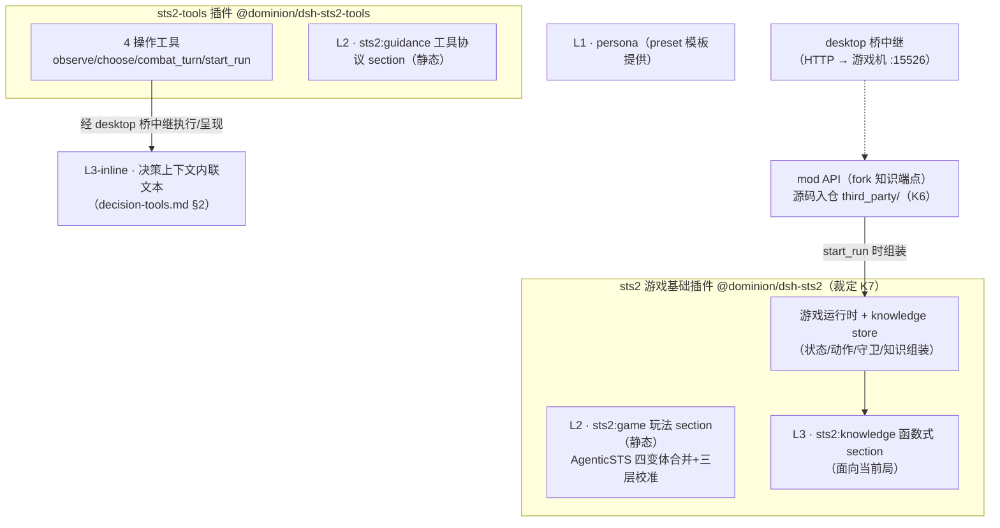

# 设计：STS2 游戏知识面（L2 玩法 / L3 item 知识）

> 阶段：SDD 前方案讨论产物（2026-10-22，与需求方逐项裁定后成文）。
> 姊妹篇：[survey/sts2-decision-tools.md](sts2-decision-tools.md)（操作工具面）。
> 本文定义 agent 玩游戏所需的**知识面**：怎么玩（L2）与 item/敌人先验知识（L3），
> 分层术语对齐 [AgenticSTS](https://github.com/AlayaLab/AgenticSTS) 的五层记忆契约
> （L1 operator prompts / L2 state-typed prompts / L3 game knowledge / L4 episodic /
> L5 skills——L4/L5 对应本仓库 memory/skill 机制，留后续 feature，不在本文范围）。

## 0. 裁定记录（2026-10-22 需求方）

| # | 决策点 | 裁定 |
|---|---|---|
| K1 | L3-prior 数据来源 | **通过 mod API 获取**（小 fork 加知识端点）；否决离线提取——游戏更新后离线表会过时且**感知不到过时**（静默失效）；mod API 数据随游戏版本天然同步，失配时 fail loud（PoC §3.1 的 v0.107 `MissingMethodException` 即例） |
| K1 附 | fork 维护 | K1 **推翻** PoC §5.6 的「fork 暂不维护」裁定——L3-prior 需要全池文本，现有端点无法提供（见 §4.3） |
| K2 | agent 注入范围 | 机制与数据面已定（§4.2/§4.5）；agent 形式已另文裁定为主子模型、暂不用 team、host 场景化重构先行（[survey/sts2-agent-model.md](sts2-agent-model.md) A1–A3），注入范围在新形态下随 spec 定（其 S4/U4 同源） |
| K3 | bestiary | v1 纳入知识包（战斗决策质量的主要先验） |
| K4 | L2 校准来源 | AgenticSTS 四变体基线 + 官方文档 + 社区策略（三层并用） |
| K5 | wiki 工具 | 不进 v1 工具面——知识包开局全量注入后，按需查询的定位被替代（§5） |
| K6 | fork 源码归置 | STS2MCP fork 源码**移入 `third_party/` 仓内维护**（路径镜像惯例：`third_party/github.com/Gennadiyev/STS2MCP`，对齐 `third_party/README.md` 本地化第三方源码约定；上游 MIT，保留上游 LICENSE）；取代 PoC §5.6「fork 暂不维护、仅固化 DLL」形态，构建沿用 PoC §4.1（dotnet + 游戏 DLL 编译引用） |
| K7 | 插件拓扑与通讯 | 对齐 saolei 双插件模式：**`@dominion/dsh-sts2` 游戏基础插件**（游戏状态获取/运行时维护/knowledge store + L2 `sts2:game` 与 L3 `sts2:knowledge` section）+ **`@dominion/dsh-sts2-tools` 工具插件**（4 操作工具 + `sts2:guidance` section）；**L1 = persona 由 preset 模板提供**；tools ↔ mod API 通讯经 **desktop 桥中继**（saolei 同链路），FlowPart 游戏转发 kind 的接口设计归 desktop-bridge feature |

## 1. 分层总览

设计原则：**状态能自带的知识不进提示词**（L3-inline 承担，PoC §5.8 分层结论）；
**提示词里的先验知识与游戏版本同步**（L3-prior 走 mod API，裁定 K1）；
**玩法/协议静态化**（L2 常驻，保证 run 内 system prompt 稳定）。

## 2. L2：怎么玩（静态 sections）

### 2.1 结构

对齐 saolei 三层提示词模式（`specs/060-agent-v2-team-optimize/contracts/prompt-sections.md`）
与 saolei-tools 先例（`common/js/dsh-plugins/saolei-tools/src/index.ts`）：

| section | order | 内容边界 | 来源 |
|---|---|---|---|
| persona | 0 | 身份/职责/风格，不重复玩法 | **preset 模板 persona 行（L1，裁定 K7）** |
| `sts2:game` | 50 | 游戏规则+流程+策略框架；不含工具用法 | §2.2 |
| `sts2:guidance` | 100 | 仅工具用法（决策上下文格式/选项键/行动列表/失败语义/纪律） | [survey/sts2-decision-tools.md](sts2-decision-tools.md) §2–§4 |

### 2.2 `sts2:game` 内容与基线

**基线 = AgenticSTS `system.py` 四变体合并为单一静态文本**（Apache-2.0，可改编，
来源：[AgenticSTS/src/brain/prompts/system.py](https://github.com/AlayaLab/AgenticSTS/blob/main/AgenticSTS/src/brain/prompts/system.py)）：

| AgenticSTS 变体 | 适用场景 | 核心内容 |
|---|---|---|
| `SYSTEM_COMBAT` | monster/elite/hand_select | 回合结构（抽5/能量3/格挡清零）、手牌上限 10、抽牌即时可用、"生成牌须排队打出"、HP 是全局资源（保血优先）、药水纪律 |
| `SYSTEM_COMBAT_BOSS` | boss | 幕间 HP 全恢复→boss 战可自由换血、持续增益药水早用、优先 scaling |
| `SYSTEM_DECKBUILD` | card_reward/card_select/shop | 四维评估（伤害/防御/抽牌/能量）、**两阶段卡组构建框架**（Foundation 找引擎 / Commitment 喂引擎+pivot 规则）、`strategic_note` 输出习惯 |
| `SYSTEM_STRATEGIC` | rest_site/map/event | HP 全局资源、篝火默认锻造、药水使用时机 |

改编要点：

- **输出格式段不搬运**：AgenticSTS 用 `<decision>` JSON 标签回传决策；我们用 dsh 工具
  调用（`sts2_choose`/`sts2_combat_turn`），该部分归 `sts2:guidance`。`strategic_note`
  类的"自我提示"字段同理由工具调用参数/对话承载，不设强制 JSON 字段。
- **合并为单一文本**（不按场景切换）：单成员一份连续历史，system prompt 随场景 churn
  会打碎 KV cache 前缀；合并后约 3–5KB 常驻可接受（AgenticSTS 自身也强调
  "Four static system prompts are cacheable; all per-run state lives in the user
  message"）。场景特定信息由决策上下文（工具结果）承载。
- **校准来源**（裁定 K4，三层）：
  1. AgenticSTS 基线（上表）；
  2. 官方文档（patch notes / 新手指引，[Steam 公告页](https://steamcommunity.com/app/2868840/announcements/)、[Neowsletter](https://megacrit.com/news/)）校准事实偏差（数值/机制随版本变化）；
  3. 社区策略（公开网络调研汇编，先例：AgenticSTS 自带 `character_strategies.md` 即此形态）作为策略层补充。

### 2.3 静态性

L2 两 section 均为**静态文本，物化时注册**，run 内不变——与 L3-prior 的动态机制
（§4）分离，保证 system prompt 中只有知识包一个可变部分。

## 3. L3-inline：状态自带知识（零机制）

工具面决策上下文**内联完整规则文本**（[survey/sts2-decision-tools.md](sts2-decision-tools.md) §2）：
手牌/卡牌奖励/商店条目（费用/类型/稀有度/效果/可打性）、遗物与药水（效果+keywords）、
敌人（HP/格挡/状态/**当前意图**及描述）、keywords 对象逐条内联。依据 PoC §5.8：
对局内决策**不依赖** wiki/外部知识——所见即所知。

因此 L3-prior 只需覆盖**状态里看不到的先验**（§4.1）；工具面不产生裸 id 引用
（`entity_id` 仅作为 target 参数回传键，语义文本始终伴随呈现）。

## 4. L3-prior：先验知识包（开局组装、动态注入）

### 4.1 内容

| 内容 | 形态 | 补足状态盲区 | 体积估算 |
|---|---|---|---|
| 卡池表（当前角色 ∩ 已解锁） | `id: 名称/费用/类型/稀有度/效果` 紧凑表 | card_reward 只见 3 张候选，池内还有什么不可见（评估"这张 vs 期望"） | 全角色 577 张（AgenticSTS 数据），单角色约 1/4 → ~6–9KB |
| 遗物池表（已解锁） | `id: 名称/稀有度/效果` | 商店/奖励只见眼前几件 | ~100 件 × ~80B ≈ 8KB |
| 敌人图鉴 bestiary（裁定 K3） | `敌人 id: HP 范围/招式循环/出现幕` | 战斗态只见当前回合意图，完整招式模式与跨层分布不可见 | ~121 种 × ~100B ≈ 12KB |

合计 ~25–30KB（≈6–8K tokens）常驻。裁剪预留：基础打击/防御类卡、遗物常见子集
黑名单等，实测 token 预算后调（细节属后续 feature）。

### 4.2 交付机制：函数式 section + knowledge store（物化后可变）

**system prompt 物化后可变**——dsh-system-prompt（0.2.0-rc.2）事实：

- `PromptSection.text` 支持 `string | ((context) => string)`，函数形式是
  "**a provider evaluated at each assembly**"；assembly 发生在**每次 model step 前**
  （`node_modules/@deepseek-ai/dsh-system-prompt/lib/types/index.d.ts`、包 README
  "one ordered system prompt ... for each model step"）。
- 变化的 section 以 **in-history update** 进入 derived history 的 system 节点。
- 仓库先例：planner memory 快照即"函数式 section + 物化时预取的固定数据"
  （`projects/game/agent_v2/README.md`「planner memory」节）——机制支持读可变数据。

设计：

- `sts2:knowledge`（order 200+，函数式）：provider 从**游戏作用域 knowledge store**
  读取当前知识包渲染；store 为空时渲染为空（section 空不渲染）。
- **组装时机**：`sts2_start_run` 执行时，经游戏基础运行时（K7）拉取本局池文本 →
  写入 knowledge store → 下一次 model step 的 assembly 自动带入。store 属游戏
  基础插件的运行时（对齐 `sts2Game` agent-scoped handle 模式），生命周期随游戏会话。
- **多局刷新**：每局开局重新组装（解锁发生在局末，新局可能有新解锁）；run 内
  system prompt 稳定 → KV cache 前缀在 run 内保持，每局仅一次 in-history update。
- 组装动作归 tools 层还是 loop 编排层，随 agent 形式（K2）在后续 feature 定。

### 4.3 数据来源：mod API（小 fork 知识端点）

裁定 K1：**通过 mod API 获取**，否决离线提取（静默过时风险）。现有端点能力核对
（[raw-full.md](https://github.com/Gennadiyev/STS2MCP/blob/main/docs/raw-full.md)）：

| 现有端点 | 能力 | 缺口 |
|---|---|---|
| `GET /api/v1/wiki` | fuzzy 搜索，按已发现过滤，`limit` 有内部上限 | 搜索接口，**无法全量枚举** |
| `GET /api/v1/compendium` | `card_library`/`relic_collection` 的 `discovered_ids`（纯 id 无文本）；bestiary 明确 stats-only | 无规则文本，无敌人元数据 |

因此需要**小 fork 增加知识端点**，暴露全池文本（fork 源码入仓 `third_party/` 维护，裁定 K1 附/K6）：

- **现成路径**（PoC §5.8；命名勘误：实际为 `ModelDb.AllCards`/`ModelDb.AllRelics`
  而非 PoC 所记 CardPool）：mod 的 Wiki 端点
  （[McpMod.Wiki.cs](https://github.com/Gennadiyev/STS2MCP/blob/main/McpMod.Wiki.cs)）
  遍历**完整 `CardModel`/`RelicModel` 对象**（Title/Type/Rarity/cost/完整
  description/升级变体/HoverTips keywords），fork 端点 = 复用其
  `BuildCardWikiCandidates`/`BuildWikiCardResult` 构建路径、去掉 query 必填与
  `Take(limit)` 的全量输出。
- **bestiary 待验证**（K3 的实现前提）：mod 进程内访问敌人定义/招式表的代码路径
  （类似 `ModelDb` 的敌人模型注册表）需在 fork 端点设计时验证——若游戏侧无现成
  可读对象，bestiary 数据源需要重新评估（此为 K3 的风险项，验证前不视为已解决）。
- 端点具体形态（路径/参数/过滤维度如角色）属 fork feature 的接口设计，遵循
  接口优先（宪法 III）在彼时给出契约。

### 4.4 版本同步性（K1 的核心理由）

mod API 数据与游戏版本天然同步：游戏更新 → mod 因 API 变更 fail loud
（v0.107 `MissingMethodException` 先例，PoC §3.1）→ 知识端点随之显式失败——
**不存在离线表那种感知不到的过时**。游戏钉 v0.107.1 + fork 锁版本的前提下，
知识包正确性与 mod 兼容性共用同一保障链（升级前先核对上游适配，PoC §1）。

### 4.5 插件归属与 agent 形式边界（裁定 K2/K7）

**插件拓扑已定**（K7，对齐 saolei 双插件模式——`specs/075-saolei-game-foundation/contracts/saolei-foundation.md` 的基础面/工具面分立）：

- `@dominion/dsh-sts2`（游戏基础插件）：游戏运行时（状态获取/动作执行/等待守卫）与
  knowledge store 及其组装（"游戏状态、维护"）；**L2 `sts2:game` 与 L3
  `sts2:knowledge` section 均由本插件拥有**（对齐 saolei 基础面拥有 `saolei:game`
  的所有权模式）；tools 插件经本插件运行时操作游戏（saoleiTools 经 `saoleiGame`
  句柄同构）。
- `@dominion/dsh-sts2-tools`（工具插件）：4 操作工具 + `sts2:guidance` section
  （[survey/sts2-decision-tools.md](sts2-decision-tools.md)）。
- L1 = persona 由 preset 模板提供（K7）。
- 通讯：tools ↔ mod API 经 desktop 桥中继（saolei 同链路；FlowPart 游戏转发
  kind 归 desktop-bridge feature，见
  `specs/066-desktop-bridge-split/contracts/desktop-bridge-v2.md`）。

**仍未定（K2，已收窄）**：agent 形式已裁定为主子模型（主 player + 每房间类型
子代理，暂不用 team；[survey/sts2-agent-model.md](sts2-agent-model.md) A1–A3）；
剩余待定 = 主/子 agent 的知识包注入范围与 section 注册归层（其 S4）——随
sts2-loop spec 定。本文只约束机制、数据面与插件所有权。

## 5. wiki 工具定位闭环（裁定 K5）

PoC 阶段工具面曾预留 wiki 透传工具为待定项
（[survey/sts2-decision-tools.md](sts2-decision-tools.md) §8）。知识包方案确立后：
池内条目开局全量注入 + 状态内联文本，按需查询的定位被替代——**wiki 工具不进
v1 工具面**。若后续出现"查知识包之外条目"的真实需求（如裁剪黑名单命中），再评估。

## 6. 待定项清单（下游 feature 输入）

| # | 待定项 | 归属 |
|---|---|---|
| U1 | 知识包 id:detail 的具体格式（压缩/字段取舍/裁剪黑名单）与 token 实测 | sts2 知识 feature |
| U2 | fork 知识端点契约（路径/参数/过滤维度/输出 schema）——数据面已定案：`ModelDb.AllCards ∩ DiscoveredCards` 全量输出（wiki 构建路径复用，见 §4.3） | fork feature（接口优先） |
| U3 | bestiary 在 mod 内的可访问性验证（K3 风险项） | fork feature 前置调研 |
| U4 | 知识包注入范围/组装触发归层——主子模型下的主/子 agent 分配（[survey/sts2-agent-model.md](sts2-agent-model.md) S4 同源） | sts2-loop feature（K2 收窄后） |
| U5 | `sts2:game`/`sts2:guidance` 文本成文（AgenticSTS 基线改编+三层校准） | sts2 知识 feature（写作任务） |
| U6 | L4/L5（episodic memory / skills）与既有 memory/skill 机制的对接 | 后续 feature（本文范围外） |

## 7. 引用清单

- 姊妹篇：[survey/sts2-decision-tools.md](sts2-decision-tools.md)（操作工具面/决策上下文/内联原则）
- PoC：[survey/sts2-mod-poc.md](sts2-mod-poc.md)（§5.8 知识面分层/§5.6 fork 裁定/§3.1 版本 fail loud）
- 调研：[survey/sts2-game-control.md](sts2-game-control.md)
- AgenticSTS：[system.py 四变体](https://github.com/AlayaLab/AgenticSTS/blob/main/AgenticSTS/src/brain/prompts/system.py)
  （L2 基线，Apache-2.0）、[data/knowledge/README.md](https://github.com/AlayaLab/AgenticSTS/blob/main/AgenticSTS/data/knowledge/README.md)
  （L3 数据组织先例——其离线提取路线被本仓库裁定 K1 否决，仅作结构参考）、
  [bounded memory contract](https://github.com/AlayaLab/AgenticSTS)（分层术语）
- dsh 机制：`node_modules/@deepseek-ai/dsh-system-prompt/lib/types/index.d.ts`
  （函数式 section/每次 assembly 求值）、`projects/game/agent_v2/README.md`
  （memory 快照先例/三层提示词模式）、
  `specs/060-agent-v2-team-optimize/contracts/prompt-sections.md`（section 所有权）
- raw API：[STS2MCP raw-full.md](https://github.com/Gennadiyev/STS2MCP/blob/main/docs/raw-full.md)
  （wiki/compendium 能力边界）
- 官方校准源：[Steam 公告页](https://steamcommunity.com/app/2868840/announcements/)、
  [Neowsletter](https://megacrit.com/news/)
