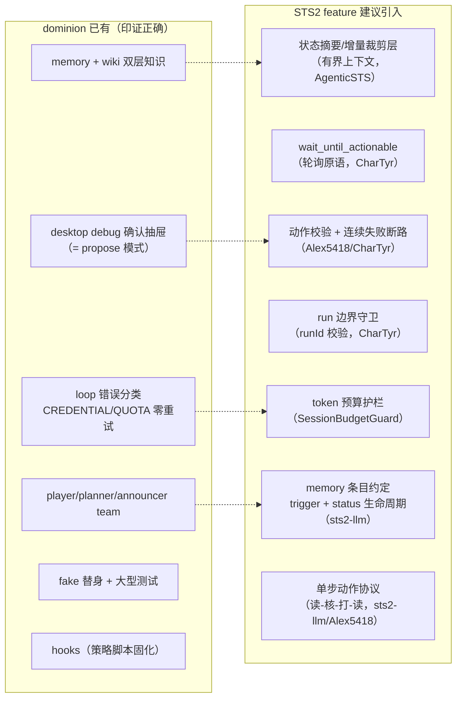
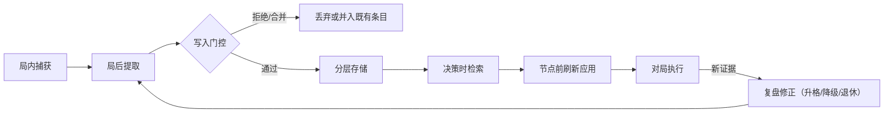

# 调研：LLM 玩 STS2 的 agent 项目——基建与架构经验

> 承接 `survey/sts2-game-control.md`（已裁定 mod API 路线 + STS2MCP 基座）。本文深入
> 分析 LLM 玩 STS2/STS1 的代表性项目，提炼**基建实现**与 **agent 架构**两层可借鉴
> 经验，并映射到 dominion game 域现有设施（已有什么 / 缺什么）。
> 调研时间：2026-10-21。

## 1. 项目深读结论总表

| 项目 | 一句话定位 | 最值得借鉴的点 |
|---|---|---|
| [AgenticSTS](https://github.com/AlayaLab/AgenticSTS)（AlayaLab，[arXiv:2607.02255](https://arxiv.org/abs/2607.02255)） | 学术级有界记忆 testbed（A0 6/10 胜） | 有界类型化记忆契约、四级模型路由、可消融评估、token 效率证据 |
| [sts2-llm](https://github.com/ttxttx1111/sts2-llm) | Copilot 长期玩家代理定制包 | 四层记忆 + 经验生命周期、战斗安全协议、SL 预算、"厚多智能体→薄主链路"演进教训 |
| [CharTyr/STS2-Agent](https://github.com/CharTyr/STS2-Agent) | 游戏内 overlay mod + 双实例 co-op | `/actions/available` 自描述动作、SSE 事件流、预算护栏、断路器、run 边界守卫 |
| [Alex5418/STS2-Agent](https://github.com/Alex5418/STS2-Agent) | 本地小模型实战 agent | 客户端侧护栏五件套（能量守卫/单动作/循环检测/智能等待/解析回退） |
| [Minhao-Zhang/slay_the_spire_agent](https://github.com/Minhao-Zhang/slay_the_spire_agent)（STS1） | 知识增强 agent + 操作员 dashboard | strategist/decision 双模型分工、auto/propose/manual 三模式 HITL、决策 trace 与地图回放 |
| [banjtheman/slay_the_spire_2_agent_harness](https://github.com/banjtheman/slay_the_spire_2_agent_harness) | 多 harness 评测台 | 战斗算术在代码、判断给模型的混合决策；trace + 成本估算 dashboard |
| [Orak](https://github.com/krafton-ai/Orak)（KRAFTON AI，STS1） | 12 游戏 LLM benchmark | 统一评测基建与 leaderboard（评测维度的远期参照） |

## 2. Agent 架构层经验

### 2.1 AgenticSTS：有界类型化记忆契约（对 dominion 最重要的一条）

核心主张：**长程 agent 的记忆是"每个未来决策允许看到什么"的契约**。AgenticSTS
用五层类型化知识替代"append 一切"的 transcript 模式——每个决策 prompt 由
`u_d = π(L1, L2(s), L3(s), L4(s), L5(s))` 类型化检索组装，**从不把原始跨决策
transcript 追加进 prompt**：

| 层 | 内容 | 可变性 |
|---|---|---|
| L1 operator prompts | 按状态类型的角色/协议模板 | 不可变 |
| L2 state-typed prompts | 各状态 schema 与合法动作格式 | 不可变 |
| L3 game knowledge | 卡牌/遗物/事件/敌人知识（随版本刷新） | 静态 |
| L4 episodic memory | 局后摘要（角色 × 进阶 × 幕 × 敌人） | 局后写入 |
| L5 skill library | 带显式 trigger 的策略指南 | 门控写入 |

实测证据（对 dominion 的 token 预算设计是硬数据）：

- 竞品（逐动作调用 + transcript 累积的 agent）单局内 per-call prompt 从 ~9k 涨到
  **~500k tokens**；AgenticSTS 的 per-call prompt 全程平坦，**每得分点 fresh token
  少 66–90×**、每层墙钟快 ~4×。
- 关键手法：**决策批处理**——一次 strategic 调用驱动多个动作，**每局中位数仅 67
  次 strategic LLM 调用**（而非每个游戏动作一次）；战斗每回合至多保留 3 条消息，
  更早回合以类型化状态摘要替代。
- 明确**不做原始日志 RAG**：近似状态可能有相反策略含义，只检索摘要与触发式指南。

> 对照 dominion：agent_v2 已知限制「compact 明确排除——成员历史不裁剪，多局后
> token 代价接受为已知限制」（`projects/game/agent_v2/README.md`）。STS2 单局决策
> 数远超扫雷（社区实测全自主 7~8M tokens/局），该限制在 STS2 场景会从"接受"变成
> "不可行"。建议在 STS2 feature 中显式设计：工具结果向 planner 广播时做**状态摘要
> 化/增量化的裁剪层**，而不是全量 JSON transcript 进上下文。

### 2.2 AgenticSTS：四级模型路由

决策按价值分级路由：`fast`（平凡战斗出牌/药水/地图步）→ `strategic`（战斗规划/
商店/事件/路线）→ `analysis`（局后 L4 提取）→ `evolution`（L5 技能蒸馏）。四个
静态 system prompt 可缓存，**所有 per-run 状态放 user message**（缓存友好）。

> 对照 dominion：preset 分池 + model 绑定（`UpdateTeam` members 的 `model` 字段）
> 天然支持按角色配模型，但同角色内未分级。player 的战斗高频低价值决策与 planner
> 的复盘高价值决策若同模型，token 成本与延迟都不优。候选方向：player 战斗动作走
> 轻量模型、planner 走强模型；或引入"战术动作批处理"（一次调用出一整回合出牌序）。

### 2.3 sts2-llm：四层记忆 + 经验生命周期

四层记忆与数据流原则「**过程可追、全量保真、跨局压缩、战斗再压缩**」
（`play → timeline → review → archive → compress → recall → revise`）：

| 层 | 职责 | dominion 对应物 |
|---|---|---|
| `reviews/` 完整复盘 | 保真：完整 outcome、转折点、牌组尸检、反例条件 | wiki（64KB/条） |
| `run-history.md` + `runs/` | 近期 run 快速定位（角色/遗物/HP/地图快照） | **缺**（team 重启即失） |
| `lesson-ledger.md` 跨局经验 | 每条含 Rule/Scope/**Trigger to recall**/Why/Evidence/**Status** | planner memory（1024 runes/条） |
| `current-playbook.md` 当前 run | 本局战术：什么在赢、什么在威胁、未来几层优化什么 | **缺**（散在 player 历史里，随局丢弃） |

经验生命周期状态机：`candidate → validated → situational → retired`——新证据可
降级、改写或退休旧 heuristic；单局现象默认低置信，只有跨局重复或机制上确定才升格。

> 对照 dominion：planner memory 是自由文本 add/replace/remove，没有结构化 status /
> trigger 字段，也没有"当前 run 战术层"。STS2 场景建议：memory 条目格式约定中引入
> trigger 与 status 约定（prompt 层约定即可，无需改服务端 schema）；"当前 run
> playbook"可由 hooks（JS 脚本固化）承担或作为 planner 的轻量产出。

### 2.4 sts2-llm：战斗安全协议与 SL 预算

- **单步动作协议**：读状态 → 只选一张牌 → 用最新状态再核对（牌名/费用/可打性/
  目标需求）→ 打这一张 → 再读状态。防手牌索引漂移（Alex5418 同款"单工具模式"）。
- **SL（读档重试）预算**：同场战斗最多 **3 次** deterministic SL；必须能说清
  `baseline line → exact alternative decision point → expected gain`；超预算转入
  复盘或接受现状。把"重试"当高层恢复分支而非无限循环。

> 对照 dominion：saolei tools 已有校验拒绝语义；STS2 工具层应延续——动作校验
> （目标合法/费用足够/索引最新）在工具层做，拒绝以普通文本结果反馈。

### 2.5 sts2-llm 的架构演进教训（反面参照）

`deprecated/` 目录保留了三代演进：厚 `player/runtime/reviewer` 多智能体 → 实战中
发现 **coordinator 包装过厚反而更易出错、更慢、更脆** → 收敛为「player 直连游戏、
skill 教 player 怎么想、组织者只通过与 player 对话求证」的薄主链路。

> 对照 dominion：dominion 的 player/planner 分工是 dsh 原生 team 语义且经扫雷验证，
> 不必推翻；但该教训对 STS2 场景的分工粒度是警示——**planner 的介入应停留在
> 局间/节点级（复盘、路线方针），不进入战斗内的每动作回路**；战斗内高频决策由
> player + 工具层护栏 + playbook 自治完成。

### 2.6 Minhao-Zhang：strategist/decision 双模型（STS1）

strategist（support model）只产 scene-level notes 不做决策；decision model（
LangGraph 循环 + 工具）决策；策略知识与事实知识分离（`data/knowledge` 策略
markdown vs `data/reference` 事实 JSON）。与 dominion 的 player/planner 分工同构，
印证"**上下文生产者与决策执行者分离**"是可行模式。

### 2.7 banjtheman harness：混合决策边界

战斗算术（伤害/致死计算）留在代码里执行，deck/route/reward/potion 判断交给模型
（"Combat arithmetic stays in code; deck, route, reward, and potion judgments go
to the model"）。STS2 数字交互密集，纯 LLM 心算是主要失败源之一——工具层提供
确定性计算辅助（如战斗求解器思路）是候选增强，但首期可先不做。

### 2.8 AgenticSTS 论文级深读：决策粒度、postrun 语义与技能填充模式

以下细节来自论文全文（[arXiv:2607.02255](https://arxiv.org/abs/2607.02255)，
含附录 E 完整决策时 prompt 展品）。

#### 决策粒度（论文 §3.1 P2 / §4.3 / 附录 E.1）

决策是**决策点（decision point）级**，不是每个游戏动作一次调用，且按价值分层：

| 层级 | 单位 | 承接者 |
|---|---|---|
| 战斗决策 | **一整个回合的出牌计划**——一次 LLM 调用输出 `plan` 数组（含生成牌的排队，如"Cloak and Dagger+ → Shiv → Shiv"）、`end_turn`、`reasoning`、**`note_to_future_self`**（写给未来回合的笔记）与 `analysis`（问题/候选线/chosen_line）结构化字段 | strategic 或 fast 层 |
| 非战斗决策 | 一个节点一个决策（选图/商店/事件/卡牌奖励），输出 `{action, option_index, reasoning, strategic_note}` | strategic 层 |
| 微观动作 | 战斗目标确认、宝箱选择、地图节点、手牌选择等，**每局约 500 个** | 机械解决（mechanical handlers）或 fast 层（有界战斗上下文） |

一局 run（中位 ~80 分钟墙钟）仅含**中位 67 次 strategic LLM 调用**（IQR 27-105）；
战斗是唯一带局部会话对象的决策类型，每回合至多 3 条消息（`combat_start`、`ok`、
最新 user state），更早回合以类型化状态摘要重建而非 append。竞品对比中明确：
"one strategic call drives multiple actions in our agent, while the competitors
call the LLM once per action by design"。

> dominion 落点：STS2 工具面可提供**回合计划批量执行**原语（一次提交整回合
> 出牌序列，工具层校验能量/目标/可打性后顺序执行），对齐此决策批处理设计；
> 单步动作协议（Alex5418）与批量计划（AgenticSTS）的取舍本质是模型能力分级
> ——大模型可信任 plan 批处理，小模型需要单步护栏。`note_to_future_self` /
> `strategic_note` 是"本局战略线程"的写入原语，值得在工具结果与 playbook 层
> 借鉴。

#### L4 postrun 语义（论文 §4 / §4.4 / §5）

- **postrun = 局后写入，作用于未来的新 run**：一局结束后由 analysis 层模型提取
  摘要，按 **（角色 × 进阶等级 × 幕 × 敌人类别）** 键写入 L4，供之后的新局按
  键检索（case-based recall：Past Experience 敌人招式、Combat Guide 战术建议、
  Card Notes 卡牌心得）。运行中的局**不会**因 postrun 写入而改变当前上下文。
- **不存在同 seed 回放**：论文 §3.1 P3 明确——随机抽牌/洗牌序/奖励/地图路径/
  遗物/精英与事件布置/进阶修饰符多轴随机，"prevent simple trajectory replay. A
  strong policy must generalize over states, not memorize a fixed route"。auto
  模式爬塔（胜则 Aₙ→Aₙ₊₁、败则重试）每一局都是全新随机局。
- 因此**不构成作弊**，三点理由：① 跨局经验正是 roguelike 的设计意图，对照锚点
  （人类 16% 胜率）本身就是带跨局经验的人类玩家；② L4 键与内容都是敌人/卡牌级
  泛化知识，非 seed 级布局记忆，且 P3 随机性使 seed 记忆不可行；③ 论文将
  "有无记忆层"作为**显式消融变量**而非隐藏优势——无任何 store 的
  baseline-strict 也有 3/10 胜，L4/L5 的增量（→6/10）正是研究对象；固定 A0
  矩阵中全部 L4/L5 为 SHA 锚定冻结快照（1888a62），五 cell 间只差"用不用"。
- L4 另有一张**局内面孔——Strategic Thread（战略线程）**：本局内跨决策携带的
  有界摘要（由每次决策的 `strategic_note`/`note_to_future_self` 沉淀，如
  "Committed Shiv plan: scale with Accuracy..."），随决策类型更新，同样不 append
  原始 transcript。

#### 技能库（L5）的三种填充模式（论文 §4.5 / §6.4 / Limitations）

| 模式 | 内容来源 | 用途 |
|---|---|---|
| **mode-a：hand-authored 种子库** | 研究者**人工手写**的技能正文（L5 检索展品中标 `(seed)`） | 固定 A0 矩阵基线：6/10 |
| **mode-b：stub-template-filled** | **非人工撰写 prose**——在作者策划的 5 个角色参数化桩模板（combat/boss/deckbuilding/map/intermission）框架内填充正文，受 namespace 隔离、库锁、warn-only 校验器约束 | 对照组：同样 6/10——证明收益来自**技能层的结构存在**（trigger + 政策槽位），而非特定人类措辞质量 |
| **self-evolve：mistake-driven discovery** | 自动路线：读战斗失败（相对 per-enemy 基线）→ pre-write A/B 检查（B=3 重采样、strict 2/3 + zero-harmful）→ 四级写入门（cosine/Jaccard/LLM judge/可选 reap），多数候选被拒或合并 | 可写流（爬塔 ladder，A6-A8） |

Limitations 明确：桩模板与种子技能均为作者策划，Mode B 测的是"接口内模板填充"
这一个操作点，**不是**完全自主的技能发明；自主发明留作 future work。

> dominion 落点：planner memory 的写入质量管理可借鉴其**写入门控**（A/B 重采样
> 验证 + 相似度去重 + LLM judge）与 sts2-llm 的 status 生命周期（candidate →
> validated）组合——防止复盘噪声直接污染长期记忆。

### 2.9 架构定性：flow 管线 vs agent 驱动，与 agent+subagent 的关系

**AgenticSTS 的定性**：harness 状态机（按游戏 `state_type` 分派）+ 决策点 LLM
填充结构化 JSON——模型不选择工具、不自主检索，上下文组成由引擎的类型化检索
决定。本质是「结构化决策管线 + 决策点 LLM」（每决策 RAG 式组装），**不是自主
agent loop**。论文自我定位即 loop engineering 的 memory stage；multi-agent 为明
确 non-target（§Limitations）。保留的 agent 性元素有限：战斗局部会话（每回合
≤3 条消息）、同决策修复重试、`note_to_future_self` 自指笔记、self-evolve 从
自身轨迹蒸馏技能。

**论文对 context 长度（≠token 数量）的直接论述**：

- §2 引 loop-engineering 文献：累积 transcript 的失效模式是双重的——"**overflows
  the window and dilutes attention**"（窗口溢出 + 注意力稀释）；
- §7 机制图：竞品 per-call prompt 单局内 ~9k → **~500k**（最差一局在第 ~1100 次
  决策时达 500k）；"trimming caps message *count*, but late-game states grow
  each message"——裁剪消息数无效，晚期游戏状态本身让每条消息变大；
- 关键句（Figure 7 注）：**"caching changes billing, not what the model attends
  to"**——缓存只改计费，不改注意力；测量用含缓存 token 的完整 prompt；
- 界定：竞品跑在 Gemini 1M 窗口上**完成了整局**（败因是 0/5 胜率与成本延迟，
  非溢出）。"context 决定能否完成"在 ≤256k 常规窗口成立；在 1M 级窗口退化为
  质量/成本问题。论文未在 200k 级窗口上测竞品（未测溢出硬失败场景）；
- fresh token 亦非纯价格问题：竞品 96% 墙钟为 LLM 延迟（每层慢 ~4×）。

**agent + subagent 派发能否替代**：论文未评估 subagent 架构（全文无 subagent
对照）。分析结论——两种方案解决的是正交问题，可组合而非互斥：

| 维度 | agent+subagent 提供什么 | bounded typed contract 提供什么 |
|---|---|---|
| 上下文有界化（可行性） | ✅ orchestrator 只看子代理摘要，机制性保证 | ✅ per-decision 组装有界（效果同构） |
| 决策上下文**组成策略** | ❌ 不回答"该看什么"——STS2 的 per-decision 主体是**当前状态切片**（牌组/遗物/牌堆/敌人意图，见附录 E 展品）+ 选中知识，不是历史；子代理只是转移了该问题 | ✅ 五层类型化组装即该策略的显式化；~5k token 组装即支撑 6/10 |
| 知识召回形态 | 一次性有损摘要（子代理回传） | 类型化存储可**多次精确召回**（trigger 索引，重复状态类复用） |
| 局内战略连续性 | 需另设摘要机制 | Strategic Thread 内建 |
| 微观动作经济性 | 派发本身烧调用（~500 微观动作） | 机械层 + fast 层解决 |
| 可归因/可消融 | 摘要为不透明融合体，难以按层消融 | 命名 slot 独立开关（论文核心卖点） |

拓扑观察：AgenticSTS 的 analysis（postrun 提取）/evolution（技能蒸馏）两层
**就是局后子任务派发给独立上下文**——它已是 harness 调度的 subagent 派发；
与"orchestrator-LLM 调度的 subagent"差异只在调度者，不在隔离思想。

> dominion 落点：agent-v2 当前即累积 transcript 型（compact 明确排除），论文
> 证据表明该设计在 STS2 量级任务上不可持续（9k→500k）。SDD 需裁定的核心架构
> 决策：**保持 agent 驱动 + 有界化改造**（决策点/回合级 fresh 上下文 + 历史外
> 置到 memory/战略线程工具 + 工具结果摘要化注入，保住 dsh agent 语义——steer/
> hooks/工具自主）vs **play 活动内 flow 化**（AgenticSTS 式管线，牺牲自主性换
> 稳定与可归因）。二者可混合：默认路径有界组装、修复/探索路径保留 agent 自主。

## 3. 基建层经验

### 3.1 CharTyr/STS2-Agent：桥 API 面的两个好设计

STS2MCP 之外，CharTyr 的 mod API（`:8080`，`GET /state`、`POST /action`、
`GET /events/stream` SSE）有两个 STS2MCP 没有的设计值得在工具层补齐：

- **`GET /actions/available`**：当前状态合法动作 + schema 自描述——动作文档不需要
  硬编码进 prompt，减少版本漂移时的 prompt 失真。
- **`GET /events/stream`（SSE）**：实时事件推送——免轮询。STS2MCP 只有拉取式
  `GET`，敌回合/动画期间需要客户端轮询（Alex5418 的 smart-wait 是补丁）。

> dominion 落点：desktop relay 层（或 agent-v2 工具层）实现
> `wait_until_actionable` 语义原语（轮询直到 `state_type` 离开敌方回合/过渡态，
> 带超时），作为 STS2 工具集的一员——对齐 CharTyr MCP 工具
> `wait_until_actionable` 的成熟设计。

### 3.2 CharTyr：护栏三件套（全部可平移为 dominion 需求）

| 护栏 | CharTyr 实现 | dominion 现状 / 建议 |
|---|---|---|
| **Session Budget Guard** | 跟踪 provider 报告的 usage/请求数，超配置上限停止新调用（缺失 usage 显示 unknown，不视为零） | **缺**。loop 错误分类有 QUOTA 码但无主动预算。建议 STS2 feature 引入会话级 token 预算护栏（可先做工具调用计数/估算） |
| **AutoPlay 断路器** | 连续 3 次失败自动停 + 2s/4s 指数退避——防未识别弹窗/无效选择自旋 | loop 层有失败/冻结语义，但没有"连续无效动作"断路（STS2 的软锁场景：未知 overlay 反复尝试）。建议工具层统计连续 error 动作并冻结上抛 |
| **Config Error 立即退出** | HTTP 401/403/404 立即停，不浪费 token 重试 | 已对齐（llm-failure-taxonomy：CREDENTIAL/QUOTA 零重试），印证设计正确 |
| **Run Boundary Guard** | autoplay 严格 scope 到活动 runId；退出/投降/回大厅立即停 | **部分缺**。扫雷 gameEnded 语义有，但 STS2 有 profile 切换/回菜单等更多上下文切换面。建议工具层校验 runId 一致性，跨 run 残留状态 fail-loud |

### 3.3 Alex5418：客户端侧护栏五件套（工具层清单）

小模型（Qwen3.5-27B Q4，88% 动作成功率、过 A1 boss）实战总结，全部应在 dominion
STS2 工具层实现而非依赖模型自律：

1. **能量守卫**：客户端跟踪能量，出不起的牌直接拒绝（不发给游戏）；
2. **单动作模式**：每个 LLM 响应只执行一个动作，防批量动作间的索引漂移；
3. **循环检测**：识别奖励领取/确认类死循环并打破；
4. **smart-wait**：敌方回合计轮询（配超时），不浪费 LLM 调用；
5. **解析回退**：结构化解析失败时从文本恢复工具调用（dominion 走 dsh 官方 loop
   工具调用协议，此项天然免疫，无需做）。

### 3.4 CharTyr：测试策略印证

核心逻辑单测**不需要游戏客户端**（预算护栏、恢复退避、run 边界、端口 fallback
均有独立 C# 单测），真实游戏行为单独做 live 验证——与 dominion「游戏进不了 CI，
用 fake 替身 + 大型测试」的策略（fake-desktop/fake-llm）互相印证；STS2 的
fake-sts2 桥应对齐该思路：护栏逻辑必须可在无游戏环境下单测。

### 3.5 Minhao-Zhang：可观测性与 HITL 面

- **三模式 HITL**：auto（全自主）/ propose（提案-人工审批）/ manual——dominion
  desktop 的 debug 确认抽屉（操作挂起、15 分钟自动放行）就是 propose 模式的实例；
  STS2 场景可考虑**按状态类型分级确认**（如商店购买/boss 遗物选择需确认，普通
  出牌免确认）作为后续增强。
- **决策 trace + 地图回放**（`/metrics/map` 多幕轨迹回放）——评估面参照：dominion
  web 有双视图与 system prompt 查看，但缺"整局轨迹回放"维度；STS2 的 run 摘要
  （`GET /api/v1/compendium` 的 run_history）可作为数据源。

### 3.6 数据与知识组织

- AdrianNO1/SlayTheSpireAI 的 `data/`（卡牌/遗物/药水/能力的描述 JSON）是最小可行
  知识库组织范例——dominion wiki 的 STS2 初始内容可参考其分类法，事实数据优先从
  游戏内导出（STS2MCP wiki/compendium 或 CharTyr `GET /data/{collection}`）。
- AgenticSTS 明确**不将游戏元数据再分发**（许可风险），本地再生
  （`sync_upstream_data.py` / `extract_mechanics_from_dll.py`）——dominion 同样
  不应把游戏数据文件提交进仓库，运行时从游戏侧拉取。

## 4. 借鉴清单：dominion 已有 / 缺失 / 建议

优先级建议（进入 STS2 SDD spec 的需求候选）：

1. **P0（不做则不可用/不可持续）**：B1 状态裁剪层（token 可持续性）、B2 wait
   原语、B3 动作校验、B7 单步协议；
2. **P1（显著提升稳定性）**：B4 run 边界守卫、B5 预算护栏、B6 memory 约定；
3. **P2（后续增强）**：按状态分级 HITL 确认、战斗算术辅助工具、整局轨迹回放
   评估面、决策分级路由（fast/strategic 模型）。

## 5. 经验传递与更新机制（策略提升与迭代专题）

跨项目综合各 agent 的"经验"如何被捕获、提炼、门控、存储、召回与修正。

### 5.1 通用生命周期

各环节的项目级实现：

| 环节 | AgenticSTS | sts2-llm | Minhao-Zhang | banjtheman |
|---|---|---|---|---|
| **局内捕获** | 每次决策的 `strategic_note` / `note_to_future_self` 沉淀为 Strategic Thread（本局战略主线） | run timeline（关键节点快照：牌组/遗物/HP/地图）+ current playbook（本局战术） | logs 树全量记录 | JSONL traces + run memory |
| **局后提取** | analysis 层（postrun 摘要，键：角色×进阶×幕×敌人）；evolution 层（从战斗失败蒸馏技能） | 正式复盘（死亡/通关/大 swing 触发；含牌组尸检）→ 写 reviews archive → 提炼 ledger 条目 | reflector · consolidator（postrun）→ lesson store（MEMORY_DIR） | —（无自动提取） |
| **写入门控** | self-evolve：pre-write A/B 检查（B=3 重采样、strict 2/3 + zero-harmful）→ 四级写入门（cosine → Jaccard → LLM judge → 可选 reap）；**多数候选被拒绝或合并** | 流程约束：单局现象默认低置信，跨局重复或机制上确定才升格；ledger 条目六字段（Rule/Scope/**Trigger to recall**/Why/Evidence/**Status**） | 文档未详述 | — |
| **分层存储** | L4 episodes（键控）+ L5 skills（trigger 索引，`(C,π)`：触发条件选正文政策）；评估用冻结快照 SHA 锚定 | 四层：`reviews/`（保真）→ timeline（定位）→ ledger（跨局压缩）→ playbook（当前局再压缩） | lesson store + `data/knowledge`（策略）+ `data/reference`（事实）分离 | Markdown agent profiles（策略即数据、人工可编辑） |
| **决策时检索** | 键检索（Past Experience/Combat Guide/Card Notes）+ 触发匹配（带置信分，如 `(92%)`）；**明确不做原始日志相似度 RAG**（近似状态策略含义可能相反） | 战斗只读 playbook + ledger；仅当强依赖少见卡/遗物/事件/Boss 时**定向**回查 archive | retrieval 拼进决策上下文（strategist 层承载） | profile 整体作为 system prompt |
| **应用协议** | 类型化组装进决策 prompt（~5k token 有界） | 重大节点（卡牌奖励/商店/路线/火堆/精英/Boss/高风险事件）前刷新，**选 1-3 条最相关经验、先判适用性再用** | strategist 场景注记注入 | — |
| **修正机制** | ladder 流跨局累积（胜升 Aₙ 败重试）；冻结流固定不动 | status 状态机 `candidate → validated → situational → retired`；反例与适用条件随 archive 保留（"新证据应该能降级、改写或退休旧 heuristic"） | consolidator 整理 | 人工改 profile |

### 5.2 设计要点提炼

1. **双时间轴严格分离**：局内（thread/playbook，随决策更新、随局废弃或归档）与
   局间（ledger/skills/episodes，仅 postrun 写入、只影响未来局）。AgenticSTS 中
   postrun 写入不会改变进行中一局的上下文——学习与执行互不污染。
2. **保真-压缩分层**：sts2-llm 的原则「过程可追、全量保真、跨局压缩、战斗再
   压缩」——检索面只暴露压缩层（ledger/playbook），保真层（archive）用于定向
   回查与反例核对，不进实时上下文。
3. **写入门控四件套**（防止复盘噪声污染长期记忆）：
   统计验证（A/B 重采样）→ 去重（cosine/Jaccard，拒绝或合并）→ 语义审判
   （LLM judge）→ 时间维度状态机（升格/降级/退休）。AgenticSTS 数据点：门控
   越严越好——多数技能候选被拒或合并后胜率反而提升。
4. **检索形态 = 键 + 显式 trigger，非相似度 RAG**：经验按（角色×进阶×幕×敌人）
   键或显式触发条件索引；原始对局日志不作为相似度检索源。
5. **随机性治理**：经验以「条件 + 反例 + 置信度」形态存储，不存无条件结论；
   单局现象默认低置信（roguelike 多轴随机下单局归因易错）。
6. **评估隔离**：学习层可整体冻结（SHA 锚定快照）——保证"有无经验"作为消融
   变量的可复现性（研究/评测场景需要；产品场景可放宽为滚动更新）。

### 5.3 dominion 映射（已有 / 缺口）

| 机制 | dominion 已有设施 | 缺口 |
|---|---|---|
| 局间压缩层 | planner memory（1024 runes/条，preset 作用域跨 session 共享，add/replace/remove） | 条目无 Trigger/Status/证据字段约定；写入无门控（自由文本直写） |
| 保真层 + 策略知识 | wiki（64KB/条，template 作用域，模糊标题搜索） | 无自动 postrun 写入（目前靠 planner 复盘时自行调用） |
| **触发式技能** | **saolei hooks**（planner 固化 JS 策略脚本 → 棋盘变动触发执行 + announcer 播报）——已是 L5 触发式技能的先声 | STS2 场景的"棋盘变动"对应"状态/节点类型"触发，形态可沿用 |
| 局后提取触发点 | flow 的 review 活动 + announcer 终局统计（gameStatsText） | 提取非结构化（无 键=角色×进阶×幕×敌人 的结构化沉淀） |
| 局内战略线程 | 无（player 对话历史承担，随局膨胀） | playbook/strategic thread 层（结合 §2.9 架构裁决一并设计） |
| 写入门控 | 无 | 四件套中至少应引入：去重（防重复条目）+ 状态机（生命周期约定） |

优先级衔接 §4：写入门控与 memory 条目约定已在 P1（B6）；局内线程层归属
P0 的 B1（状态裁剪层）设计范围——检索面与写入面是同一契约的两半。

### 5.4 「只写不读」问题的实践经验（wiki/memory 查询失活）

问题：工具化的经验存储（wiki/memory 读写 tools）实践中常见 agent **只写不查**——
dominion 扫雷场景即如此（planner 的 wiki tools 已因无查询而移除）。各项目的经验
一致指向：**读不能靠 agent 自觉，必须靠结构**。

**两种被验证的解法**：

1. **引擎侧组装（AgenticSTS / Minhao-Zhang）**——查询根本不是 agent 的选项：
   - AgenticSTS 的 L4/L5 是每个决策 prompt 的**固定槽位**（`u_d = π(L1..L5)`），
     键检索 + trigger 匹配由引擎执行，模型没有"查不查 memory"的决定权；L5 层
     的胜率增量（3/10 → 6/10）正是在这种结构化注入下实现的。
   - Minhao-Zhang 同构：retrieval 是决策上下文组装的一个槽位（Ctx = view ·
     retrieval · combat plan · map analysis · strategist · memory），非工具。
   - 连游戏知识也随状态走：STS2MCP 的卡牌规则文本随游戏状态返回（"Card rules
     text is supplied by game state when cards are visible"），`search_wiki` 只是
     补缺口的**次要**路径——"状态自带知识"优先于"按需查询"。
2. **协议侧强制门（sts2-llm）**——把刷新写成决策协议的硬步骤：pilot skill 规定
   在卡牌奖励/商店/路线/火堆/精英前/Boss 前/高风险事件前**默认必须刷新 memory**，
   且"选出最相关的 1-3 条 → 判断本次是否适用 → 再决策"；战斗中只读 playbook +
   ledger（不装载 archive）。这是 prompt 纪律承载的流程门，不依赖工具存在性。

**为什么 agent 自主查询会失活**：

- 决策时可见状态"显得完整"——agent 对"自己不知道什么"无信号（unknown
  unknowns），查询没有感知价值；工具调用有回合成本，模型天然回避。
- 工具化 memory 隐含"模型有回忆纪律"的假设——实证很弱。写入有明确触发点
  （复盘），读取没有，故单向失活。
- 领域差异也是真实变量：扫雷全可观察、规则简单，经验的边际价值本就低（"扫雷
  没这个必要"的判断一半是领域属性）；STS2 的敌人招式/Boss 机制/卡牌协同是
  真正的经验型知识（sts2-llm 整个项目的前提）。

**对 wiki 价值的修正**：harness/flow 结构化不是让 wiki 价值变低，而是 wiki 价值
**得以实现的唯一路径**——wiki 的问题从来不是存在性，而是**不在检索路径上**。
结构化后角色重定位：

| 存储 | 结构化架构中的角色 | 交互方式 |
|---|---|---|
| memory/ledger | 检索层素材源：按 trigger/键切片，随决策注入（或随 read_state 返回） | harness 采样，agent 不调用 |
| wiki/archive | 保真层：服务 planner 复盘蒸馏的**读源**与人工查阅，player 不接触 | 写路径（review 活动蒸馏）+ 人读 |

**dominion 落点**：

- 已有正确原语：memory snapshot 本就是引擎注入（物化时 `memory:snapshot`
  section，order 200+）——问题仅在时机与粒度（一次性注入，不随决策点刷新）。
- STS2 的自然实现：把触发式经验切片**放进 `sts2_read_state` 的工具返回**（状态
  与经验同框返回），或按 `state_type` 组装——agent 无需记得去查；wiki 则退出
  player 面，保留为 planner 复盘蒸馏的保真层（与扫雷移除 wiki tools 的决定方向
  一致）。
- 写侧 dominion 已经是对的：flow 的 review 活动就是调度化的 postrun 提取时机
  （planner 写 memory 是被编排的行为，不是自主行为）。

## 6. 引用清单

- AgenticSTS：<https://github.com/AlayaLab/AgenticSTS>（README 含完整实验数据；
  论文 <https://arxiv.org/abs/2607.02255>；轨迹数据集
  <https://huggingface.co/datasets/ShandaAI/AgenticSTS-trajectories>；mod 为
  CharTyr/STS2-Agent 的 AGPL fork）
- sts2-llm：<https://github.com/ttxttx1111/sts2-llm>（架构设计
  <https://github.com/ttxttx1111/sts2-llm/blob/main/.github/design/system-details.md>）
- CharTyr/STS2-Agent：<https://github.com/CharTyr/STS2-Agent>（API 文档
  <https://github.com/CharTyr/STS2-Agent/blob/main/docs/api.md>）
- Alex5418/STS2-Agent：<https://github.com/Alex5418/STS2-Agent>
- Minhao-Zhang/slay_the_spire_agent（STS1）：
  <https://github.com/Minhao-Zhang/slay_the_spire_agent>
- banjtheman/slay_the_spire_2_agent_harness：
  <https://github.com/banjtheman/slay_the_spire_2_agent_harness>
- AdrianNO1/SlayTheSpireAI（STS1）：<https://github.com/AdrianNO1/SlayTheSpireAI>
- Orak（KRAFTON AI，STS1 benchmark）：<https://github.com/krafton-ai/Orak>
- 社区索引（含上述项目卡片）：<https://slaythespire.dev/projects/>
- 本仓库对照：`projects/game/agent_v2/README.md`（已知限制：compact 排除）、
  `survey/sts2-game-control.md`（操作方案调研）
